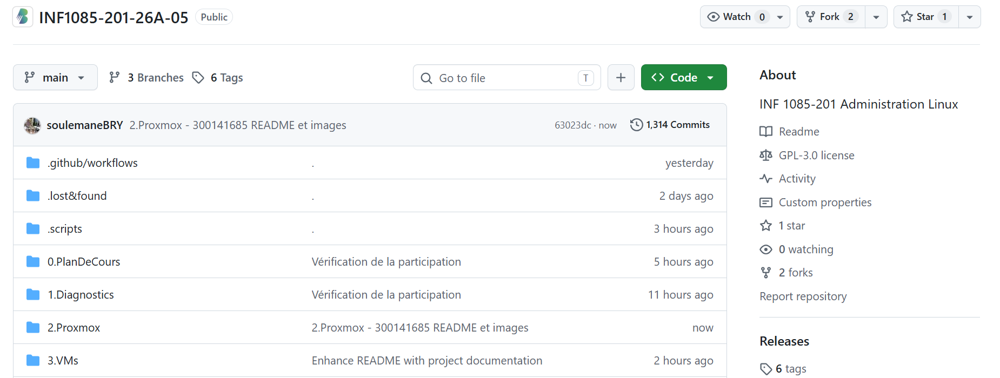

# 🐧 INF1085 · Administration Linux

## Participation 0 : Plan de cours

**Souleymane Barry · 300141685**
Techniques des systèmes informatiques · Collège Boréal, campus de Toronto
Automne 2026 · Section 201-05 · Professeur : Brice Robert

---

## 🅰️ GitHub

### 🎯 Objectif

Cette première activité consiste à utiliser **GitHub** pour créer ma page personnelle dans le dépôt du cours, puis à y afficher des images en **Markdown**.

### ✅ Étapes réalisées

- [x] Créer mon compte GitHub : [`soulemaneBRY`](https://github.com/soulemaneBRY)
- [x] Explorer [GitHub Education](https://education.github.com/), le programme gratuit de GitHub pour les étudiants
- [x] Créer mon répertoire `300141685` avec le fichier `README.md`
- [x] Créer le répertoire `images` avec le fichier `.gitkeep`
- [x] Ajouter des images dans `images`
- [x] Afficher les images dans ce `README.md`

### 📁 Organisation de mon dossier

```text
0.PlanDeCours/
└── 300141685/
    ├── README.md          ← cette page
    └── images/
        ├── .gitkeep       ← garde le dossier dans Git même s'il est vide
        └── 01-compte-github.png
```

| Élément | Rôle |
| --- | --- |
| `README.md` | Page affichée automatiquement par GitHub quand on ouvre le dossier. |
| `images/` | Regroupe toutes les images de la page. |
| `.gitkeep` | Git ne suit pas les dossiers vides. Ce fichier vide permet de conserver `images/` avant d'y mettre la première image. |

### 🖼️ Mon compte GitHub en action

La capture montre un de mes commits dans le dépôt du cours **INF1085-201-26A-05**. On y voit mon compte `soulemaneBRY` et le message de commit.



Pour afficher une image en Markdown, on utilise cette syntaxe :

```markdown

```

---

## 🅱️ Plan de cours 📈

### 📖 Description

Le cours **INF1085 Administration Linux** (56 heures) porte sur l'étude approfondie du système d'exploitation en réseau **Linux** : organisation d'un domaine, gestion avancée des utilisateurs et des groupes, et gestion des permissions selon les privilèges d'accès.

### 🧭 Le parcours en une ligne

🐧 **Installer → Administrer → Sécuriser → Automatiser → Déployer → Surveiller → Documenter → Mettre en production** un serveur Linux d'entreprise.

| Étape | Ce que je deviens |
| --- | --- |
| 🐣 Installation Linux | Junior Linux User |
| 💻 Ligne de commande | Terminal Ninja |
| 👥 Utilisateurs et groupes | Administrateur système |
| 🔐 Sécurité | Gardien du serveur |
| ⚙️ Scripts Bash | Automatisation Guru |
| 🌐 Services réseau | Architecte Linux |
| 📊 Monitoring | Dépanneur d'élite |
| 🚀 Projet final | Linux SysAdmin prêt pour l'entreprise |

### 🎓 Les 3 résultats d'apprentissage (RAC)

| RAC | Ce que je dois savoir faire | Exemples |
| :-: | --- | --- |
| **1** | **Installer** un système d'exploitation en réseau selon les normes de l'entreprise | Préparer l'environnement (serveur, VM), configurer l'installation, faire les mises à jour, documenter |
| **2** | **Gérer** les comptes et les groupes | Structurer les utilisateurs et les groupes, donner les bonnes permissions, automatiser avec des scripts |
| **3** | **Optimiser, sécuriser et surveiller** le système | Choisir le niveau de sécurité, trouver les défaillances, automatiser la surveillance, documenter les changements |

### 📝 Évaluation

| RAC | Évaluation | % |
| :-: | --- | --: |
| 1 | Laboratoire : Installation initiale du système | 10 |
| 1 | Quiz : Installation et configuration initiale | 10 |
| 2 | Laboratoire : Gestion des comptes, processus et permissions | 10 |
| 2 | Laboratoire : Ligne de commande | 10 |
| 2 | Quiz : Gestion des comptes, processus et permissions | 10 |
| 3 | Laboratoire : Installation d'application | 10 |
| 3 | Laboratoire : Configuration | 10 |
| 3 | Quiz : Configuration et surveillance | 10 |
| 3 | **Projet de session : Mise en fonction d'un serveur Web** | **20** |
| | **Total** | **100** |

> 🎯 **Note de passage : 60 % (C-)**

### 🗂️ Mes travaux dans le cours

| # | Travail | Lien |
| :-: | --- | --- |
| 0 | Plan de cours | *(cette page)* |
| 1 | Diagnostic matériel du HP ProLiant DL360 G6 | [1.Diagnostics](../../1.Diagnostics/300141685/README.md) |
| 2 | Installation de Proxmox VE 9 | [2.Proxmox](../../2.Proxmox/300141685/README.md) |
