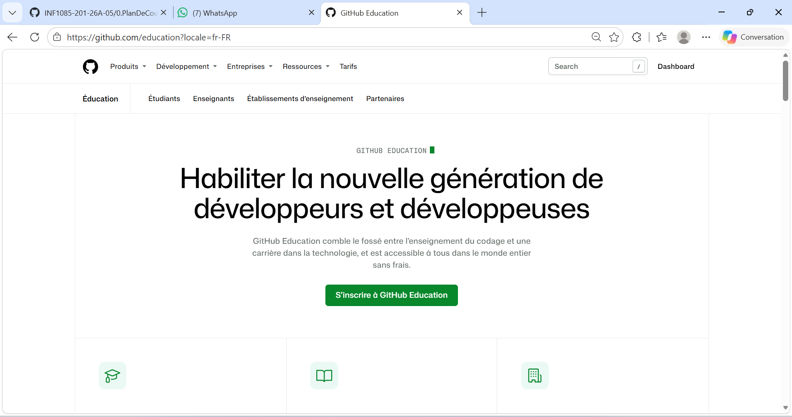

# INF1085 · Administration Linux

## Participation 0 — Plan de cours

**Anis Benabbas** · Matricule **300150477**  
Techniques des systèmes informatiques · Collège Boréal, campus de Toronto  
Automne 2026 · Section 201-05

### Objectif

Cette première activité consiste à créer ma page dans le dépôt GitHub du cours et à y intégrer une capture d’écran avec Markdown.

### Organisation de mon dossier

| Élément | Rôle |
| --- | --- |
| `README.md` | Présente ma participation et affiche les captures de l’activité. |
| `images/` | Regroupe les images utilisées sur cette page. |
| `images/.gitkeep` | Permet à Git de conserver le dossier avant l’ajout de la première capture. |

### GitHub Education

GitHub Education regroupe des ressources destinées aux étudiants qui apprennent à utiliser Git et GitHub. [Consulter GitHub Education](https://education.github.com/)

