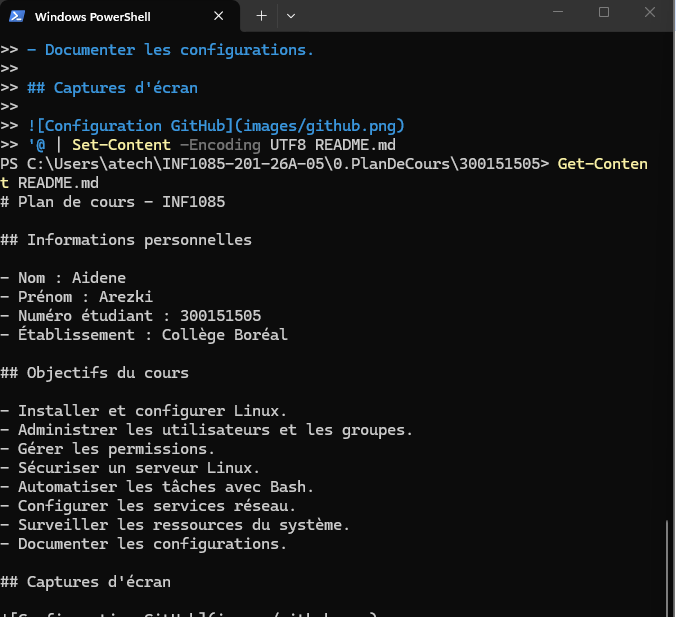

# Plan de cours - INF1085

## Informations personnelles

- Nom : Aidene
- Prénom : Arezki
- Numéro étudiant : 300151505
- Établissement : Collège Boréal

## Objectifs du cours

- Installer et configurer Linux.
- Administrer les utilisateurs et les groupes.
- Gérer les permissions.
- Sécuriser un serveur Linux.
- Automatiser les tâches avec Bash.
- Configurer les services réseau.
- Surveiller les ressources du système.
- Documenter les configurations.

## Captures d'écran

