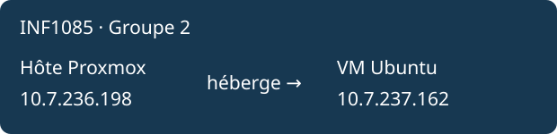

# Lyes Medjahed — Administration Linux

Numéro étudiant : 300153676 · Groupe 2

Le laboratoire utilise Proxmox pour héberger des machines virtuelles Linux. Le schéma situe le serveur du groupe et l’adresse réservée à ma VM dans le tableau de participation.

