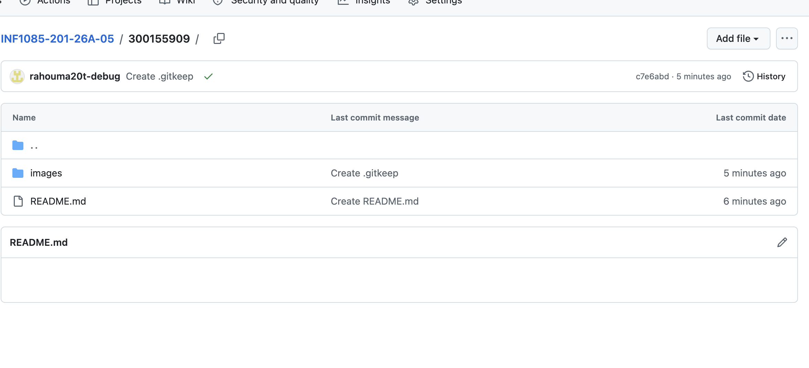
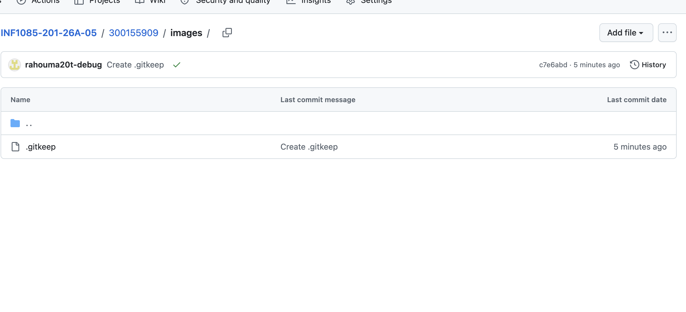
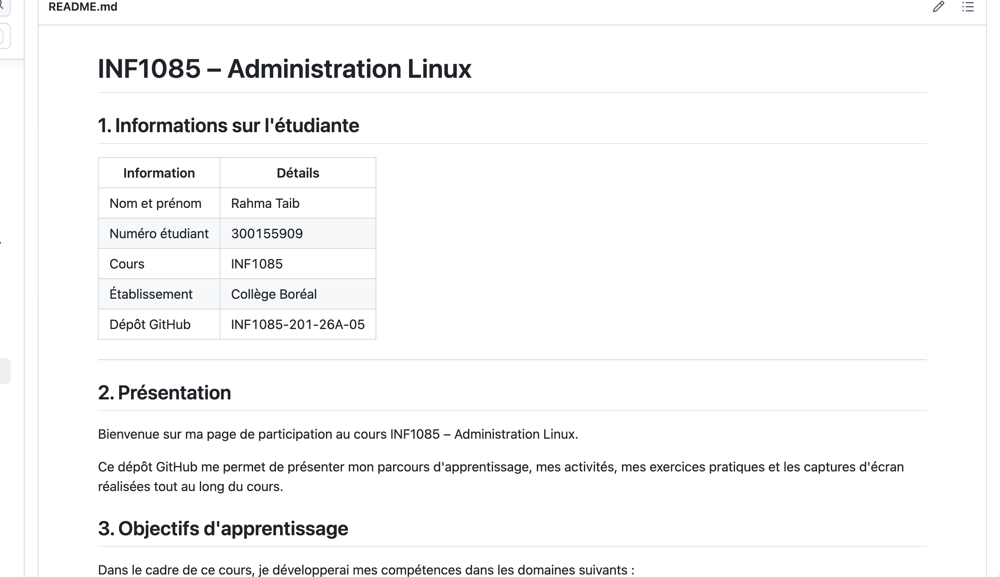

# INF1085 – Administration Linux

## 1. Informations sur l'étudiante

| Information | Détails |
|---|---|
| Nom et prénom | Rahma Taib |
| Numéro étudiant | 300155909 |
| Cours | INF1085 |
| Établissement | Collège Boréal |
| Dépôt GitHub | INF1085-201-26A-05 |

---

## 2. Présentation

Bienvenue sur ma page de participation au cours INF1085 – Administration Linux.

Ce dépôt GitHub me permet de présenter mon parcours d'apprentissage, mes activités, mes exercices pratiques et les captures d'écran réalisées tout au long du cours.

## 3. Objectifs d'apprentissage

Dans le cadre de ce cours, je développerai mes compétences dans les domaines suivants :

- Installation et configuration de Linux.
- Utilisation de la ligne de commande.
- Gestion des utilisateurs et des groupes.
- Gestion des permissions et de la sécurité.
- Programmation Bash et automatisation.
- Configuration des services réseau.
- Surveillance et dépannage des systèmes.
- Déploiement et documentation d'un serveur Linux.

## 4. Plan d'apprentissage

| Étape | Sujet |
|---|---|
| 01 | Installation de Linux |
| 02 | Ligne de commande |
| 03 | Utilisateurs et groupes |
| 04 | Permissions et sécurité |
| 05 | Scripts Bash |
| 06 | Services réseau |
| 07 | Surveillance et dépannage |
| 08 | Projet final |

## 5. Captures d'écran

### 5.1 Plan de cours



### 5.2 Parcours d'apprentissage



### 5.3 Participation GitHub



## 6. Structure du dépôt

```text
300155909/
│
├── README.md
│
└── images/
    ├── .gitkeep
    ├── plan-de-cours-1.jpg
    ├── plan-de-cours-2.jpg
    └── github-repository.png
```

## 7. Participation

Ce dépôt sera utilisé pour organiser mes documents de cours, publier mes captures d'écran, présenter mes travaux pratiques et démontrer ma participation ainsi que ma progression tout au long du cours INF1085.

## 8. Conclusion

Ce dépôt GitHub constitue mon espace de documentation et de suivi de mon apprentissage en administration des systèmes Linux.

**Merci !**
