# 🔌 Diagnostic matériel d'un HP ProLiant DL360 G6

**Souleymane Barry · 300141685 · Groupe 1**
INF1085 · Collège Boréal

Avec mon groupe, nous avons démonté et identifié les composants d'un serveur **HP ProLiant DL360 G6**. Nous l'avons ensuite redémarré par étapes pour vérifier que le BIOS reconnaissait chaque pièce. Pour finir, nous avons reconfiguré les disques en **RAID 5** pour préparer l'installation de Proxmox.

## 📋 Résumé du diagnostic

| Élément | Résultat | État |
| --- | --- | :-: |
| Processeurs | 2 × Intel Xeon E5540 (SLBF6) · 2,53 GHz · 8 Mo de cache L3 | ✅ |
| Mémoire | 61 440 Mo configurés (DDR3 ECC registered PC3-8500R) | ✅ |
| Disques | 3 × 146,8 Go SAS | ✅ |
| Contrôleur RAID | HP Smart Array P410i avec module de cache | ✅ |
| Volume logique | RAID 5 · 273,4 Go · Status OK | ✅ |
| Alimentations | 2 × HP 750 W redondantes | ✅ |
| BIOS | HP P64 du 16/08/2010 | ✅ |

---

## 1️⃣ Composants matériels

### ⚡ Alimentations

Le serveur possède **deux blocs d'alimentation** HP enfichables à chaud (*hot-plug*). Ils sont redondants : si un bloc tombe en panne, l'autre continue d'alimenter le serveur.

| Caractéristique | Valeur |
| --- | --- |
| Modèle réglementaire | HSTNS-PL18 |
| Référence | PS-2751-2CB-LF |
| Puissance maximale | 750 W |
| Entrée | 100–240 V ~, 50–60 Hz |
| Tests en usine | B/I, Hi-Pot, ATE : *Pass* |

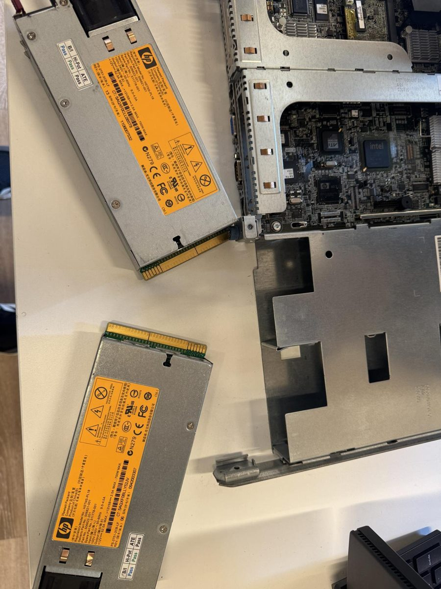

### 💾 Disques durs

Les trois disques sont au format **2,5 pouces SAS**, dans des tiroirs HP *hot-plug*. Ils n'ont pas tous la même marque ni la même vitesse, mais ils ont tous la même capacité (146 Go). C'est ce qui compte pour former un volume RAID.

| Baie | Fabricant / modèle | Capacité | Vitesse | Interface |
| :-: | --- | --- | --- | --- |
| 1 | IBM System x · Hitachi HUC103014CSS600 | 146 Go | 10 000 tr/min | SAS 6 Gb/s |
| 2 | HP DG146BB976 · Seagate ST9146803SS | 146 Go | 10 000 tr/min | SAS |
| 3 | HP 6G DP 15K (pièce 512744-001) | 146 Go | 15 000 tr/min | SAS 6 Gb/s *dual port* |

| Les trois disques dans leurs tiroirs | Étiquette du disque 15K |
| --- | --- |
| 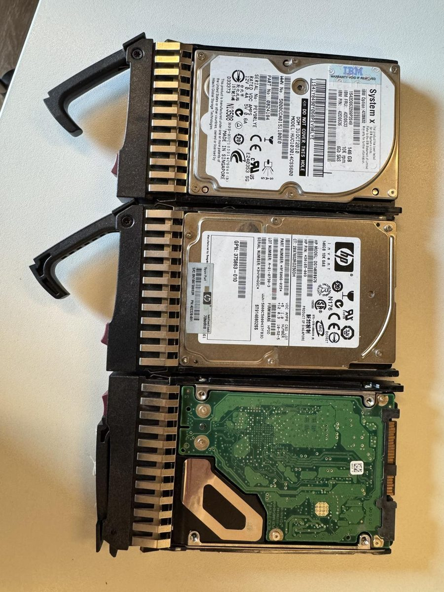 | 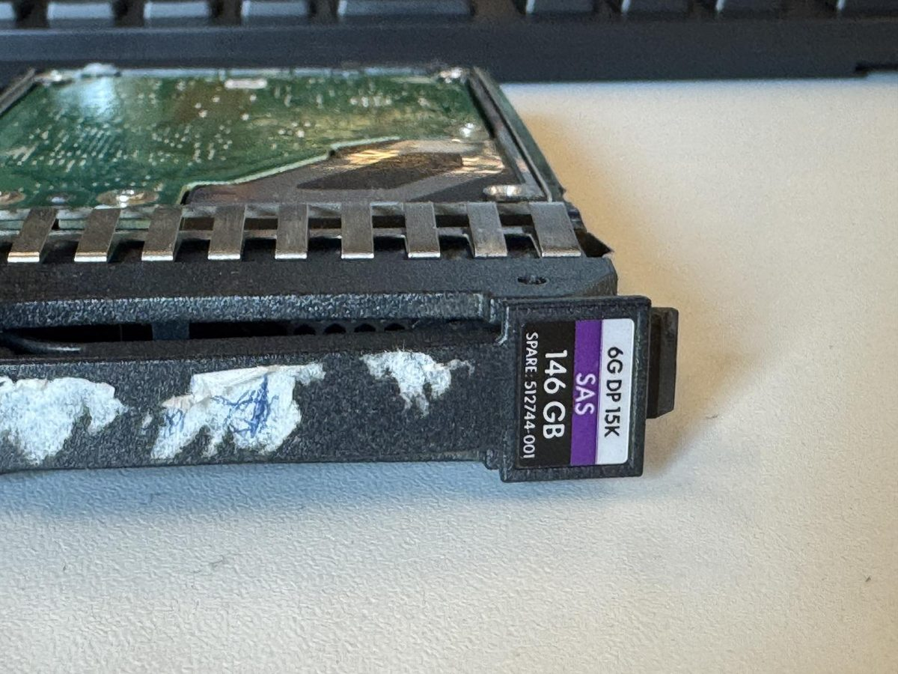 |

### 🧠 Mémoire vive

Le DL360 G6 utilise de la **DDR3 ECC avec registre** (RDIMM). L'ECC corrige les erreurs de mémoire, ce qui est indispensable sur un serveur. Le serveur a **18 emplacements** : 9 par processeur.

| Fabricant | Référence | Capacité | Type |
| --- | --- | --- | --- |
| Samsung | M393B5170FHD-CF8 | 4 Go | 2Rx4 PC3-8500R |
| Samsung (étiquette HP 500207-071) | M393B2K70DM0-CF8 | **16 Go** | 4Rx4 PC3-8500R |
| Samsung | M393B5170EH1-CF8 | 4 Go | 2Rx4 PC3-8500R |
| Samsung | M393B5170EH1-CF8 | 4 Go | 2Rx4 PC3-8500R |
| Hynix | HMT151R7BFR4C-G7 | 4 Go | 2Rx4 PC3-8500R |

> **Lire une étiquette :** `4GB 2Rx4 PC3-8500R` = 4 Go, 2 rangées (*ranks*) de puces de 4 bits, DDR3 à 1066 MT/s (8 500 Mo/s), **R** pour *Registered*.

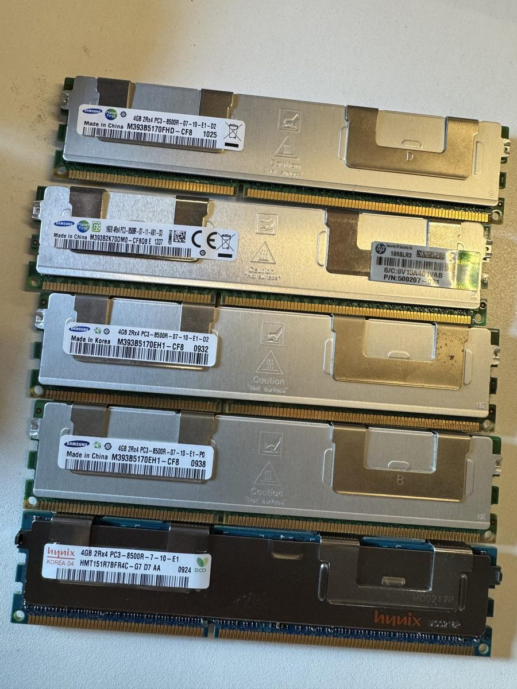

### 🔲 Processeur

Le code **SLBF6** gravé sur le processeur correspond à un **Intel Xeon E5540** : 4 cœurs, 8 threads, 2,53 GHz, socket **LGA1366**. On voit encore la pâte thermique qui assure le contact avec le radiateur. Il faudra en remettre une fine couche au remontage.

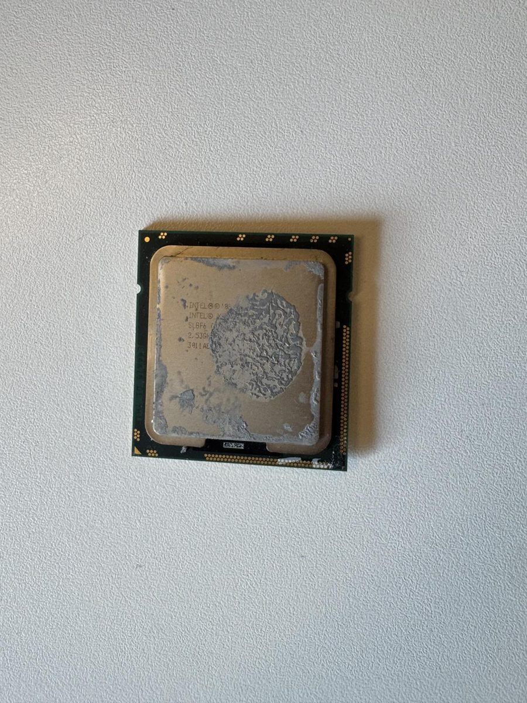

### 🗄️ Module de cache du contrôleur RAID

Cette carte s'enfiche sur le contrôleur **HP Smart Array P410i**. Elle contient la **mémoire cache** du contrôleur, qui accélère les écritures sur le volume RAID.

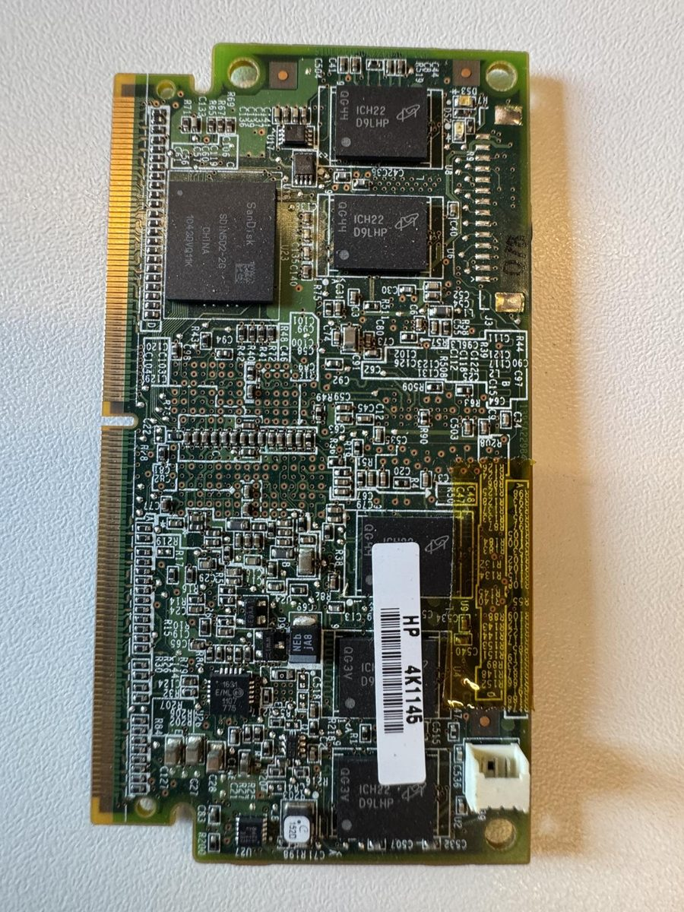

---

## 2️⃣ Écrans POST et BIOS

### 🟢 Premier démarrage : un seul processeur

Le cours recommande de **tester un processeur à la fois** pour savoir si une panne vient du processeur ou du socket. Au premier démarrage, le POST affiche :

```text
16 GB Installed
ProLiant System BIOS - P64 (08/16/2010)
1 Processor(s) detected, 4 total cores enabled, Hyperthreading is enabled
Proc 1: Intel(R) Xeon(R) CPU E5540 @ 2.53GHz
```

Le serveur passe le POST avec un seul processeur, donc **le processeur 1, son socket et sa mémoire fonctionnent**.

| POST avec 1 processeur | Touches de fonction du POST |
| --- | --- |
| 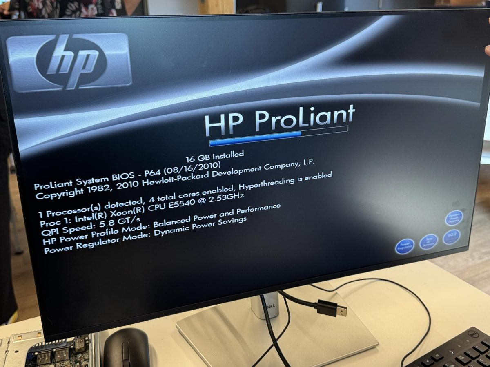 | 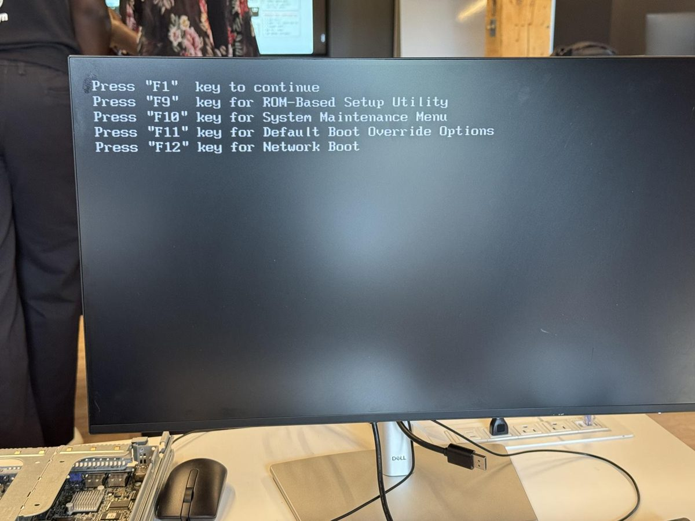 |

| Touche | Rôle |
| :-: | --- |
| **F1** | Continuer le démarrage |
| **F9** | ROM-Based Setup Utility (le « BIOS » HP) |
| **F10** | System Maintenance Menu |
| **F11** | Choisir le périphérique de démarrage (clé USB, DVD…) |
| **F12** | Démarrage par le réseau (PXE) |

### ⚙️ ROM-Based Setup Utility (F9)

L'utilitaire de configuration donne les informations du serveur :

| Information | Valeur |
| --- | --- |
| Modèle | HP ProLiant DL360 G6 |
| BIOS | P64 du 16/08/2010 (secours : 15/05/2010) |
| Bootblock | 22/01/2010 |
| Power Management Controller | 2.9 |

L'évolution du diagnostic se lit sur trois captures :

| Étape | Proc 1 | Proc 2 | Mémoire |
| --- | --- | --- | --- |
| 1. Un seul processeur | 2,53 GHz, 8 Mo L3 | **Not Installed** | 16 384 Mo |
| 2. Ajout du 2ᵉ processeur | 2,53 GHz, 8 Mo L3 | **2,53 GHz, 8 Mo L3** ✅ | 16 384 Mo |
| 3. Ajout des barrettes | 2,53 GHz, 8 Mo L3 | 2,53 GHz, 8 Mo L3 | **61 440 Mo** ✅ |

| 1 processeur | 2 processeurs | Mémoire complète |
| --- | --- | --- |
| 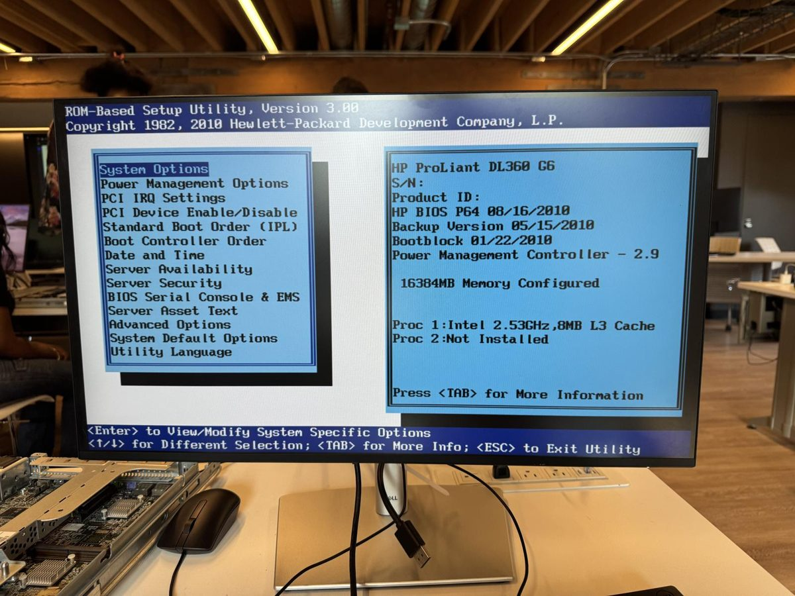 | 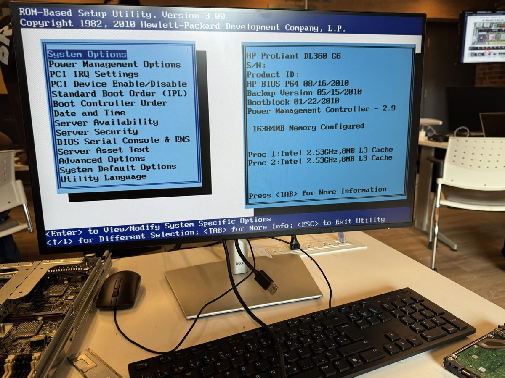 | 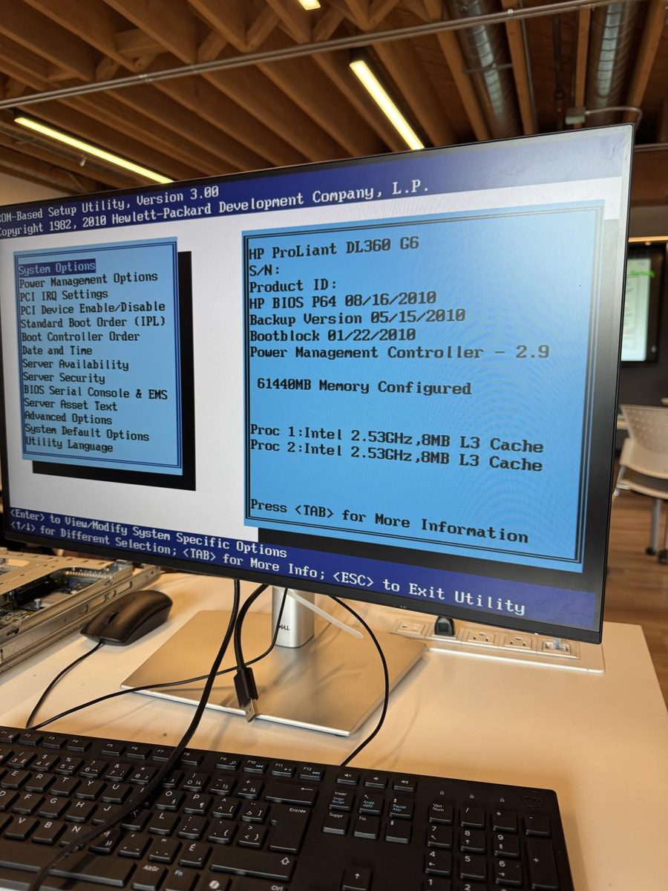 |

Le second processeur est reconnu, donc **le socket 2 n'est pas endommagé** : on évite les cas 2 et 3 du cours (remplacement du socket ou de la carte système).

### 🧪 Test de la mémoire

Quand on ajoute des barrettes, le BIOS détecte le changement (*Memory configuration change – memory test invoked*) et teste la mémoire automatiquement. L'écran liste chaque emplacement `PROC x DIMM y` avec la barrette installée ou *Not Installed*. En bas, le compteur indique **61440MB Available / 61440MB Configured**.

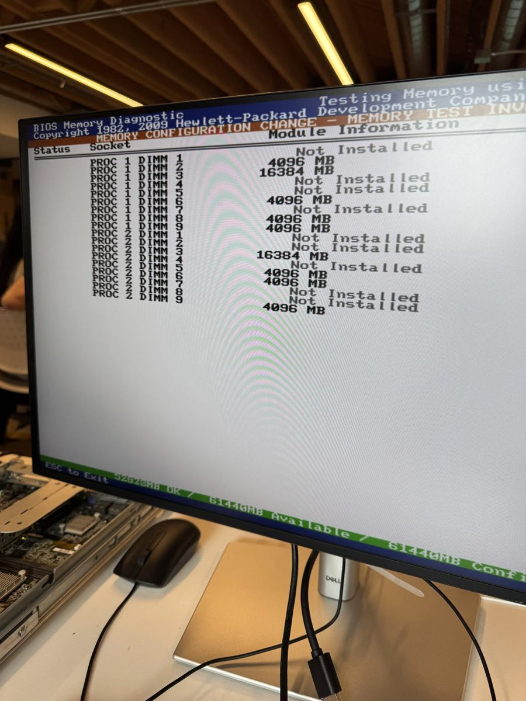

---

## 3️⃣ Configuration des disques (RAID)

Pendant le démarrage, la touche **F8** ouvre l'**Option ROM Configuration for Arrays** (version 8.30.08.00) du contrôleur **HP Smart Array P410i**.

### Étape 1 : menu principal

Le menu propose *Create*, *View* et *Delete Logical Drive*. Avec **View Logical Drive**, nous avons vu qu'un ancien volume existait déjà.

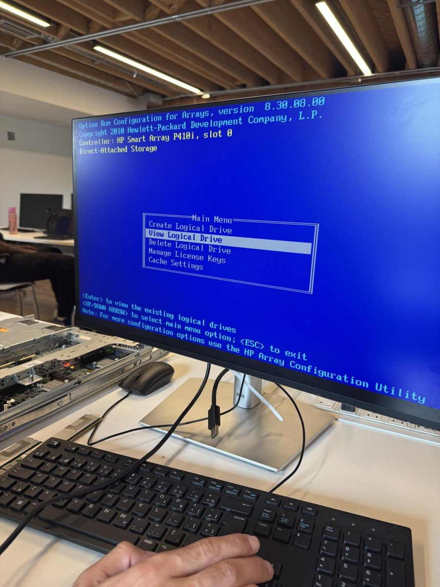

### Étape 2 : suppression de l'ancien volume

Pour repartir d'un disque propre, nous avons supprimé l'ancien volume (**RAID 5, 273,4 Go, 3 disques**). L'utilitaire avertit que **toutes les données seront perdues**. On confirme avec **F3**.

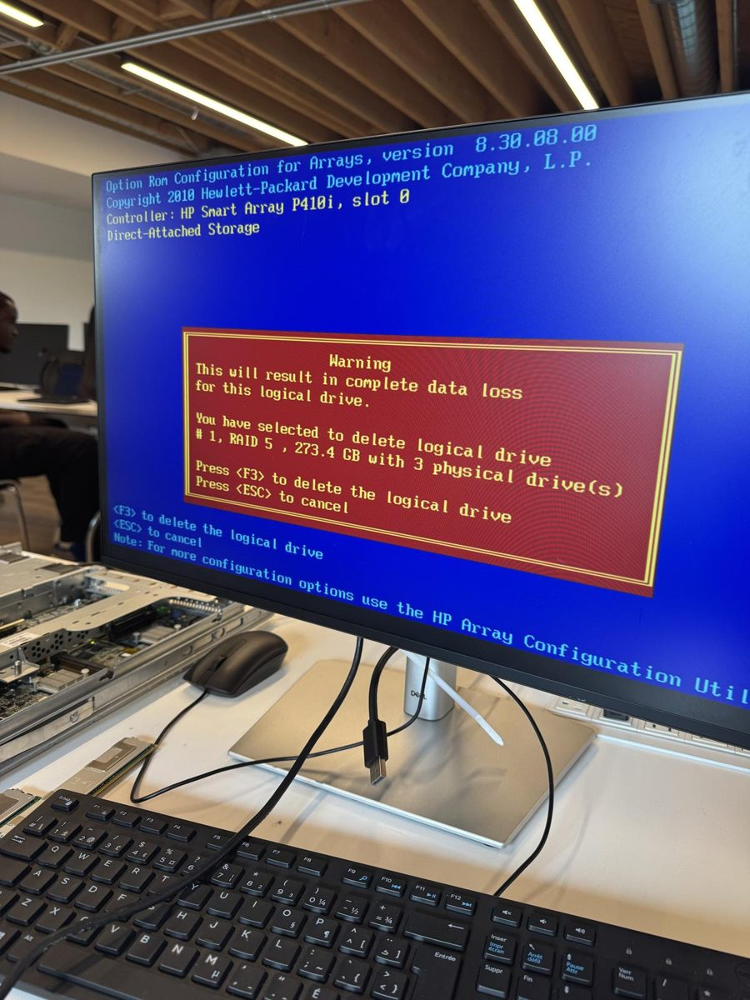

### Étape 3 : création du RAID 5

Avec **Create Logical Drive** :

- les **3 disques** de 146,8 Go (Port 1I, Box 1, Bay 1 à 3) sont cochés ;
- **RAID 5** est choisi ;
- aucun disque de secours (*spare*) ;
- *Maximum Boot partition* reste sur **Disable** (4 Go).

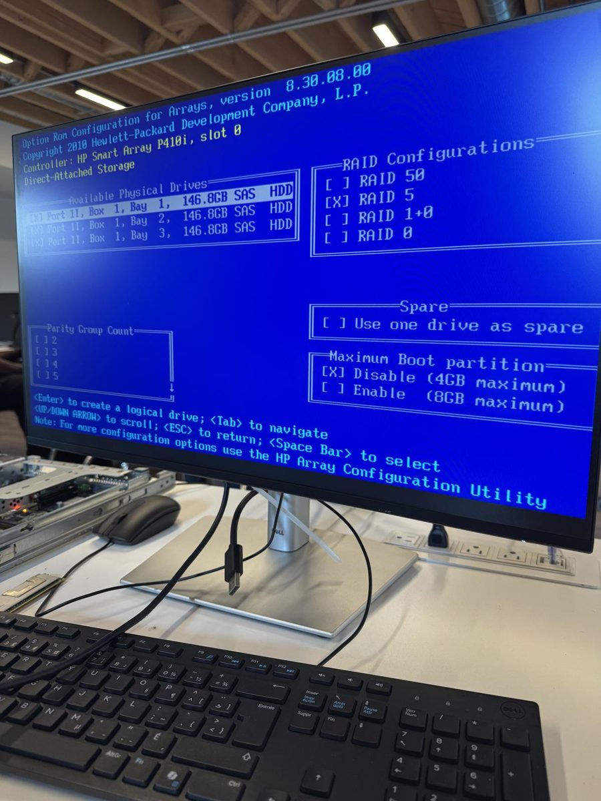

### Étape 4 : enregistrement

L'utilitaire résume : **273,4 Go avec tolérance de panne RAID 5**. On enregistre avec **F8**.

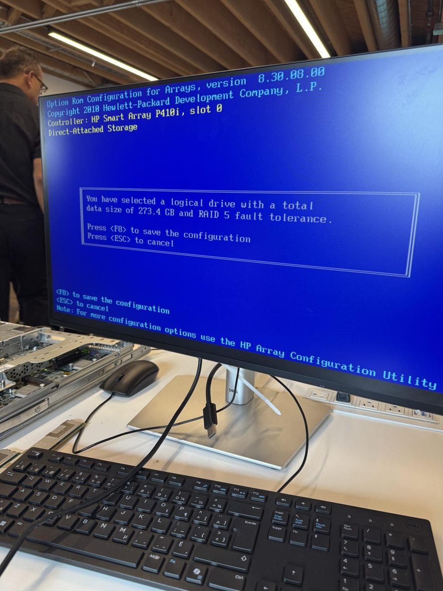

### Étape 5 : vérification

```text
Logical Drive # 1, RAID 5, 273.4 GB, Status OK
Port 1I, Box 1, Bay 1, 146.8GB SAS HDD   OK
Port 1I, Box 1, Bay 2, 146.8GB SAS HDD   OK
Port 1I, Box 1, Bay 3, 146.8GB SAS HDD   OK
```

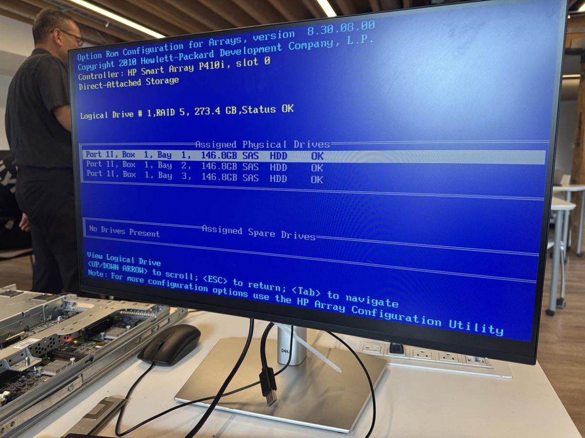

### 🧮 Pourquoi 273,4 Go ?

En RAID 5, l'équivalent d'**un disque** sert à stocker la parité :

```text
Capacité utile = (nombre de disques − 1) × taille d'un disque
               = (3 − 1) × 146,8 Go = 293,6 Go  (en milliards d'octets)
293,6 × 10⁹ ÷ 1 073 741 824 ≈ 273,4 Go       (comme l'affiche le contrôleur)
```

| Niveau RAID | Capacité avec 3 × 146,8 Go | Panne tolérée | Choix |
| --- | --- | --- | :-: |
| RAID 0 | ~410 Go | Aucune | ❌ trop risqué |
| RAID 1+0 | Impossible (il faut un nombre pair de disques) | 1 par miroir | ❌ |
| **RAID 5** | **~273 Go** | **1 disque** | ✅ |
| RAID 50 | Impossible (6 disques minimum) | — | ❌ |

Le RAID 5 offre le meilleur compromis avec 3 disques : beaucoup d'espace, et le serveur continue de fonctionner si un disque tombe en panne.

---

## ✅ Conclusion

Le diagnostic montre que le DL360 G6 est **entièrement fonctionnel** :

- les **deux processeurs** Xeon E5540 sont reconnus, testés un à la fois puis ensemble ;
- **61 440 Mo** de mémoire ECC sont configurés et testés par le BIOS ;
- les **3 disques SAS** forment un volume **RAID 5 de 273,4 Go** au statut **OK** ;
- les deux alimentations de 750 W assurent la redondance électrique.

Le serveur est prêt pour l'installation de **Proxmox VE** (voir [2.Proxmox](../../2.Proxmox/300141685/README.md)).
