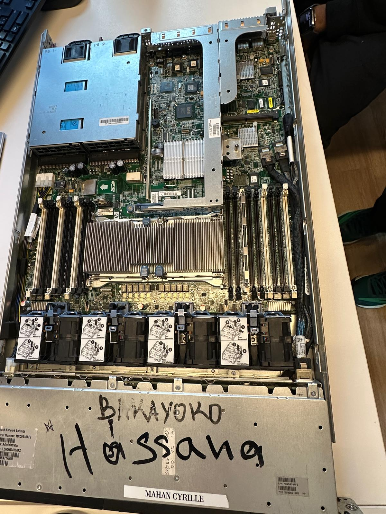
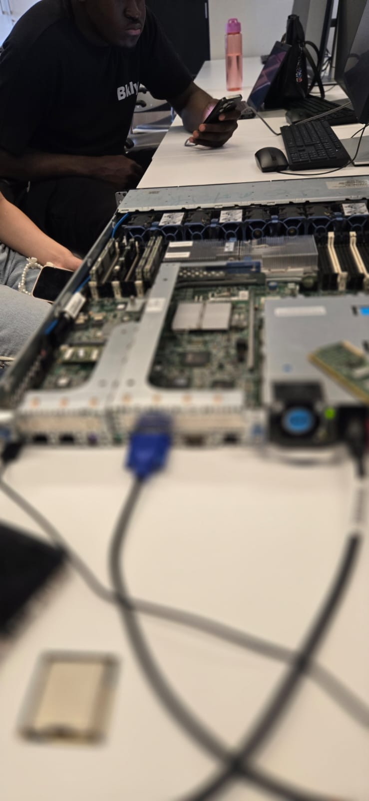
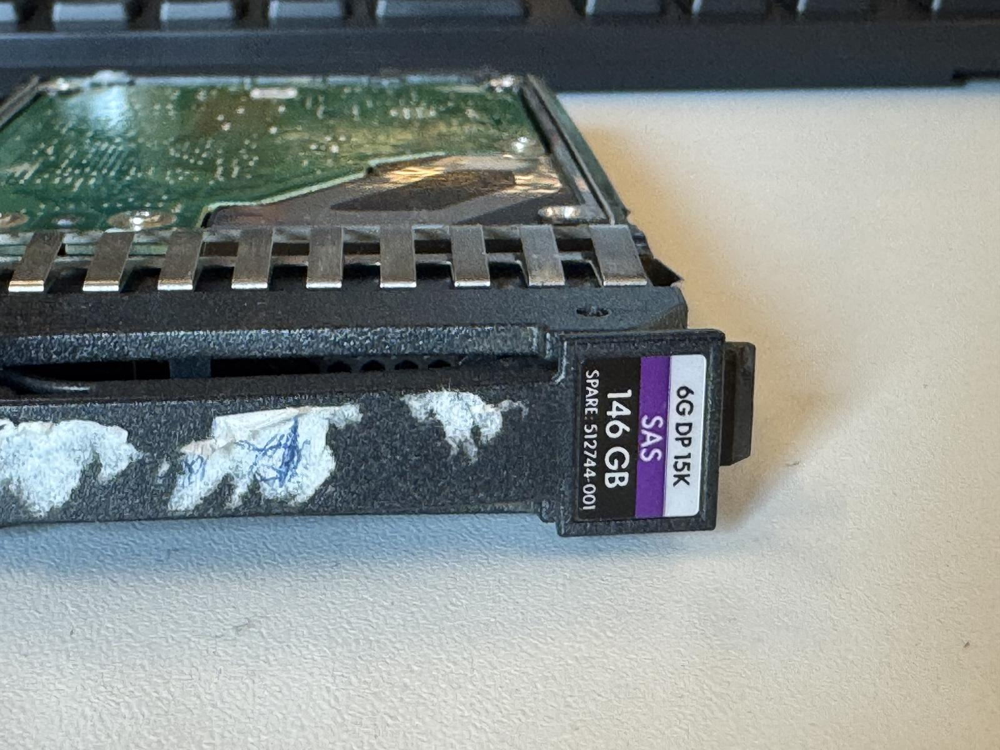
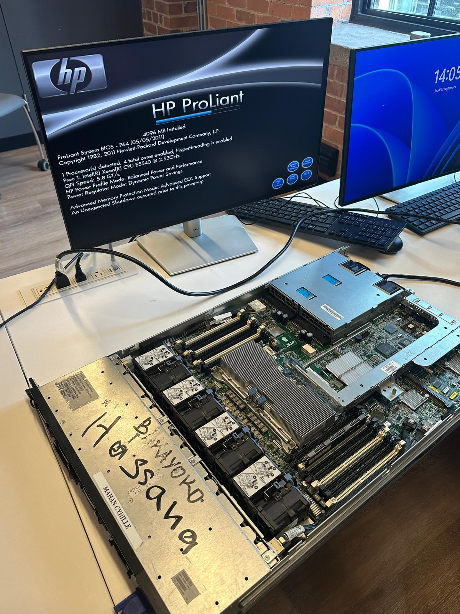
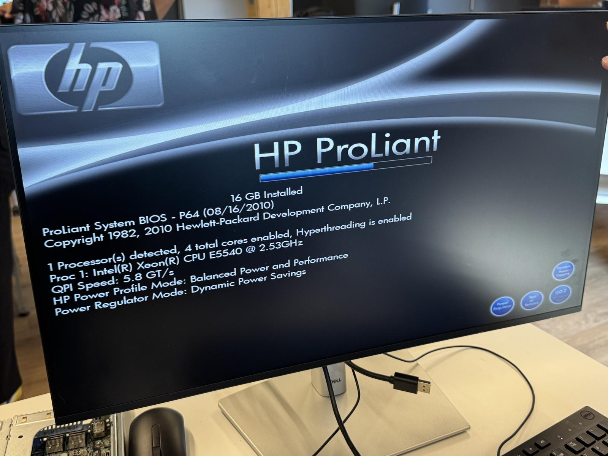
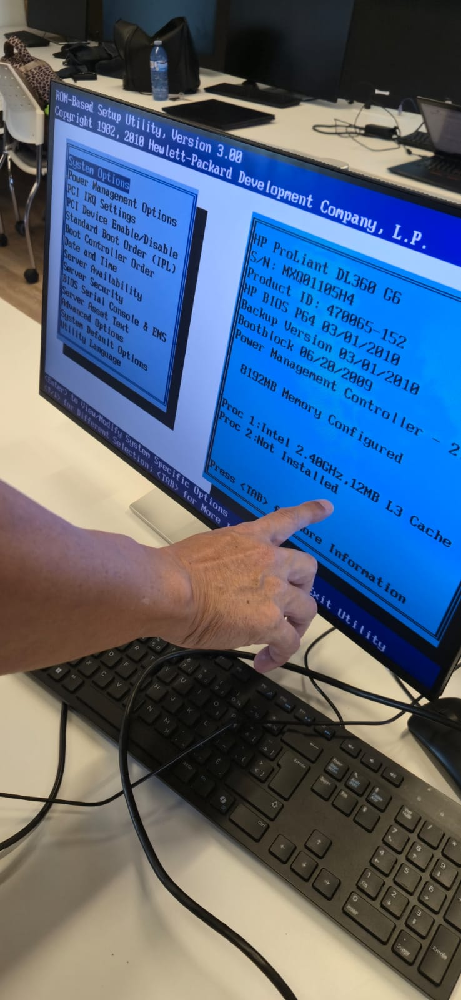
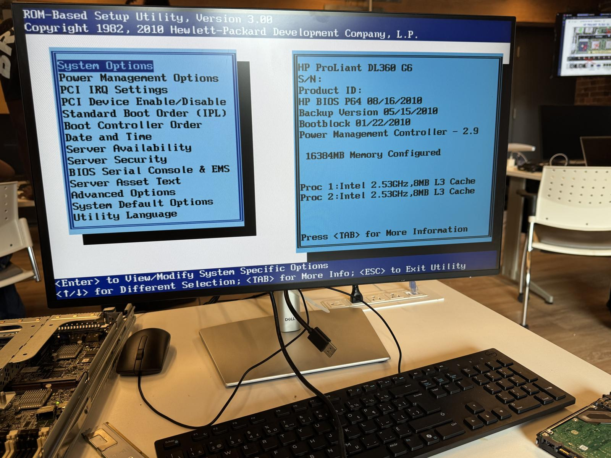
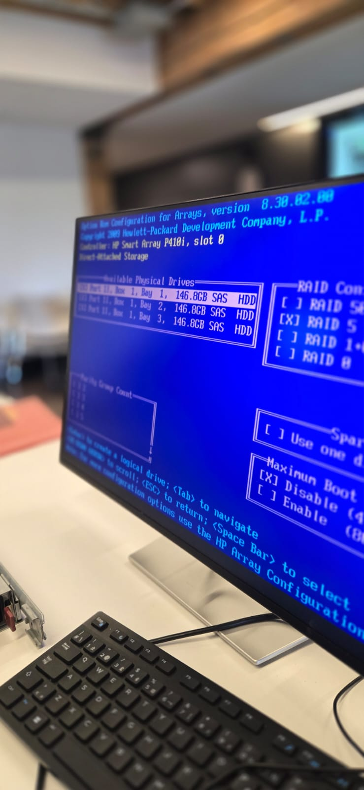
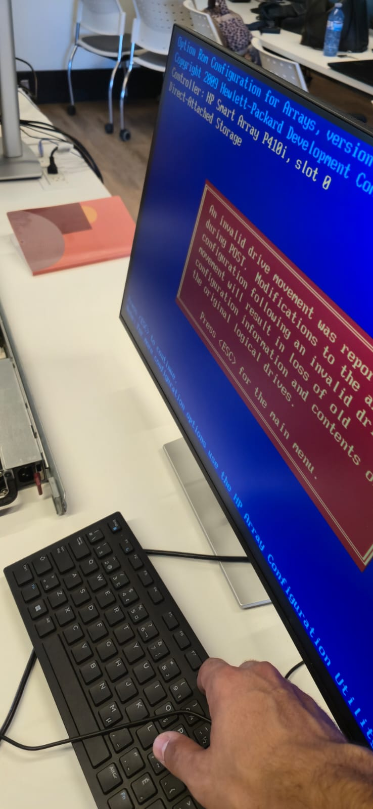
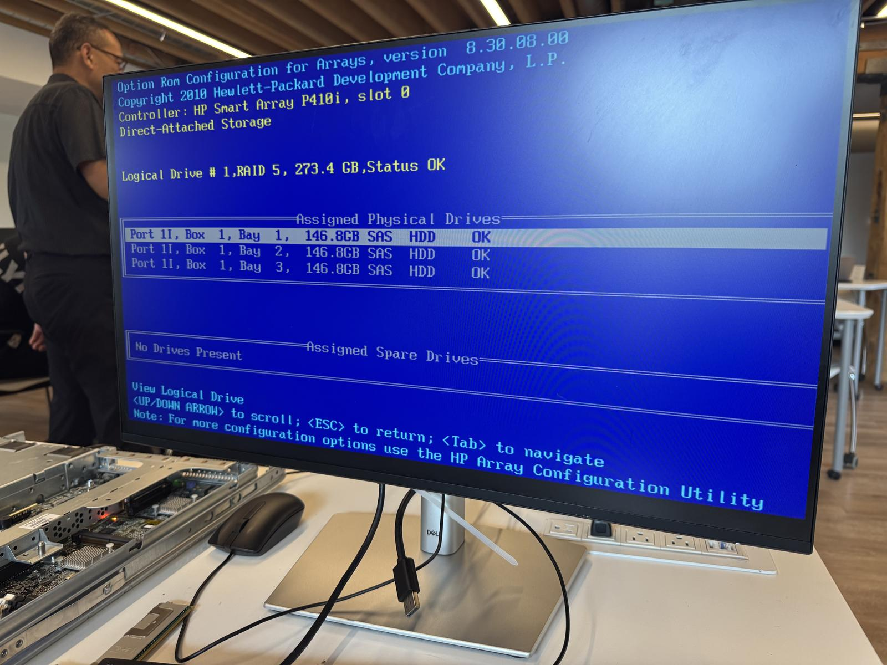

# Diagnostic matériel d’un serveur HP ProLiant

**Anis Benabbas · 300150477 · Groupe 1**  
INF1085 — Administration Linux · Collège Boréal

Pour diagnostiquer un serveur qui ne démarre pas, ce compte rendu présente trois vérifications : identifier les composants installés, lire les résultats du démarrage, puis vérifier le stockage dans l’utilitaire RAID. Les photos de laboratoire du groupe 1 illustrent plusieurs essais. Les valeurs indiquées ci-dessous se rapportent à l’écran de chaque essai.

## 1. Repérer les composants

| Châssis ouvert | Installation de la mémoire | Identification d’un disque |
| --- | --- | --- |
|  |  |  |
| Les rangées de connecteurs DIMM sont visibles sur la carte système. | Les barrettes occupent les emplacements mémoire associés au processeur. | L’étiquette indique un disque SAS de 146 Go. Cette valeur concerne un seul disque physique. |

## 2. Vérifier le démarrage et la détection des processeurs

Le POST est le test effectué par le serveur à la mise sous tension. L’affichage du POST donne un premier point de contrôle. On peut ensuite comparer la mémoire et les processeurs détectés aux composants installés.

| Contrôle | Photo du laboratoire | Observation |
| --- | --- | --- |
| Affichage au démarrage |  | L’écran relié au serveur affiche la séquence de démarrage HP ProLiant. |
| Essai avec un processeur |  | Le premier essai affiche un Intel Xeon E5540 et 16 Go de mémoire. |
| Vérification dans le BIOS |  | Le BIOS indique « Proc 2 Not Installed ». Cette indication décrit la détection du second processeur lors de cet essai. |
| Essai avec deux processeurs |  | Lors d’un autre essai, le démarrage affiche deux processeurs et 16 384 Mo de mémoire configurée. |

Le résultat du BIOS doit être interprété avec la configuration de l’essai. Si le second emplacement est vide, « Not Installed » est attendu. Si un processeur y est installé, ce même message signale un écart à examiner.

## 3. Contrôler le volume RAID 5

### Sélection des disques

Le contrôleur Smart Array présente trois disques SAS de 146,8 Go. Le choix du RAID 5 permet de regrouper ces disques en un volume logique. Une partie de la capacité sert à la parité.

*Sélection des disques dans l’utilitaire du contrôleur.*

### Message de diagnostic

Lors d’un essai, le contrôleur a signalé un déplacement de disque (« invalid drive movement »). Le message avertit qu’une modification de la configuration peut faire perdre l’accès aux données de l’ancien volume. Le premier contrôle consiste à vérifier la position des disques dans les baies.

*Avertissement affiché par le contrôleur RAID.*

### Vérification du résultat

*Le contrôleur affiche « Logical Drive #1 », RAID 5, environ 273,4 Go et l’état « OK ».*

Cet écran confirme que le contrôleur reconnaît le volume logique. La vérification du système de fichiers relève d’une étape distincte dans le système d’exploitation.
