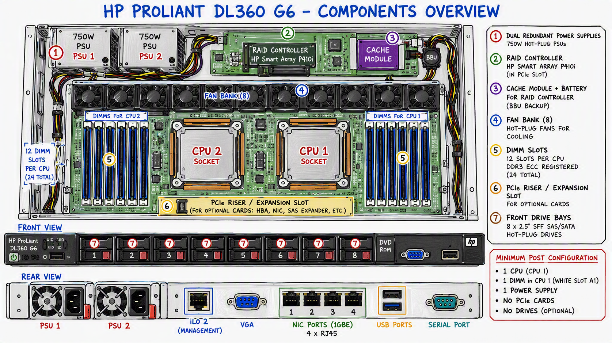
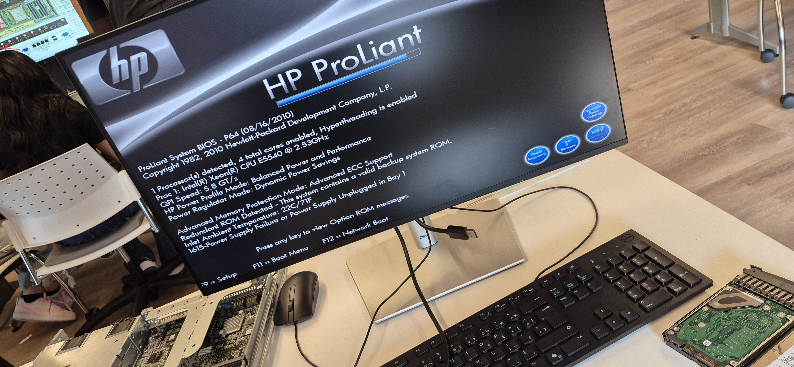



# Diagnostic matériel – HP ProLiant DL360 G6

## Informations générales

- **Étudiant :** Arezki Aidene

- **Identifiant :** 300151505

- **Cours :** INF1085 – Linux

- **Date :** 24 novembre 2026

## 1. Introduction

Ce travail présente une démarche de diagnostic matériel

d'un serveur HP ProLiant DL360 G6 qui ne démarre pas.

L'objectif est d'identifier les causes possibles de la panne

et de proposer des solutions adaptées.

## 2. Identification du matériel

| Composant | Caractéristique |

|---|---|

| Fabricant | HP |

| Modèle | ProLiant DL360 G6 |

| Format | Serveur rack 1U |

| Processeur | Intel Xeon |

| Socket | LGA1366 |

| Mémoire | DDR3 ECC |

## 3. Causes possibles de la panne

### Cas 1 : Broches légèrement pliées

Les broches du socket LGA1366 se trouvent sur la carte

mère. Une broche pliée peut empêcher le contact électrique

avec le processeur et provoquer un échec du démarrage.

Solution proposée :

- Éteindre et débrancher le serveur.

- Respecter les précautions antistatiques.

- Examiner les broches avec une loupe.

- Faire réaligner les broches par une personne qualifiée.

- Effectuer un nouveau test de démarrage.

### Cas 2 : Socket endommagé

Des broches cassées, arrachées ou écrasées peuvent rendre

le socket inutilisable.

Le remplacement du socket nécessite des équipements

spécialisés et une expertise en réparation électronique.

### Cas 3 : Carte système défectueuse

Lorsque le socket est gravement endommagé, le remplacement

de la carte mère peut être une solution plus économique.

Il faut vérifier la compatibilité de la carte de remplacement

avec le serveur et ses composants.

## 4. Procédure de diagnostic

1. Éteindre et débrancher le serveur.

2. Vérifier les alimentations électriques.

3. Observer les voyants de diagnostic.

4. Inspecter les sockets et les processeurs.

5. Retirer les deux processeurs.

6. Installer CPU2 dans le socket 1.

7. Installer une barrette mémoire compatible dans

&#x20;  le premier emplacement mémoire recommandé pour CPU1.

8. Installer correctement le dissipateur thermique.

9. Rebrancher et démarrer le serveur.

10. Observer le résultat du test POST.

## 5. Interprétation des symptômes

| Symptôme | Cause possible |

|---|---|

| Écran noir | Processeur ou carte mère |

| Ventilateurs à pleine vitesse | Échec de l'initialisation matérielle |

| Voyant CPU rouge | Processeur ou socket défectueux |

| Erreur mémoire | DIMM ou emplacement incorrect |

| Arrêt immédiat | Alimentation ou court-circuit |

| POST réussi | Configuration matérielle minimale fonctionnelle |

## 6. Test POST

POST signifie Power-On Self-Test.

Il s'agit d'un ensemble de vérifications effectuées

au démarrage du serveur afin de contrôler ses composants

matériels essentiels.

Si CPU2 fonctionne dans le socket 1, le problème peut

provenir du socket 2 ou de son circuit mémoire.

Si CPU2 ne fonctionne pas dans le socket 1, il faut

également vérifier la mémoire, la compatibilité et

l'état du socket avant de conclure à une panne du CPU.

## 7. Résultats des tests

| Test | Résultat |

|---|---|

| Vérification de l'alimentation | À vérifier |

| Inspection du socket | À vérifier |

| Test CPU2 dans Socket 1 | À effectuer |

| Vérification de la mémoire | À effectuer |

| Test POST | À effectuer |

Les résultats seront complétés après les tests physiques

sur le serveur.

## 8. Recommandations

- Respecter les précautions antistatiques.

- Ne jamais manipuler un processeur sous tension.

- Vérifier les composants individuellement.

- Utiliser des pièces compatibles.

- Documenter chaque intervention.

- Prendre des photos avant et après les manipulations.

## 9. Conclusion

Le diagnostic d'un serveur nécessite une démarche

méthodique permettant d'isoler progressivement les

composants susceptibles de provoquer la panne.

Le test du processeur CPU2 dans le socket 1 permet

notamment de mieux orienter le diagnostic avant

d'envisager le remplacement de la carte mère.

## 10. Références

- [Documentation du cours INF1085](https://github.com/CollegeBoreal/INF1085-201-26A-05/tree/main/1.Diagnostics)

- [LGA1366 – Wikipédia](https://fr.wikipedia.org/wiki/LGA_1366)

- [Support technique HPE](https://support.hpe.com/)

## 11. Illustrations techniques

### Figure 1 : Diagnostic du serveur

Cette illustration présente le contexte du diagnostic
matériel du serveur.

### Figure 2 : Serveur HP ProLiant DL360 G6

Cette photographie accompagne la procedure de diagnostic
du processeur et du socket.

**Source des images :** Documentation du professeur INF1085.
Ces images sont des illustrations du cours et non des
preuves de tests personnels.

