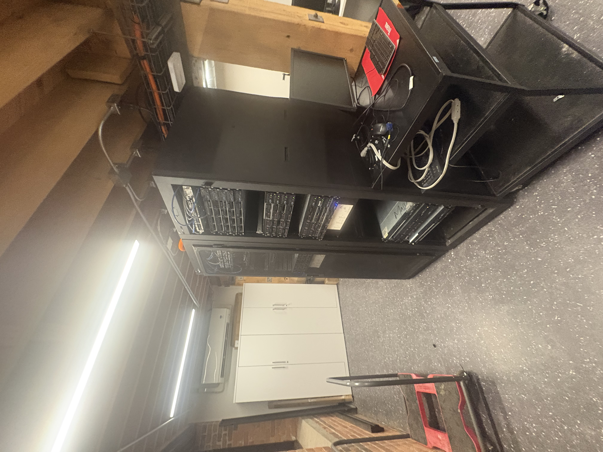
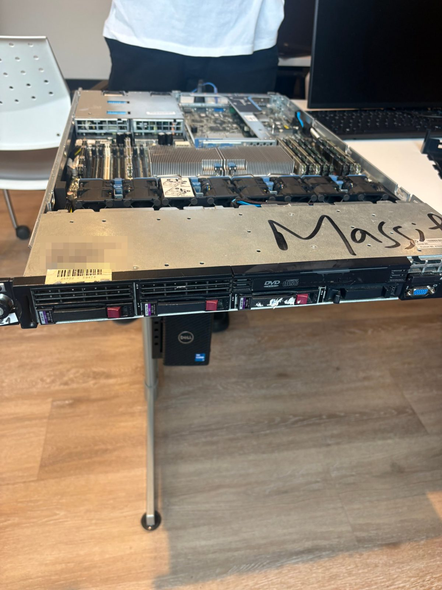
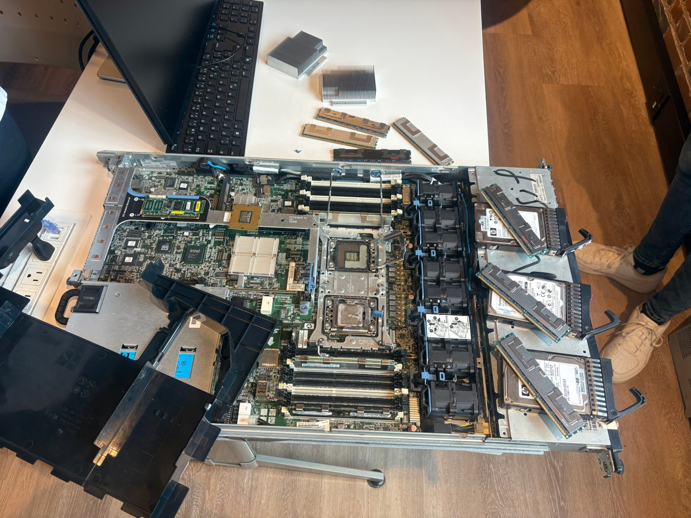
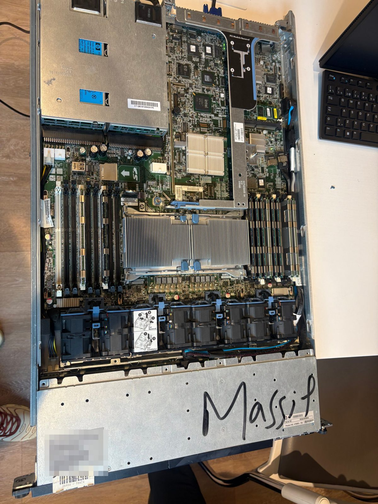
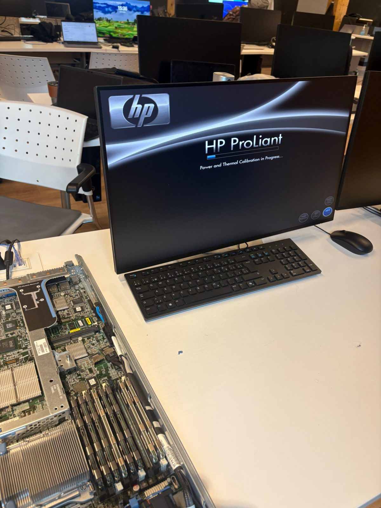
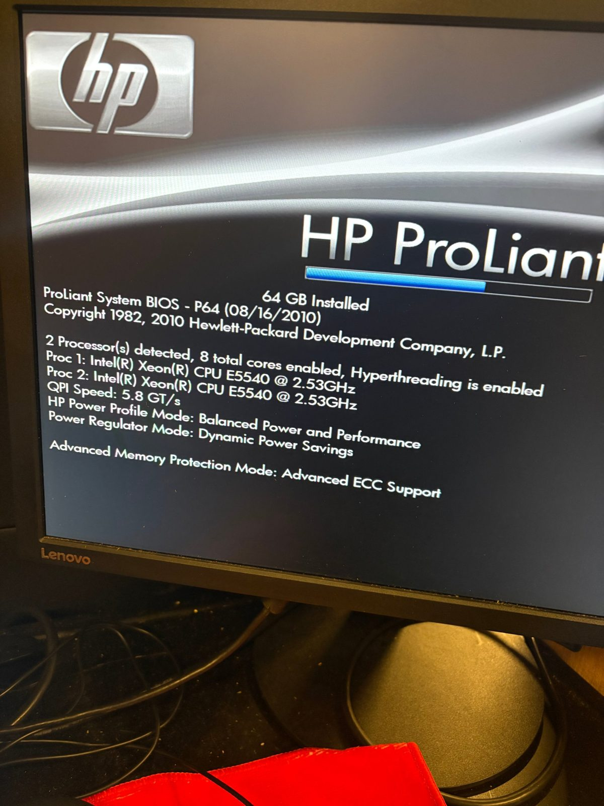
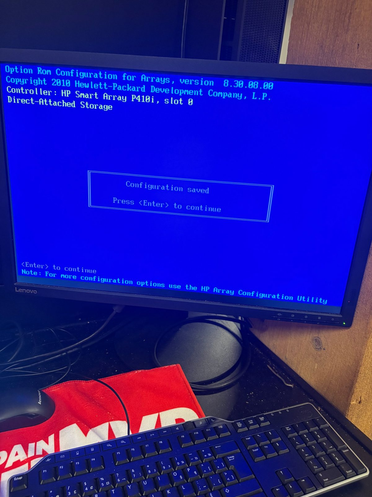

  

<h1 align="center">🖥️ Diagnostic du serveur HP ProLiant</h1>
<h3 align="center">Étape 1 · Préparation du matériel</h3>

  
  
  

---

## 👤 Informations de l'étudiant

| | |
|---|---|
| **Nom** | Nabil Hafsi |
| **Identifiant (ID)** | `300151732` |
| **Courriel** | 300151732@monboreal.ca |
| **Cours** | Administration Linux |
| **Dépôt** | `INF1085-201-26A-05` |
| **Étape** | 1 · Diagnostics |
| **Mois** | Novembre 2026 |

## 🗄️ Carte d'identité du serveur

| | |
|---|---|
| **Fabricant / gamme** | HP ProLiant |
| **Numéro de série** | `MXQ0390BMX` |
| **Format** | Serveur 1U monté en baie, avec gestion à distance iLO 2 |

---

## 📑 Table des matières

1. [Objectif de l'étape](#-objectif-de-létape)
2. [Qu'est-ce qu'un datacentre ?](#-quest-ce-quun-datacentre-)
3. [Présentation du serveur](#-présentation-du-serveur)
4. [Composants matériels](#-composants-matériels)
5. [Démarrage du serveur : POST et BIOS](#-démarrage-du-serveur--post-et-bios)
6. [Disques et contrôleur](#-disques-et-contrôleur)
7. [Ressources matérielles disponibles](#-ressources-matérielles-disponibles)
8. [Prochaines étapes](#-prochaines-étapes)

---

## 🎯 Objectif de l'étape

Cette étape sert à **découvrir et préparer le matériel** du serveur de l'école, sur lequel nous installerons ensuite un hyperviseur pour créer des machines virtuelles.

Ce document :

- ✅ présente le serveur et ses composants (processeurs, mémoire, disques, réseau) ;
- ✅ montre l'écran de démarrage (POST) et confirme que le matériel est détecté ;
- ✅ documente la configuration du contrôleur de disques ;
- ✅ fait le point sur les ressources matérielles disponibles.

---

## 🏢 Qu'est-ce qu'un datacentre ?

  

Un **datacentre** (ou **centre de données**) est une installation physique qui regroupe des **équipements informatiques** (serveurs, stockage, équipements réseau) et toute l'**infrastructure** nécessaire à leur fonctionnement continu. Il sert à **héberger des applications et des données** pour une organisation ou pour de nombreux clients, par exemple dans le cas des services infonuagiques.

**Ce qu'on y trouve :**

| Élément | Rôle |
|---|---|
| 🖥️ **Serveurs** | Exécutent les applications et les machines virtuelles |
| 💾 **Stockage** | Conserve les données (disques, baies de stockage) |
| 🌐 **Réseau** | Commutateurs, routeurs et pare-feux qui relient les serveurs entre eux et à Internet |
| ⚡ **Alimentation** | Double alimentation, onduleurs et génératrices en cas de panne |
| ❄️ **Refroidissement** | Climatisation et circulation d'air pour évacuer la chaleur |
| 🔒 **Sécurité physique** | Accès contrôlé, caméras, détection d'incendie |

**Niveaux de fiabilité (Tier I à IV) :** la classification de l'Uptime Institute décrit la disponibilité attendue d'un datacentre : du Tier I (environ 99,67 %) au Tier IV (environ 99,995 %), selon le niveau de redondance des équipements.

**Lien avec notre travail :** notre serveur est un équipement du même type que ceux d'un datacentre : un modèle **1U monté en baie**, avec **deux alimentations redondantes**, des **ventilateurs remplaçables à chaud**, une **mémoire ECC** et un **module de gestion à distance (iLO)**. Il constituera ainsi un petit datacentre de laboratoire, que nous mettrons à profit dans les prochaines étapes.

---

## 🔎 Présentation du serveur

Vue de face : on distingue **trois disques durs** dans les baies, un **lecteur DVD** et le **connecteur VGA**.

  

Le serveur ouvert, pendant le diagnostic : dissipateurs, barrettes de mémoire et disques démontés pour inspection.

  

Vue du dessus après remontage : les deux dissipateurs des processeurs, les deux banques de mémoire, les ventilateurs et les alimentations sont en place.

  

---

## 🧩 Composants matériels

| Composant | Détail | Source |
|---|---|---|
| **Processeurs** | 2 × Intel Xeon **E5540** à 2,53 GHz | Écran POST |
| **Cœurs** | 8 cœurs au total (4 par processeur), Hyper-Threading activé, donc 16 threads | Écran POST |
| **Bus processeur** | QPI à 5,8 GT/s | Écran POST |
| **Mémoire** | **64 Go** installés, protection **Advanced ECC** | Écran POST |
| **Disques** | 3 disques **SAS** de 2,5 po : 2 × 300 Go et 1 × 146 Go | Vue de face |
| **Contrôleur de disques** | HP **Smart Array P410i** (slot 0), avec module de cache 256 Mo | Écran du contrôleur |
| **Réseau** | 2 interfaces réseau intégrées (pilote `bnx2`) | Détection au démarrage |
| **Alimentation** | 2 blocs d'alimentation (PS 1 et PS 2) | Vue du dessus |
| **Refroidissement** | Plusieurs ventilateurs remplaçables à chaud | Vue du dessus |
| **Lecteur optique** | DVD-ROM | Vue de face |
| **Gestion à distance** | iLO 2 | Étiquette du serveur |
| **BIOS** | HP ProLiant System BIOS **P64** (16/08/2010) | Écran POST |

> 💡 Les processeurs E5540 utilisent le socket **LGA1366**, dont les broches fragiles font partie des causes classiques d'un serveur qui ne démarre pas.

---

## 🚦 Démarrage du serveur : POST et BIOS

Au démarrage, le serveur affiche l'écran **HP ProLiant** pendant la calibration de l'alimentation et de la température.

  

L'écran **POST** (Power-On Self-Test) confirme que le serveur démarre et détecte correctement le matériel :

- **2 processeurs** détectés, **8 cœurs** actifs, Hyper-Threading activé ;
- **64 Go** de mémoire installés ;
- profil d'énergie « Balanced Power and Performance » et mode mémoire « Advanced ECC Support ».

  

---

## 💽 Disques et contrôleur

Les trois disques sont gérés par le contrôleur **HP Smart Array P410i**. L'utilitaire de configuration du contrôleur (Option ROM Configuration for Arrays, version 8.30.08.00) a **enregistré la configuration** (« Configuration saved »).

  

| Disque | Capacité | Type |
|---|---|---|
| Disque 1 | 300 Go | SAS 2,5 po |
| Disque 2 | 300 Go | SAS 2,5 po |
| Disque 3 | 146 Go | SAS 2,5 po |

---

## 📊 Ressources matérielles disponibles

| Ressource | Quantité |
|---|---|
| Processeurs | 2 × Xeon E5540, 8 cœurs, 16 threads |
| Mémoire vive | 64 Go (ECC) |
| Stockage brut | 746 Go (2 × 300 Go + 146 Go, avant RAID) |
| Réseau | 2 interfaces |
| Alimentation | 2 blocs redondants |

> 💡 La capacité de stockage réellement utilisable dépend de la configuration choisie sur le contrôleur (par exemple, un miroir RAID 1 réduit la capacité de moitié).

---

## 🚀 Prochaines étapes

- [x] Découvrir le serveur et ses composants
- [x] Vérifier le démarrage (POST et BIOS)
- [x] Configurer le contrôleur de disques
- [ ] Étape suivante : installer l'hyperviseur et créer les machines virtuelles

---

  Réalisé par <b>Nabil Hafsi</b> · ID <code>300151732</code> · Administration Linux

