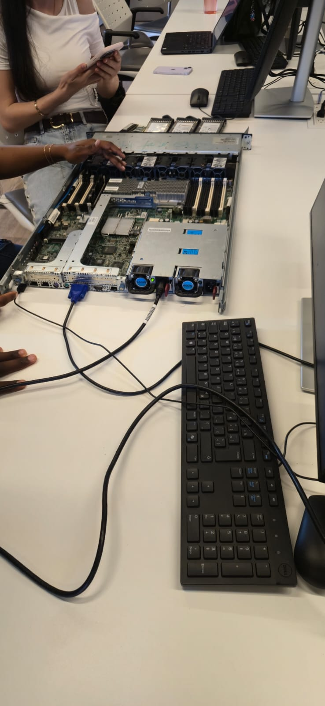
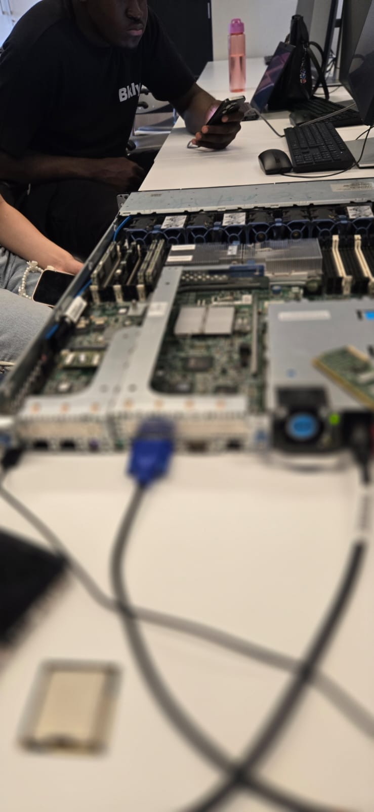
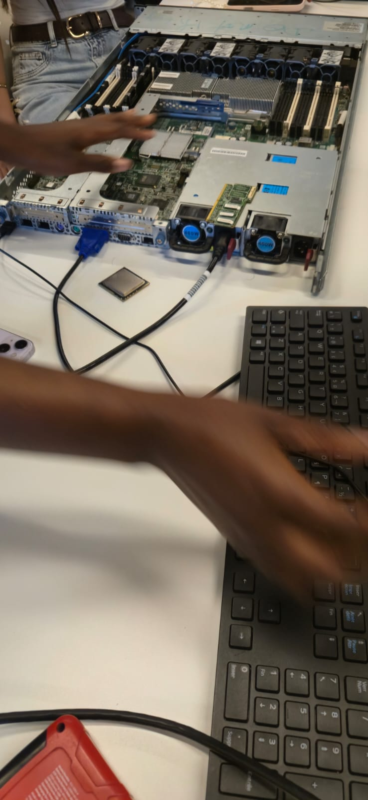
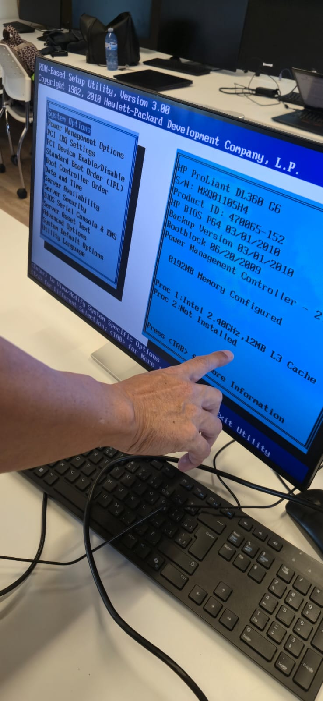
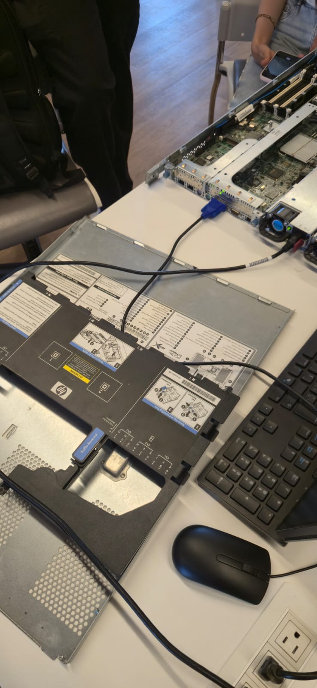

# Diagnostic et configuration – HP ProLiant DL360 G6

**Étudiant :** 300155909  
**Cours :** INF1085  
**Projet :** Diagnostics  
**Répertoire :** 1.Diagnostics

---

## 1. Build Overview

Le serveur HP ProLiant DL360 G6 a été ouvert sur l'établi afin de vérifier et d'installer ses composants internes avant sa remise en place dans le rack.

Les principaux composants vérifiés sont :
- La mémoire RAM
- Les processeurs (CPU)
- Les disques durs
- La carte mère
- Les alimentations

*Figure 1 — Vue générale du serveur ouvert sur l'établi.*

---

## 2. RAM Installation

La mémoire installée comprend **4 barrettes de 16 Go**, pour une capacité totale de **64 Go de RAM**.

Les barrettes sont installées dans les emplacements DIMM de la carte mère.

*Figure 2 — Installation des barrettes de mémoire RAM sur la carte mère.*

---

## 3. CPU Installation

Le serveur possède deux sockets pour processeurs : Proc 1 et Proc 2.

- ✅ **Proc 1 :** installé et fonctionnel (Intel, 2,40 GHz, cache L3 de 12 Mo).
- ❌ **Proc 2 :** une tentative d'installation a été effectuée, mais le processeur n'a pas été reconnu par le système (Not Installed).

*Figure 3 — Tentative d'installation du deuxième processeur.*

*Figure 4 — Écran RBSU confirmant l'état du processeur Proc 2 : Not Installed.*

---

## 4. Hard Drive Installation

Trois disques durs SAS de **146,8 Go chacun** ont été installés dans les baies suivantes :

- Bay 1
- Bay 2
- Bay 3

Les disques sont connectés au contrôleur Smart Array P410i.

*Figure 5 — Châssis du serveur ouvert montrant les baies des disques.*

---

## 5. RAID Configuration – HP Smart Array P410i

La configuration RAID a été effectuée à l'aide de l'utilitaire HP Smart Array accessible pendant le démarrage du serveur.

**Touche utilisée : F8**

Cette touche permet d'accéder à l'utilitaire de configuration du contrôleur.

### 5.1 Drive Selection and RAID Level

Les trois disques physiques SAS de 146,8 Go ont été détectés par le contrôleur HP Smart Array P410i.

Le niveau **RAID 5** a été sélectionné afin de fournir une tolérance à la panne grâce à la distribution des données et de la parité sur les disques.

*Figure 6 — Sélection des disques physiques et configuration RAID 5.*

### 5.2 Issue Encountered: Invalid Drive Movement

Pendant la reconfiguration, le contrôleur a affiché le message d'erreur suivant :

> An invalid drive movement was reported during POST.

Ce message indique que le contrôleur a détecté un changement dans la position ou l'ordre des disques.

**Cause probable :**

Un disque a pu être déplacé, débranché ou réinséré dans une autre baie, empêchant le contrôleur de reconnaître correctement la configuration RAID précédente.

**Solution proposée :**

1. Appuyer sur ESC pour revenir au menu principal.
2. Vérifier la position des trois disques.
3. Remettre chaque disque dans sa baie d'origine.
4. Vérifier la configuration existante avant toute modification.

⚠️ Toute recréation de la configuration RAID peut entraîner une perte des données existantes.

*Figure 7 — Message d'erreur Invalid Drive Movement détecté par le contrôleur.*

### 5.3 Saving the Configuration

Après la sélection du niveau RAID 5, l'utilitaire affiche un résumé de la configuration du disque logique.

La capacité totale indiquée est de **273,4 Go**, avec une tolérance à la panne grâce au RAID 5.

- **Enter :** confirmer et enregistrer la configuration.
- **Esc :** annuler et revenir au menu précédent.

*Figure 8 — Confirmation et enregistrement de la configuration RAID 5.*

---

## 6. Conclusion

Ce travail a permis d'étudier les composants matériels du serveur HP ProLiant DL360 G6 et de comprendre les étapes de configuration du stockage avec le contrôleur HP Smart Array P410i.

L'installation de la mémoire, la vérification des processeurs, l'installation des disques SAS et la configuration RAID 5 constituent les principales étapes documentées dans ce projet.

Le problème Invalid Drive Movement souligne l'importance de conserver les disques dans leurs baies d'origine et de vérifier la configuration avant toute modification.

---

## 7. Références

- Documentation technique HP ProLiant DL360 G6.
- Documentation du contrôleur HP Smart Array P410i.
- Architecture du socket LGA1366 : https://fr.wikipedia.org/wiki/LGA_1366

