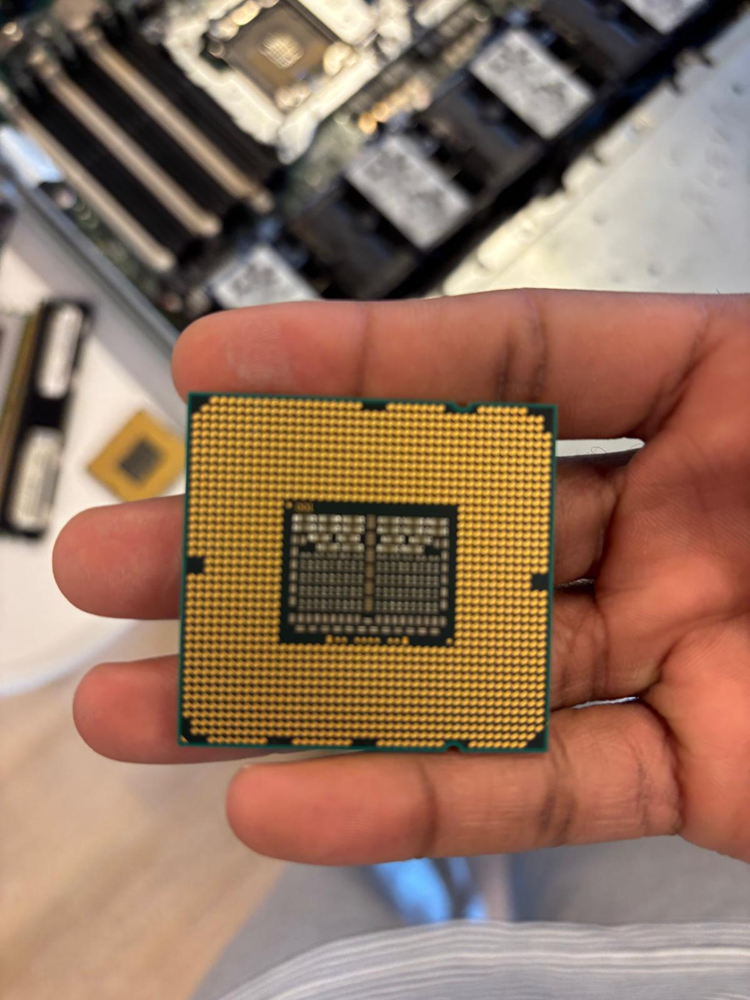
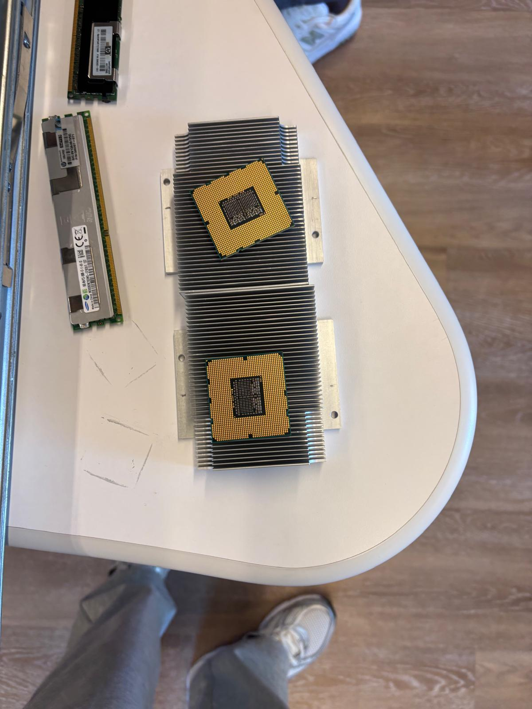
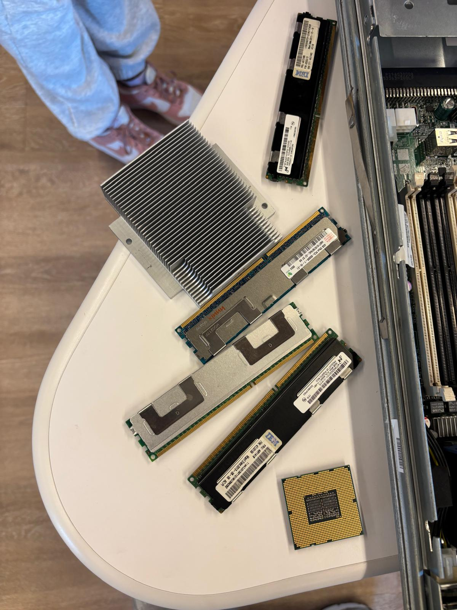
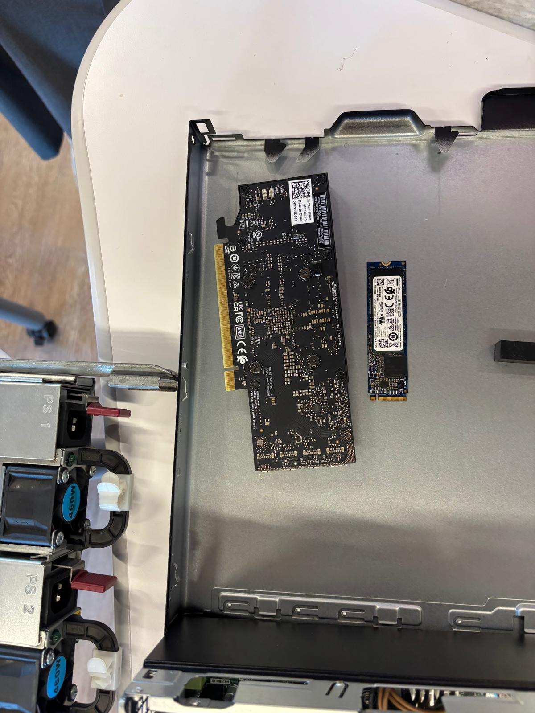
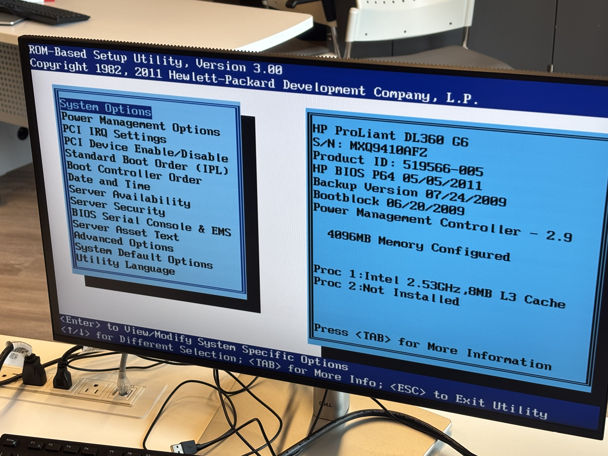
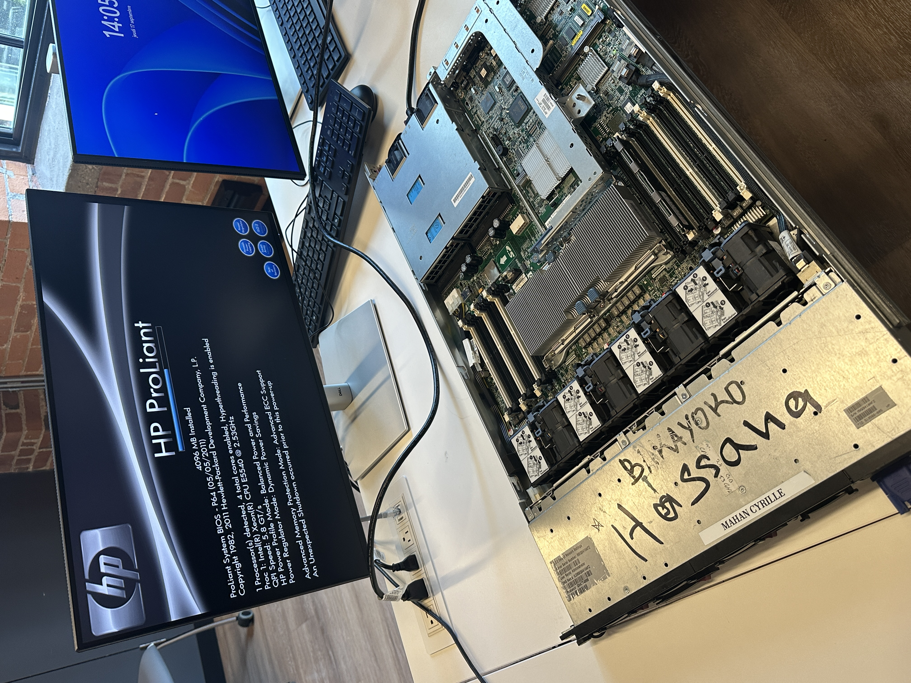
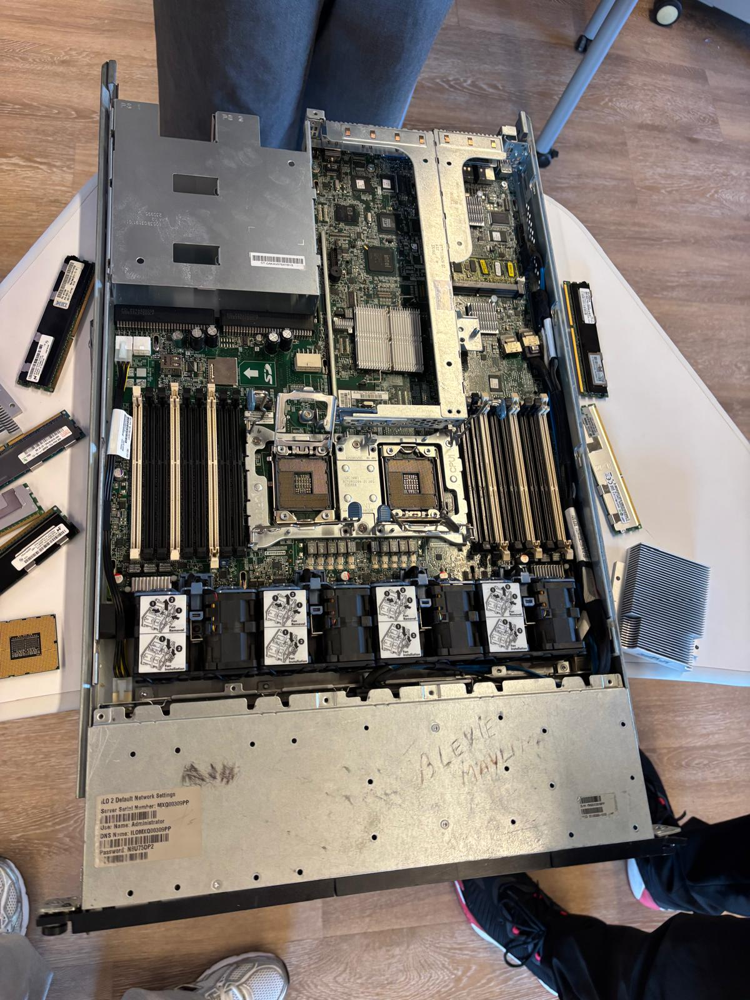
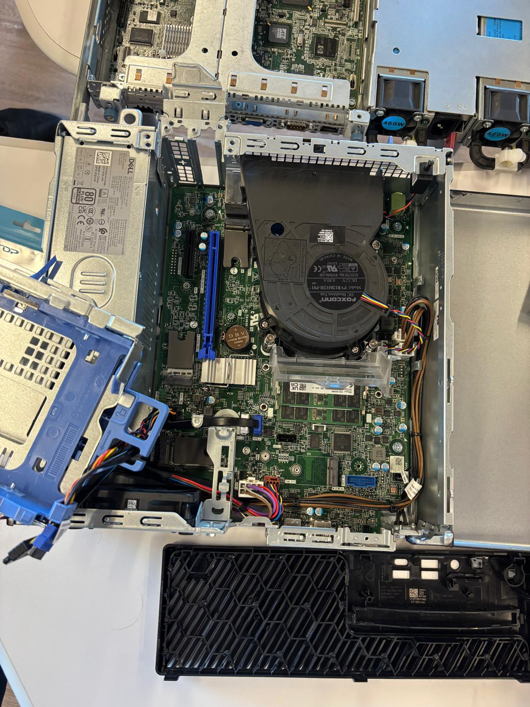

# 300155927

# Laboratoire matériel — Serveur HP ProLiant DL360 G6

Documentation d'un travail pratique sur le matériel d'un serveur : ouverture du serveur, visite du BIOS, et démontage des pièces principales (processeurs, mémoire vive, carte graphique, SSD). On commence par les pièces démontées, puis on présente le serveur lui-même. Chaque photo est expliquée une par une.

## Le serveur utilisé

| Pièce | Détail |
|---|---|
| Modèle | HP ProLiant DL360 G6 |
| Processeur | Intel Xeon E5540 à 2,53 GHz (4 cœurs, cache L3 de 8 Mo) |
| Mémoire vive | 4096 Mo (4 Go) |
| BIOS | HP P64, version du 05/05/2011 |

## Les pièces démontées

### Photo 1 — Le processeur

Cette photo montre le **dessous d'un processeur**. Les petits points dorés sont les contacts : c'est par là que le processeur communique avec la carte mère quand il est installé dans son emplacement (le *socket*). Il faut toujours tenir le processeur par les bords et ne pas toucher les contacts avec les doigts.

### Photo 2 — Les processeurs et leurs dissipateurs

Les deux processeurs ont été retirés du serveur. Ils sont posés sur leurs **dissipateurs de chaleur** : ce sont les blocs en aluminium avec des ailettes, qui absorbent la chaleur du processeur pour l'empêcher de surchauffer. À côté, on voit des barrettes de mémoire vive retirées elles aussi.

### Photo 3 — Les barrettes de mémoire vive

Plusieurs **barrettes de mémoire vive (RAM)** de serveur sont posées sur la table, à côté d'un dissipateur de chaleur et d'un processeur. Ce sont des barrettes DDR3 avec correction d'erreurs (ECC), utilisées dans les serveurs pour éviter les erreurs de données. On reconnaît les marques des fabricants sur les étiquettes (IBM, Hynix, Samsung).

### Photo 4 — Carte graphique et SSD M.2

Dans le capot du serveur, on a posé deux pièces : une **carte graphique** (la grande carte noire, vue de dos, qui se branche dans un port PCIe) et un **SSD au format M.2** (la petite carte à droite, qui sert de disque de stockage rapide). À gauche de la photo, on voit les deux blocs d'alimentation du serveur (460 W chacun), un principal et un de secours.

## Le serveur

### Photo 5 — Le BIOS du serveur

Cet écran est le **BIOS** du serveur, l'utilitaire de configuration qui démarre avant le système. On y voit le modèle du serveur (HP ProLiant DL360 G6), la version du BIOS (P64, 05/05/2011), le processeur Intel à 2,53 GHz et les 4096 Mo de mémoire. Le menu de gauche donne accès aux réglages : les options du système, l'ordre de démarrage (*Boot Order*), la date et l'heure, la sécurité, etc. On voit aussi que le deuxième emplacement de processeur est vide (*Proc 2 : Not Installed*).

### Photo 6 — Le démarrage du serveur ouvert

Le serveur est ouvert sur la table, et l'écran montre le **démarrage** (l'étape de test automatique appelée POST). Le serveur détecte 1 processeur Intel Xeon E5540 à 2,53 GHz avec 4 cœurs, la fonction Hyper-Threading activée et 4096 Mo de mémoire installée. Sur la photo, on voit l'intérieur du serveur : la carte mère, les emplacements de mémoire et les ventilateurs.

### Photo 7 — La carte mère du serveur sans les processeurs

Vue du dessus du serveur ouvert après le démontage : au centre, les **deux emplacements de processeur sont vides** (les processeurs ont été retirés). De chaque côté, on voit les rangées d'emplacements pour les barrettes de mémoire, et en bas la rangée de ventilateurs qui refroidit le serveur. Les pièces retirées (processeurs, mémoire, dissipateurs) sont posées autour du serveur.

### Photo 8 — L'intérieur d'un ordinateur de bureau Dell

Pour comparer avec le serveur, cette photo montre l'intérieur d'un **ordinateur de bureau Dell** ouvert : la carte mère verte, le gros ventilateur rond du processeur, le bloc d'alimentation et les supports pour les disques. Les pièces sont les mêmes en principe, mais l'intérieur d'un serveur est plus compact et fait pour fonctionner sans arrêt.

## Conclusion

Ce laboratoire a permis de voir concrètement les pièces principales d'un serveur : le processeur et son dissipateur, la mémoire vive ECC, la carte graphique, le SSD, les blocs d'alimentation redondants, et la carte mère avec ses deux emplacements de processeur et son BIOS. Le démontage montre aussi la différence entre un serveur (compact, double alimentation, beaucoup de ventilateurs) et un ordinateur de bureau.
