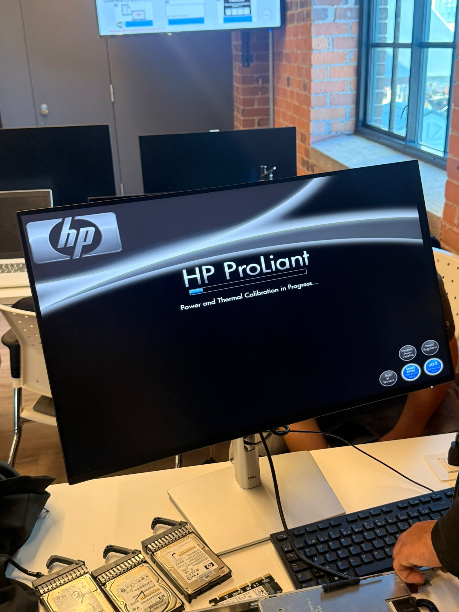
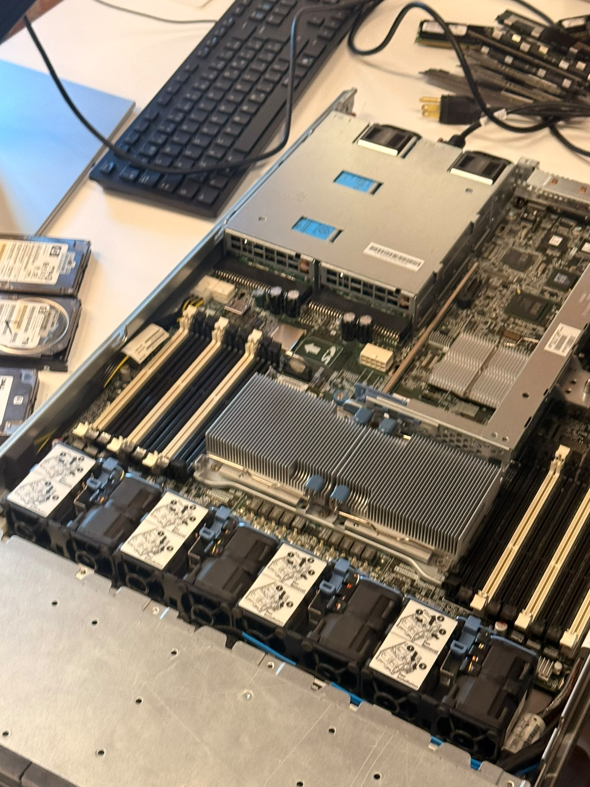

# 300156615 : Diagnostics, le serveur ne démarre pas

**Cours :** INF1085, Administration Linux
**Serveur :** HP ProLiant DL360 (socket LGA1366)

## 1. Contexte

Un serveur HP ProLiant DL360 ne démarre pas. L'objectif est de trouver la cause par élimination, avant de remplacer des pièces coûteuses.

## 2. Photos du diagnostic

[À COMPLÉTER : ce que montre la photo 1]

[À COMPLÉTER : ce que montre la photo 2]

## 3. Les trois cas étudiés

| Cas | Situation | Solution | Coût |
|---|---|---|---|
| 1 | Quelques broches légèrement pliées | Redresser avec une loupe et une pince fine | 0 $ |
| 2 | Socket endommagé | Remplacer le socket (équipement de rework BGA) | Souvent plus cher que le serveur |
| 3 | Socket mort | Remplacer la carte système usagée | Moins cher qu'une réparation |

## 4. Test de démarrage minimal

Pour isoler la panne : un seul processeur (CPU2 seul dans le Socket 1) et un DIMM dans le premier slot de CPU1.

L'écran affiche : BIOS P64 (16/08/2010), 1 processeur détecté (Intel Xeon E5540 à 2,53 GHz, 4 cœurs, Hyperthreading activé), 16 Go de mémoire installée.

| Résultat du test | Interprétation |
|---|---|
| Le serveur démarre (POST) | CPU2 est bon, le problème vient du Socket 2 ou de son circuit mémoire |
| Le serveur ne démarre pas | Forte probabilité que CPU2 soit défectueux |

## 5. Symptômes et causes probables

| Symptôme | Cause probable |
|---|---|
| Écran noir, ventilateurs à fond | Socket 2 ou CPU2 |
| Voyant rouge CPU | CPU2 défectueux |
| Bips mémoire | DIMM dans le mauvais emplacement |
| Démarre puis s'éteint | Alimentation ou court-circuit du socket |

## 6. Vérification après le remontage

### Mémoire

Après le remontage complet, le BIOS Memory Diagnostic indique 61 440 Mo disponibles et configurés (environ 60 Go), répartis sur des modules de 4 Go et de 16 Go dans les deux processeurs.

### Stockage

Le contrôleur HP Smart Array P410i affiche le Logical Drive n° 1 en RAID 5, d'une capacité de 293,56 Go. Avec trois disques SAS, la capacité utilisable est celle de deux disques : la parité, répartie sur tous les disques, permet de reconstruire les données si un disque tombe en panne.

### Processeurs

Les deux processeurs Intel Xeon E5540 sont détectés après le remontage (2 sockets, 4 cœurs chacun).

## 7. Outils utilisés

- Loupe et éclairage, pince de précision
- Voyants de diagnostic du panneau avant
- BIOS Memory Diagnostic et utilitaire du contrôleur Smart Array
- [À COMPLÉTER : autres outils]

## 8. Problèmes rencontrés

[À COMPLÉTER : difficultés réelles et comment elles ont été réglées]

## 9. Conclusion

Lorsqu'un serveur HP ProLiant DL360 ne démarre pas, il faut diagnostiquer avant de démonter. Selon l'état du socket LGA1366, trois cas sont possibles :

- **Broches légèrement pliées** : on peut les redresser avec une loupe et une pince fine, sans frais.
- **Socket endommagé** : le remplacement demande un équipement de rework professionnel et coûte souvent plus cher que le serveur.
- **Carte système défectueuse** : la remplacer par une carte usagée est généralement la meilleure solution pour un G6.

Le test le plus efficace consiste à placer CPU2 seul dans le Socket 1 avec un DIMM dans le premier slot de CPU1. Il permet de savoir si le problème vient du processeur ou du socket. Après le remontage, j'ai vérifié la mémoire (61 440 Mo), le stockage (RAID 5 de 293,56 Go) et les processeurs.

J'ai retenu qu'une démarche méthodique, en éliminant les causes une à une, évite des réparations coûteuses et inutiles.

[À COMPLÉTER : ce que j'ai retenu personnellement du laboratoire]
