# TP1 - Diagnostic matériel d'un serveur HP ProLiant DL360 G6

**Étudiant :** Yahia Benkara
**Matricule :** 300157275
**Programme :** Techniques des systèmes informatiques
**Cours :** INF1085 - Linux

## 1. Objectif du laboratoire

Comprendre les composants matériels d'un serveur, les méthodes de diagnostic des pannes, la détection du matériel dans le BIOS et la configuration du stockage RAID.

## 2. Identification des composants

### Blocs d'alimentation

Les deux blocs d'alimentation permettent d'assurer la redondance électrique du serveur.

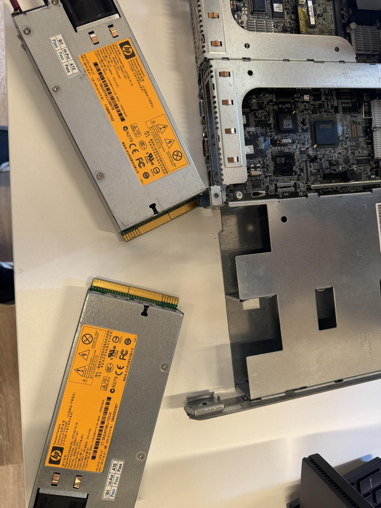

### Disques durs

Le serveur de référence possède trois disques durs SAS de 146 Go.

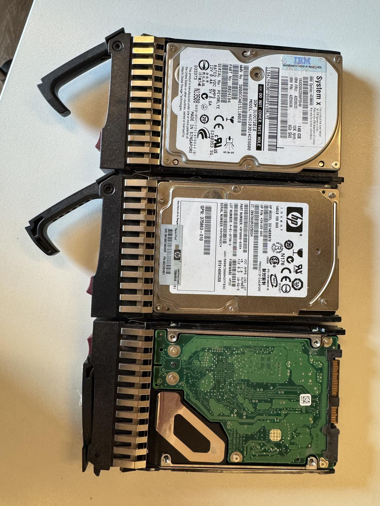

### Caractéristiques des disques

Les disques SAS sont adaptés aux environnements professionnels nécessitant de bonnes performances.

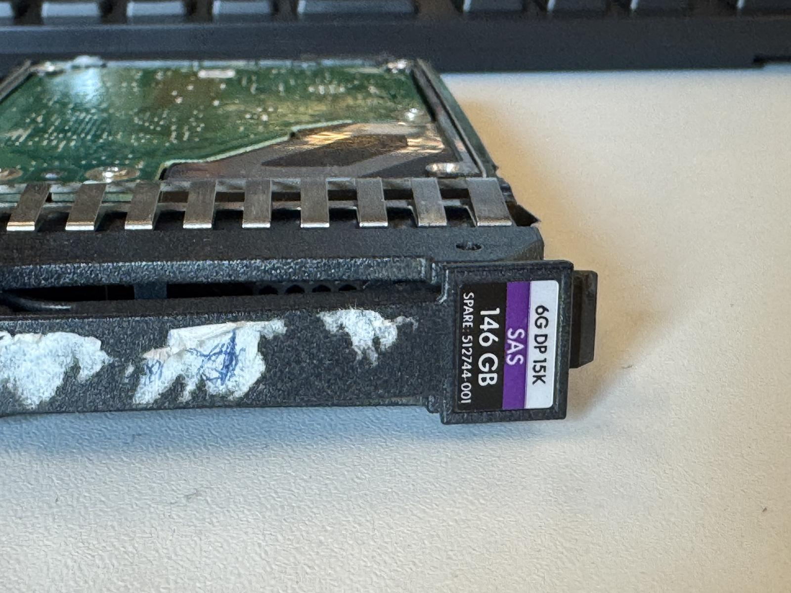

### Mémoire RAM

La mémoire RAM permet de stocker temporairement les données utilisées par les processeurs.

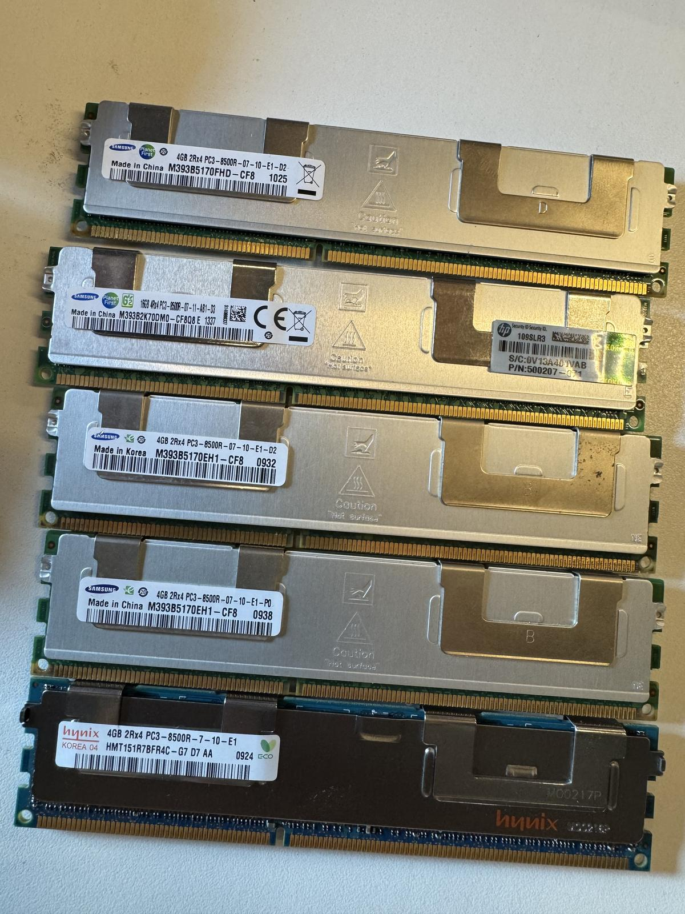

### Processeurs

Le serveur utilise des processeurs Intel Xeon E5540 cadencés à 2,53 GHz.

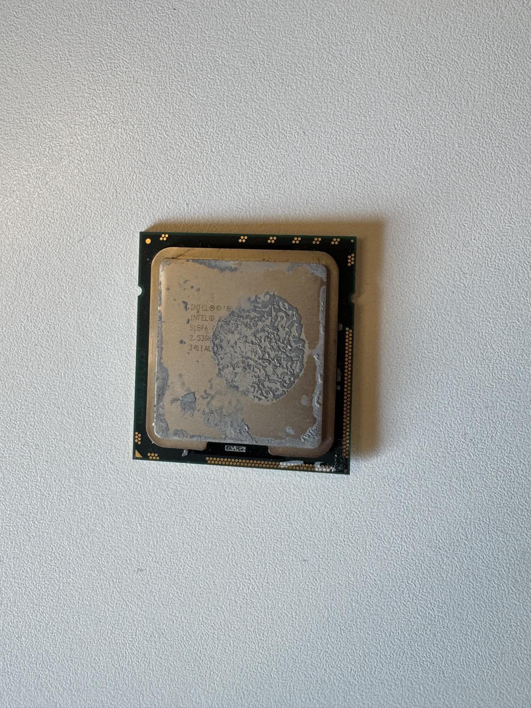

### Contrôleur RAID

Le module de mémoire cache du contrôleur RAID contribue aux performances du stockage.

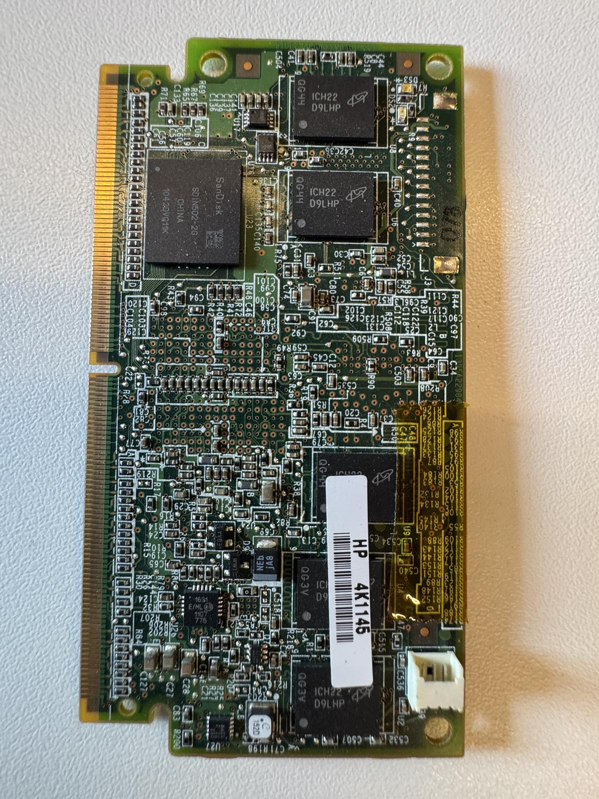

## 3. Diagnostic et tests matériels

### Test avec un processeur

Une configuration minimale avec un processeur et 16 Go de RAM permet de vérifier le démarrage du serveur.

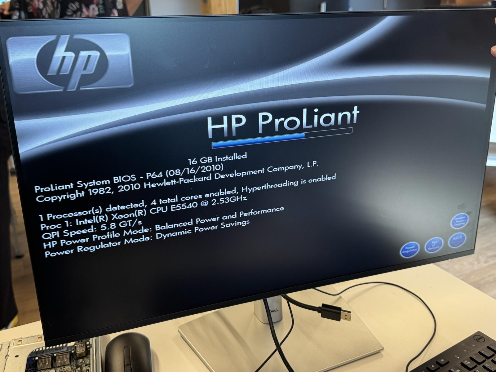

### Test avec deux processeurs

Le deuxième processeur est ajouté afin de vérifier sa reconnaissance par le BIOS.

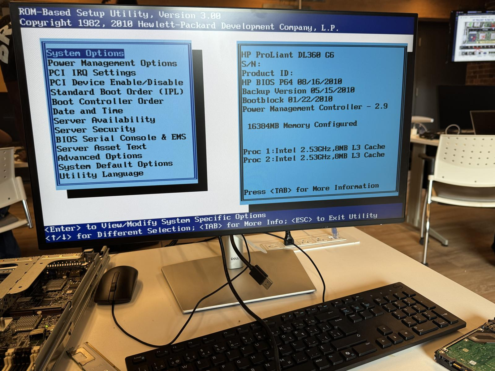

Si le serveur ne démarre pas avec le deuxième processeur, les causes possibles sont :

- Processeur défectueux.
- Broches du socket endommagées.
- Mauvaise installation de la mémoire.
- Problème de carte mère ou d'alimentation.

## 4. Configuration du stockage RAID

### RAID 5

Le RAID 5 répartit les données et la parité entre plusieurs disques. Il permet de supporter la panne d'un disque.

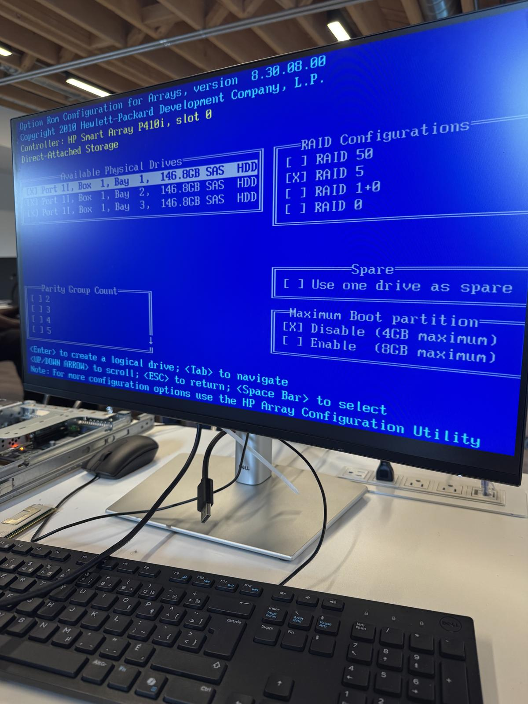

### Vérification du volume logique

Dans le laboratoire de référence, les trois disques SAS sont configurés en RAID 5.

Le volume logique obtenu est de 273,4 Go avec un statut OK.

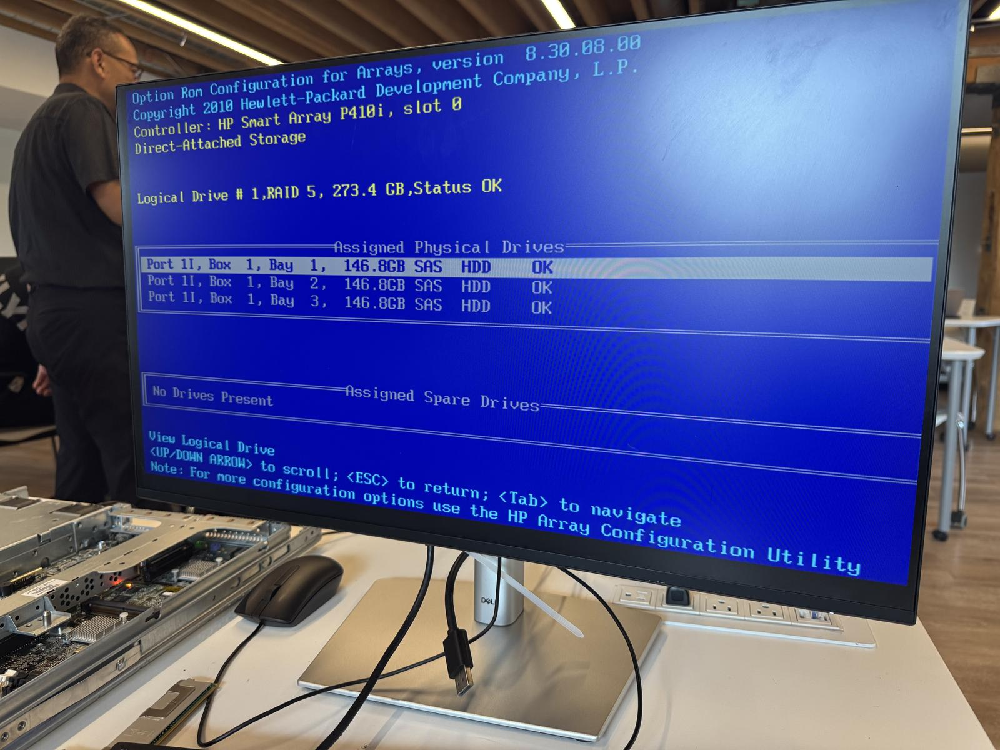

## 5. Configuration finale

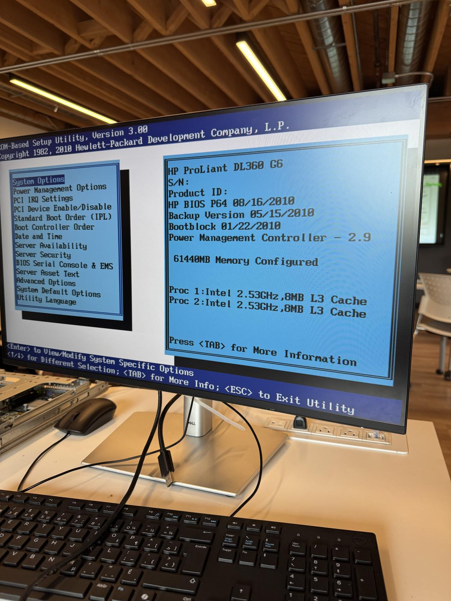

| Composant | Configuration de référence |
|---|---|
| Serveur | HP ProLiant DL360 G6 |
| Processeurs | 2 Intel Xeon E5540 |
| Fréquence | 2,53 GHz |
| Mémoire installée | 64 Go |
| Mémoire disponible observée | Environ 60 Go |
| Disques | 3 SAS de 146 Go |
| Stockage | RAID 5 |
| Volume logique | 273,4 Go |
| Alimentations | 2 |

## 6. Conclusion

Cette étude permet de comprendre le fonctionnement des composants matériels d'un serveur et les méthodes de diagnostic des pannes.

La vérification des processeurs, de la mémoire et du stockage constitue une étape importante avant l'installation d'un système Linux.

## Références

- Consignes du professeur : https://github.com/CollegeBoreal/INF1085-201-26A-05/tree/main/1.Diagnostics
- Photos et résultats du laboratoire de référence : Ouassim Ahmed Benamira (300150564), utilisés avec son autorisation.
- https://github.com/CollegeBoreal/INF1085-201-26A-05/tree/main/1.Diagnostics/300150564
