# 🖥️ Installation de Proxmox VE 9 sur un HP ProLiant DL360 G6

**Souleymane Barry · 300141685**
INF1085 · Collège Boréal

J'ai préparé et installé **Proxmox VE 9.2** sur un serveur **HP ProLiant DL360 G6** (S/N `MXQ0390BMX`, surnommé « Massif »). Ce serveur est aujourd'hui joignable à l'adresse `10.7.236.197` sous le nom `server197`, et il héberge des machines virtuelles, dont la mienne.

## 📋 Résumé du serveur

| Élément | Valeur |
| --- | --- |
| Modèle | HP ProLiant DL360 G6 · BIOS P64 (16/08/2010) |
| Processeurs | 2 × Intel Xeon E5540 à 2,53 GHz · 8 cœurs, Hyper-Threading activé |
| Mémoire | 64 Go (65 536 Mo testés OK) |
| Contrôleur disque | HP Smart Array P410i |
| Hyperviseur | Proxmox VE 9.2 · noyau `7.0.2-6-pve` |
| Paramètres de démarrage | `nomodeset acpi=off` |
| Réseau | `10.7.236.0/23` · passerelle `10.7.237.1` · DNS `8.8.8.8` |
| Accès web | `https://10.7.236.197:8006` |

---

## 1️⃣ Inspection du matériel

J'ai d'abord ouvert le serveur pour identifier ses composants : les deux processeurs sous leurs radiateurs, les barrettes de mémoire de chaque côté, les ventilateurs et les disques à l'avant. L'étiquette iLO 2 sur le capot donne le numéro de série `MXQ0390BMX`. C'est le même que celui du serveur `10.7.236.197` dans le tableau du cours.

| Façade (disques et lecteur DVD) | Serveur démonté | Serveur remonté |
| --- | --- | --- |
| 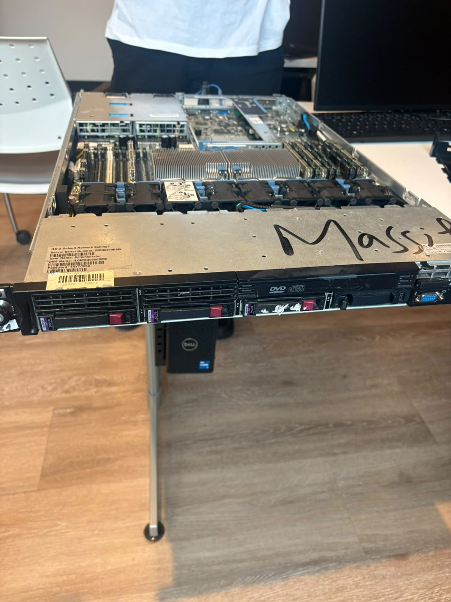 | 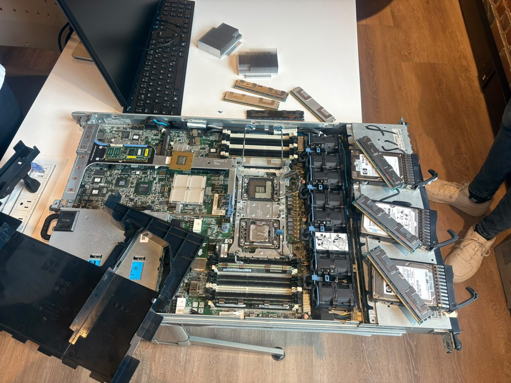 | 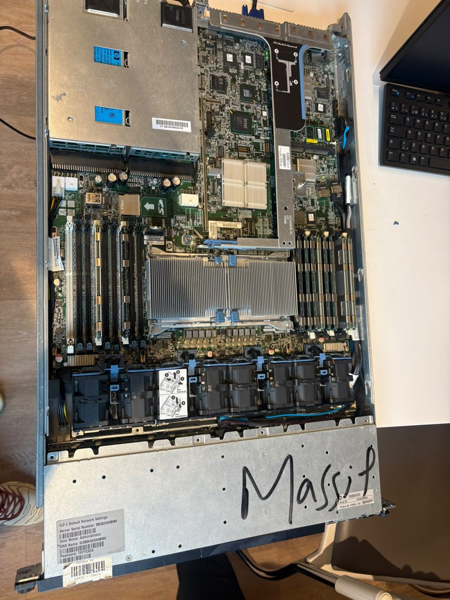 |

## 2️⃣ Démarrage et vérification du BIOS

Au démarrage, le POST confirme le matériel :

- **2 processeurs détectés, 8 cœurs au total**, Hyper-Threading activé
- 2 × **Intel Xeon E5540 @ 2.53GHz**
- **64 GB Installed**

Comme la mémoire avait été déplacée, le BIOS a lancé un **test mémoire** automatique (*Memory configuration change – memory test invoked*). Résultat : **65536MB OK / 65536MB Available / 65536MB Configured**.

| POST du BIOS | Diagnostic de la mémoire |
| --- | --- |
| 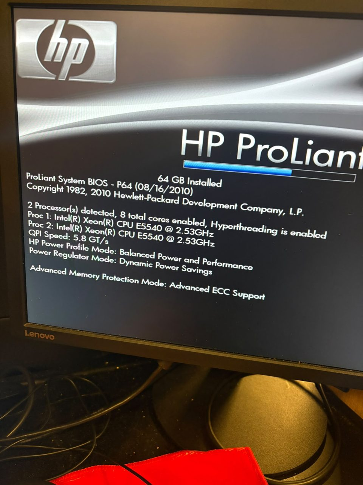 | 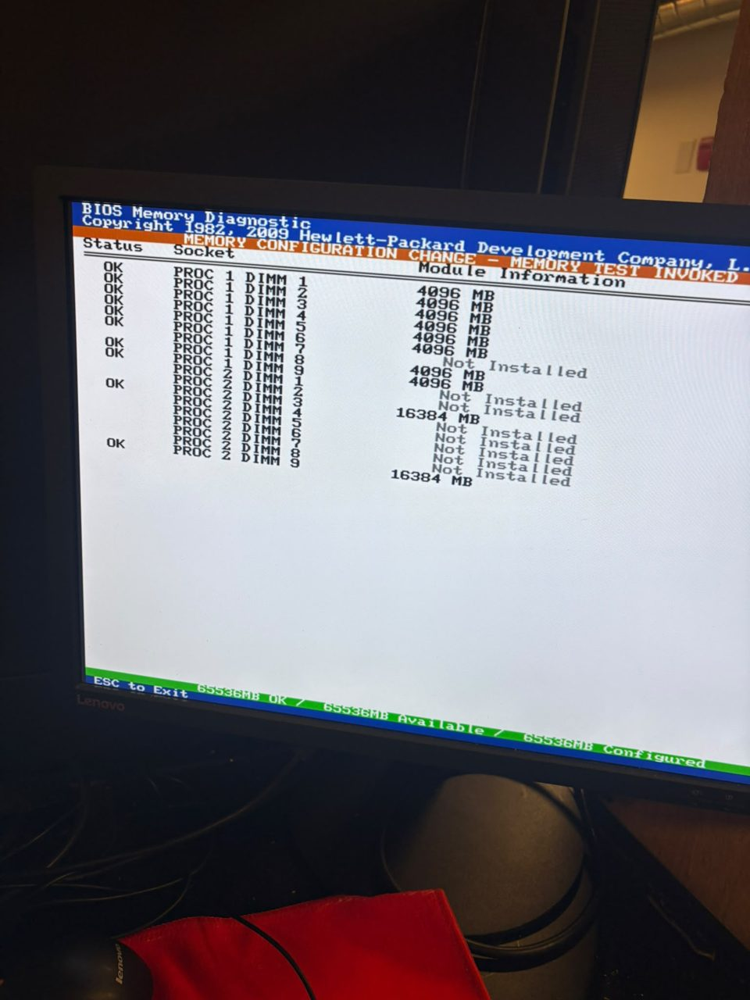 |

## 3️⃣ Configuration du stockage (Smart Array P410i)

Dans l'utilitaire **Option ROM Configuration for Arrays** du contrôleur **HP Smart Array P410i**, j'ai créé le volume logique qui sert de disque système. Le message **« Configuration saved »** confirme l'enregistrement.

| Volume enregistré | Calibration au démarrage |
| --- | --- |
| 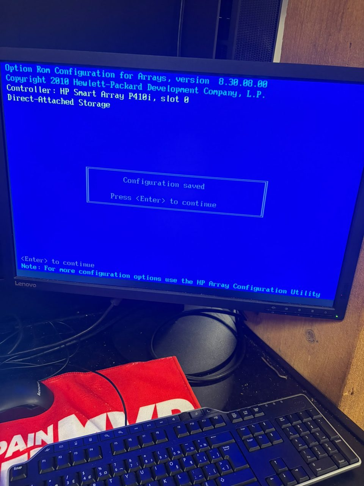 | 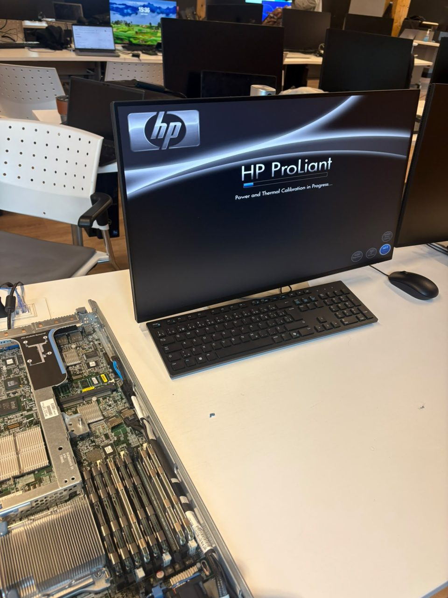 |

## 4️⃣ Démarrage de l'installateur Proxmox

Le serveur démarre ensuite sur le support d'installation de **Proxmox VE 9.2 (ISO release 1)**.

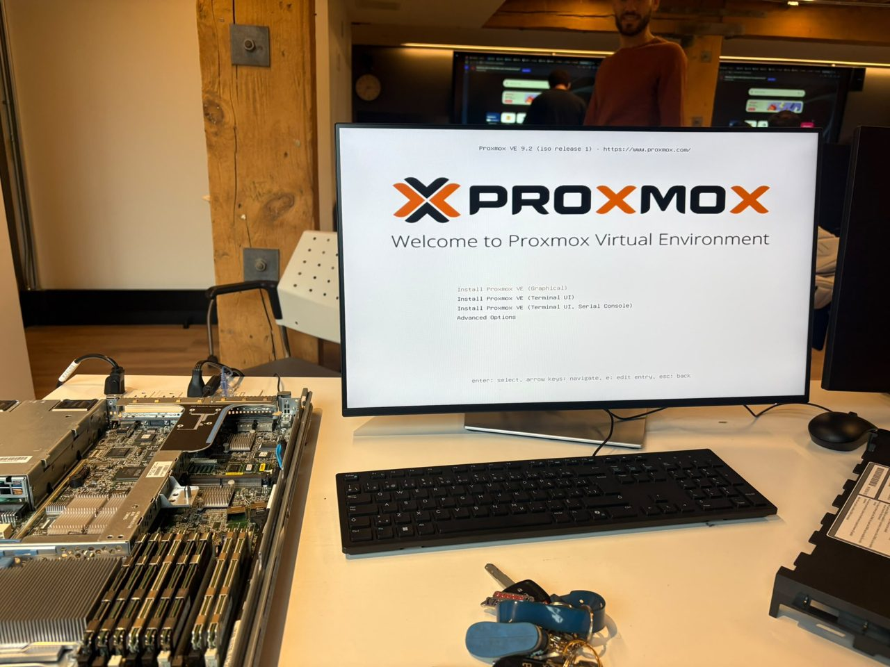

### ⚙️ Ajout de `nomodeset acpi=off`

Le DL360 G6 date de 2010 et le noyau de Proxmox est beaucoup plus récent. Pour éviter un écran noir ou un blocage, j'ai sélectionné une entrée et appuyé sur **`e`**. J'ai ajouté à la fin de la ligne `linux` :

```text
nomodeset acpi=off
```

Le démarrage se lance ensuite avec **Ctrl + X** (ou **F10**).

| Édition dans GRUB | Paramètres reçus par le noyau |
| --- | --- |
| 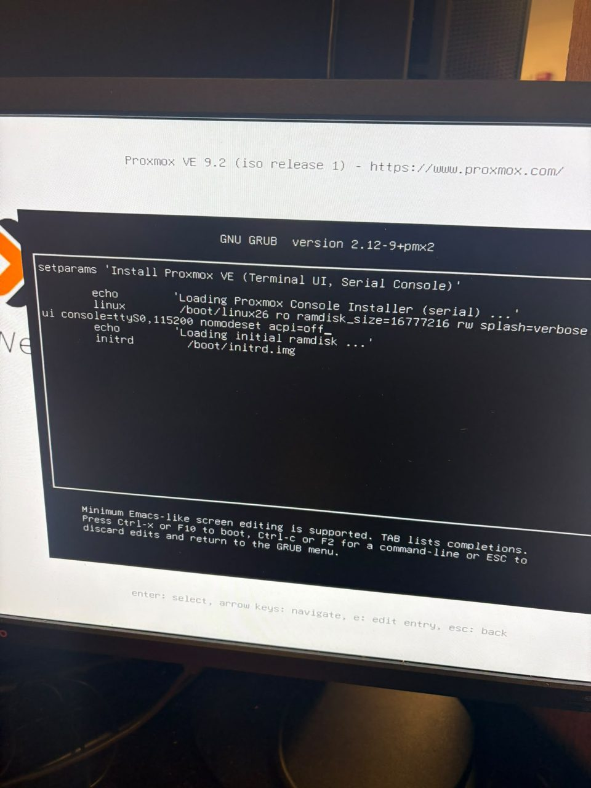 | 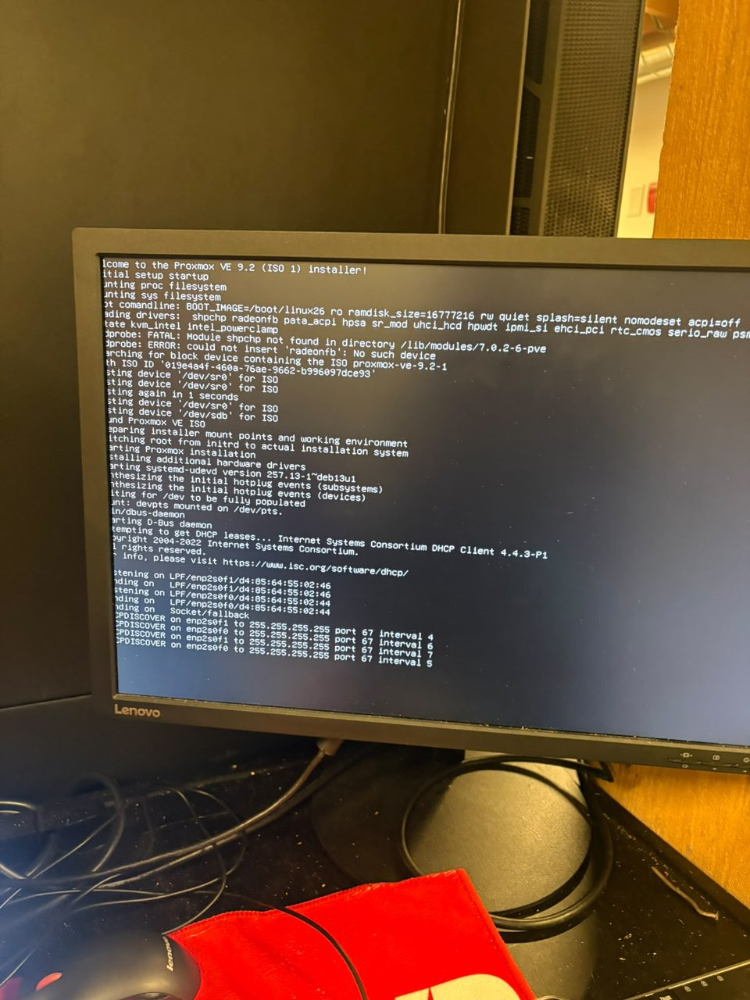 |

Le journal de l'installateur confirme les paramètres :

```text
Boot comandline: BOOT_IMAGE=/boot/linux26 ro ramdisk_size=16777216 rw quiet splash=silent nomodeset acpi=off
```

## 5️⃣ Messages observés pendant le chargement

| Message | Explication |
| --- | --- |
| `Module shpchp not found` | Module absent du noyau 7.0, sans conséquence. |
| `could not insert 'radeonfb': No such device` | Pilote vidéo Radeon non utilisé, normal avec `nomodeset`. |
| `found Proxmox VE ISO` | L'installateur a trouvé son support (`/dev/sdb`). |
| `No DHCPOFFERS received` | Aucun serveur DHCP n'a répondu : le réseau doit être saisi à la main. |
| `Starting the installer GUI` | L'interface graphique démarre correctement. |

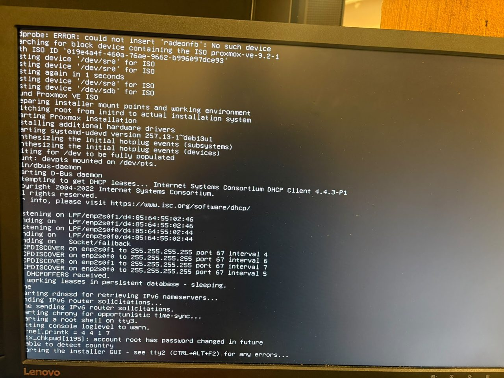

## 6️⃣ Configuration du réseau de gestion

Comme le DHCP ne répondait pas, j'ai rempli le réseau de gestion à la main :

| Champ | Valeur saisie |
| --- | --- |
| Management Interface | `nic0` · `d4:85:64:55:02:44` (bnx2) |
| Hostname (FQDN) | `ServerBMX.Labinfo.Local` |
| IP Address (CIDR) | `10.7.237.197/23` |
| Gateway | `10.7.237.1` |
| DNS Server | `8.8.8.8` |

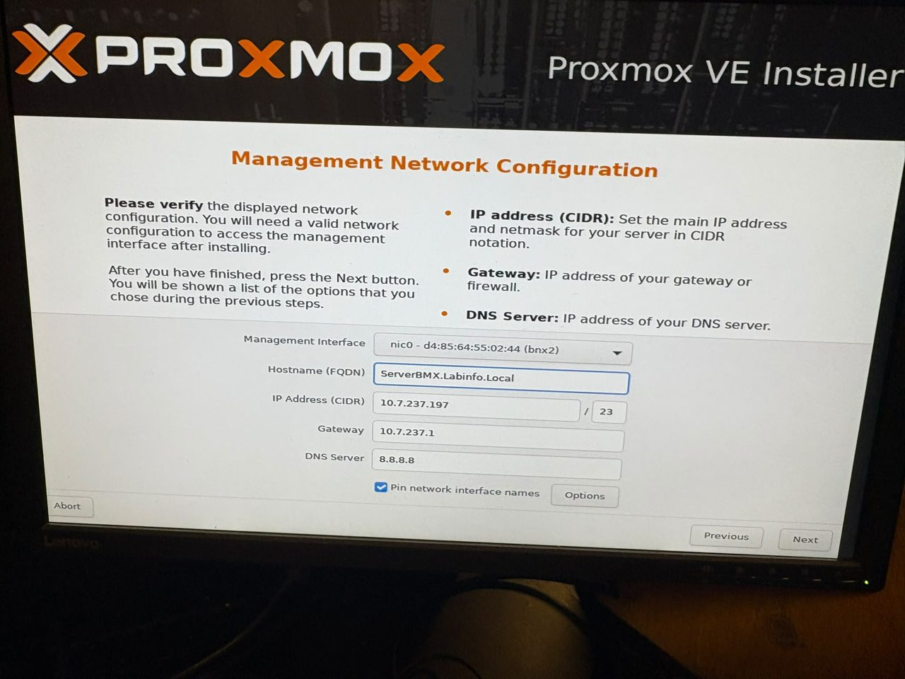

> Le masque `/23` couvre `10.7.236.0` à `10.7.237.255`, donc la passerelle `10.7.237.1` est dans le même réseau. Le serveur en service répond aujourd'hui à **`10.7.236.197`** sous le nom **`server197`** (section 7).

## 7️⃣ Vérification : le serveur Proxmox fonctionne

Depuis Windows PowerShell, la connexion SSH au serveur fonctionne :

```powershell
ssh root@10.7.236.197
```

Le serveur répond avec le noyau Proxmox **`7.0.2-6-pve`**. La commande `qm list` montre les machines virtuelles du serveur, dont ma VM `126 B300141685`.

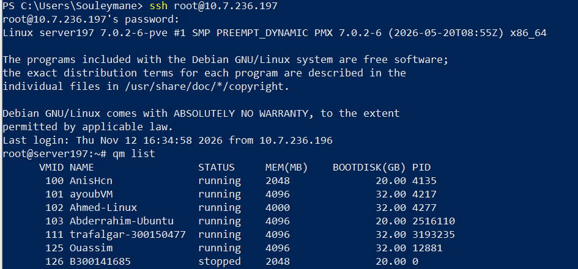

Commandes de vérification du cours, à lancer dans la console du serveur :

```bash
cat /proc/cmdline   # doit contenir nomodeset acpi=off
lscpu               # 2 sockets, 4 cœurs par socket
nproc               # nombre de processeurs logiques
lsmem               # mémoire détectée
lsblk               # disque système et volumes LVM
lspci               # contrôleurs (P410i, cartes réseau bnx2)
ip a                # adresse de gestion sur vmbr0
```

---

## ❓ Questions de réflexion

1. **À quoi sert `nomodeset` ?**
   Il empêche le noyau de charger les pilotes graphiques avancés (KMS). Linux garde un mode vidéo simple, ce qui évite l'écran noir avec la vieille carte graphique du DL360 G6.

2. **Pourquoi un ancien BIOS peut-il nécessiter `acpi=off` ?**
   Le BIOS P64 de 2010 fournit des tables ACPI qu'un noyau récent peut mal lire. Cela peut provoquer des erreurs (`Illegal Opcode`, `NMI PCI Error`) ou bloquer le démarrage. `acpi=off` fait ignorer ces tables.

3. **Quelle est la différence entre ACPI et APIC ?**
   **ACPI** sert au BIOS à décrire le matériel au système (énergie, processeurs, ressources PCI). **APIC** est le contrôleur qui répartit les **interruptions** entre les processeurs.

4. **Pourquoi `nolapic` peut-il réduire le nombre de processeurs visibles ?**
   Chaque processeur a son APIC local (LAPIC). Sans lui, Linux ne peut pas réveiller les autres cœurs : il affiche `smpboot: SMP disabled` et n'utilise qu'un seul processeur.

5. **Quelle commande montre les paramètres réellement utilisés au démarrage ?**
   `cat /proc/cmdline`

## ✅ Conclusion

Proxmox VE 9.2 est installé et stable sur le DL360 G6 grâce aux paramètres `nomodeset acpi=off`. Le BIOS détecte les 2 Xeon E5540 (8 cœurs) et les 64 Go de RAM. Le serveur est joignable en SSH et par l'interface web à `10.7.236.197`, et il héberge déjà plusieurs machines virtuelles, dont la mienne.
