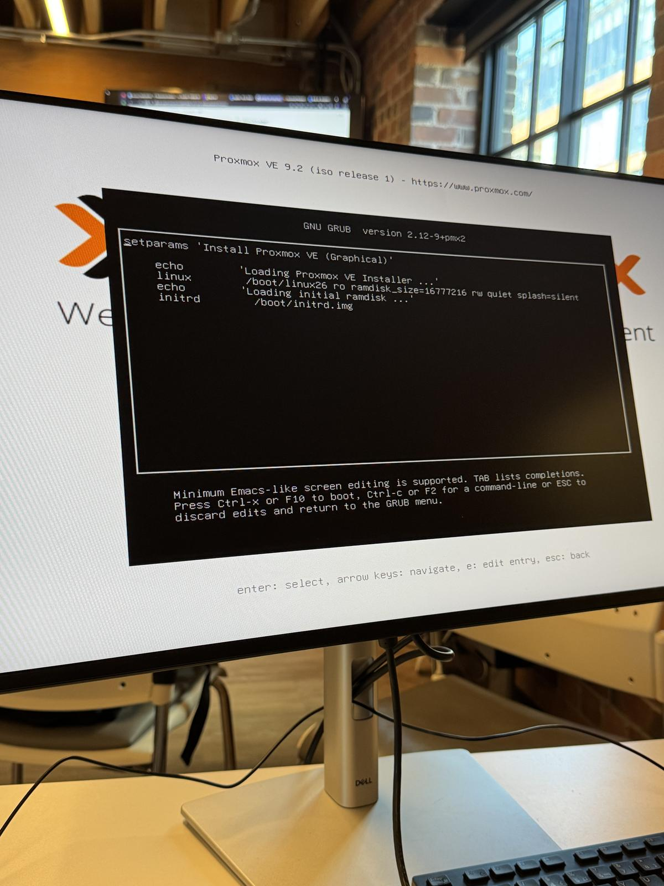
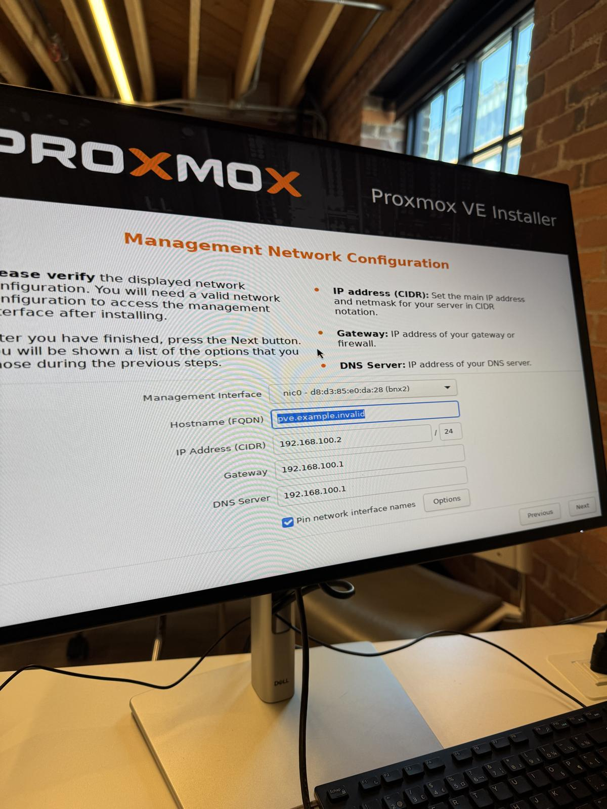
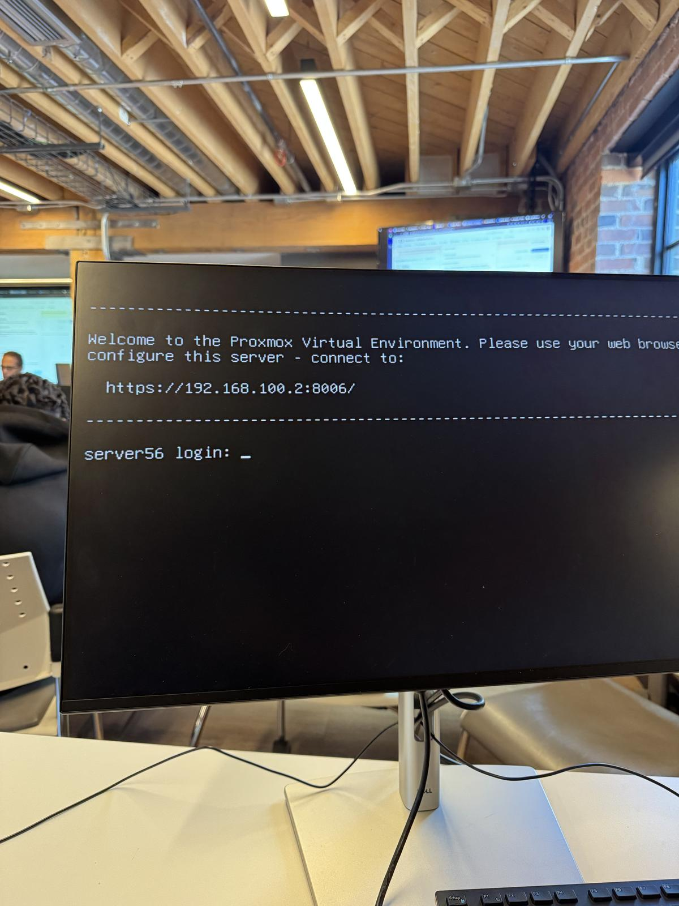
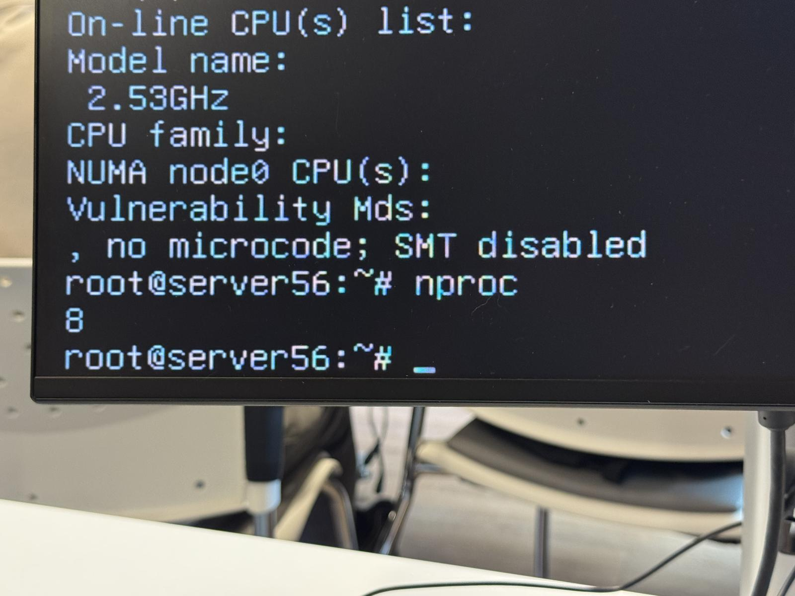
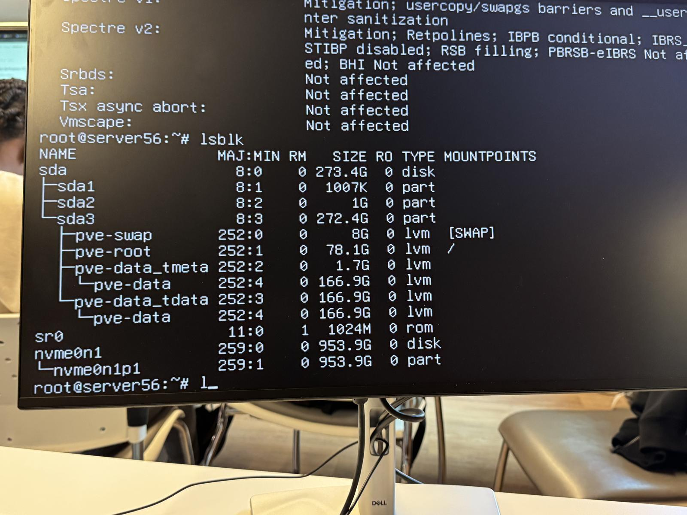
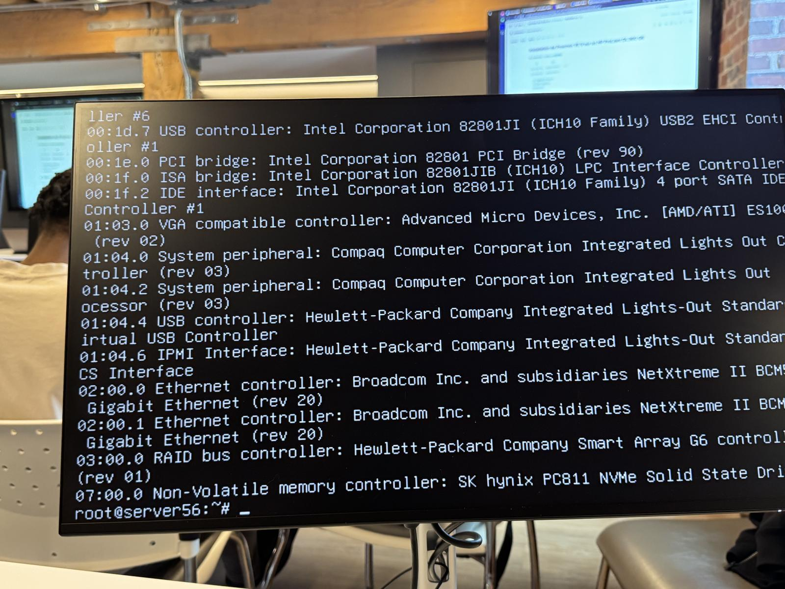

# Installation et vérification de Proxmox VE

**Anis Benabbas · 300150477 · Groupe 1**  
INF1085 — Administration Linux · Collège Boréal

Le laboratoire porte sur l’installation de Proxmox VE 9 sur un HP ProLiant DL360 G6. Les photos du groupe illustrent le démarrage de l’installateur, la configuration du réseau et les vérifications en console.

## 1. Démarrer l’installateur

Sous Windows, Rufus permet de préparer une clé USB à partir de l’image ISO de Proxmox. Sur le serveur, la touche **F11** ouvre le menu de démarrage pour sélectionner la clé. Dans le menu Proxmox, la touche **e** permet de modifier les options du noyau pour ce démarrage.

| Menu d’installation | Édition de l’entrée de démarrage |
| --- | --- |
|  |  |

Le cours utilise `nomodeset acpi=off` pour tester la compatibilité de ce serveur avec le noyau Linux. Après le redémarrage, la commande `cat /proc/cmdline` permet de lire les options effectivement utilisées.

## 2. Configurer le disque et le réseau de gestion

L’assistant demande de choisir le disque système, la disposition du clavier, le compte d’administration et les paramètres réseau. L’adresse de gestion doit appartenir au réseau du serveur. Après l’installation, la console affiche l’adresse HTTPS à ouvrir depuis un poste qui peut joindre ce réseau, sur le port **8006**.

| Configuration du réseau | Premier démarrage sur le disque |
| --- | --- |
|  |  |

## 3. Vérifier le matériel depuis la console

| Commande | Résultat à examiner |
| --- | --- |
| `lscpu` et `nproc` | Identifier le processeur et compter les processeurs logiques disponibles. Sur la photo, `nproc` renvoie **8**. |
| `lsmem` | Relever la mémoire en ligne détectée par Linux. |
| `lsblk` | Repérer le disque système, ses partitions et le volume logique monté sur `/`. |
| `lspci` | Identifier les contrôleurs de stockage et les interfaces réseau. |
| `ip a` | Comparer l’adresse de gestion active avec celle configurée dans l’assistant. |

| Processeurs disponibles | Disques et volumes | Périphériques PCI |
| --- | --- | --- |
|  |  |  |

## 4. Questions de réflexion

1. **À quoi sert `nomodeset` ?** Il désactive le réglage du mode vidéo par le noyau. Cela peut permettre à l’installateur de garder un affichage utilisable sur ce serveur.
2. **Pourquoi tester `acpi=off` ?** Un ancien BIOS peut fournir des tables ACPI que le noyau interprète mal. Désactiver ACPI au démarrage permet de vérifier si elles contribuent au blocage.
3. **Quelle différence entre ACPI et APIC ?** ACPI décrit le matériel et participe à la gestion de l’énergie. APIC distribue les interruptions aux processeurs.
4. **Pourquoi `nolapic` peut-il limiter les CPU visibles ?** La désactivation de l’APIC local peut empêcher Linux d’activer les processeurs logiques supplémentaires. La liste des CPU actifs se lit dans `/sys/devices/system/cpu/online`.
5. **Comment vérifier les paramètres du démarrage en cours ?** La commande `cat /proc/cmdline` affiche la ligne de commande reçue par le noyau.
