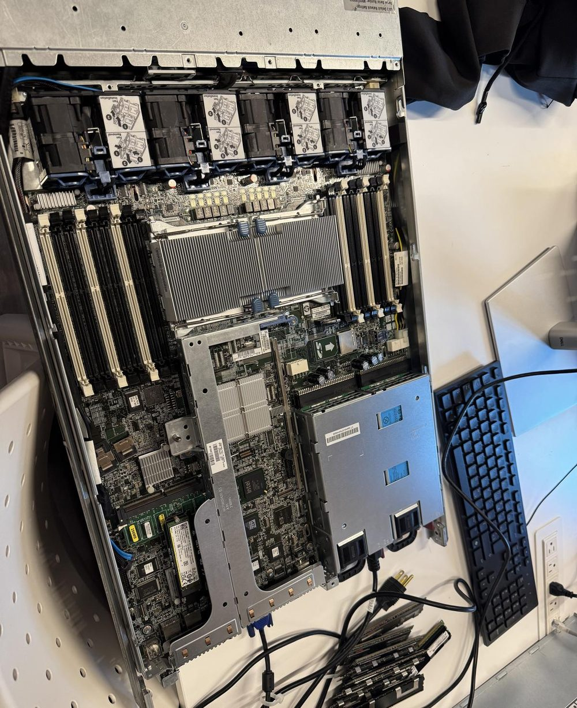
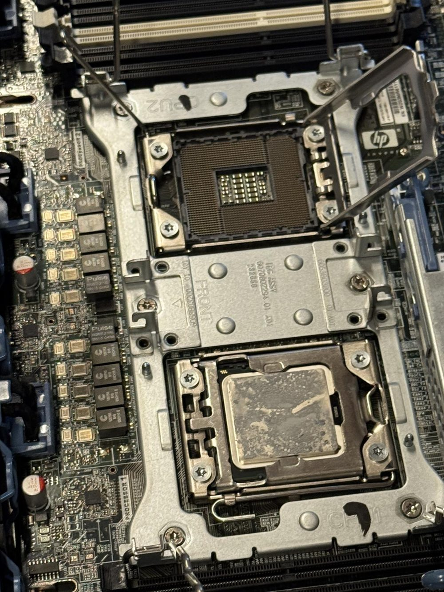
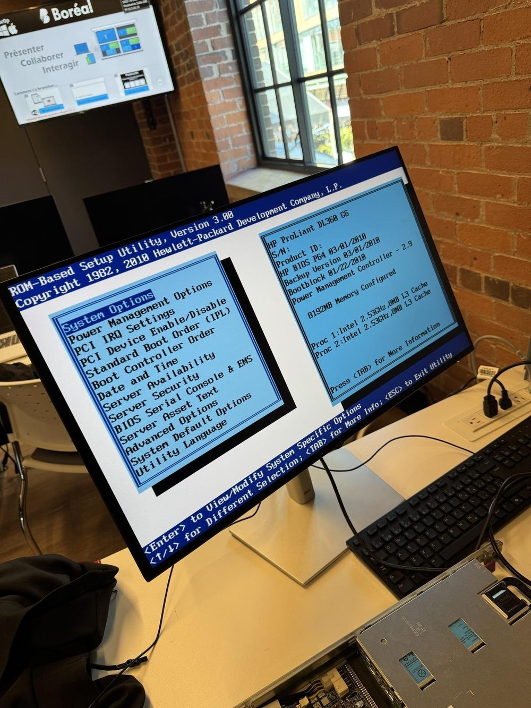
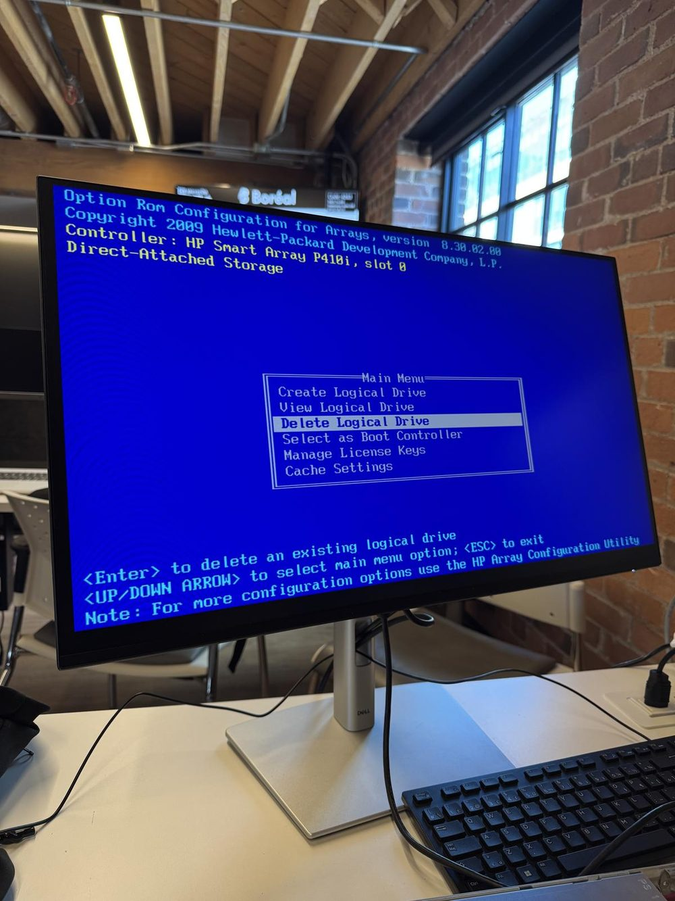
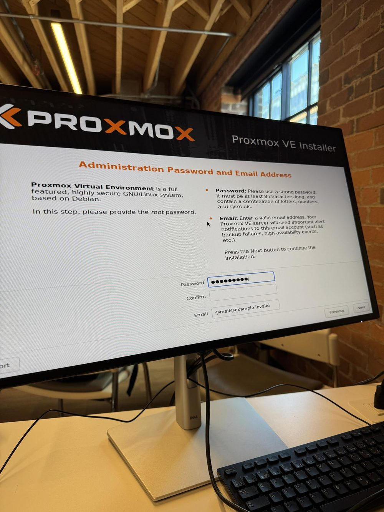
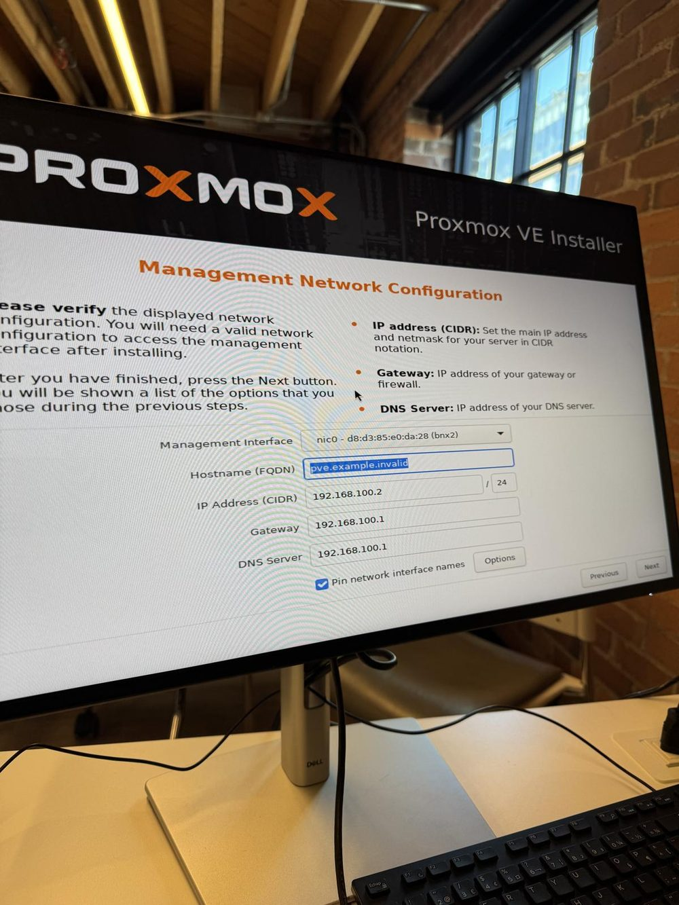
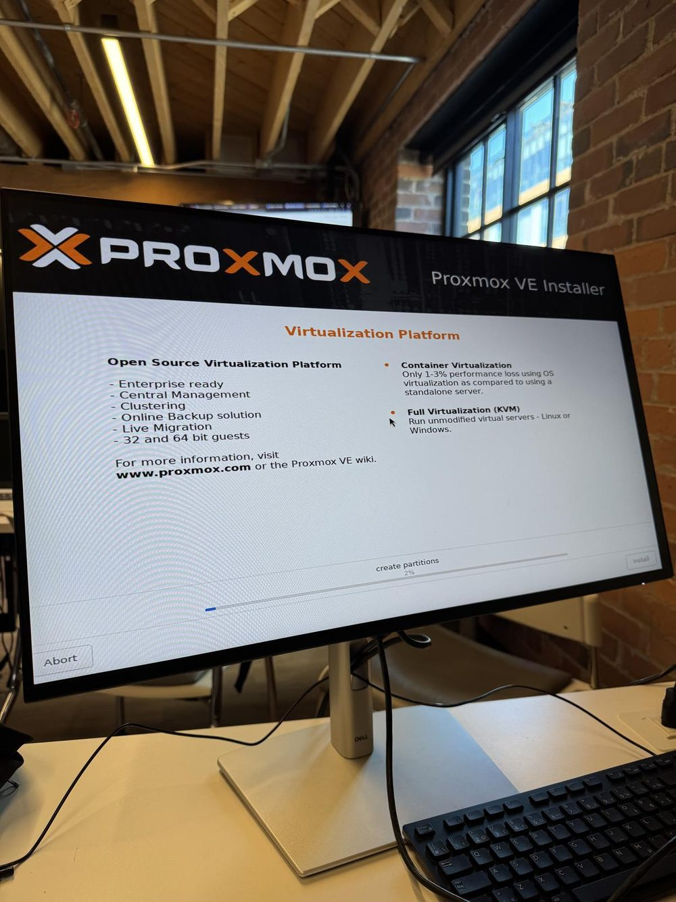
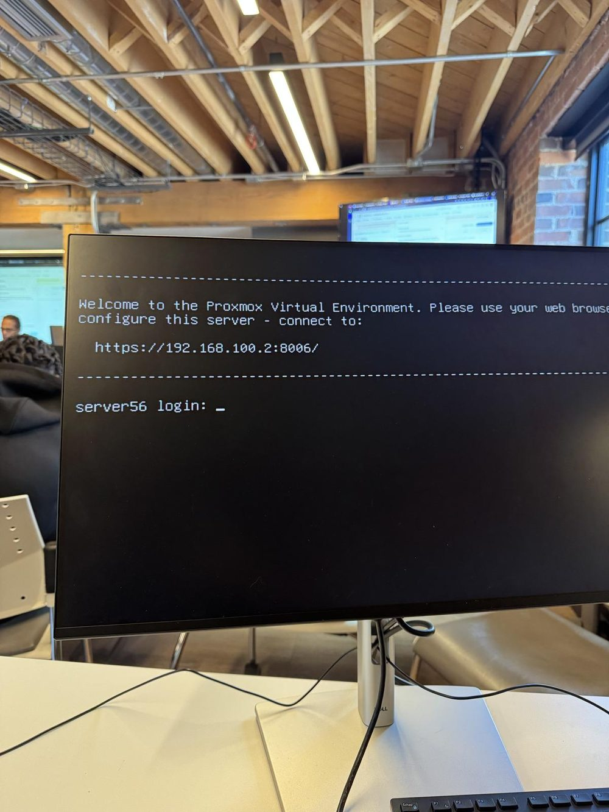
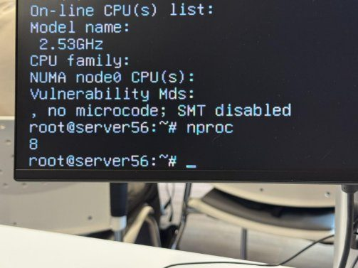

# Compte-rendu d'installation — Proxmox VE 8.2 sur HP ProLiant DL360 G6

**Étudiant :** Anis Ouhocine (matricule 300151496)
**Cours :** Diagnostic Linux (INF1085)
**Date du compte-rendu :** 22 octobre 2026
**Serveur :** HP ProLiant DL360 G6 — nom d'hôte `server56`
**Système installé :** Proxmox VE 8.2

---

## 1. Objectif

Installer l'hyperviseur **Proxmox VE 8.2** sur un serveur physique rack **HP ProLiant DL360 G6**, en partant du matériel nu : diagnostic et inspection des composants internes, configuration du BIOS, configuration du contrôleur RAID, installation du système depuis une clé USB bootable, puis vérification du bon fonctionnement (processeurs détectés, accès à l'interface d'administration).

## 2. Matériel et environnement de travail

| Composant | Détail |
| --- | --- |
| Serveur | HP ProLiant DL360 G6 (rack 1U) |
| Processeurs | 2× Intel Xeon à 2,53 GHz, 8 Mo de cache L3 chacun |
| Mémoire vive | 48 Go au total (voir la remarque ci-dessous) |
| Contrôleur RAID | HP Smart Array P410i (slot 0) |
| Interface réseau de gestion | Broadcom (pilote bnx2), adresse MAC `d8:d3:85:e0:da:28` |
| Support d'installation | Clé USB SanDisk bootable créée avec **Rufus**, contenant l'image ISO de Proxmox VE 8.2 |
| Poste de travail | Écran, clavier et souris branchés directement sur le serveur |

> **Remarque sur la mémoire :** pendant le diagnostic matériel (étape 1), les barrettes de RAM ont été retirées du serveur pour inspection. Au moment de la capture du BIOS (étape 2), seuls **8192 Mo** étaient donc « configurés ». La capacité totale de la machine est de 48 Go.

## 3. Étape 1 — Diagnostic et inspection du matériel

**Action :** ouverture du capot supérieur du serveur et inspection visuelle des composants internes.

**Éléments observés :**

- La rangée des **6 modules de ventilation** en façade de la carte mère.
- Le grand dissipateur thermique du processeur et les **emplacements mémoire (DIMM)** de part et d'autre.
- Les **barrettes de RAM retirées** et déposées sur la table (en bas à droite de la photo) pour le diagnostic.
- Le module d'alimentation et la carte contrôleur.



**Gros plan sur les sockets des processeurs :** le socket **CPU1** contient un processeur (on distingue les restes de l'ancienne pâte thermique sur son capot métallique), tandis que le socket **CPU2** est ouvert et vide, ce qui permet d'observer la grille de contacts du socket LGA. Cette inspection confirme la plateforme double processeur de la machine.



## 4. Étape 2 — Configuration du BIOS (HP RBSU)

**Action :** démarrage du serveur et accès à l'utilitaire **ROM-Based Setup Utility (RBSU), version 3.00** (BIOS HP P64 du 01/03/2010).

**Informations relevées sur l'écran du BIOS :**

- Produit : **HP ProLiant DL360 G6**
- Proc 1 : Intel 2,53 GHz, 8 Mo de cache L3
- Proc 2 : Intel 2,53 GHz, 8 Mo de cache L3
- Mémoire configurée : **8192 Mo** (barrettes retirées, voir la remarque de la section 2)

**Objectif de la configuration :** dans le menu **Standard Boot Order (IPL)**, placer la **clé USB en première position** dans l'ordre de démarrage, afin que le serveur amorce sur le support d'installation de Proxmox VE au redémarrage.



## 5. Étape 3 — Configuration du contrôleur RAID (ORCA)

**Action :** pendant la séquence de démarrage (POST), accès à l'utilitaire **ORCA (Option ROM Configuration for Arrays), version 8.30.02.00**, du contrôleur **HP Smart Array P410i (slot 0)**.

**Opérations effectuées :** à partir du menu principal (Create Logical Drive / View Logical Drive / Delete Logical Drive), l'ancienne unité logique a été **supprimée**, puis une **nouvelle unité logique** a été créée sur les disques physiques, afin de repartir d'une base propre avant l'installation de Proxmox VE. L'unité logique créée est ensuite présentée au programme d'installation comme le disque cible.



## 6. Étape 4 — Amorçage de l'ISO et lancement de l'assistant

**Action :** redémarrage du serveur sur la clé USB SanDisk (première dans l'ordre de démarrage configuré à l'étape 2).

**Résultat :**

1. Affichage du menu d'accueil du programme d'installation **Proxmox VE** et sélection du mode **« Install Proxmox VE (Graphical) »**.
2. Séquence d'amorçage du gestionnaire **GRUB (v2.12)** : chargement en mémoire RAM du noyau Linux et du système de fichiers initial (`initrd.img`), nécessaires au lancement de l'assistant d'installation graphique.


## 7. Étape 5 — Assistant d'installation Proxmox VE

L'assistant graphique **Proxmox VE Installer** guide l'installation en plusieurs écrans :

1. **Disque cible et partitionnement :** sélection de l'unité logique créée à l'étape 3 ; le partitionnement est préparé par l'assistant (voir l'étape 6 pour la progression).
2. **Localisation :** pays, fuseau horaire et disposition du clavier.
3. **Mot de passe d'administration et courriel :** définition du mot de passe du compte **root** (minimum 8 caractères, avec lettres, chiffres et symboles) et de l'adresse courriel qui recevra les alertes du serveur (échecs de sauvegarde, événements de haute disponibilité, etc.).



4. **Configuration du réseau de gestion** — valeurs saisies :

| Paramètre | Valeur |
| --- | --- |
| Interface de gestion | `nic0` — d8:d3:85:e0:da:28 (bnx2) |
| Nom d'hôte (FQDN) | `server56` |
| Adresse IP (CIDR) | `192.168.100.2/24` |
| Passerelle (Gateway) | `192.168.100.1` |
| Serveur DNS | `192.168.100.1` |
| Option | « Pin network interface names » cochée |



## 8. Étape 6 — Installation du système

**Action :** validation du résumé et lancement de l'installation avec le bouton **Install**.

**Résultat :** l'assistant formate le disque et copie les fichiers du système. La barre de progression montre le début du processus, à l'étape de **création des partitions** (« create partitions », 2 %). L'écran rappelle les deux modes de virtualisation offerts par la plateforme : la virtualisation complète **KVM** (machines virtuelles Linux ou Windows non modifiées) et la virtualisation par **conteneurs** (perte de performance de seulement 1 à 3 % par rapport à un serveur autonome).



## 9. Étape 7 — Premier démarrage

**Action :** à la fin de l'installation, **retrait de la clé USB** et redémarrage du serveur sur son disque (unité logique du P410i).

**Résultat :** Proxmox VE démarre correctement. La console affiche le message d'accueil du système avec l'adresse de l'interface web d'administration, ainsi que l'invite de connexion locale :

```text
Welcome to the Proxmox Virtual Environment. Please use your web browser to
configure this server - connect to:

        https://192.168.100.2:8006/

server56 login:
```



## 10. Vérifications

Après l'installation, les contrôles suivants confirment que le système est fonctionnel :

1. **Connexion locale** à la console avec le compte `root` sur l'hôte `server56` : réussie (invite `root@server56:~#`).
2. **Processeurs détectés par le système** — commande `lscpu` (extrait visible sur la capture) :
   - `Model name : ... 2.53GHz`
   - `CPU family : 6`
   - `NUMA node0 CPU(s) : ...`
   - `Vulnerability Mds : ... no microcode; SMT disabled`
3. **Nombre de processeurs logiques** — commande `nproc` : **8**, soit les 2 sockets × 4 cœurs, conformément aux deux Xeon détectés dans le BIOS.
4. **Interface d'administration web** : le système annonce lui-même l'adresse `https://192.168.100.2:8006/`, accessible avec le compte `root` et le mot de passe défini à l'étape 5.



## 11. Conclusion

L'installation de **Proxmox VE 8.2** sur le serveur physique **HP ProLiant DL360 G6** est terminée et vérifiée : diagnostic matériel effectué (processeurs, mémoire, ventilation), BIOS configuré pour démarrer sur la clé USB, unité logique recréée sur le contrôleur RAID Smart Array P410i, système installé avec une adresse de gestion fixe (`192.168.100.2/24`), et contrôles finaux concluants (`nproc` = 8, invite de connexion `server56`, interface web annoncée sur le port 8006). Le serveur est prêt à héberger des machines virtuelles (KVM) et des conteneurs (LXC).

## Annexe — Récapitulatif des paramètres

| Paramètre | Valeur |
| --- | --- |
| Serveur | HP ProLiant DL360 G6 |
| Système | Proxmox VE 8.2 (installateur graphique, GRUB 2.12) |
| Nom d'hôte | `server56` |
| Compte d'administration | `root` |
| Interface web | `https://192.168.100.2:8006/` |
| Adresse IP de gestion | `192.168.100.2/24` |
| Passerelle / DNS | `192.168.100.1` |
| Contrôleur RAID | HP Smart Array P410i (ORCA 8.30.02.00) |
| Processeurs | 2× Intel Xeon 2,53 GHz (8 cœurs au total, `nproc` = 8) |
| Mémoire | 48 Go (8192 Mo configurés pendant le diagnostic, barrettes retirées) |
