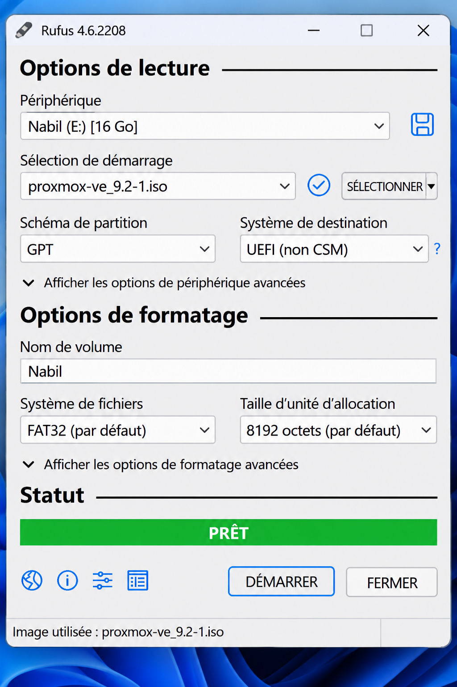
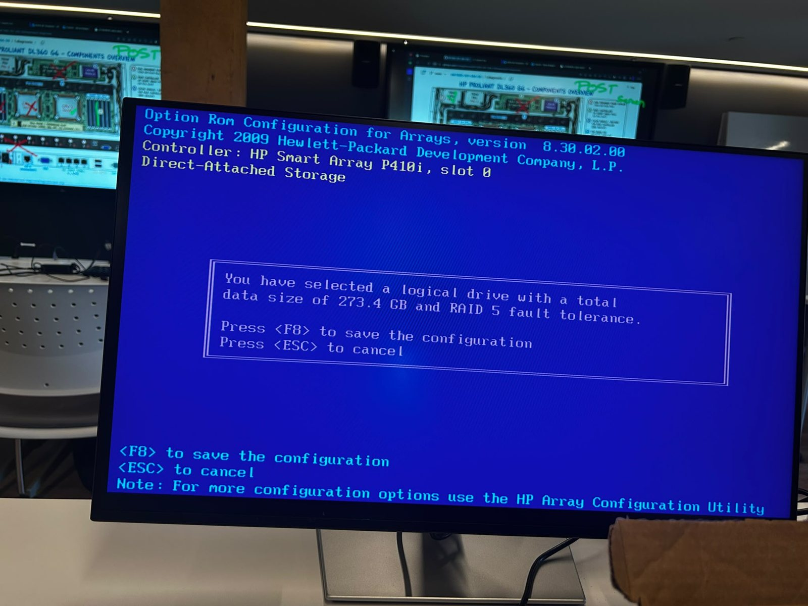
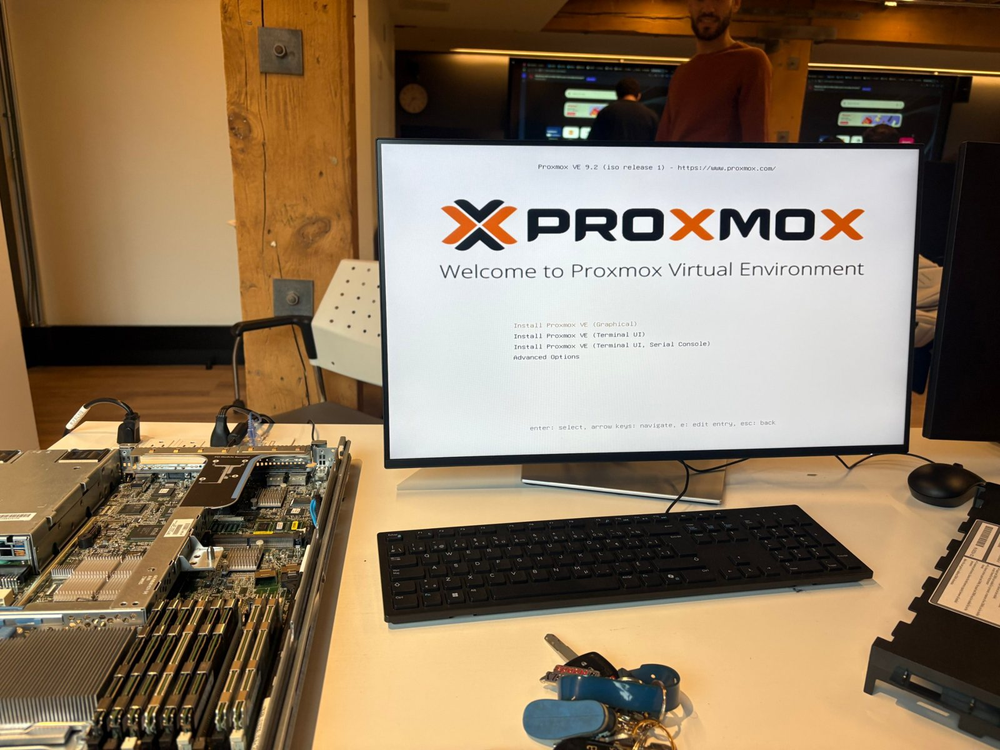
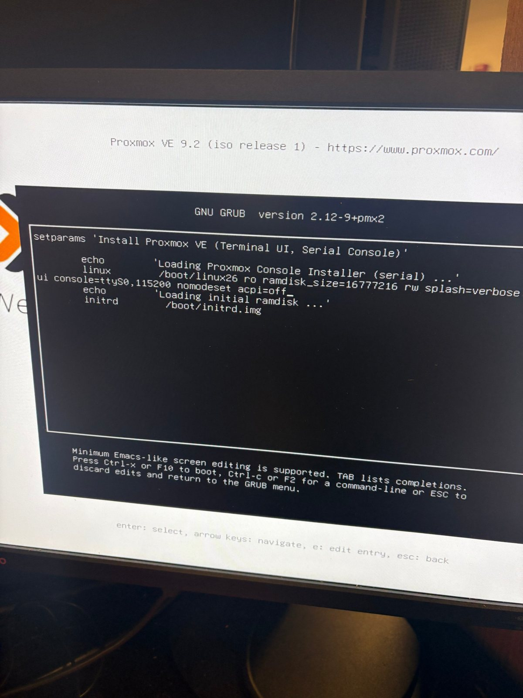
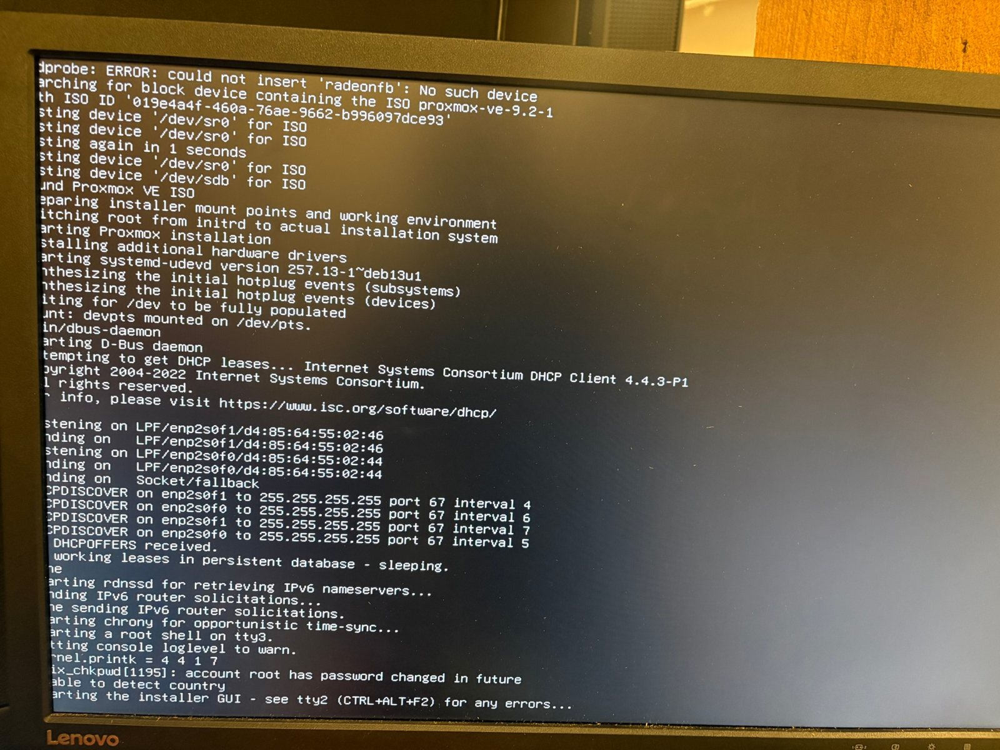
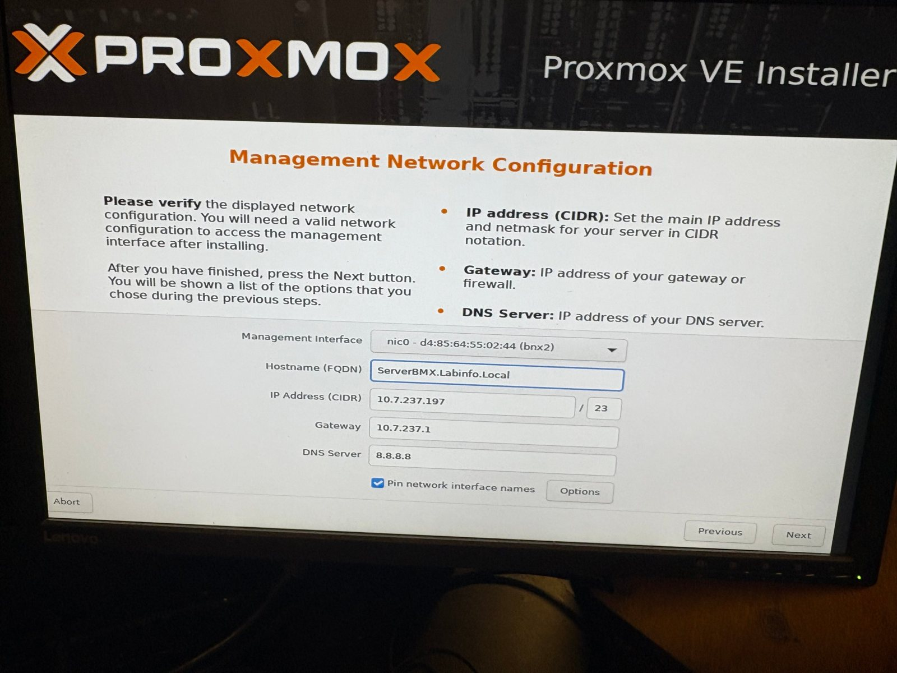
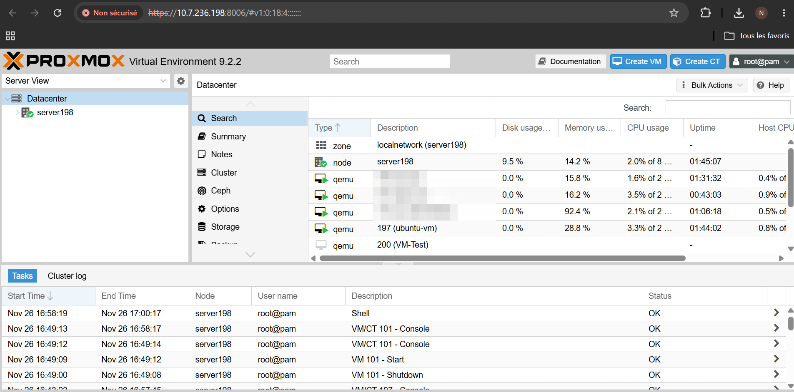

# 🖥️ Installation de Proxmox VE

**Étape 2 · Proxmox · Administration Linux**

| | |
|---|---|
| **Nom** | Nabil Hafsi |
| **ID** | `300151732` |
| **Courriel** | 300151732@monboreal.ca |
| **Dépôt** | `INF1085-201-26A-05` |

---

## 1. 💾 Préparation de la clé USB

Création d'une clé USB bootable avec **Rufus** à partir de l'image `proxmox-ve_9.2-1.iso`.

  

---

## 2. 💽 Configuration des disques

Avant l'installation, le contrôleur **HP Smart Array P410i** est configuré : un volume logique en **RAID 5** de 273,4 Go est créé, puis la configuration est enregistrée avec `F8`.

  

---

## 3. 🔌 Démarrage sur l'ISO de Proxmox

Le serveur démarre sur la clé USB et affiche le menu d'installation de **Proxmox VE 9.2**.

  

---

## 4. ✏️ Paramètres de démarrage

Sur ce serveur ancien (HP ProLiant DL360 G6), la ligne de démarrage est modifiée avec la touche `e`, en ajoutant les paramètres **`nomodeset acpi=off`** à la fin de la ligne du noyau. Le démarrage se lance ensuite avec `Ctrl + X` ou `F10`.

| Paramètre | Rôle |
|---|---|
| `nomodeset` | Utilise un mode vidéo minimal, car le contrôleur graphique du serveur est très ancien |
| `acpi=off` | Désactive ACPI, dont les tables fournies par l'ancien BIOS sont incompatibles avec les noyaux récents |

  

---

## 5. 📜 Démarrage de l'installateur

Le journal de démarrage montre que l'installateur trouve l'image ISO, charge les pilotes, détecte les deux cartes réseau, obtient une offre DHCP, puis lance l'interface d'installation.

  

---

## 6. 🌐 Configuration du réseau

L'installateur demande l'interface de gestion, le nom d'hôte (FQDN), l'adresse IP avec son masque, la passerelle et le serveur DNS.

  

---

## 7. ✅ Interface web de Proxmox

Une fois l'installation terminée, l'interface web est accessible dans un navigateur à l'adresse `https://10.7.236.198:8006` (version **Proxmox VE 9.2.2**, nœud `server198`). Le message « Non sécurisé » du navigateur est normal : Proxmox utilise un certificat auto-signé.

  

---

  Réalisé par <b>Nabil Hafsi</b> · ID <code>300151732</code> · Administration Linux

