# 🖥️ Installation de Proxmox VE 9 sur un HP ProLiant DL360 G6

**Allouti Lounes**  
**Matricule :** 300151781  
**Programme :** TSIQ – Techniques des systèmes informatiques  
:octocat: [lounesallouti](https://github.com/lounesallouti) — INF1085 Administration Linux, Automne 2026

---

## :bookmark_tabs: Table des matières

- [🎯 Objectif du laboratoire](#-objectif-du-laboratoire)
- [🔧 Partie 1 — Préparation du serveur](#-partie-1--préparation-du-serveur)
- [🚀 Partie 2 — Installation de Proxmox VE 9](#-partie-2--installation-de-proxmox-ve-9)
- [⚠️ Partie 3 — Problème rencontré et solution](#️-partie-3--problème-rencontré-et-solution)
- [🌐 Partie 4 — Configuration et test du réseau](#-partie-4--configuration-et-test-du-réseau)
- [🔍 Partie 5 — Vérification du système](#-partie-5--vérification-du-système)
- [📋 Résumé](#-résumé)
- [💡 Ce que j'ai appris](#-ce-que-jai-appris)

---

## 🎯 Objectif du laboratoire

Installer **Proxmox VE 9** sur un serveur **HP ProLiant DL360 G6**. Ce serveur date de 2009-2010 :
son matériel est beaucoup plus ancien que le noyau Linux utilisé par Proxmox. Il faut donc utiliser
des paramètres de démarrage particuliers, puis vérifier que les processeurs, la mémoire, le stockage
et le réseau sont bien détectés.

---

## 🔧 Partie 1 — Préparation du serveur

### 🔌 Étape 1 — Démarrage du serveur

À la mise sous tension, le serveur fait sa **calibration de l'alimentation et de la température**
(*Power and Thermal Calibration in Progress*).

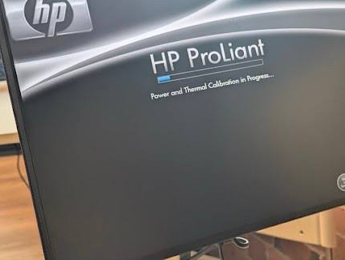

Ensuite, l'écran **POST** affiche la version du BIOS, les 2 processeurs Intel Xeon détectés
et la quantité de mémoire installée.

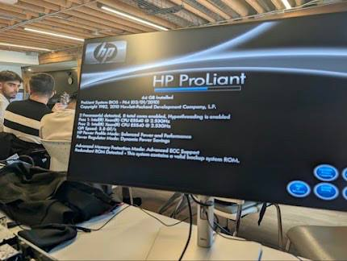

---

### 🧠 Étape 2 — Test de la mémoire

Le serveur teste chaque barrette de mémoire. L'écran indique, pour chaque processeur
(**PROC 1** et **PROC 2**), quels emplacements **DIMM** contiennent une barrette de **4096 MB**
et lesquels sont vides (*Not Installed*).

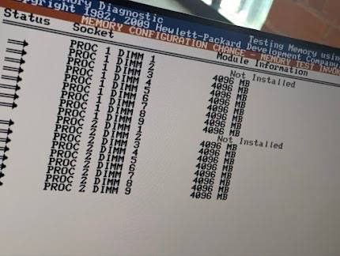

---

### 💿 Étape 3 — Préparation de la clé USB

Création d'une clé USB bootable avec l'image `proxmox-ve_9.2-1.iso` à l'aide de **Rufus** sous Windows.

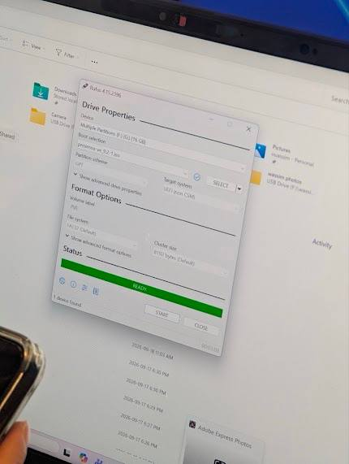

---

## 🚀 Partie 2 — Installation de Proxmox VE 9

### ⚙️ Étape 4 — Paramètres de compatibilité

Dans le menu de démarrage de l'installateur, on modifie la ligne de démarrage (touche `e`)
pour ajouter les paramètres suivants :

```text
nomodeset acpi=off
```

| Paramètre | Rôle | Pourquoi sur le DL360 G6 ? |
|---|---|---|
| `nomodeset` | Empêche le noyau de changer le mode graphique au démarrage | Évite l'écran noir avec la vieille carte graphique du serveur |
| `acpi=off` | Désactive les tables ACPI du BIOS | Le BIOS de 2010 a des tables ACPI incompatibles avec le noyau récent (blocages, erreurs) |

---

### 💽 Étape 5 — Paramètres de l'installateur

1. Accepter la licence
2. Choisir le disque cible : `/dev/sda` (le disque logique du contrôleur RAID)
3. Choisir le pays, le fuseau horaire et le clavier
4. Définir le mot de passe `root` et une adresse courriel
5. Configurer le réseau (voir la partie 4)

Les consignes du TP (adresses IP des serveurs, passerelle, DNS) sont sur la page GitHub du cours :

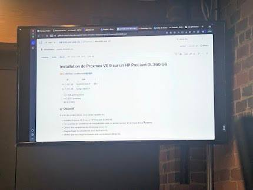

---

## ⚠️ Partie 3 — Problème rencontré et solution

### ❌ Étape 6 — Échec de l'installation

À la fin de la première tentative, l'installation a échoué :

> **`Installation failed! Proxmox VE could not be installed.`**  
> **`unable to initialize physical volume /dev/sda3`**

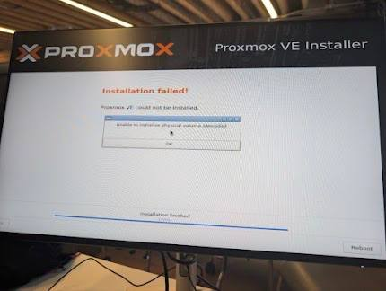

**Cause :** Proxmox utilise **LVM** et crée un volume physique sur la 3e partition (`/dev/sda3`).
L'ancien disque logique RAID contenait encore des données d'une installation précédente,
ce qui empêchait l'initialisation du volume.

---

### 🗑️ Étape 7 — Suppression de l'ancien volume RAID

On redémarre le serveur et on entre dans l'utilitaire du contrôleur **HP Smart Array P410i**
(touche `F8`, **ORCA**), puis on choisit **Delete Logical Drive**.

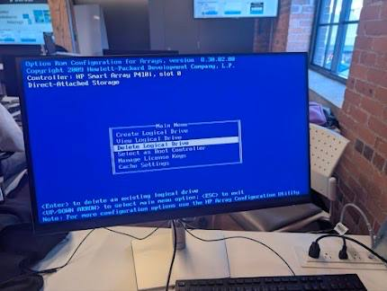

Un avertissement rouge confirme la suppression du disque logique **#1, RAID 5, 273.4 GB,
avec 3 disques physiques**. Toutes les données de ce volume sont effacées (touche `F3`).

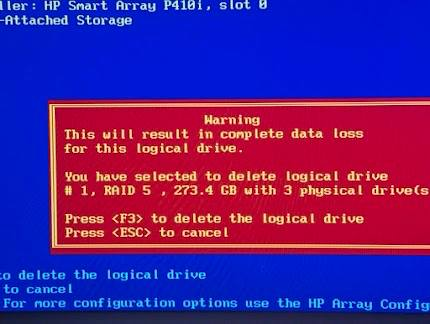

---

### ➕ Étape 8 — Création d'un nouveau volume RAID

Dans le menu principal, on choisit **Create Logical Drive** pour recréer un disque logique propre
avec les 3 disques.

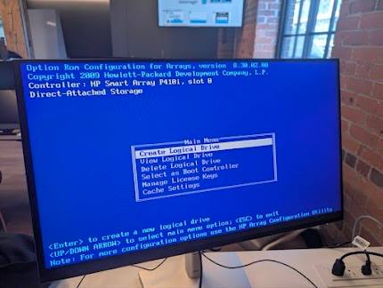

Le message **« Configuration saved »** confirme que le nouveau volume est créé.

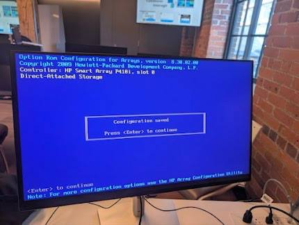

---

### ✅ Étape 9 — Installation réussie

On relance l'installation avec les mêmes paramètres. Cette fois, elle se termine correctement
et l'installateur demande de **retirer la clé USB** avant le redémarrage.

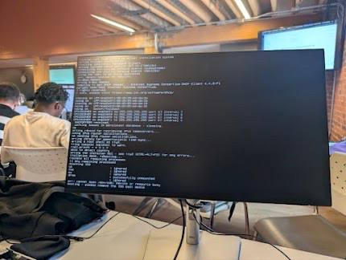

Au redémarrage, le serveur démarre sous Proxmox VE et affiche l'invite de connexion
`root@server56`.

---

## 🌐 Partie 4 — Configuration et test du réseau

### 🔎 Étape 10 — Vérification de l'adresse IP

La commande `ip addr` montre que le pont réseau **`vmbr0`** avait encore l'adresse par défaut
`192.168.100.2/24`, qui ne correspond pas au réseau du laboratoire. On voit aussi les deux cartes
réseau du serveur, `nic0` et `nic1`.

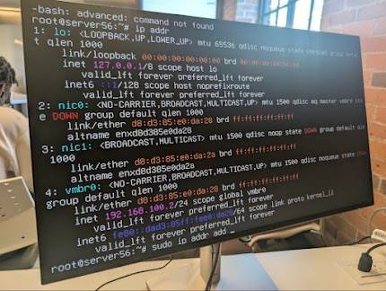

---

### ✏️ Étape 11 — Correction de l'adresse IP

Les commandes avec `sudo` renvoient **`command not found`** : sur Proxmox, on est déjà connecté
en `root` et `sudo` n'est pas installé. On retire donc `sudo` et on ajoute la bonne adresse :

```bash
ip addr add 10.7.237.28/23 dev vmbr0
```

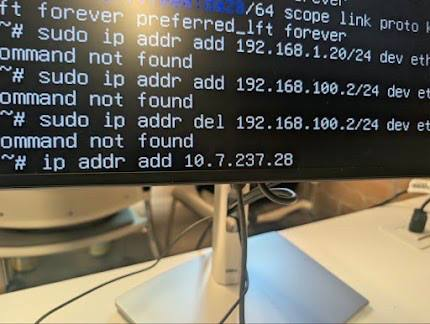

| Paramètre | Valeur |
|---|---|
| Adresse IP | `10.7.237.28/23` |
| Réseau | `10.7.236.0/23` |
| Passerelle | `10.7.237.1` |
| DNS | `8.8.8.8` |

Après la correction, `vmbr0` a bien l'adresse `10.7.237.28/23`.

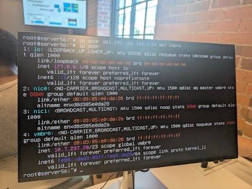

> :memo: La commande `ip addr add` est temporaire (perdue au redémarrage). Pour la rendre permanente,
> il faut modifier le fichier `/etc/network/interfaces`.

---

### 📶 Étape 12 — Test de connectivité

```bash
ping 10.7.237.28
ping 10.7.237.1
```

- `ping 10.7.237.28` : **12 paquets envoyés, 12 reçus, 0 % de perte** → l'adresse du serveur répond
- `ping 10.7.237.1` : **4 paquets envoyés, 4 reçus, 0 % de perte** → la passerelle est joignable

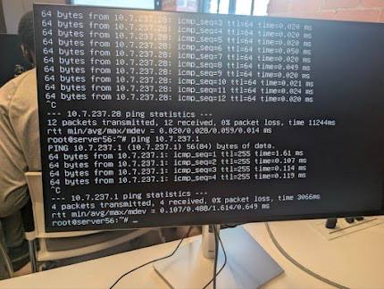

---

## 🔍 Partie 5 — Vérification du système

### ⚙️ Étape 13 — Modules, paramètres du noyau et processeurs

```bash
lsmod
cat /proc/cmdline
cat /sys/devices/system/cpu/online
```

| Commande | Résultat | Ce que ça prouve |
|---|---|---|
| `lsmod` | Modules `hpsa`, `bnx2`, `nvme_core`, `ehci_hcd`… | Le contrôleur RAID HP (`hpsa`) et les cartes réseau Broadcom (`bnx2`) sont pris en charge |
| `cat /proc/cmdline` | `BOOT_IMAGE=/boot/vmlinuz-7.0.2-6-pve root=/dev/mapper/pve-root ... quiet` | Le noyau Proxmox `7.0.2-6-pve` démarre sur le volume LVM `pve-root` |
| `cat /sys/devices/system/cpu/online` | `0-7` | Les **8 processeurs logiques** sont actifs : les 2 CPU sont bien détectés |

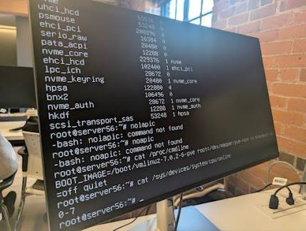

> :warning: Les commandes `nolapic` et `noapic` renvoient `command not found` : ce ne sont pas
> des commandes, mais des **paramètres du noyau**. Elles s'ajoutent à la ligne de démarrage
> (comme `nomodeset acpi=off`), pas dans le terminal.

---

## 📋 Résumé

| Élément | Valeur |
|---|---|
| Serveur | HP ProLiant DL360 G6 |
| Système installé | Proxmox VE 9 (noyau `7.0.2-6-pve`) |
| Nom d'hôte | `server56` |
| Paramètres de démarrage | `nomodeset acpi=off` |
| Stockage | HP Smart Array P410i, disque logique recréé, LVM (`pve-root`) |
| Processeurs | 2 Intel Xeon, 8 processeurs logiques (`0-7`) |
| Adresse IP | `10.7.237.28/23` sur `vmbr0` |
| Passerelle | `10.7.237.1` (ping OK) |

---

## 💡 Ce que j'ai appris

- Un serveur ancien peut faire tourner un système récent avec les bons **paramètres du noyau** (`nomodeset`, `acpi=off`)
- La différence entre une **commande** et un **paramètre de démarrage du noyau**
- Lire une erreur d'installation (`/dev/sda3`, LVM) et la régler en **recréant le volume RAID**
- Sur Proxmox, on travaille en `root` : `sudo` n'est pas nécessaire
- Vérifier et corriger l'adresse IP avec `ip addr`, puis tester avec `ping`
- Vérifier que les processeurs, les modules et le noyau sont bien chargés