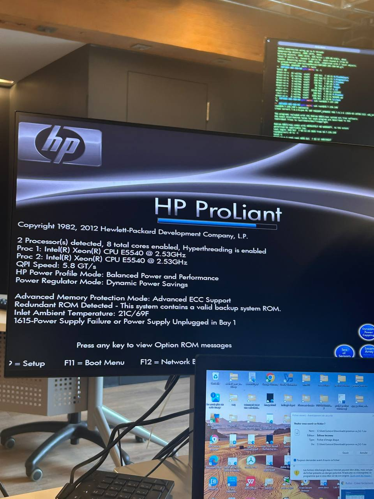
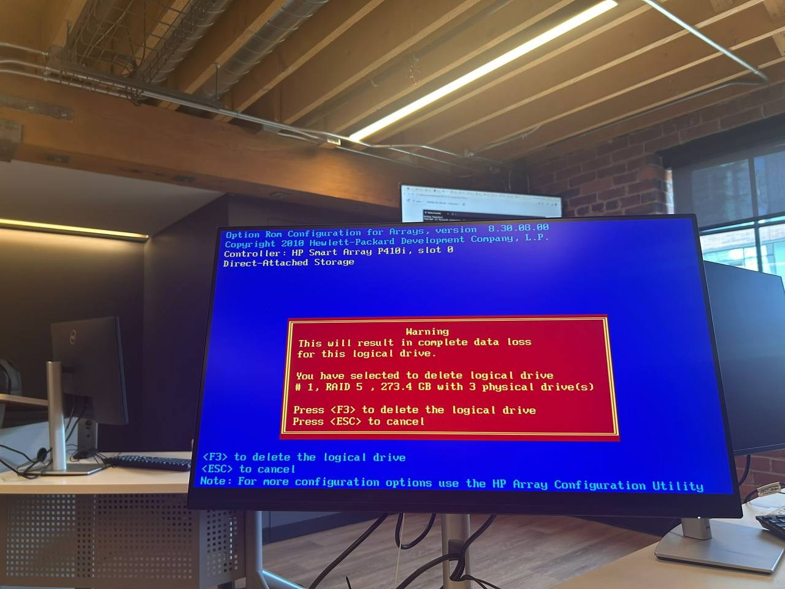
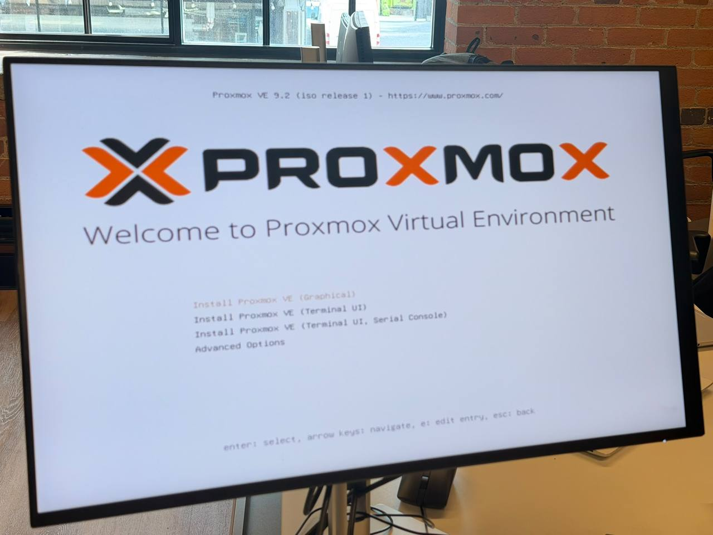
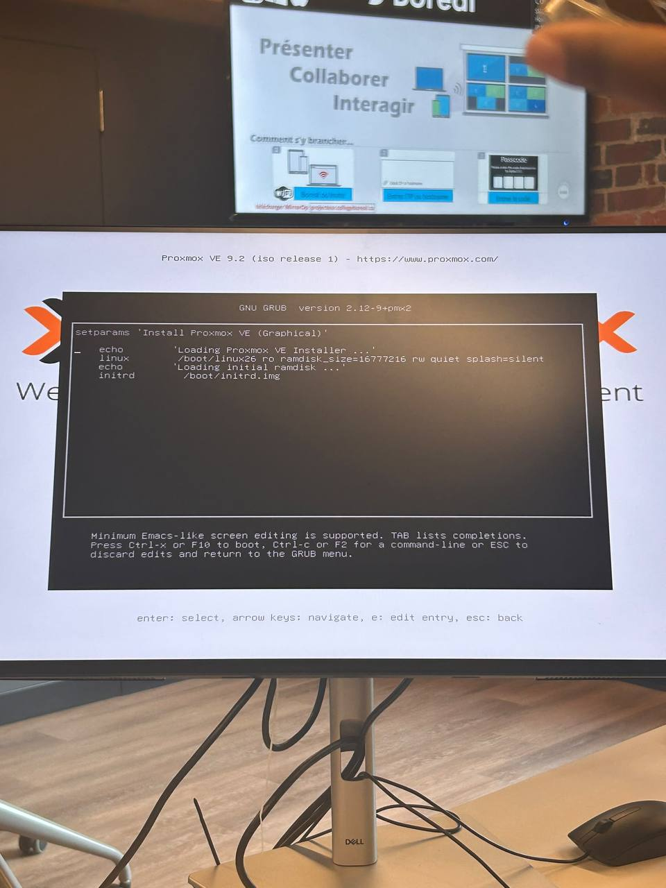
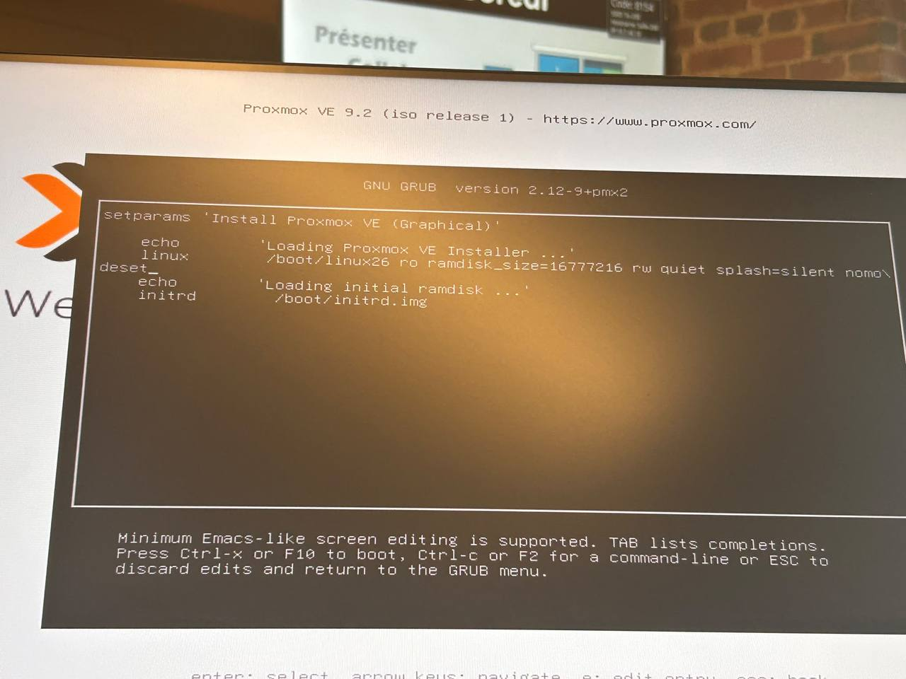
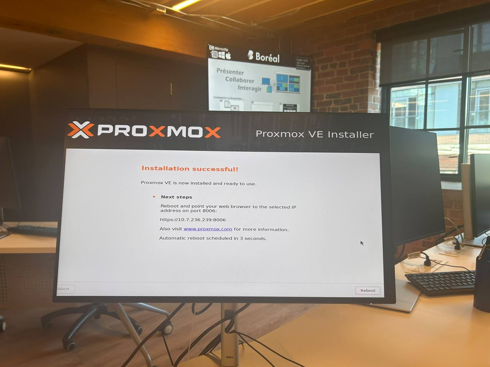

# Atelier pratique : Installation de Proxmox VE sur un serveur physique

| Champ | Information |
| --- | --- |
| Étudiant | Karim Bamba |
| Matricule | 300153972 |
| Programme | Techniques des systèmes informatiques – Collège Boréal |
| Cours | INF1085 – Administration Linux |

---

## 1. Présentation de l'atelier

Dans le cadre du cours INF1085 – Administration Linux, j'ai installé **Proxmox VE 9.2** sur le serveur physique HP ProLiant DL360 G6 préparé lors de l'atelier précédent (RAID 5).

L'objectif était de préparer une clé USB d'installation, de démarrer le serveur à partir de cette clé, puis d'installer Proxmox VE sur le volume RAID.

## 2. Matériel utilisé

- Un serveur physique HP ProLiant DL360 G6 (2 × Xeon E5540, volume RAID 5)
- Un écran, un clavier et une souris
- Une clé USB
- Un ordinateur Windows
- Le fichier ISO de Proxmox VE 9.2 (`proxmox-ve_9.2-1.iso`)
- Le logiciel Rufus pour créer la clé USB bootable

## 3. Préparation de la clé USB

J'ai téléchargé le fichier ISO de Proxmox VE, puis j'ai utilisé **Rufus** pour créer une clé USB bootable.

Cette étape rend la clé utilisable pour démarrer le serveur et lancer l'installateur.

## 4. Démarrage du serveur

J'ai branché la clé USB au serveur et j'ai allumé la machine. Pendant le POST, le serveur affiche :

- **2 Processor(s) detected, 8 total cores enabled**, Hyperthreading activé ;
- Proc 1 et Proc 2 : Intel Xeon E5540 @ 2.53 GHz ;
- **Advanced ECC Support** pour la mémoire ;
- le message **1615 – Power Supply Failure or Power Supply Unplugged in Bay 1** : un des deux blocs d'alimentation n'était pas branché. Le serveur démarre quand même grâce à l'alimentation redondante de la baie 2.

J'ai dû essayer plusieurs options de démarrage avant de trouver la bonne méthode :

- **F8** : premier essai pour accéder aux options de démarrage.
- **F12** : démarrage réseau (PXE), ce qui n'était pas ce que je cherchais.
- **F11** : menu de démarrage (*Boot Menu*).
- J'ai sélectionné **« One Time Boot to USB DriveKey »** pour démarrer une seule fois sur la clé USB.

## 5. Vérification du volume RAID

Avant l'installation, j'ai ouvert l'utilitaire du contrôleur **HP Smart Array P410i**. Le volume logique #1 (RAID 5, 273,4 Go, 3 disques) de l'atelier précédent était présent. L'écran d'avertissement rappelle que la suppression d'un volume efface toutes ses données.

## 6. Menu d'installation de Proxmox

Le menu de démarrage de **Proxmox VE 9.2 (iso release 1)** est apparu. J'ai choisi **« Install Proxmox VE (Graphical) »**.

Avec la touche **e**, on peut modifier l'entrée GRUB avant le démarrage, par exemple pour ajouter une option à la ligne `linux` (comme `nomodeset` quand l'affichage graphique pose problème). On démarre ensuite avec **Ctrl-x** ou **F10**.

## 7. Installation

L'installateur graphique demande d'abord d'accepter la licence (EULA). Proxmox VE est distribué sous licence libre **GNU AGPL v3**.

J'ai ensuite choisi le disque cible, le pays, le fuseau horaire, le mot de passe `root` et la configuration réseau du serveur.

L'installation s'est terminée avec le message **« Installation successful! »**. Le serveur redémarre automatiquement, et l'interface web est accessible à l'adresse **https://10.7.236.239:8006**.

## 8. Difficultés rencontrées

| Difficulté | Cause | Solution |
| --- | --- | --- |
| Démarrage sur le réseau au lieu de la clé USB | Mauvaise touche (F12 = démarrage réseau PXE) | Utiliser le *Boot Menu* et « One Time Boot to USB DriveKey » |
| Mauvais support de stockage sélectionné au premier essai | Plusieurs supports visibles (clé USB, volume RAID) | Bien vérifier le disque cible avant de continuer : le disque choisi est entièrement effacé |
| Message 1615 au POST | Bloc d'alimentation de la baie 1 débranché | Brancher les deux alimentations pour garder la redondance |

## 9. Ce que j'ai appris

- Créer une clé USB bootable avec Rufus.
- Accéder au menu de démarrage d'un serveur HP et faire la différence entre démarrage USB et réseau (PXE).
- Lire les messages du POST (processeurs, mémoire ECC, alimentation).
- Modifier une entrée GRUB avant le démarrage.
- Vérifier le support de stockage avant d'installer un système.

## 10. Conclusion

Proxmox VE 9.2 est installé sur le serveur HP ProLiant DL360 G6, sur le volume RAID 5. Le serveur est administrable par l'interface web à l'adresse `https://10.7.236.239:8006` et par SSH (`ssh root@10.7.236.239`).

La prochaine étape est la création de machines virtuelles (atelier 3.VMs) et la création de comptes administrateurs individuels (atelier 4.Root).
