# Installation de Proxmox VE 9.2 sur un serveur HP ProLiant DL360 G6

## Description

Ce document présente les différentes étapes que j’ai suivies pour installer Proxmox VE 9.2 sur un serveur physique HP ProLiant DL360 G6.

L’objectif de ce laboratoire était de préparer le matériel, configurer le contrôleur RAID, créer une clé USB bootable et procéder à l’installation de Proxmox VE.

Malgré plusieurs tentatives, l’installation n’a pas abouti en raison de problèmes liés au chargeur d’amorçage, aux partitions LVM et au contrôleur RAID.

---

## Caractéristiques du serveur

| Composant | Détails |
|---|---|
| Modèle | HP ProLiant DL360 G6 |
| Processeurs | 2 × Intel Xeon E5620 @ 2,40 GHz |
| Nombre de cœurs | 8 cœurs au total |
| Mémoire RAM | 8 Go |
| Contrôleur RAID | HP Smart Array P410i (slot 0) |
| BIOS | HP P64 (05/05/2011) |
| Gestion à distance | iLO 2 v2.07 |
| Système à installer | Proxmox VE 9.2 |

---

## 1. Préparation et installation du matériel

J’ai commencé par ouvrir le serveur HP ProLiant DL360 G6 afin de vérifier ses composants internes et de préparer le matériel.

Les opérations effectuées :

- Installation du module de cache du contrôleur RAID.
- Installation des disques dans les baies avant.
- Installation de quatre barrettes de mémoire RAM, soit deux par processeur.
- Vérification du positionnement des composants.

**Point important :** les barrettes de RAM doivent être installées en respectant l’ordre des emplacements indiqué sur la carte mère.

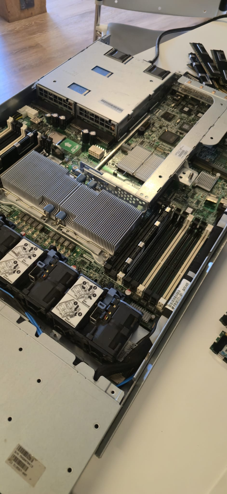

*Figure 1 – Vue intérieure du serveur HP ProLiant DL360 G6.*

---

## 2. Vérification au démarrage (POST)

Après la préparation matérielle, j’ai démarré le serveur pour vérifier la détection des composants.

L'écran POST a confirmé :

- La détection de 8 Go de mémoire RAM.
- La présence des deux processeurs Intel Xeon.
- La détection des alimentations.

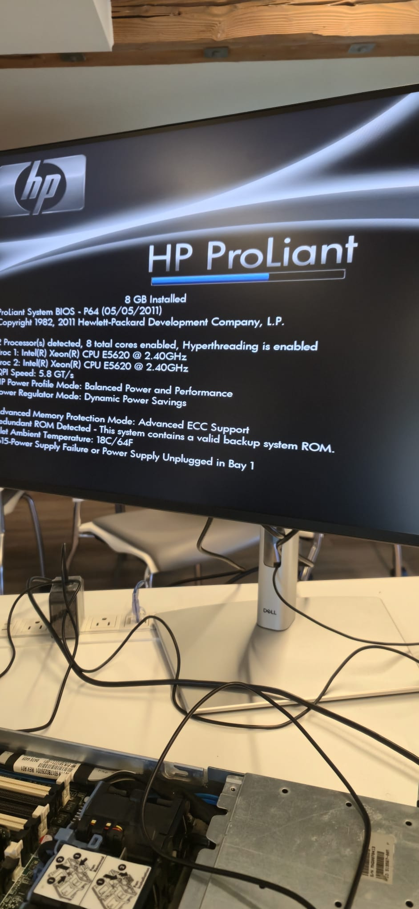

*Figure 2 – Détection des 8 Go de RAM.*

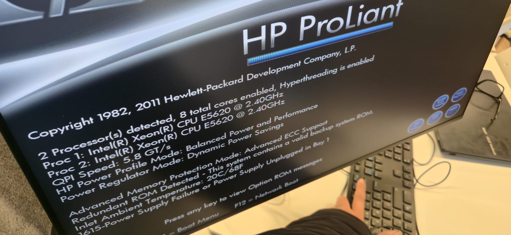

*Figure 3 – Vérification des processeurs et des alimentations.*

**Remarque :** le message `1615-Power Supply Failure or Power Supply Unplugged in Bay 1` apparaît parce qu'une seule alimentation est connectée. Ce message n'empêche pas le démarrage du serveur.

---

## 3. Vérification du BIOS (RBSU)

J’ai accédé à l’utilitaire BIOS RBSU pour vérifier la configuration générale du serveur.

Cette étape permet de contrôler les paramètres matériels avant de procéder à la configuration du stockage et à l’installation du système.

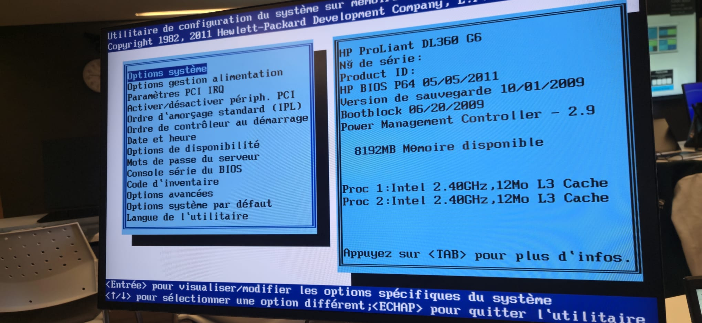

*Figure 4 – Utilitaire de configuration BIOS RBSU.*

---

## 4. Configuration du contrôleur RAID

Au démarrage, le serveur a détecté le contrôleur HP Smart Array P410i.

J’ai utilisé la touche **F8** pour accéder à l’utilitaire de configuration ORCA (Option ROM Configuration for Arrays).

Les opérations effectuées :

1. Accès à la configuration du contrôleur RAID.
2. Vérification des disques disponibles.
3. Suppression de l’ancienne configuration des disques.
4. Création d’un nouveau lecteur logique.
5. Sélection du niveau RAID 5.
6. Enregistrement de la configuration avec F8.

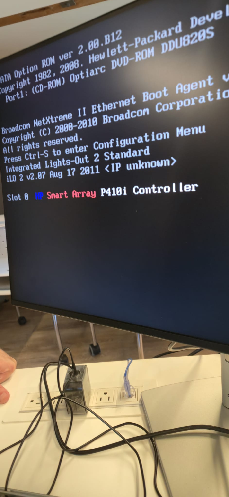

*Figure 5 – Détection du contrôleur HP Smart Array P410i.*

Le contrôleur a affiché un message **Invalid Drive Movement**, indiquant que les disques provenaient d'une autre configuration RAID.

J’ai accepté de supprimer l’ancienne configuration afin de pouvoir créer une nouvelle grappe.


*Figure 6 – Message Invalid Drive Movement.*

J’ai ensuite créé un volume logique en RAID 5 d’une capacité de 293,56 Go.


*Figure 7 – Création du volume logique RAID 5.*

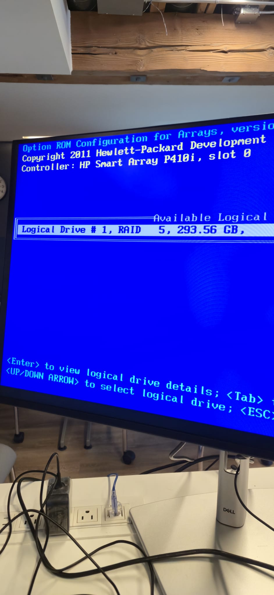

*Figure 8 – Confirmation du volume logique RAID 5.*

---

## 5. Préparation de la clé USB bootable

J’ai téléchargé l’image ISO de **Proxmox VE 9.2** depuis le site officiel.

Ensuite, j’ai utilisé cette image pour créer une clé USB bootable permettant de lancer l’installation sur le serveur.

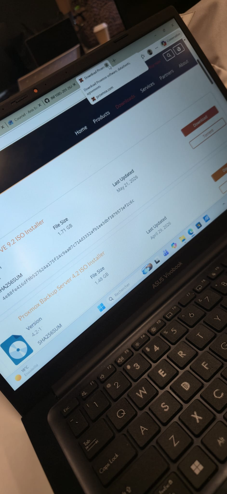

*Figure 9 – Téléchargement de l’image ISO de Proxmox VE 9.2.*

---

## 6. Démarrage à partir de la clé USB

Après avoir connecté la clé USB au serveur, j’ai redémarré la machine.

Pendant le démarrage POST, j’ai appuyé sur **F11** pour accéder au menu de démarrage.

J’ai sélectionné l’option :

`3) One Time Boot to USB DriveKey`

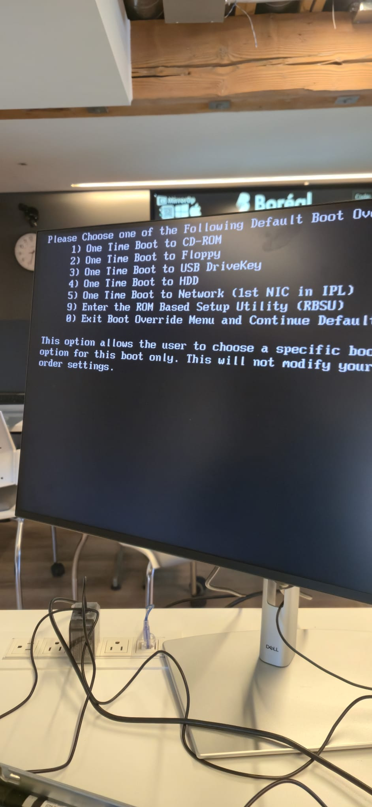

*Figure 10 – Menu de démarrage F11.*

Le menu d’installation de Proxmox VE est ensuite apparu à l’écran.

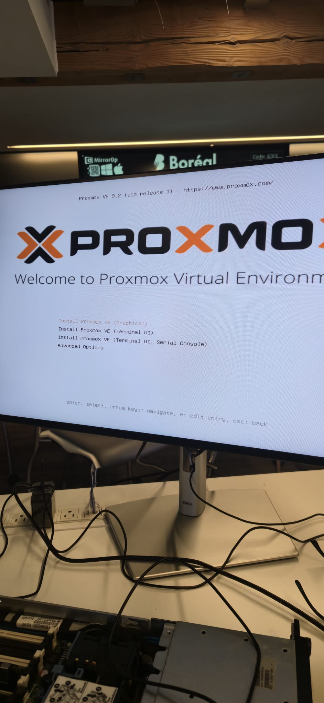

*Figure 11 – Menu de démarrage de Proxmox VE.*

---

## 7. Modification des paramètres GRUB

Conformément aux instructions du cours, j’ai modifié les paramètres de démarrage GRUB.

Les étapes suivies :

1. Sélection de `Install Proxmox VE (Graphical)`.
2. Appui sur la touche **e** pour modifier l’entrée.
3. Ajout des paramètres suivants à la ligne Linux :

```text
nomodeset acpi=off
```

4. Démarrage avec **Ctrl + X** ou **F10**.

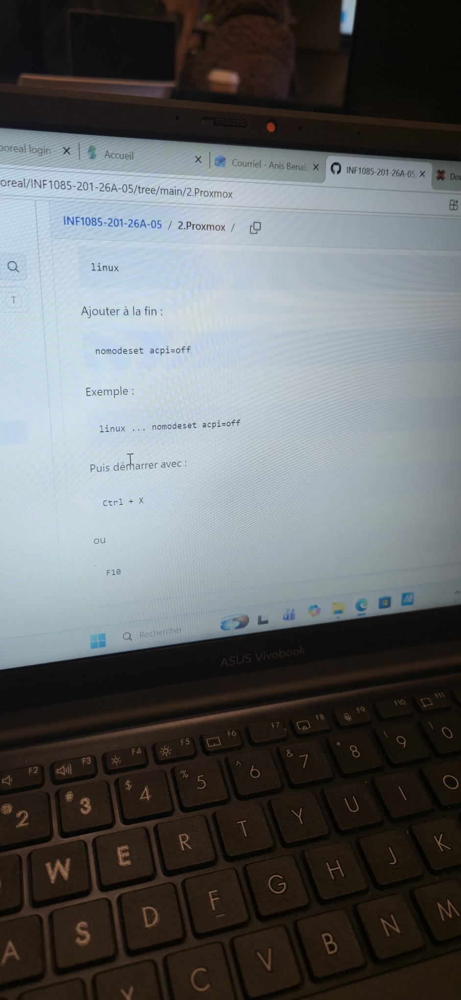

*Figure 12 – Instructions de modification GRUB.*


*Figure 13 – Modification des paramètres de démarrage.*

L’installateur a commencé à charger les fichiers nécessaires et a recherché l’image ISO, notamment sur le périphérique `/dev/sr0`.

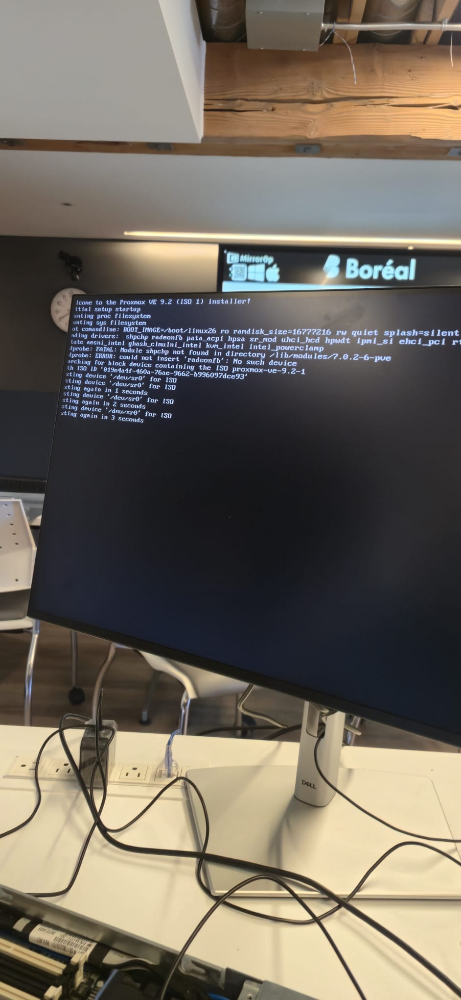

*Figure 14 – Recherche de l’image ISO par l’installateur.*

---

## 8. Détection du disque et lancement de l’installation

L’installateur de Proxmox VE a détecté le volume logique RAID 5 créé précédemment.

Le disque cible affiché était :

```text
/dev/sda (273.40 GiB, LOGICAL VOLUME)
```

Cette étape confirmait que le contrôleur RAID présentait le volume logique au système d’installation.

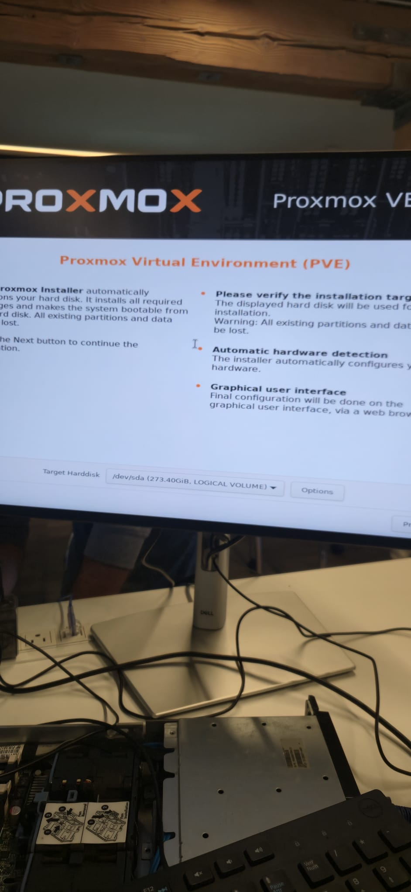

*Figure 15 – Détection du disque cible.*

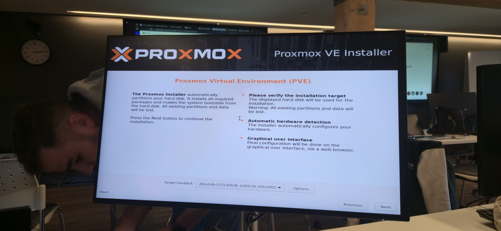

*Figure 16 – Informations complètes sur le disque détecté.*

J’ai ensuite lancé le processus d’installation de Proxmox VE 9.2.


*Figure 17 – Installation de Proxmox VE en cours.*

---

## 9. Problèmes rencontrés pendant l’installation

Malgré la détection du disque RAID 5 et le lancement de l’installation, plusieurs erreurs sont apparues.

### 9.1 Erreur du chargeur d’amorçage et de l’initramfs

À la fin de la première tentative, l’installateur a affiché les messages suivants :

```text
bootloader setup errors:
unable to install initramfs
mount: /target/sys/firmware/efi/efivars: no mount point specified.
```

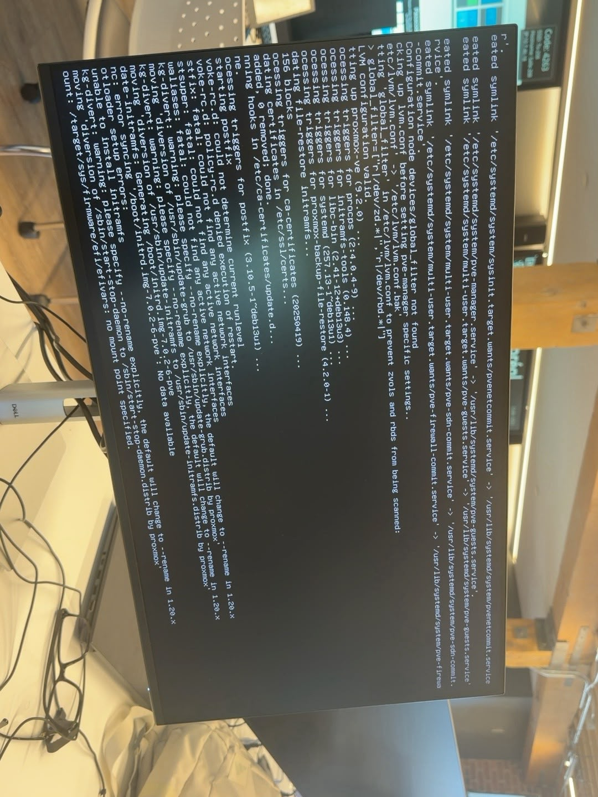

*Figure 18 – Erreur lors de la configuration du chargeur d’amorçage.*

**Cause possible :**

Cette erreur pourrait être liée au mode de démarrage utilisé par le serveur et à la configuration du chargeur d’amorçage EFI.

Le HP ProLiant DL360 G6 utilise une plateforme BIOS ancienne. Les paramètres de démarrage ajoutés, notamment `acpi=off`, pourraient également avoir contribué au problème.

### 9.2 Erreur d’initialisation du volume physique LVM

Lors d’une deuxième tentative d’installation, une nouvelle erreur est apparue :

```text
unable to initialize physical volume /dev/sda3
```

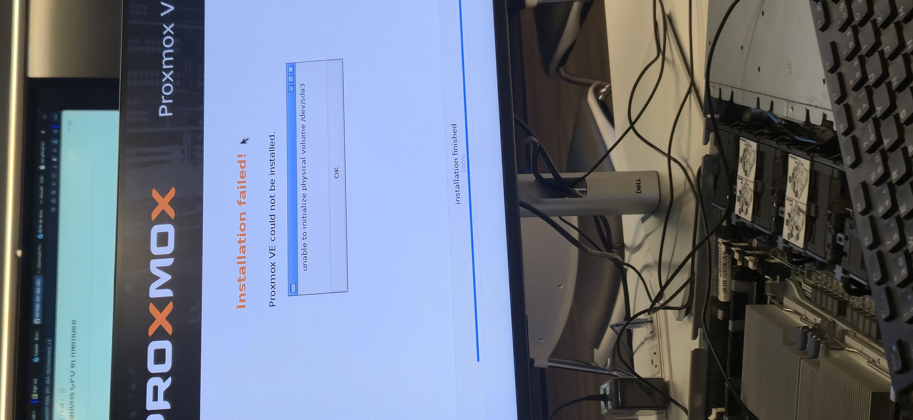

*Figure 19 – Erreur d’initialisation du volume physique /dev/sda3.*

**Cause possible :**

La première tentative d’installation ayant échoué, certaines partitions ou métadonnées LVM ont pu rester présentes sur le disque.

Un ancien groupe de volumes nommé `pve` pouvait empêcher l’installateur de réinitialiser correctement la partition.

---

## 10. Vérification du module de cache RAID

Après plusieurs tentatives, j’ai constaté un problème potentiel au niveau du module de cache du contrôleur HP Smart Array P410i.

Un module de cache défectueux ou mal reconnu peut affecter les opérations d’écriture sur le volume logique RAID.

J’ai donc effectué les opérations suivantes :

- Vérification du module de cache.
- Remplacement du module par un autre.
- Nouvelle tentative d’installation de Proxmox VE.

Cependant, même après le remplacement du module de cache, l’installation n’a toujours pas abouti.

---

## 11. Conclusion

L’installation de Proxmox VE 9.2 sur le serveur HP ProLiant DL360 G6 n’a malheureusement pas été terminée avec succès.

Malgré les différentes erreurs rencontrées, ce travail m’a permis de comprendre plusieurs aspects importants de l’administration des serveurs physiques :

- Préparation et vérification des composants matériels.
- Installation et organisation des barrettes de mémoire RAM.
- Vérification du BIOS et du processus POST.
- Configuration d’un contrôleur RAID HP Smart Array P410i.
- Création d’un volume logique RAID 5.
- Préparation d’une clé USB bootable.
- Démarrage du serveur à partir du menu F11.
- Modification des paramètres de démarrage GRUB.
- Identification des erreurs liées à l’installation, au chargeur d’amorçage et à LVM.
- Vérification du module de cache RAID.

**Bilan :** même si l’installation n’a pas abouti, les différentes tentatives ont permis d’identifier plusieurs pistes de diagnostic et de mieux comprendre le fonctionnement du matériel serveur ainsi que le processus d’installation de Proxmox VE.
