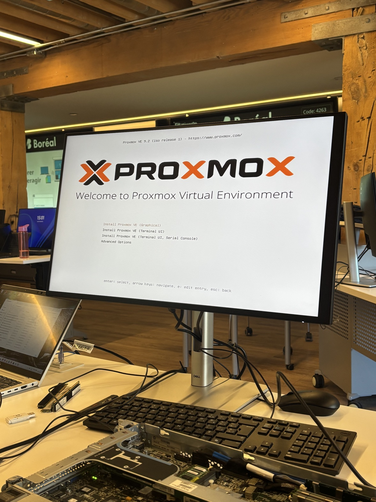
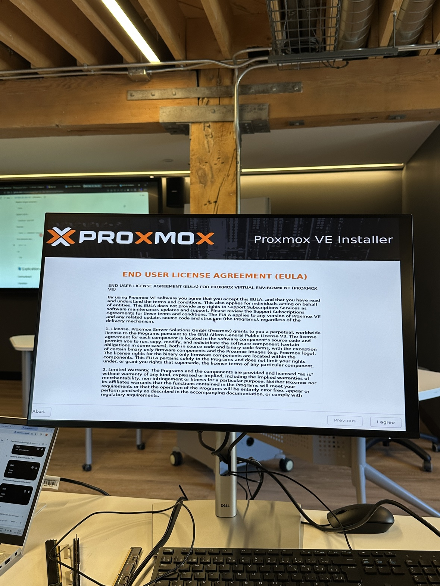
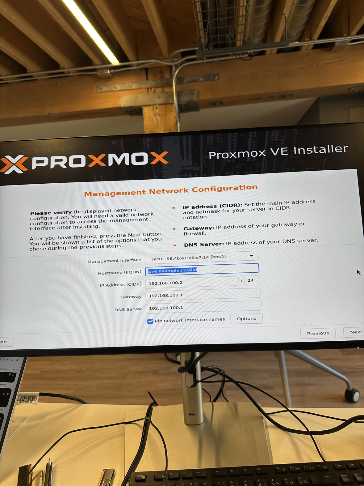
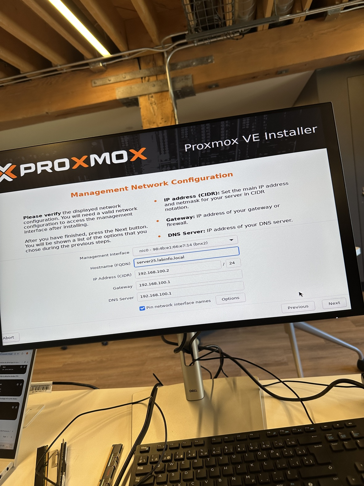
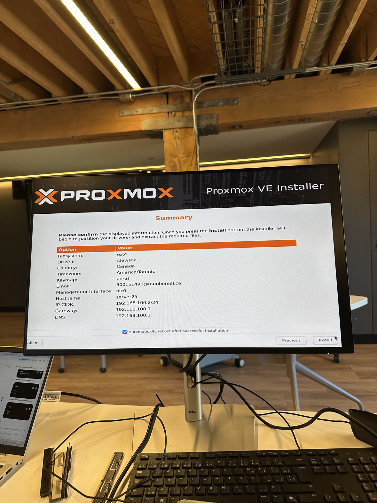
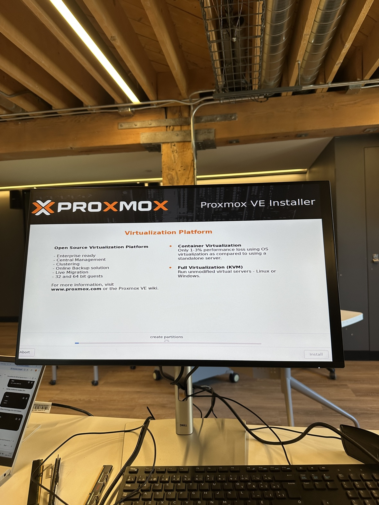
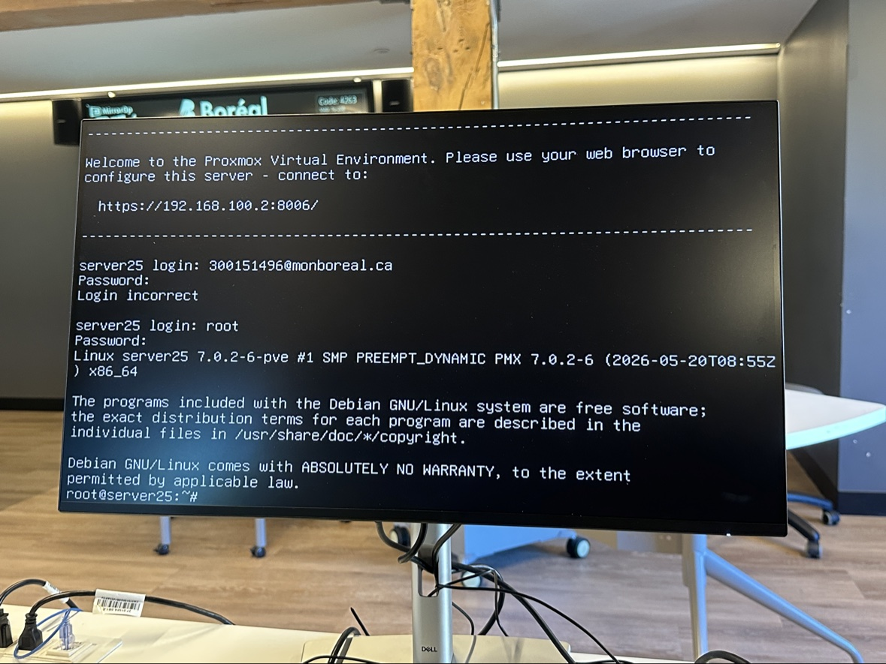
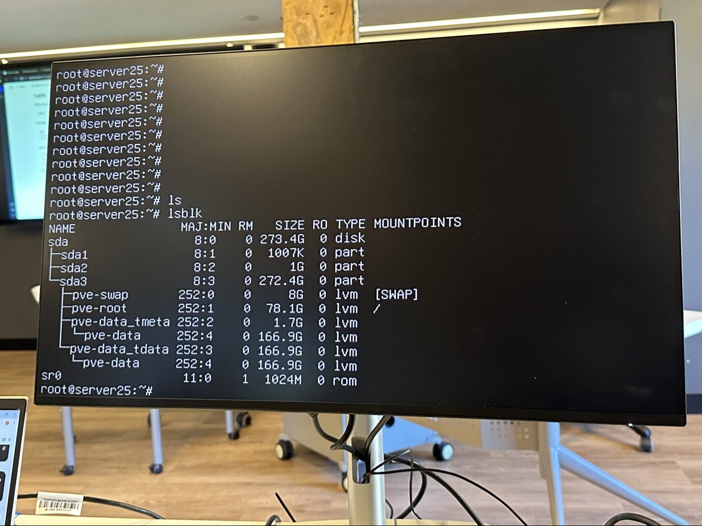

# 300156615

## Rapport : installation de Proxmox VE 9.2

### Résumé
J'ai installé Proxmox VE 9.2 sur un serveur HP ProLiant (hostname `server25`) à partir d'une clé USB, puis j'ai vérifié le système avec `lsblk`.

### Informations du serveur

| Élément | Valeur |
|---|---|
| Version | Proxmox VE 9.2 (noyau 7.0.2-6-pve) |
| Nom d'hôte | server25 (server25.labinfo.local) |
| Adresse IP | 192.168.100.2/24 |
| Passerelle / DNS | 192.168.100.1 |
| Interface réseau | nic0 (bnx2) |
| Disque système | /dev/sda (273,4 Go) |
| Système de fichiers | ext4 (LVM) |
| Pays / fuseau / clavier | Canada / America/Toronto / en-us |
| Interface web | https://192.168.100.2:8006 |

### Étapes de l'installation

**1. Menu de démarrage** : choix de *Install Proxmox VE (Graphical)*.

**2. Licence (EULA)** : acceptation avec *I agree*.

**3. Configuration réseau (valeurs par défaut)** : l'installateur propose `pve.example.invalid` et `192.168.100.2/24`.

**4. Configuration réseau (modifiée)** : nom d'hôte changé en `server25.labinfo.local`.

**5. Résumé** : vérification de toutes les options avant de cliquer sur *Install*.

**6. Installation** : création des partitions, puis copie des fichiers.

**7. Premier démarrage** : le serveur affiche l'adresse de l'interface web.

### Vérification du stockage (`lsblk`)

| Volume | Taille | Rôle |
|---|---|---|
| sda | 273,4 Go | Disque physique |
| sda1 | 1007 Ko | Partition de démarrage |
| sda2 | 1 Go | Partition EFI/boot |
| sda3 | 272,4 Go | Volume LVM |
| pve-swap | 8 Go | Mémoire d'échange |
| pve-root | 78,1 Go | Système (/) |
| pve-data | 166,9 Go | Stockage des VM |

### Problème rencontré
Ma première tentative de connexion avec mon courriel a échoué (« Login incorrect »). L'utilisateur à employer sur la console est `root`, avec le mot de passe défini pendant l'installation. La connexion avec `root` a fonctionné.

## Questions de réflexion

**1. À quoi sert nomodeset ?**
Il empêche Linux d'initialiser les pilotes graphiques avancés (KMS) et force un mode vidéo minimal, ce qui évite l'écran noir sur un vieux contrôleur graphique.

**2. Pourquoi un ancien BIOS peut-il nécessiter acpi=off ?**
Le BIOS de 2010 fournit des tables ACPI parfois incompatibles avec les noyaux récents, ce qui cause des erreurs de démarrage.

**3. Différence entre ACPI et APIC ?**
ACPI transmet les informations matérielles et la gestion d'énergie. APIC distribue les interruptions entre les processeurs.

**4. Pourquoi nolapic réduit-il les processeurs visibles ?**
Chaque processeur possède son LAPIC. Le désactiver limite le système à un seul processeur logique (SMP disabled).

**5. Quelle commande vérifie les paramètres du noyau ?**
`cat /proc/cmdline`

## Conclusion

J'ai installé Proxmox VE 9.2 sur le serveur server25 et vérifié le stockage avec `lsblk` : un disque de 273,4 Go découpé en volumes LVM (swap, root, data). J'ai retenu que l'installateur demande le réseau, le disque et le mot de passe root, et que la connexion console se fait avec `root`.
