# Déploiement d’Ubuntu Server sur Proxmox VE

**Anis Benabbas · 300150477 · Groupe 1**  
INF1085 — Administration Linux · Collège Boréal

J’ai créé la VM **111** sur `server197`, installé **Ubuntu Server 24.04.5 LTS** et configuré une adresse IPv4 statique. J’ai ensuite ouvert une session SSH depuis PowerShell et installé la clé publique du professeur pour le compte `trafalgar`.

| Paramètre | Configuration |
| --- | --- |
| Hyperviseur | Proxmox VE 9.2.2 · `server197` |
| Machine virtuelle | `111` · `trafalgar-300150477` |
| Processeur et mémoire | 1 socket, 2 cœurs, type `host` · 4 Gio de RAM |
| Disque | 32 Gio sur `local-lvm` · SCSI |
| Réseau | VirtIO sur `vmbr0` · Interface Ubuntu `ens18` |
| IPv4 statique | `10.7.236.194/23` |
| Passerelle et DNS | `10.7.237.1` · `8.8.8.8` |
| Compte Ubuntu | `trafalgar` |

## 1. Créer la VM dans Proxmox

J’ai ouvert le résumé de `server197`, puis lancé l’assistant **Créer une VM**. J’ai attribué l’ID `111` et le nom `trafalgar-300150477`.

| Résumé du serveur | Identification de la VM |
| --- | --- |
| 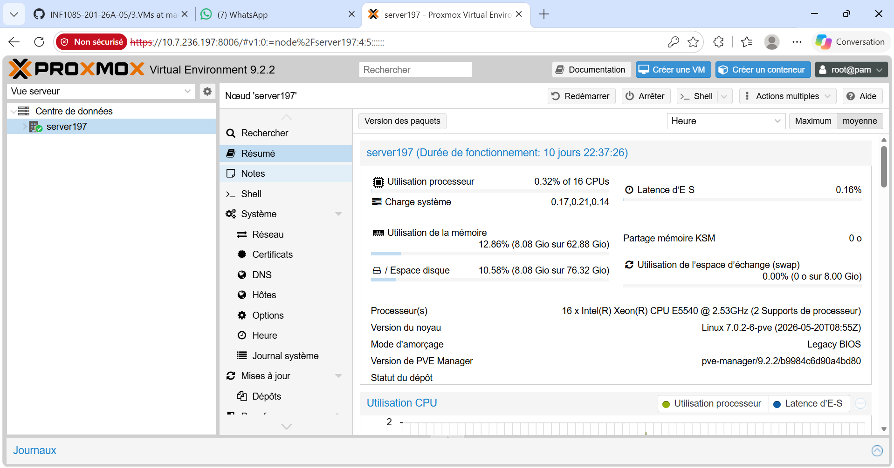 | 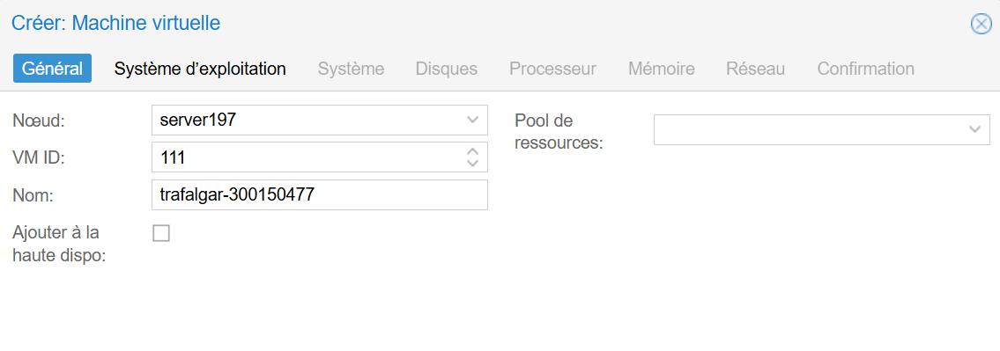 |

J’ai sélectionné l’ISO Ubuntu Server sur le stockage `local` et créé un disque SCSI de 32 Gio sur `local-lvm`.

| Support d’installation | Disque virtuel |
| --- | --- |
| 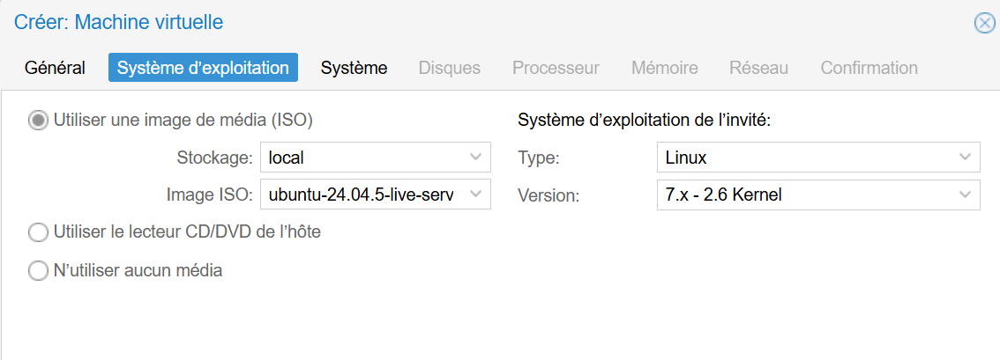 | 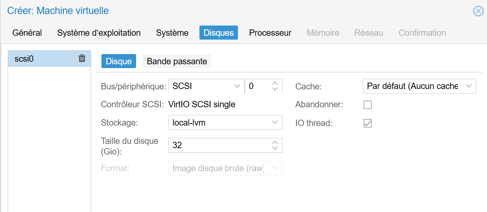 |

J’ai alloué 4096 Mio de mémoire et relié la carte réseau VirtIO au pont `vmbr0`. Le récapitulatif m’a permis de vérifier les réglages avant de créer la VM.

| Mémoire | Réseau |
| --- | --- |
| 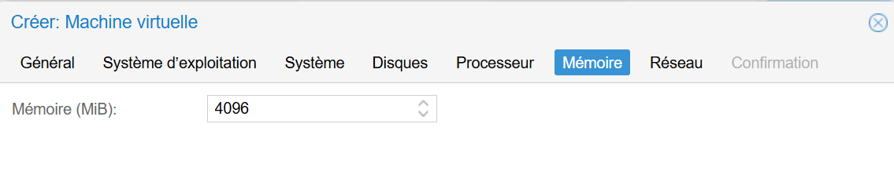 | 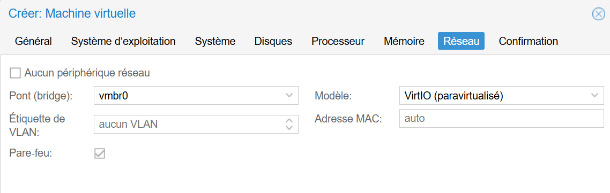 |

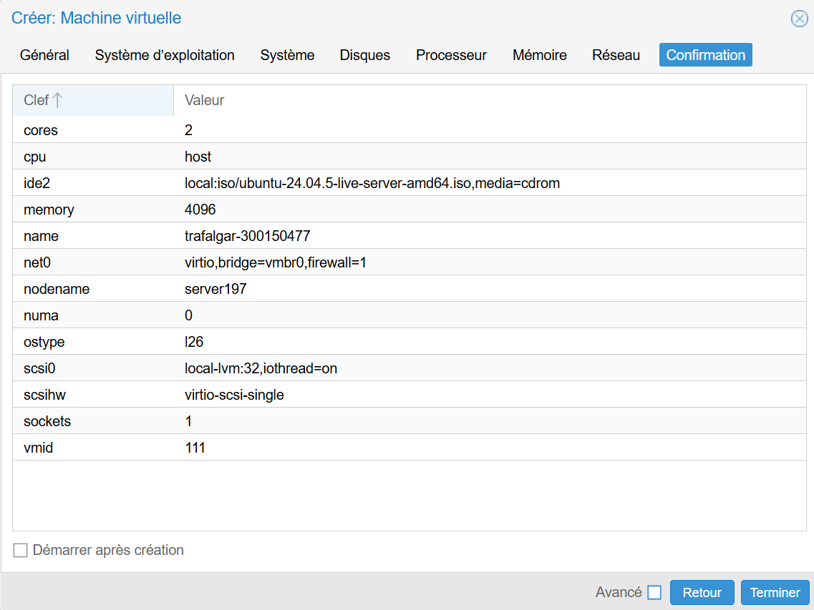

## 2. Installer Ubuntu Server

J’ai démarré sur l’ISO et ouvert l’installateur depuis la console Proxmox. L’interface `ens18` a d’abord reçu une adresse par DHCP. J’ai remplacé cette adresse par `10.7.236.194/23`. Le test du miroir Ubuntu a ensuite réussi.

| Démarrage de l’installateur | Adresse statique |
| --- | --- |
| 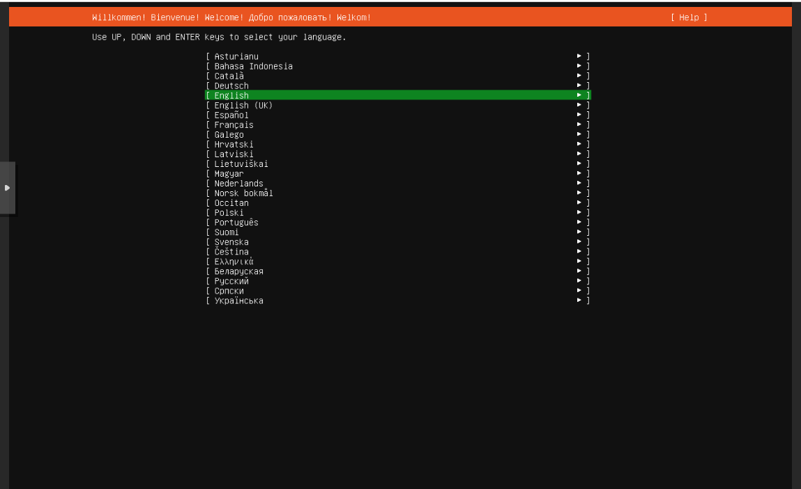 | 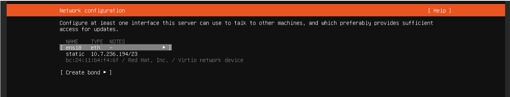 |

J’ai utilisé le partitionnement guidé avec LVM. Le résumé indiquait environ **15 Gio** pour la racine `/`, **2 Gio** pour `/boot` et **15 Gio libres** dans le groupe de volumes.

| Choix du disque | Résumé des partitions |
| --- | --- |
| 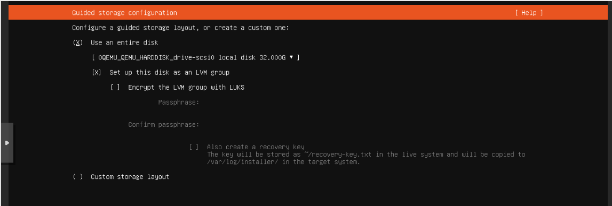 | 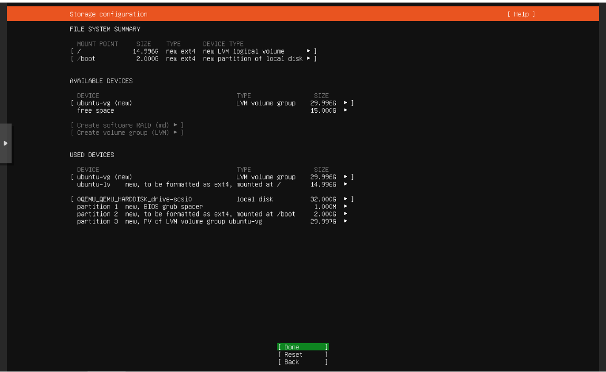 |

J’ai sélectionné **Install OpenSSH server** avant de lancer l’installation. Au redémarrage, j’ai éjecté l’ISO du lecteur virtuel `ide2`, puis ouvert ma session Ubuntu sur le disque installé. La console a affiché l’adresse IPv4 attendue.

| Configuration OpenSSH | Installation terminée |
| --- | --- |
| 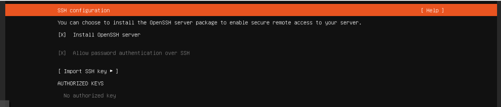 | 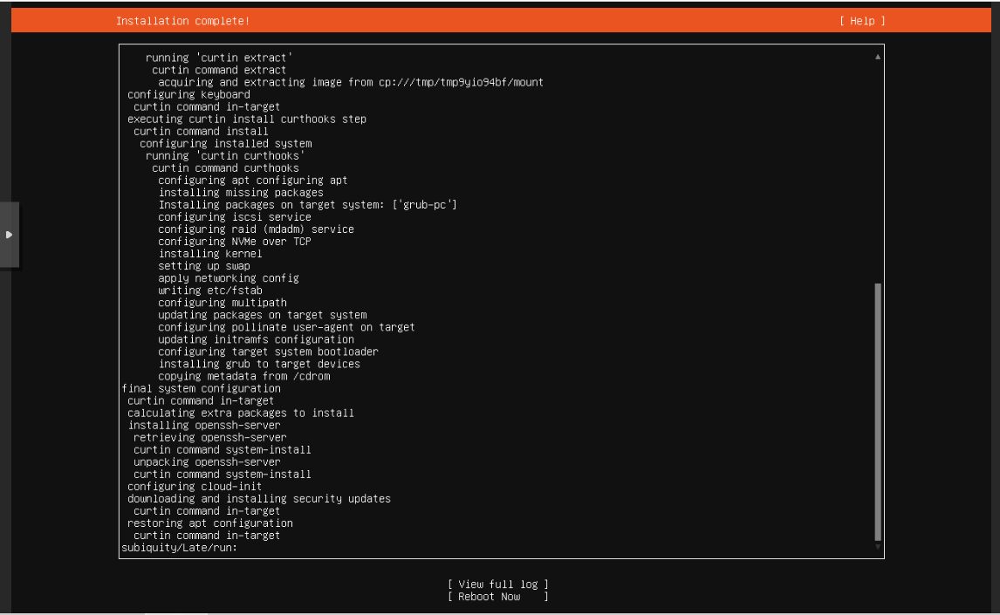 |

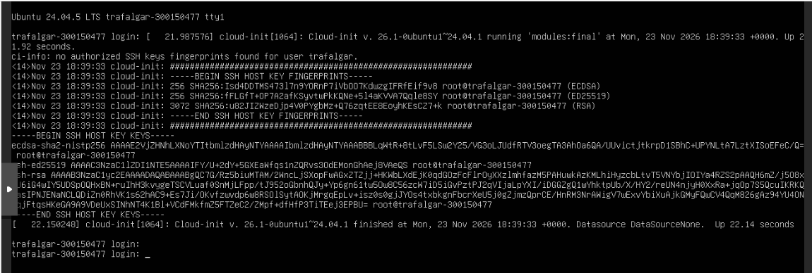

## 3. Vérifier SSH et ajouter la clé du professeur

J’ai comparé l’empreinte ED25519 proposée par PowerShell à celle affichée dans la console Proxmox avant d’accepter la clé d’hôte. La première tentative s’est fermée avant l’authentification. La suivante a ouvert une session avec le compte `trafalgar`.

```powershell
ssh trafalgar@10.7.236.194
```

J’ai ajouté la clé publique du professeur dans `~/.ssh/authorized_keys` et appliqué les permissions `600`. La commande `ssh-keygen -lf ~/.ssh/authorized_keys` a affiché l’empreinte de la clé RSA de 2048 bits. La commande `systemctl is-active ssh` a renvoyé `active`. Le professeur pourra vérifier l’authentification avec sa clé privée.

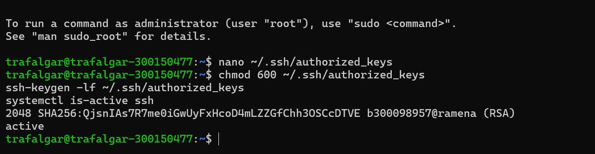
