# 🖥️ Création d'une VM Ubuntu Server sur Proxmox VE

**Nom :** Ouassim Ahmed Benamira  
**Matricule :** 300150564  
**Programme :** TSIQ – Techniques des systèmes informatiques  

---

## 🎯 **Objectif**

Créer une machine virtuelle **Ubuntu Server 24.04.5 LTS** sur le serveur **Proxmox VE 9.2.2**.

---

## 🔐 **Étape 1 — Connexion au serveur Proxmox**

Connexion au serveur `server56` avec SSH :

```bash
ssh root@10.7.237.200
```

Vérification du réseau et de la version de Proxmox :

```bash
ip a
pveversion
```

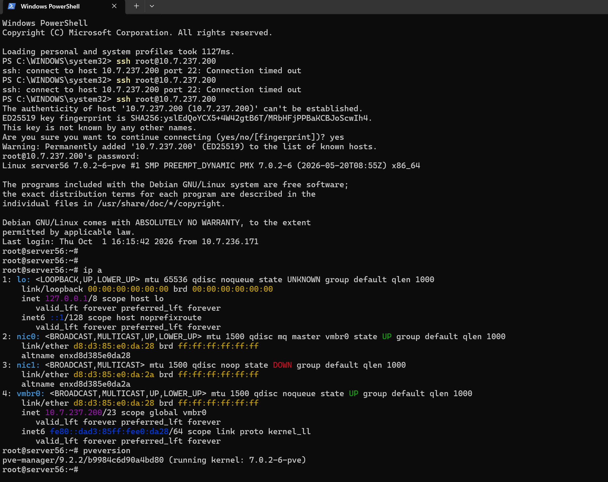

**Adresse IP du serveur :** `10.7.237.200/23` ✅

---

## 🌐 **Étape 2 — Accès à l'interface Proxmox**

Connexion à l'interface Web de **Proxmox VE 9.2.2** et sélection du serveur `server56`.

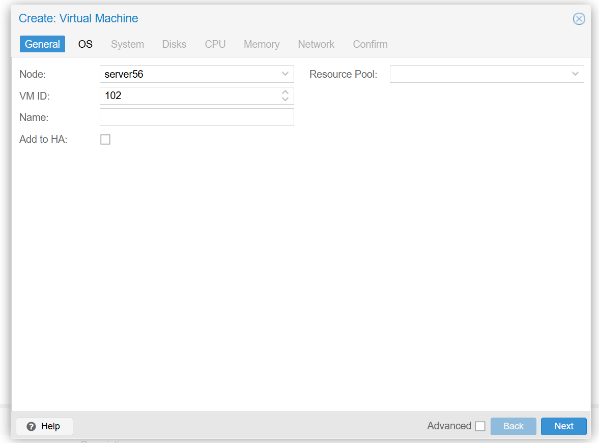

---

## 📀 **Étape 3 — Ajout de l'image ISO Ubuntu**

Dans le stockage :

**server56 → local (server56) → ISO Images**

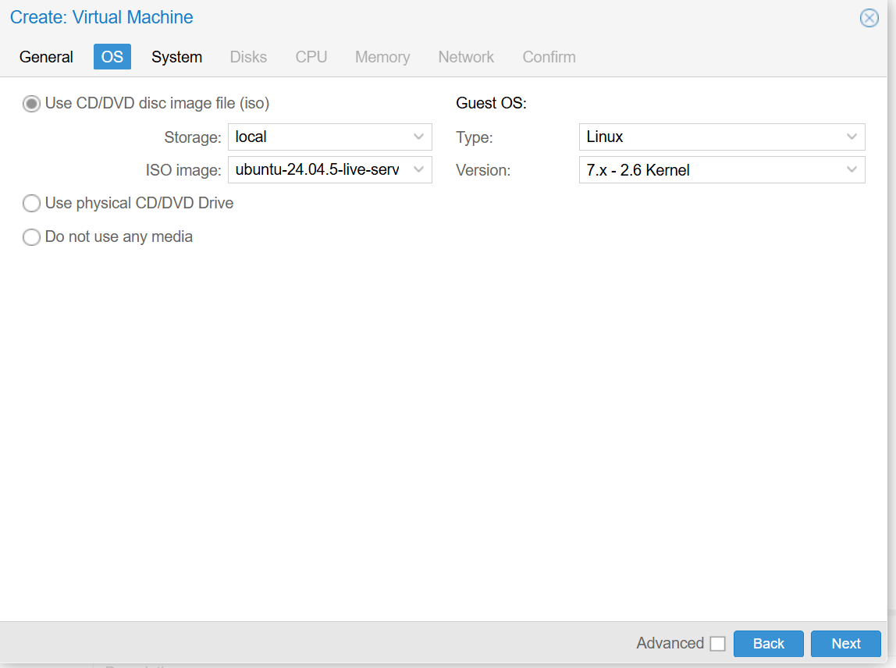

Téléversement de l'image ISO **Ubuntu Server 24.04.5 LTS**.

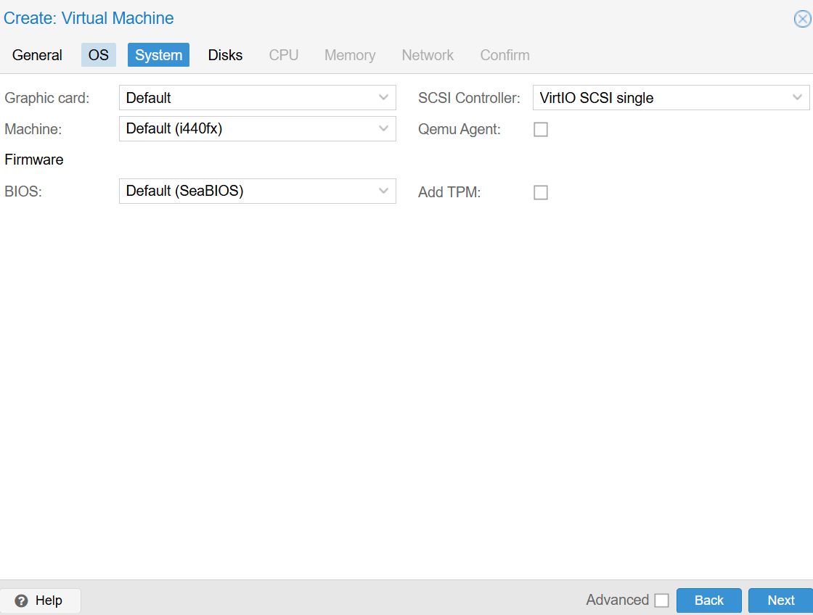

---

## 🖥️ **Étape 4 — Création de la machine virtuelle**

Création d'une nouvelle VM sur le serveur `server56`.

La machine virtuelle est nommée **Ouassim**.

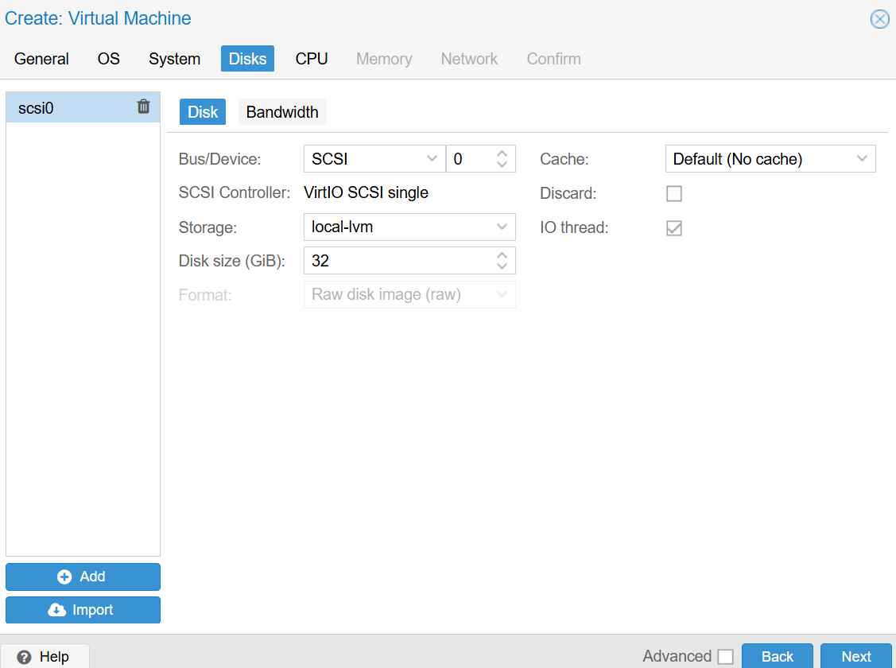

### 💿 **Sélection du système d'exploitation**

Sélection de l'image :

`ubuntu-24.04.5-live-server-amd64.iso`

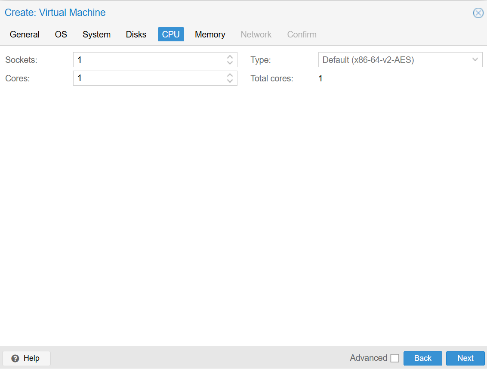

---

## ⚙️ **Étape 5 — Configuration de la VM**

Configuration du système de la machine virtuelle.

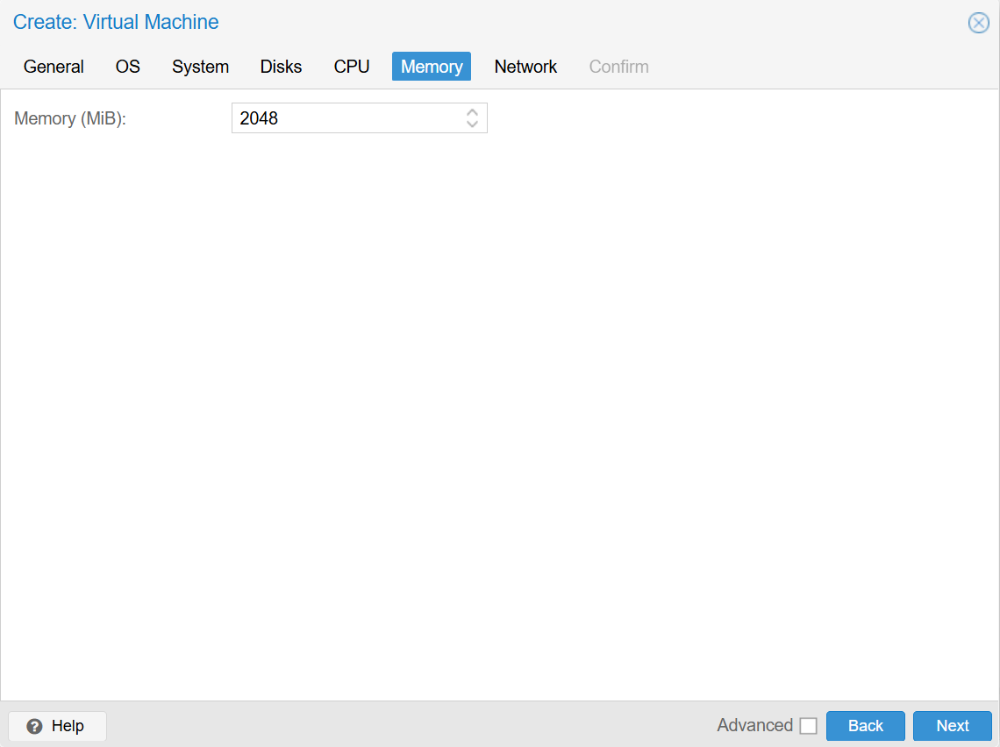

La configuration choisie pour la VM est :

- **Nom :** Ouassim
- **VM ID :** 125
- **OS :** Ubuntu Server 24.04.5 LTS
- **Disque :** 32 GiB
- **Mémoire RAM :** 4 Go
- **Réseau :** VirtIO
- **Bridge :** vmbr0

---

## 🌐 **Étape 6 — Configuration réseau**

La carte réseau virtuelle utilise **VirtIO** et le bridge `vmbr0`.

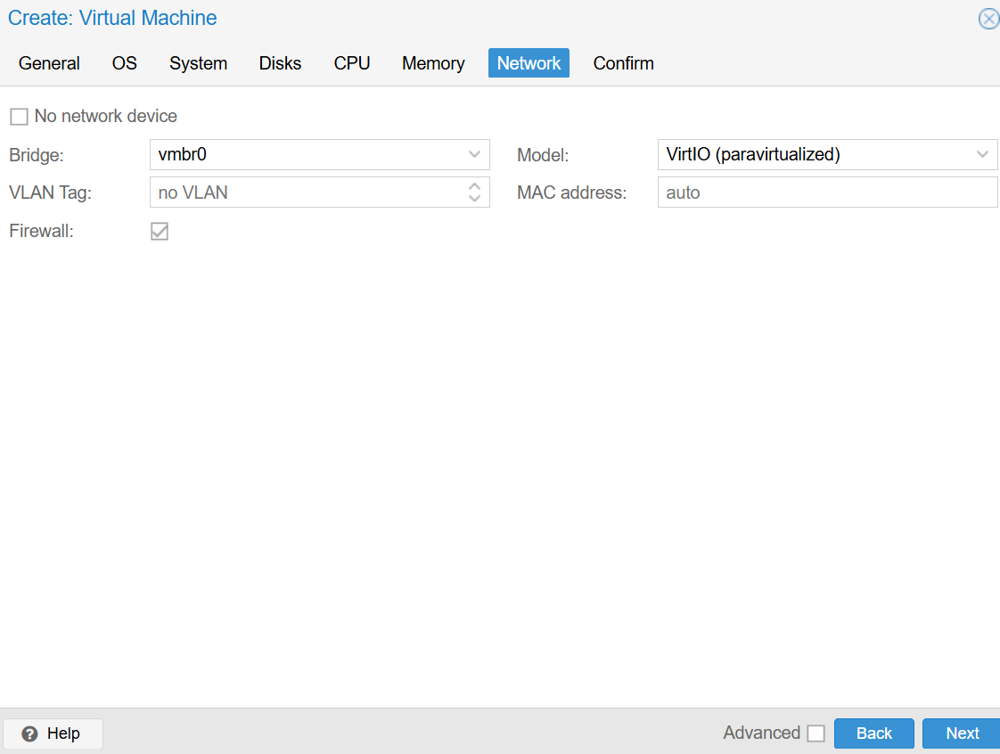

---

## ✅ **Étape 7 — Confirmation de la configuration**

Vérification des paramètres avant la création de la machine virtuelle.

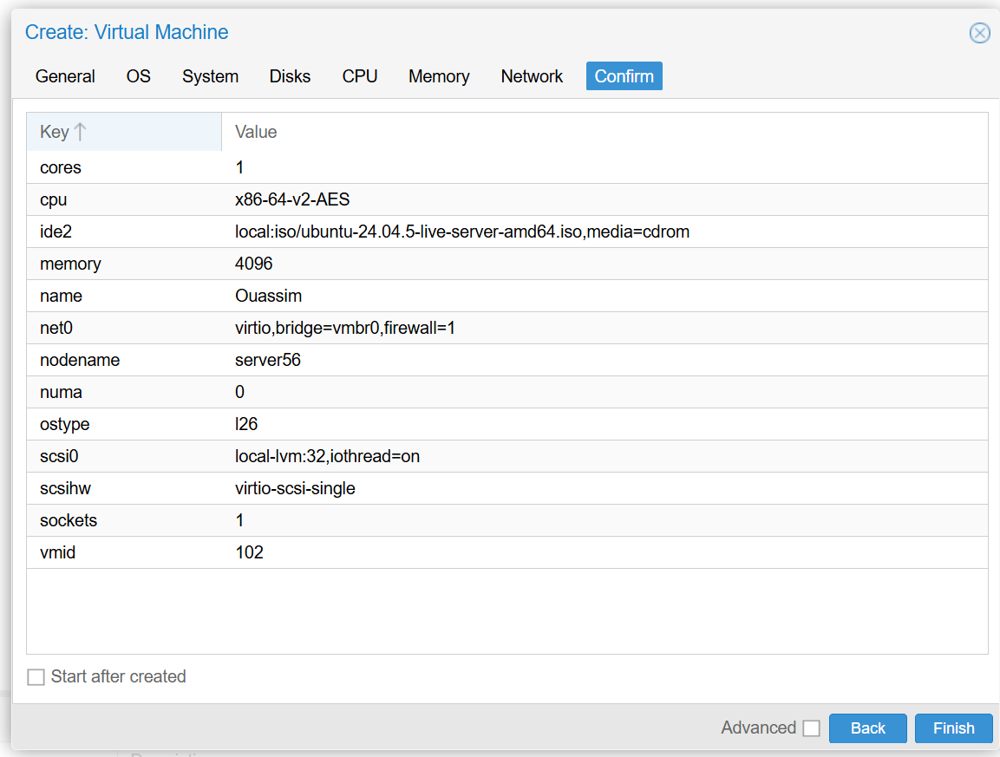

---

## ⚠️ **Étape 8 — Problème rencontré avec le VM ID**

Pendant la création, le VM ID `102` était déjà utilisé par une autre machine virtuelle.

```text
unable to create VM 102
VM 102 already exists on node 'server56'
```

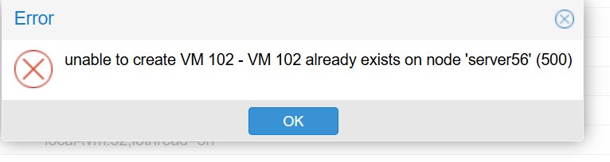

Pour résoudre le problème, un autre identifiant disponible a été utilisé : **VM ID 125**.

---

## 🟢 **Étape 9 — VM créée**

La machine virtuelle **125 (Ouassim)** est maintenant présente sur le serveur Proxmox.

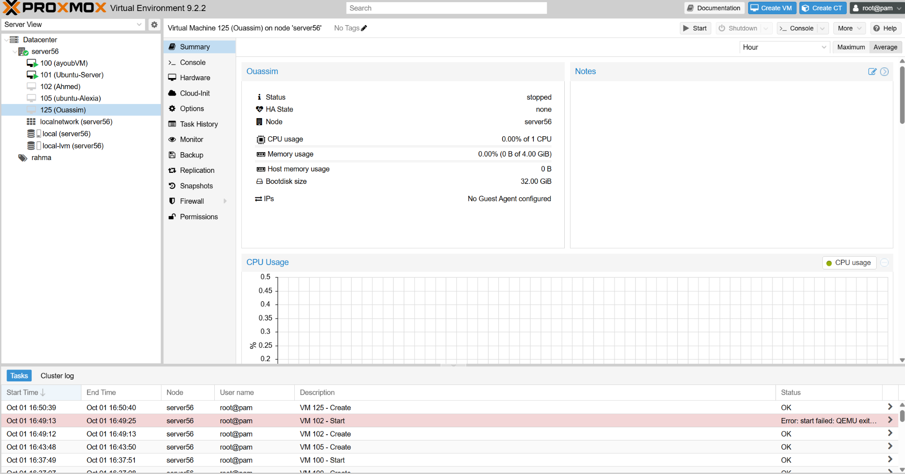

---

## ⚠️ **Étape 10 — Problème de compatibilité CPU**

Au premier démarrage, la VM affiche une erreur liée au processeur :

```text
host doesn't support requested feature: CPUID...ECX.aes
Host doesn't support requested features
TASK ERROR: start failed: QEMU exited with code 1
```

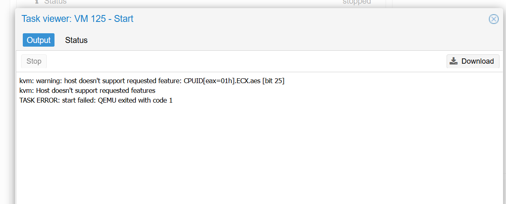

### 🔧 **Solution**

Le type de processeur configuré par défaut n'était pas compatible avec l'ancien processeur du serveur.

Dans :

**VM 125 → Hardware → Processors**

Le type de CPU a été modifié pour utiliser un modèle compatible.

Après cette modification, la VM a pu démarrer correctement. ✅

---

## 🚀 **Étape 11 — Démarrage de la VM**

Ubuntu commence maintenant son démarrage dans la console Proxmox.

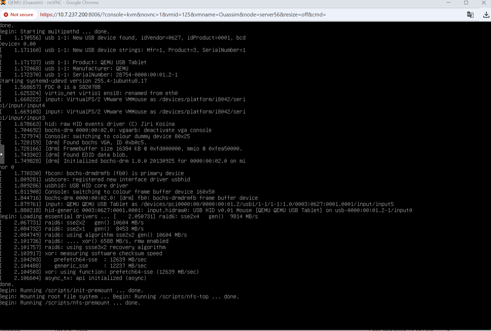

---

## 🐧 **Étape 12 — Ubuntu Server fonctionnel**

Le démarrage est terminé et Ubuntu Server affiche :

```text
Ubuntu 24.04.5 LTS ubuntu-server tty1
```

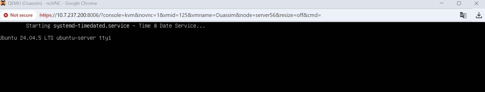

La machine virtuelle Ubuntu Server fonctionne correctement. ✅

---

## 🌐 **Étape 13 — Configuration réseau pendant l'installation**

Pendant l'installation d'Ubuntu Server, la carte réseau `ens18` a été détectée automatiquement.

Une adresse IP a été obtenue temporairement par DHCP :

`10.7.237.177/23`

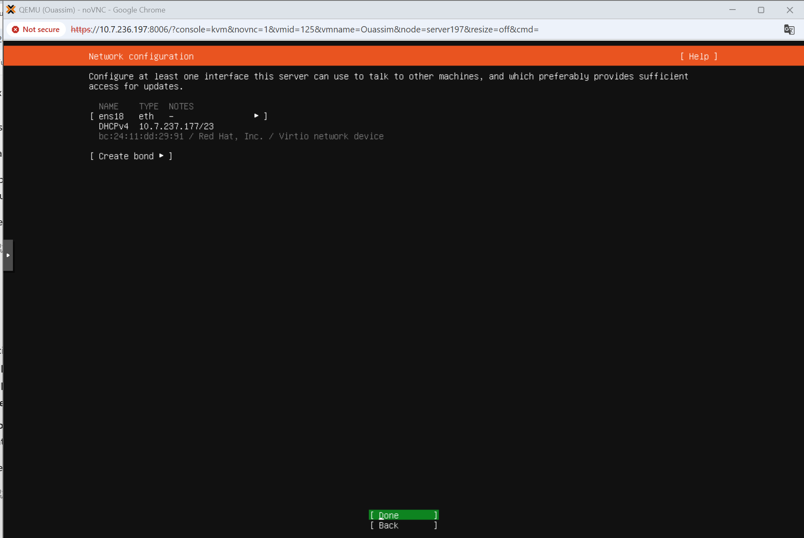

---

## 📦 **Étape 14 — Configuration du miroir Ubuntu**

Le miroir canadien d'Ubuntu a été utilisé pour télécharger les paquets nécessaires :

```text
http://ca.archive.ubuntu.com/ubuntu/
```

Le test du miroir a été effectué avec succès.

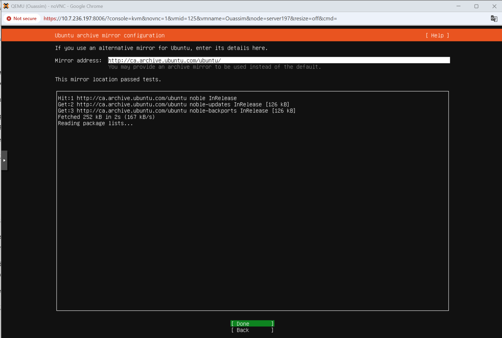

---

## 💾 **Étape 15 — Configuration du stockage Ubuntu**

Le disque virtuel de **32 Go** a été utilisé pour installer Ubuntu Server.

Le système utilise **LVM** pour gérer le stockage.

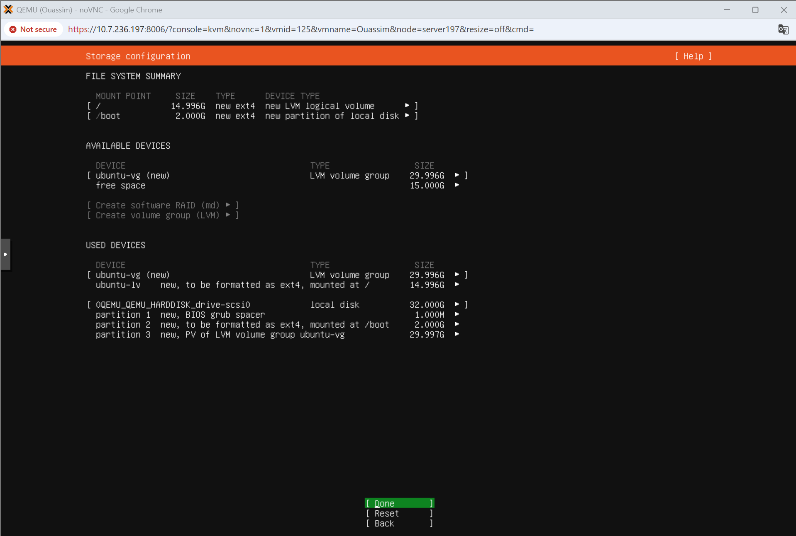

---

## 👤 **Étape 16 — Création du compte utilisateur**

Pendant l'installation, un compte utilisateur a été créé pour administrer la machine virtuelle.

- **Utilisateur :** `ouassim`
- **Nom du serveur :** `ouassim`

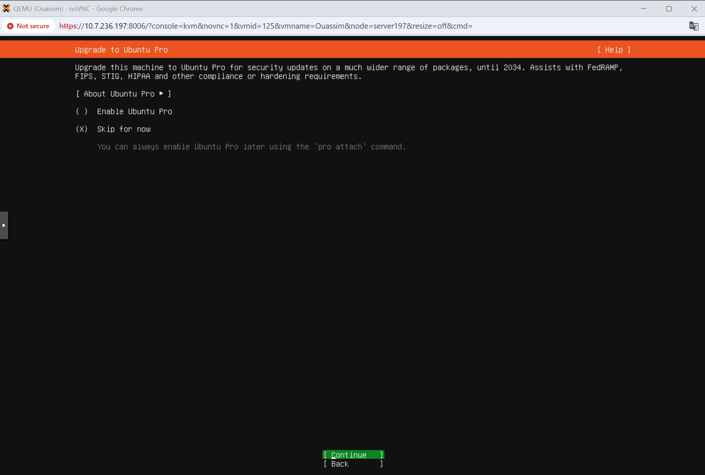

---

## 🔐 **Étape 17 — Installation du serveur SSH**

Le paquet **OpenSSH Server** a été sélectionné pendant l'installation afin de permettre l'administration à distance de la VM.

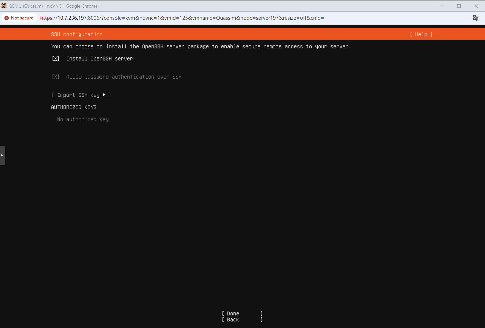

---

## ✅ **Étape 18 — Installation terminée**

L'installation d'Ubuntu Server s'est terminée correctement.

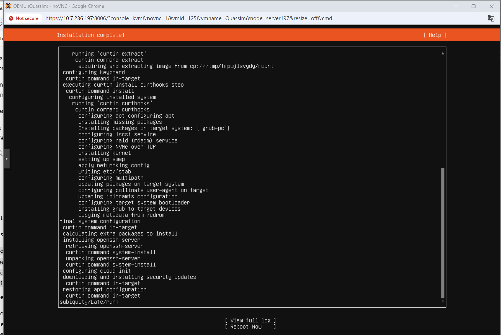

Après l'installation, l'image ISO a été retirée du lecteur CD/DVD virtuel avant le redémarrage.

---

## 🐧 **Étape 19 — Premier démarrage d'Ubuntu**

Après le redémarrage, Ubuntu Server **24.04.5 LTS** démarre correctement.

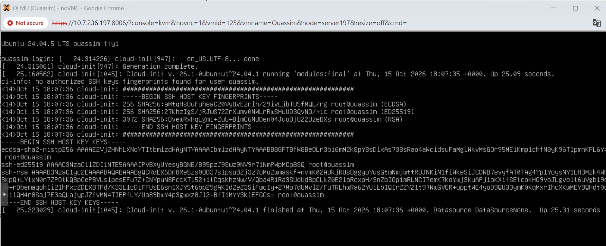

La connexion avec l'utilisateur `ouassim` fonctionne correctement.

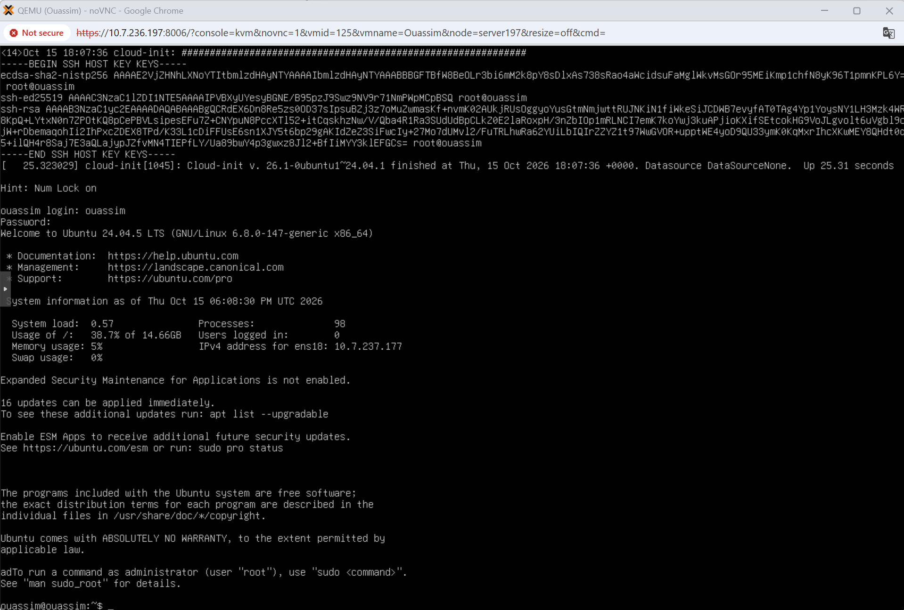

---

## 🌐 **Étape 20 — Vérification de l'adresse IP**

La configuration réseau a d'abord été vérifiée avec :

```bash
ip a
```

L'interface réseau utilisée est :

```text
ens18
```

Elle avait initialement reçu l'adresse suivante par DHCP :

```text
10.7.237.177/23
```

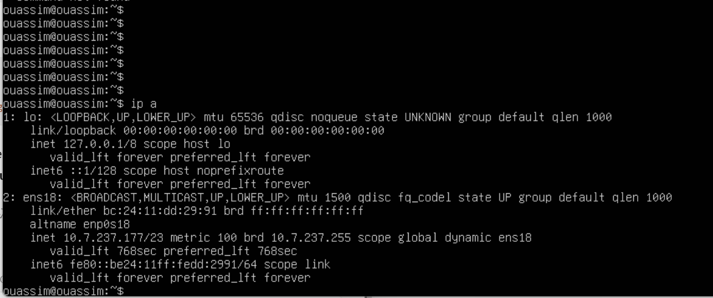

---

## 🌍 **Étape 21 — Test de la connexion Internet**

La connexion vers Internet a été testée avec :

```bash
ping -c 4 8.8.8.8
```

Les quatre paquets ont reçu une réponse avec **0 % de perte**.

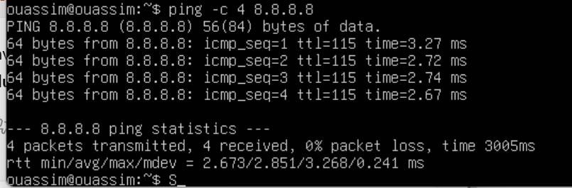

---

## 🔑 **Étape 22 — Configuration de la clé SSH**

Le dossier `.ssh` a été créé dans le répertoire personnel :

```bash
mkdir -p ~/.ssh
chmod 700 ~/.ssh
```

La clé publique fournie pour l'accès SSH a ensuite été ajoutée dans :

```text
~/.ssh/authorized_keys
```

Les permissions du fichier ont été configurées avec :

```bash
chmod 600 ~/.ssh/authorized_keys
```

Vérification :

```bash
ls -ld ~/.ssh
ls -l ~/.ssh/authorized_keys
```

Résultat :

```text
drwx------  ~/.ssh
-rw-------  ~/.ssh/authorized_keys
```

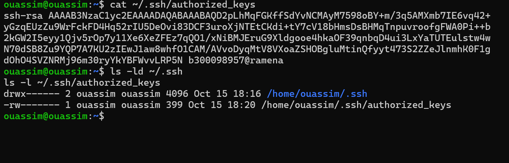

---

## 🔐 **Étape 23 — Vérification du service SSH**

Le fonctionnement du serveur SSH a été vérifié avec :

```bash
sudo systemctl status ssh
```

Le service affiche :

```text
Active: active (running)
```

Le serveur SSH écoute sur le port **22**.

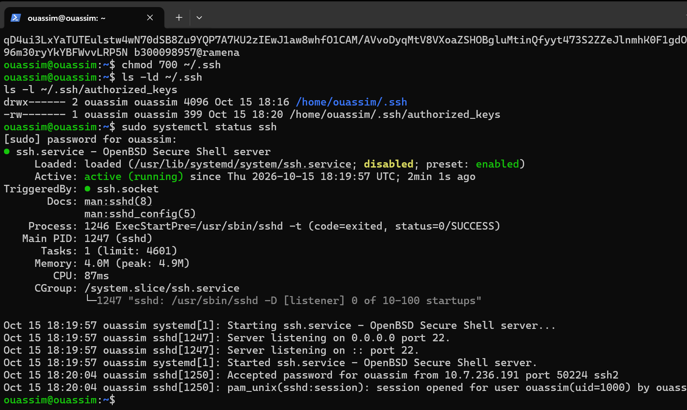

---

## 📡 **Étape 24 — Configuration d'une adresse IP statique**

L'adresse obtenue automatiquement par DHCP a été remplacée par une adresse IP statique.

Le fichier Netplan utilisé est :

```text
/etc/netplan/50-cloud-init.yaml
```

Configuration utilisée :

```yaml
network:
  version: 2
  ethernets:
    ens18:
      dhcp4: false
      addresses:
        - 10.7.236.165/23
      routes:
        - to: default
          via: 10.7.237.1
      nameservers:
        addresses:
          - 8.8.8.8
```

Après l'application de la configuration, l'adresse a été vérifiée avec :

```bash
ip a
```

La VM utilise maintenant :

```text
10.7.236.165/23
```

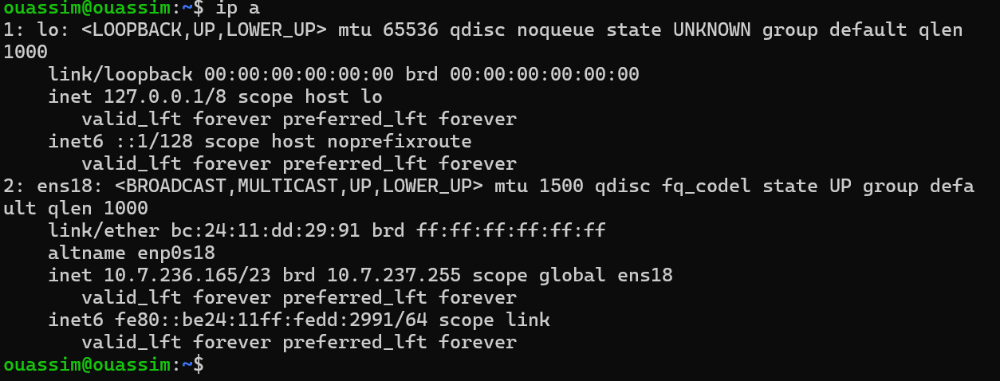

---

## 🌍 **Étape 25 — Vérification du réseau après changement d'IP**

La connectivité IP a été testée avec :

```bash
ping -c 4 8.8.8.8
```

La résolution DNS a ensuite été vérifiée avec :

```bash
ping -c 4 google.com
```

Les deux tests fonctionnent avec **0 % de perte de paquets**.

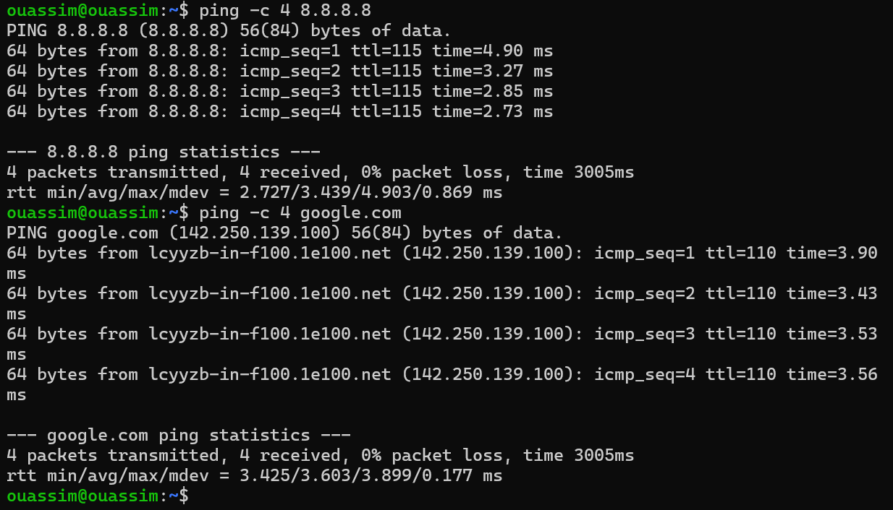

Cela confirme que :

- la passerelle fonctionne ;
- l'accès Internet fonctionne ;
- le DNS fonctionne ;
- l'adresse IP statique est fonctionnelle.

---

## 💻 **Étape 26 — Connexion SSH depuis Windows PowerShell**

Une connexion SSH vers la VM a finalement été effectuée depuis Windows PowerShell :

```powershell
ssh ouassim@10.7.236.165
```

La connexion au serveur Ubuntu a été effectuée avec succès.

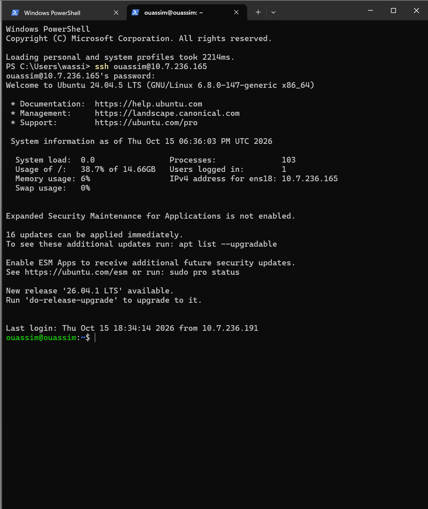

---

## 📋 **Configuration finale**

| Composant | Configuration |
|---|---|
| **Serveur Proxmox** | server56 |
| **Proxmox** | VE 9.2.2 |
| **VM** | Ouassim |
| **VM ID** | 125 |
| **OS** | Ubuntu Server 24.04.5 LTS |
| **Utilisateur** | ouassim |
| **RAM** | 4 Go |
| **Disque** | 32 GiB |
| **Interface réseau** | ens18 |
| **Carte virtuelle** | VirtIO |
| **Bridge** | vmbr0 |
| **Adresse IP** | 10.7.236.165/23 |
| **Passerelle** | 10.7.237.1 |
| **DNS** | 8.8.8.8 |
| **SSH** | Actif, port 22 |

---

## ✅ **Conclusion**

La machine virtuelle **Ubuntu Server 24.04.5 LTS** a été créée et installée avec succès sur **Proxmox VE 9.2.2**.

Pendant le laboratoire, plusieurs problèmes ont été rencontrés, notamment un **VM ID déjà utilisé**, une **incompatibilité CPU** et une erreur de syntaxe lors de la configuration Netplan.

Après correction, la VM fonctionne correctement avec l'adresse IP statique **10.7.236.165/23**.

Le réseau, le DNS et l'accès Internet ont été vérifiés avec succès. Le service **SSH** est également actif et permet maintenant d'administrer la machine Ubuntu à distance depuis Windows PowerShell.
