# 300151315

# Ubuntu Server VM on the Group 1 Proxmox Server

This guide documents how I created my own virtual machine running **Ubuntu Server 24.04** on the Group 1 Proxmox VE server, using SSH for the commands and the web interface for the installation.

## Overview

| Item | Value |
|---|---|
| Proxmox host | `server197`, Proxmox VE 9.2.2 |
| Host IP | `10.7.236.197` (web UI: `https://10.7.236.197:8006`) |
| Guest OS | Ubuntu Server 24.04.5 LTS (`ubuntu-24.04.5-live-server-amd64.iso`) |
| VM ID | `101` |
| VM name | `ayoubVM` |
| CPU | 2 cores, type `host` |
| Memory | 4 GB |
| Disk | 32 GB on `local-lvm` (LVM, `/` = 15 GB, `/boot` = 2 GB) |
| Network | VirtIO on bridge `vmbr0`, interface `ens18` in the VM |
| VM IP | `10.7.236.166/23` (static) |
| Gateway | `10.7.237.1` |
| DNS | `1.1.1.1`, `8.8.8.8` |

## Prerequisites

- Be on the college network (on campus), or connected through the **FortiClient VPN** (`RAVPN`) from home
- The `root` credentials of the group's Proxmox server (see the group's participation page)
- The IP address assigned to me in the participation table: `10.7.236.166`

## Steps

### 1. Connect to the Proxmox host

From PowerShell:

```bash
ssh root@10.7.236.197
```

Type `yes` the first time to accept the host fingerprint, then the root password (nothing is displayed while typing).

### 2. Check the server before creating anything

The server is shared by the whole group, so I first checked what already exists:

```bash
qm list                         # VMs already created by classmates
pvesh get /cluster/nextid       # first free VM ID
pvesm status                    # available storage
ip route | grep default         # gateway
ip -4 addr show vmbr0           # host IP and subnet mask
pvesm list local --content iso  # ISOs available on the server
```

Results:

| Check | Result |
|---|---|
| Existing VMs | `100 AnisHcn` (running) |
| Next free ID | `101` |
| `local-lvm` free space | about 160 GB |
| Gateway | `10.7.237.1` |
| Host address | `10.7.236.197/23`, so the network is `10.7.236.0/23` |
| ISO available | `ubuntu-24.04.5-live-server-amd64.iso` |

The ISO was already on the server, so no download was needed.

### 3. Create the VM

```bash
qm create 101 --name ayoubVM --memory 4096 --cores 2 --cpu host --ostype l26 --scsihw virtio-scsi-single --scsi0 local-lvm:32 --ide2 local:iso/ubuntu-24.04.5-live-server-amd64.iso,media=cdrom --net0 virtio,bridge=vmbr0 --boot order='scsi0;ide2'
```

| Option | Meaning |
|---|---|
| `--memory 4096` | 4 GB of RAM (the host has 64 GB shared by 8 students) |
| `--cores 2 --cpu host` | 2 CPU cores with the host CPU features |
| `--scsi0 local-lvm:32` | 32 GB virtual disk on `local-lvm` |
| `--ide2 ...iso,media=cdrom` | Ubuntu ISO in the virtual CD drive |
| `--net0 virtio,bridge=vmbr0` | Network card connected to the server's LAN |
| `--boot order='scsi0;ide2'` | Boot from the disk, then the CD |

Output:

```
Logical volume "vm-101-disk-0" created.
scsi0: successfully created disk 'local-lvm:vm-101-disk-0,size=32G'
```

### 4. Start the VM

```bash
qm start 101
qm list
```

```
VMID NAME     STATUS   MEM(MB) BOOTDISK(GB)
 100 AnisHcn  running  2048    20.00
 101 ayoubVM  running  4096    32.00
```

### 5. Open the Proxmox web interface

Go to `https://10.7.236.197:8006`. The browser shows a certificate warning because Proxmox uses a self-signed certificate: click **Paramètres avancés**, then **Continuer vers le site**.

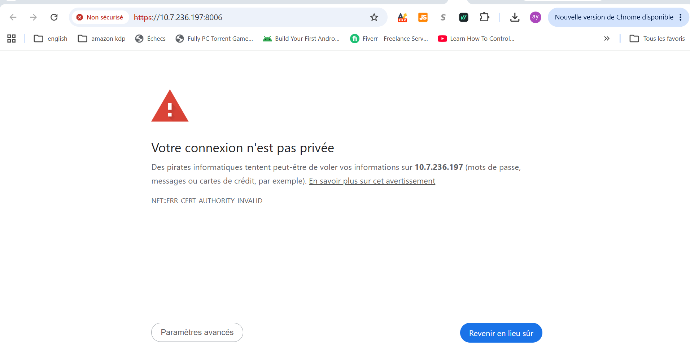

Log in as `root`, realm **Linux PAM**. VM 101 appears next to the classmate's VM 100:

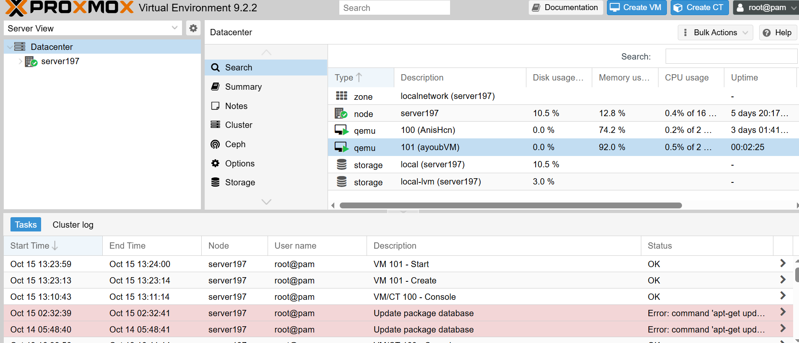

Click **server197 → 101 (ayoubVM)** to see its summary:

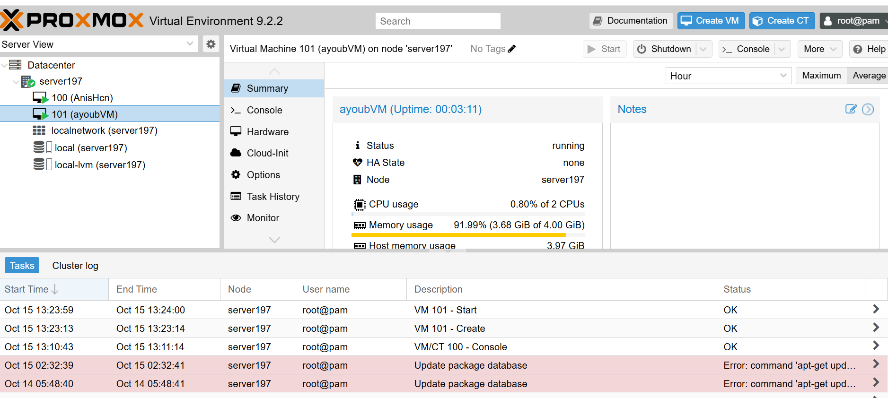

Then click **Console**.

### 6. Install Ubuntu Server

**Language:** English.

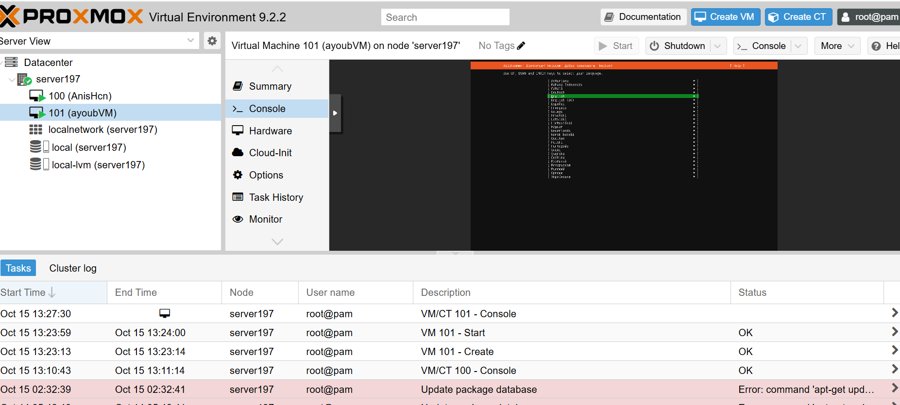

**Keyboard:** English (US). **Type of install:** Ubuntu Server.

**Network:** the VM first received a temporary DHCP address (`10.7.236.189`).

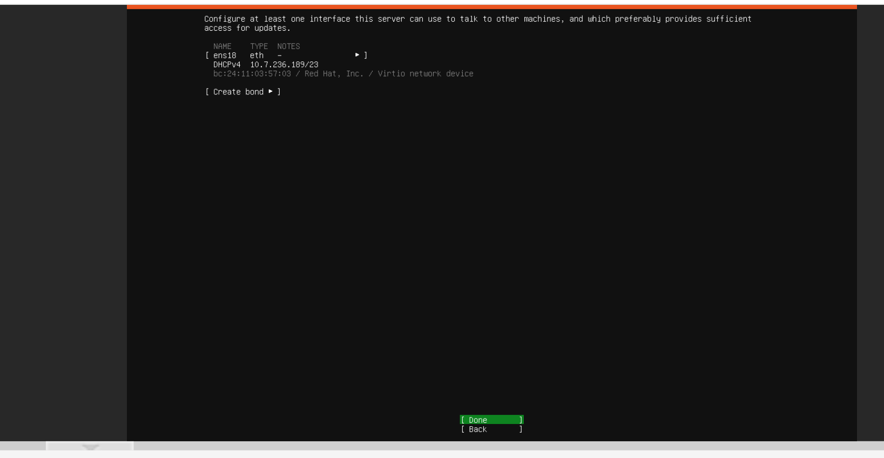

I replaced it with my assigned static address: `ens18` → **Edit IPv4** → **Manual**.

| Field | Value |
|---|---|
| Subnet | `10.7.236.0/23` |
| Address | `10.7.236.166` |
| Gateway | `10.7.237.1` |
| Name servers | `1.1.1.1,8.8.8.8` |

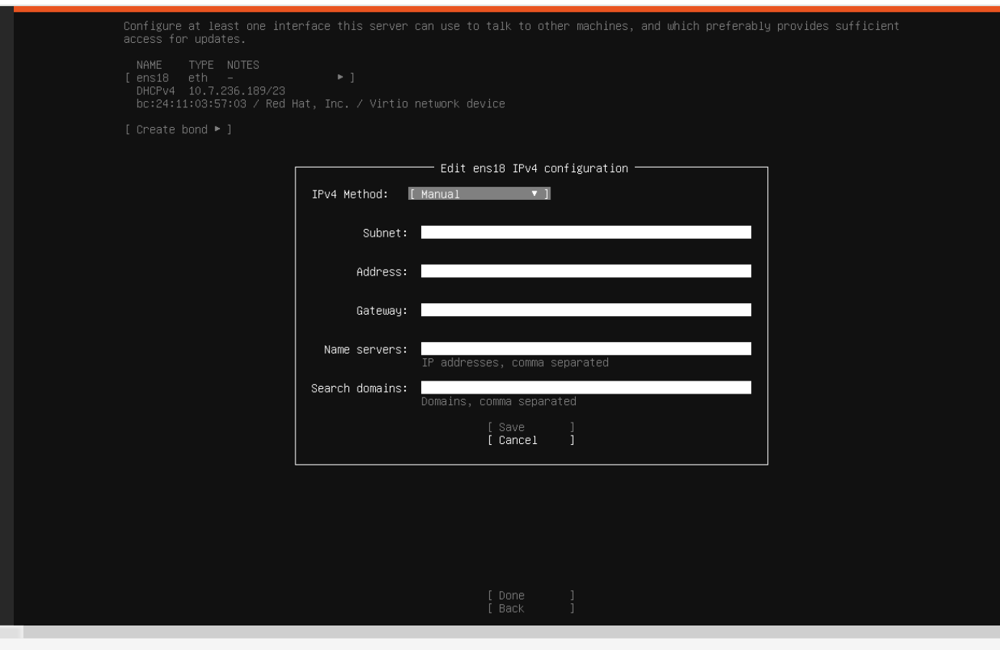

**Proxy:** empty. **Mirror:** `http://ca.archive.ubuntu.com/ubuntu/`. The mirror test passing confirmed that the IP, gateway and DNS were correct.

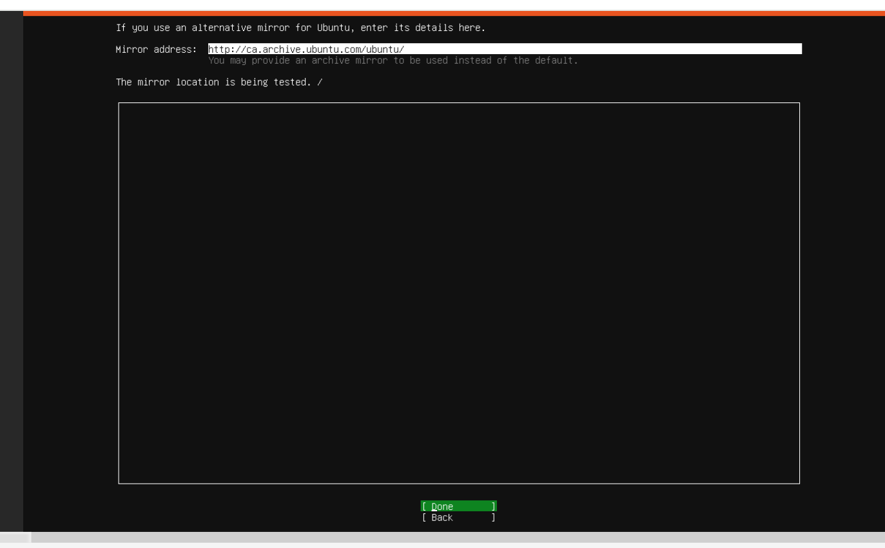

**Storage:** use an entire disk (32 GB), set up as LVM, no encryption.

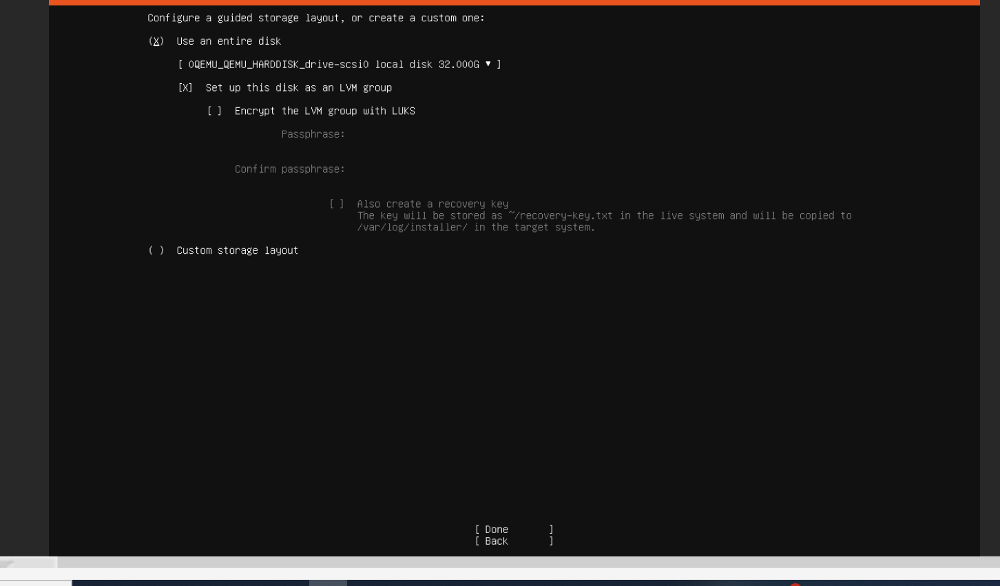

Ubuntu gives 15 GB to `/` and 2 GB to `/boot`, and leaves 15 GB free in the LVM group.

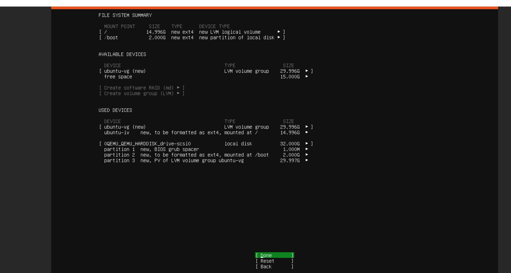

Confirm with **Continue** (this only erases the VM's empty virtual disk).

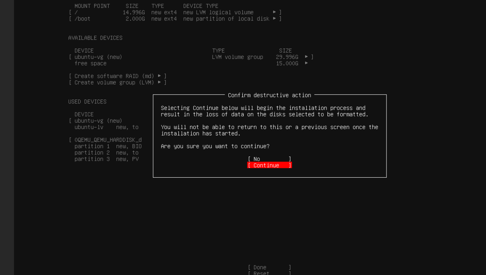

**Profile:** server name `ayoubvm`. **Ubuntu Pro:** Skip.

**SSH:** **Install OpenSSH server** checked.

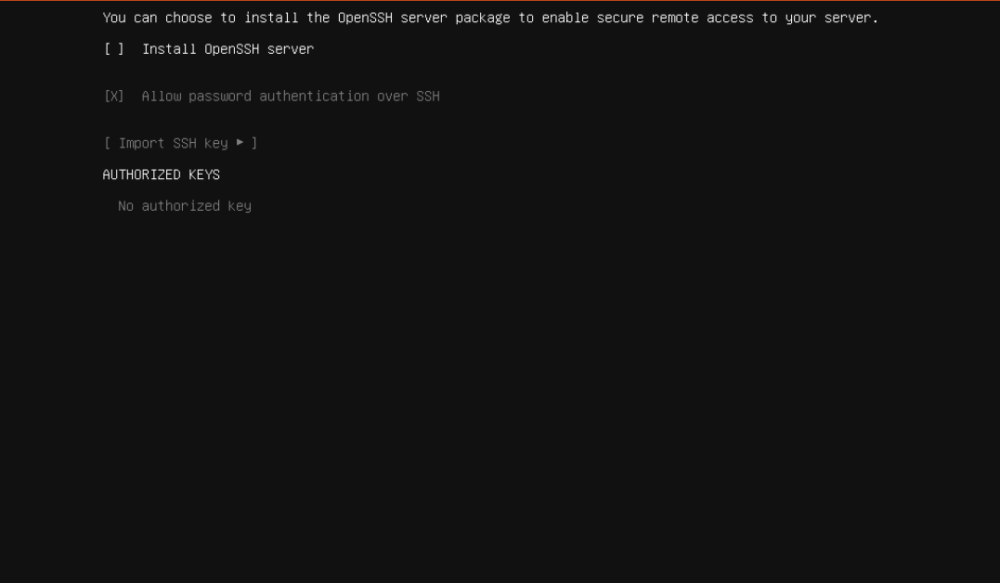

**Snaps:** none selected.

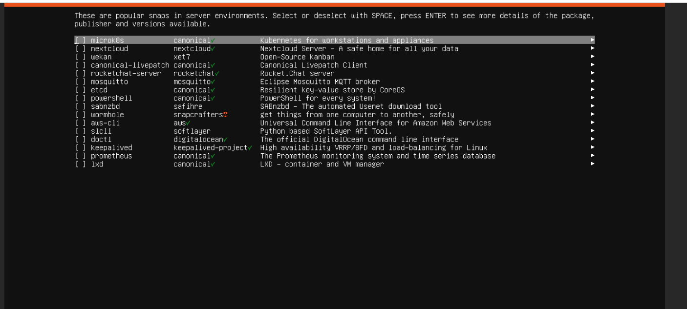

The installation then runs:

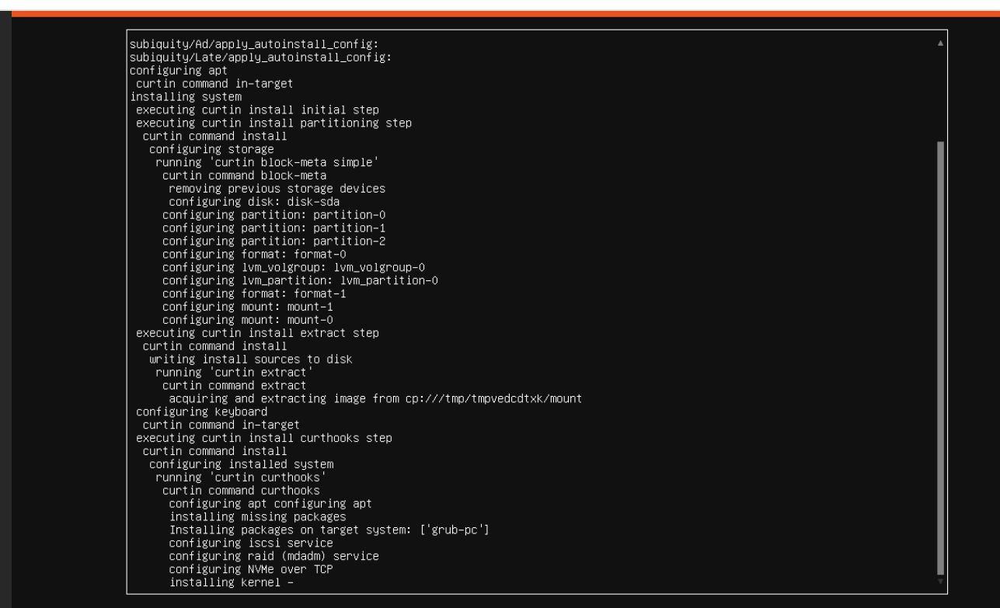

### 7. Remove the ISO and reboot

When the installer shows **Reboot Now**, detach the ISO from the Proxmox host:

```bash
qm set 101 --ide2 none,media=cdrom
```

Then press **Enter** in the console so the VM boots from its disk.

### 8. Verify

From PowerShell on my computer:

```bash
ping 10.7.236.166
ssh <username>@10.7.236.166
```

Inside the VM:

```bash
hostname          # ayoubvm
ip -4 addr        # 10.7.236.166/23 on ens18
ping -c 3 1.1.1.1
lsb_release -a    # Ubuntu 24.04.5 LTS
```


## Useful commands (on the Proxmox host)

```bash
qm list                 # list all VMs
qm start 101            # start the VM
qm shutdown 101         # graceful shutdown
qm stop 101             # force stop
qm config 101           # show the VM configuration
```

## Troubleshooting

| Problem | Cause | Fix |
|---|---|---|
| `Permission denied` on SSH | Wrong password | The emoji digits on the participation page are plain digits; type them as numbers |
| `Votre connexion n'est pas privée` / `NET::ERR_CERT_AUTHORITY_INVALID` | Self-signed Proxmox certificate | **Paramètres avancés** → **Continuer vers le site** |
| Commands pasted together don't all run | Several lines pasted at once | Run them one at a time |
| Wrong characters in the installer (`/`, `,`) | Console uses a US keyboard, PC uses FRA | Check each field before saving |
| Back on a previous installer screen | **Esc** was pressed | Press **Done** to move forward again |
| Mirror test fails | Wrong IP, gateway or DNS | **Back** to the network screen and fix the values |
