# 300151315

# Ubuntu Server VM on the Group 1 Proxmox Server

This guide documents how I created my own virtual machine running **Ubuntu Server 24.04** on the Group 1 Proxmox VE server, using SSH for the commands and the web interface for the installation.

## Overview

| Item | Value |
|---|---|
| Proxmox host | `server197`, Proxmox VE 9.2.2 |
| Host IP | `10.7.236.197` (web UI: `https://10.7.236.197:8006`) |
| Guest OS | Ubuntu Server 24.04.5 LTS (`ubuntu-24.04.5-live-server-amd64.iso`) |
| VM ID | `101` |
| VM name | `ayoubVM` |
| CPU | 2 cores, type `host` |
| Memory | 4 GB |
| Disk | 32 GB (LVM, `/` = 30 GB after `lvextend`, `/boot` = 2 GB); see 5.Storage for the move to NVMe |
| Network | VirtIO on bridge `vmbr0`, interface `ens18` in the VM |
| VM IP | `10.7.236.196/23` (static, was `.166` until an IP conflict, see step 9) |
| VM user | `ayoub` |
| Gateway | `10.7.237.1` |
| DNS | `1.1.1.1`, `8.8.8.8` |

## Prerequisites

- Be on the college network (on campus), or connected through the **FortiClient VPN** (`RAVPN`) from home
- The `root` credentials of the group's Proxmox server (see the group's participation page)
- The IP address assigned to me in the participation table: `10.7.236.166`

## Steps

### 1. Connect to the Proxmox host

From PowerShell:

```bash
ssh root@10.7.236.197
```

Type `yes` the first time to accept the host fingerprint, then the root password (nothing is displayed while typing).

### 2. Check the server before creating anything

The server is shared by the whole group, so I first checked what already exists:

```bash
qm list                         # VMs already created by classmates
pvesh get /cluster/nextid       # first free VM ID
pvesm status                    # available storage
ip route | grep default         # gateway
ip -4 addr show vmbr0           # host IP and subnet mask
pvesm list local --content iso  # ISOs available on the server
```

Results:

| Check | Result |
|---|---|
| Existing VMs | `100 AnisHcn` (running) |
| Next free ID | `101` |
| `local-lvm` free space | about 160 GB |
| Gateway | `10.7.237.1` |
| Host address | `10.7.236.197/23`, so the network is `10.7.236.0/23` |
| ISO available | `ubuntu-24.04.5-live-server-amd64.iso` |

The ISO was already on the server, so no download was needed.

### 3. Create the VM

```bash
qm create 101 --name ayoubVM --memory 4096 --cores 2 --cpu host --ostype l26 --scsihw virtio-scsi-single --scsi0 local-lvm:32 --ide2 local:iso/ubuntu-24.04.5-live-server-amd64.iso,media=cdrom --net0 virtio,bridge=vmbr0 --boot order='scsi0;ide2'
```

| Option | Meaning |
|---|---|
| `--memory 4096` | 4 GB of RAM (the host has 64 GB shared by 8 students) |
| `--cores 2 --cpu host` | 2 CPU cores with the host CPU features |
| `--scsi0 local-lvm:32` | 32 GB virtual disk on `local-lvm` |
| `--ide2 ...iso,media=cdrom` | Ubuntu ISO in the virtual CD drive |
| `--net0 virtio,bridge=vmbr0` | Network card connected to the server's LAN |
| `--boot order='scsi0;ide2'` | Boot from the disk, then the CD |

Output:

```
Logical volume "vm-101-disk-0" created.
scsi0: successfully created disk 'local-lvm:vm-101-disk-0,size=32G'
```

### 4. Start the VM

```bash
qm start 101
qm list
```

```
VMID NAME     STATUS   MEM(MB) BOOTDISK(GB)
 100 AnisHcn  running  2048    20.00
 101 ayoubVM  running  4096    32.00
```

### 5. Open the Proxmox web interface

Go to `https://10.7.236.197:8006`. The browser shows a certificate warning because Proxmox uses a self-signed certificate: click **Paramètres avancés**, then **Continuer vers le site**.

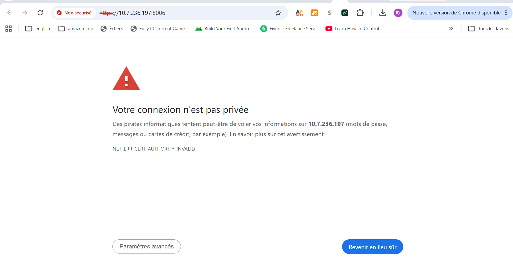

Log in as `root`, realm **Linux PAM**. VM 101 appears next to the classmate's VM 100:

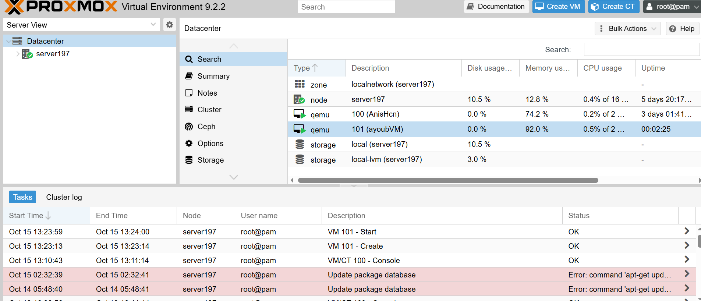

Click **server197 → 101 (ayoubVM)** to see its summary:

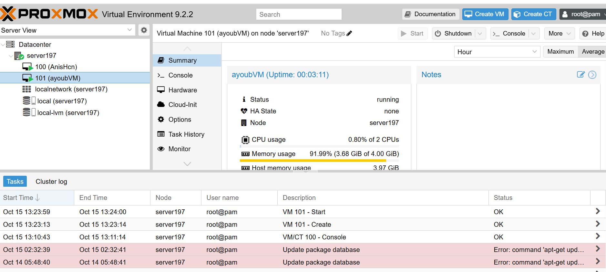

Then click **Console**.

### 6. Install Ubuntu Server

**Language:** English.

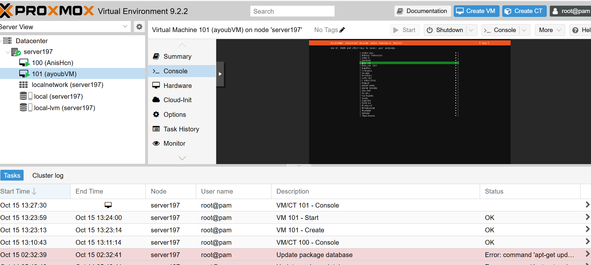

**Keyboard:** English (US). **Type of install:** Ubuntu Server.

**Network:** the VM first received a temporary DHCP address (`10.7.236.189`).

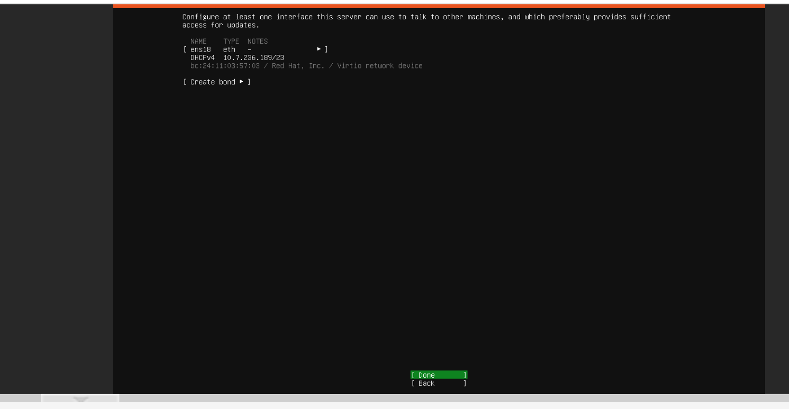

I replaced it with my assigned static address: `ens18` → **Edit IPv4** → **Manual**.

| Field | Value |
|---|---|
| Subnet | `10.7.236.0/23` |
| Address | `10.7.236.166` (changed to `.196` later, see step 9) |
| Gateway | `10.7.237.1` |
| Name servers | `1.1.1.1,8.8.8.8` |

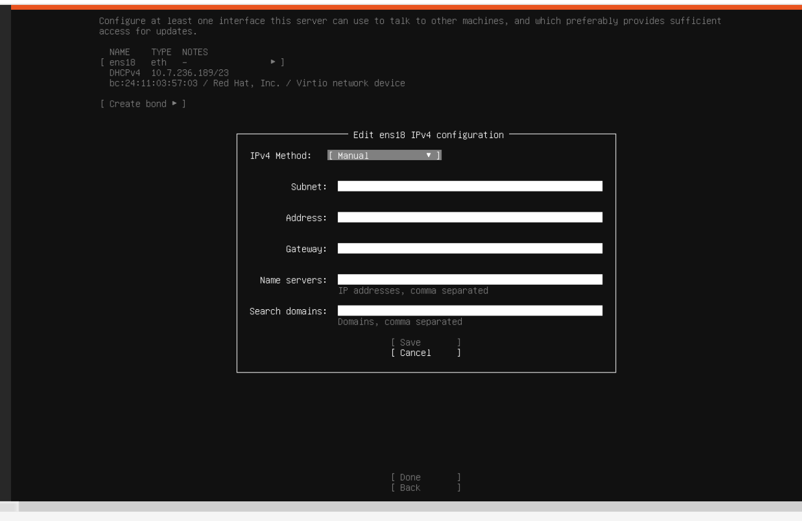

**Proxy:** empty. **Mirror:** `http://ca.archive.ubuntu.com/ubuntu/`. The mirror test passing confirmed that the IP, gateway and DNS were correct.

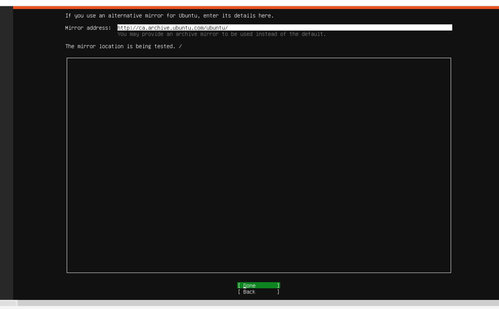

**Storage:** use an entire disk (32 GB), set up as LVM, no encryption.

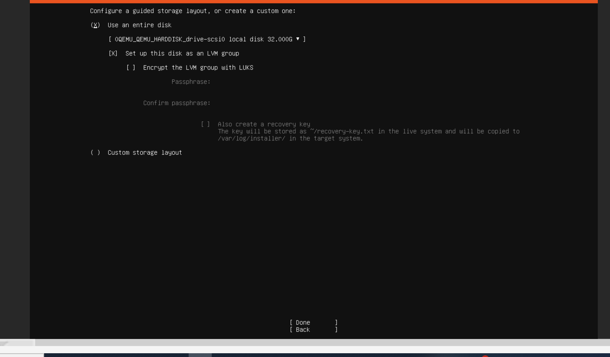

Ubuntu gives 15 GB to `/` and 2 GB to `/boot`, and leaves 15 GB free in the LVM group.

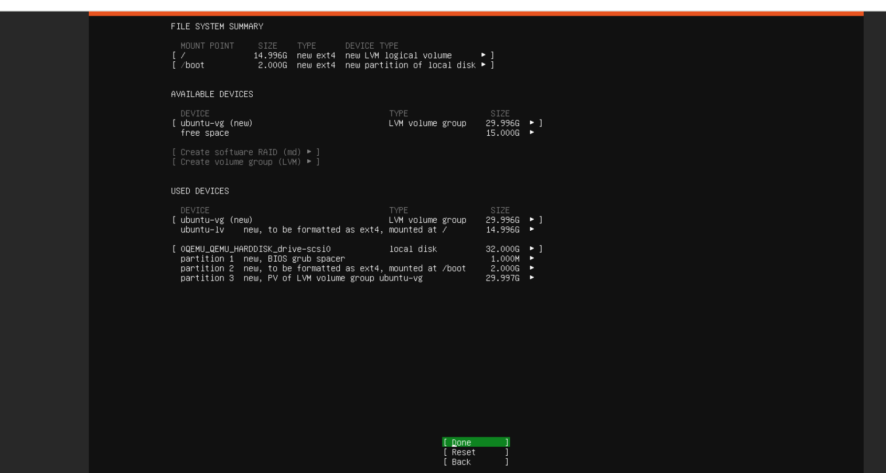

Confirm with **Continue** (this only erases the VM's empty virtual disk).

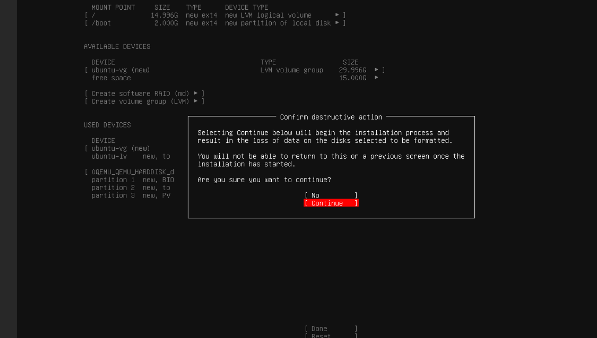

**Profile:** server name `ayoubvm`. **Ubuntu Pro:** Skip.

**SSH:** **Install OpenSSH server** checked.

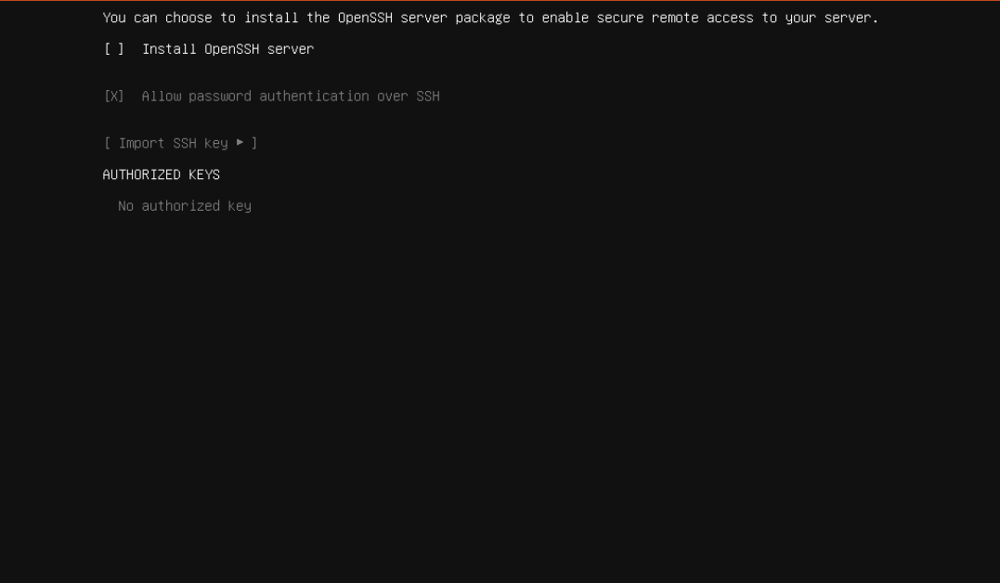

**Snaps:** none selected.

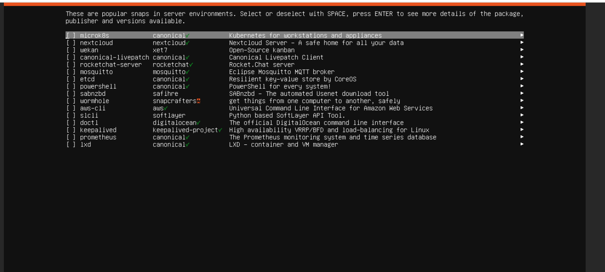

The installation then runs:

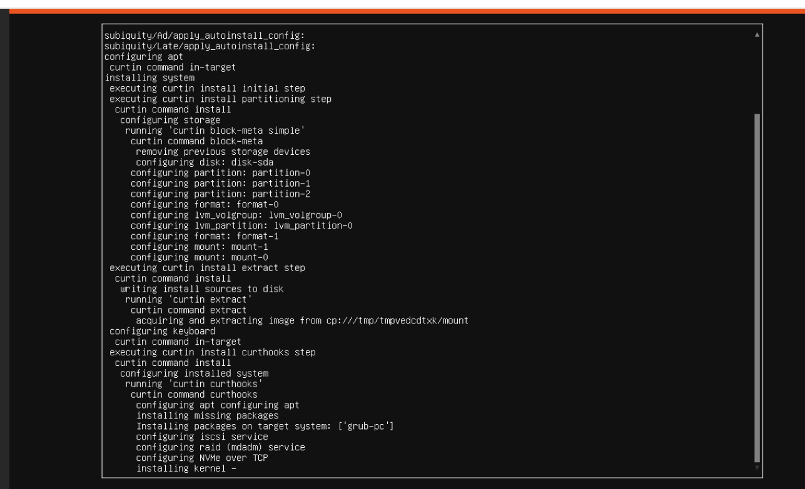

### 7. Remove the ISO and reboot

When the installer shows **Reboot Now**, detach the ISO from the Proxmox host:

```bash
qm set 101 --ide2 none,media=cdrom
```

Then press **Enter** in the console so the VM boots from its disk.

### 8. Verify

From PowerShell on my computer:

```bash
ping 10.7.236.196
ssh ayoub@10.7.236.196
```

Inside the VM:

```bash
hostname          # ayoubvm
ip -4 addr        # 10.7.236.196/23 on ens18
ping -c 3 1.1.1.1
lsb_release -a    # Ubuntu 24.04.5 LTS
```

### 9. IP conflict: moving from `.166` to `.196`

SSH to `10.7.236.166` was refused even though `sshd` was running in the VM. Comparing MAC addresses showed that another device was answering on that IP:

| Where | Command | MAC seen for `10.7.236.166` |
|---|---|---|
| Inside my VM | `ip a` | `bc:24:11:03:57:03` (my VM) |
| My PC | `arp -a \| findstr 10.7.236.166` | `ea-b9-f3-fa-25-e5` |
| Proxmox host | `ip neigh show 10.7.236.166` | `ea:b9:f3:fa:25:e5` |

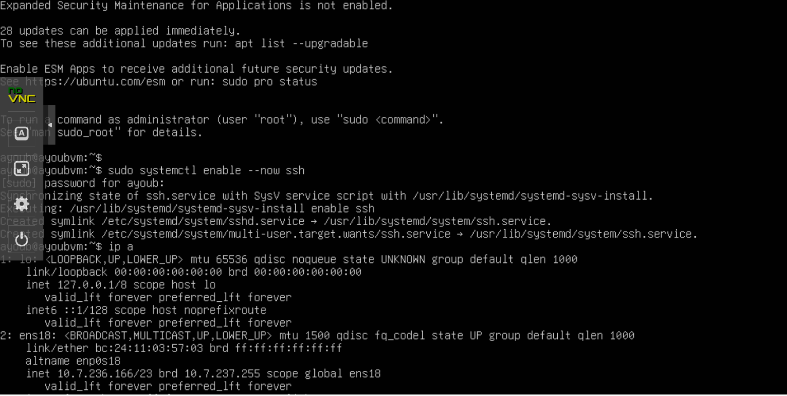

`sshd` was running and listening on port 22 inside the VM:

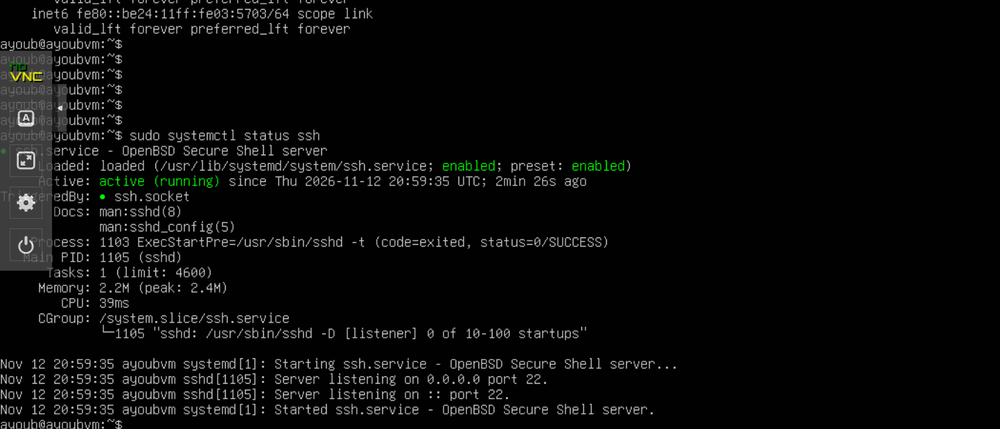

`grep -ril "ea:b9:f3:fa:25:e5" /etc/pve/` on `server197` found nothing, so it is not a VM of our group: it is another device on the network (random Wi-Fi style MAC).

I checked that `10.7.236.196` was free from the Proxmox host (`ping` → *Destination Host Unreachable*, `ip neigh` → `FAILED`), then changed the VM's IP from the console:

```bash
sudo loadkeys fr                                                  # French keyboard in the console
sudo sed -i 's/10.7.236.166/10.7.236.196/' /etc/netplan/*.yaml
sudo grep -r 196 /etc/netplan/
sudo netplan apply
ip a
```

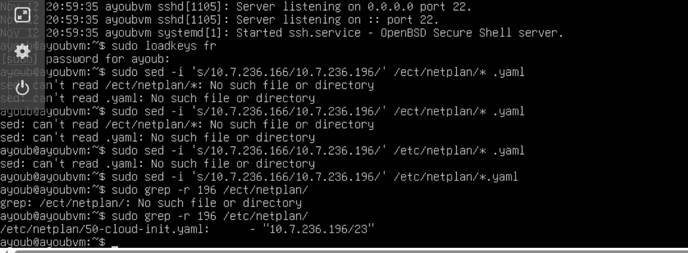

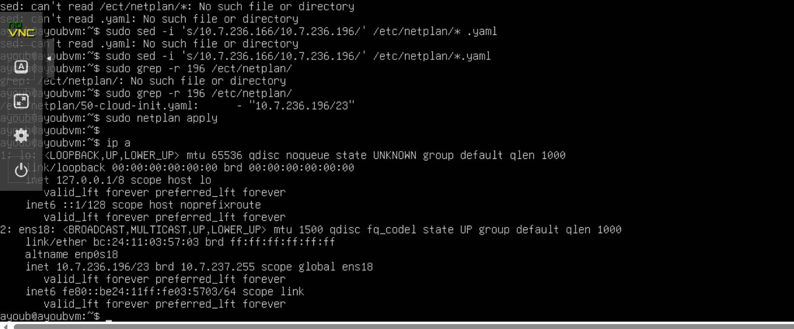

### 10. Professor's SSH key

The professor's public key ("Clé du prof" on the 3.VMs page) is added to my user `ayoub` so he can connect with `ssh -i <his key> ayoub@10.7.236.196`:

```bash
ssh ayoub@10.7.236.196
mkdir -p ~/.ssh
chmod 700 ~/.ssh
echo "ssh-rsa AAAAB3...vvLRP5N b300098957@ramena" >> ~/.ssh/authorized_keys
chmod 600 ~/.ssh/authorized_keys
ls -ld ~/.ssh                    # drwx------
ls -l ~/.ssh/authorized_keys     # -rw-------
cat ~/.ssh/authorized_keys
```

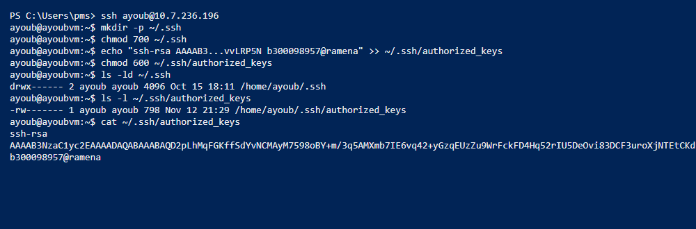

The key was already there once (added on Oct 15), so the duplicate line was removed with `sort -u ~/.ssh/authorized_keys -o ~/.ssh/authorized_keys`:

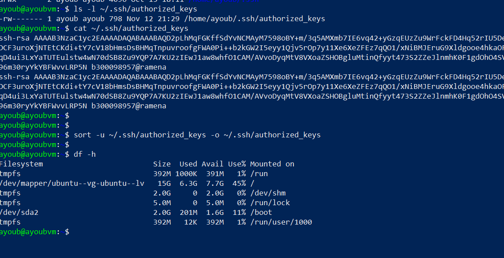

| Item | Value |
|---|---|
| VM user | `ayoub` |
| VM IP | `10.7.236.196` |
| Key | `b300098957@ramena` in `/home/ayoub/.ssh/authorized_keys` |

## Useful commands (on the Proxmox host)

```bash
qm list                 # list all VMs
qm start 101            # start the VM
qm shutdown 101         # graceful shutdown
qm stop 101             # force stop
qm config 101           # show the VM configuration
```

## Troubleshooting

| Problem | Cause | Fix |
|---|---|---|
| `Permission denied` on SSH | Wrong password | The emoji digits on the participation page are plain digits; type them as numbers |
| `Votre connexion n'est pas privée` / `NET::ERR_CERT_AUTHORITY_INVALID` | Self-signed Proxmox certificate | **Paramètres avancés** → **Continuer vers le site** |
| Commands pasted together don't all run | Several lines pasted at once | Run them one at a time |
| Wrong characters in the installer (`/`, `,`) | Console uses a US keyboard, PC uses FRA | Check each field before saving |
| Back on a previous installer screen | **Esc** was pressed | Press **Done** to move forward again |
| Mirror test fails | Wrong IP, gateway or DNS | **Back** to the network screen and fix the values |
| SSH to the VM refused although `sshd` is running | Another device was using the VM's IP (`10.7.236.166`) | Compare MACs (`arp -a`, `ip neigh`), pick a free IP, change it in `/etc/netplan/*.yaml` |
| Forgot the VM user / password | Typed in the console with a US keyboard during install | GRUB → *Advanced options* → *recovery mode* → `root`, then `ls /home` and `passwd ayoub` |

## Recovering the VM user and password

The user name was not written down and the password typed during the install (US keyboard in the console) no longer matched. From the Proxmox console: **Hard Reset**, **Esc** to open GRUB, *Advanced options for Ubuntu* → *(recovery mode)* → **root**:

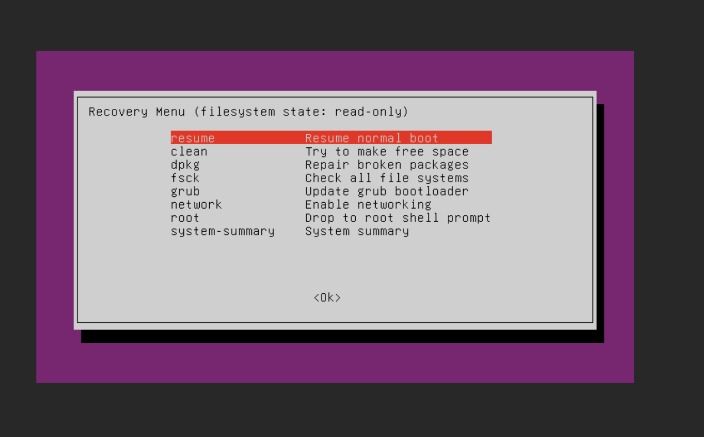

```bash
ls /home                      # ayoub
mount -o remount,rw /
passwd ayoub
reboot
```

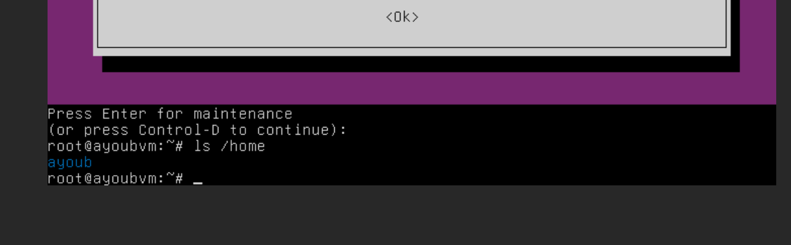

SSH was then enabled so it starts at every boot:

```bash
sudo systemctl enable --now ssh
```

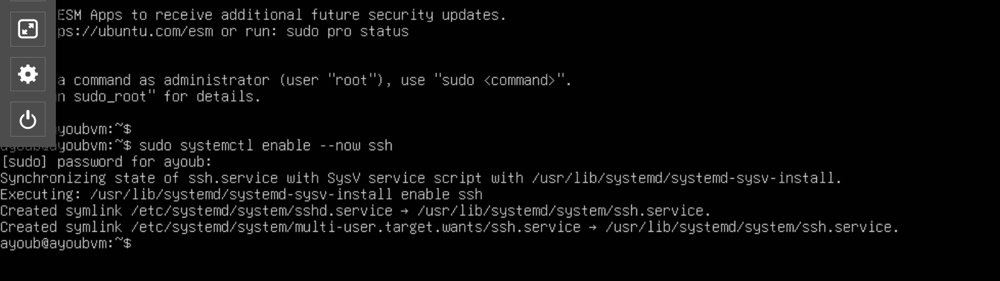

## Using the whole disk

The Ubuntu installer only gave 15 GB to `/` and left 15 GB free in `ubuntu-vg`. I extended the logical volume and the file system online (no reboot):

```bash
sudo vgs                                                  # VFree 15.00g
sudo lvextend -r -l +100%FREE /dev/ubuntu-vg/ubuntu-lv    # / goes from 15 GB to 30 GB
df -h /
```

