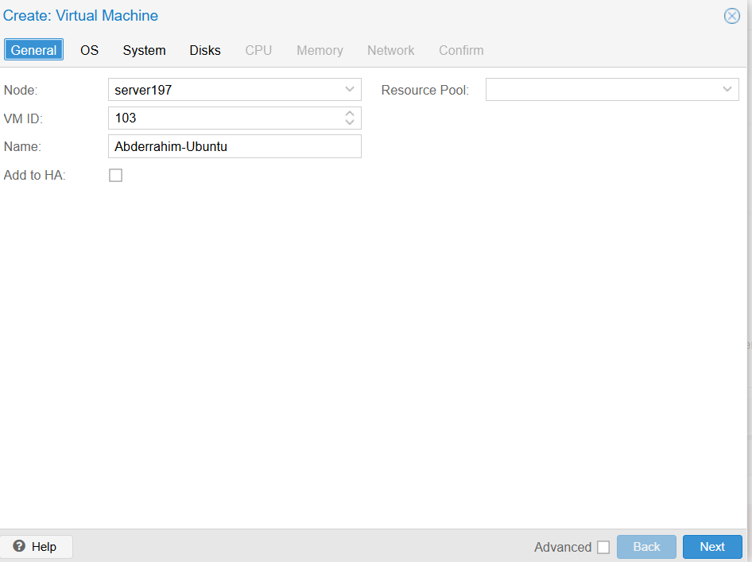
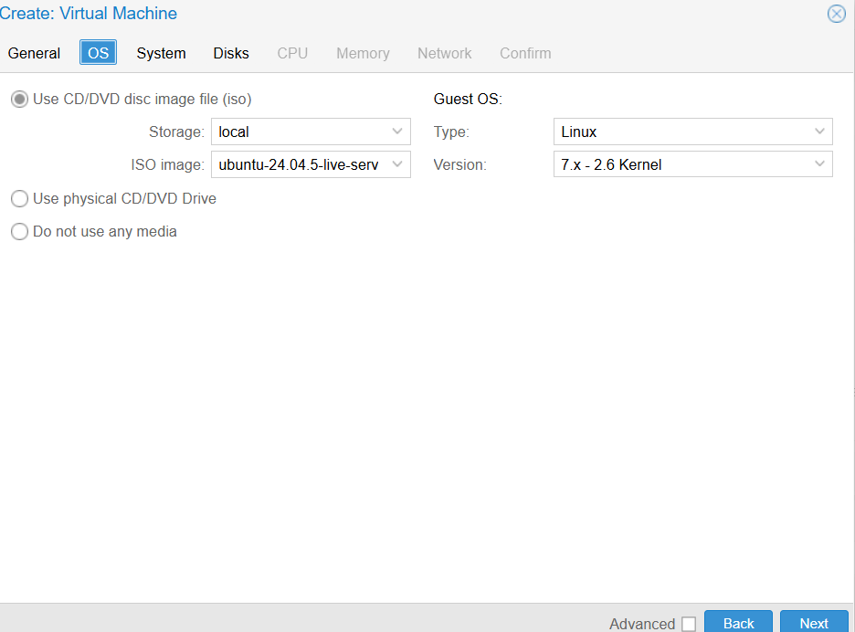
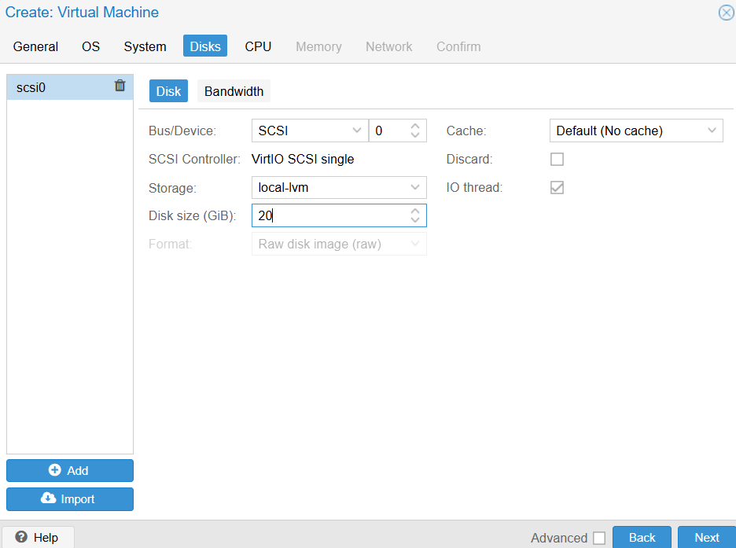
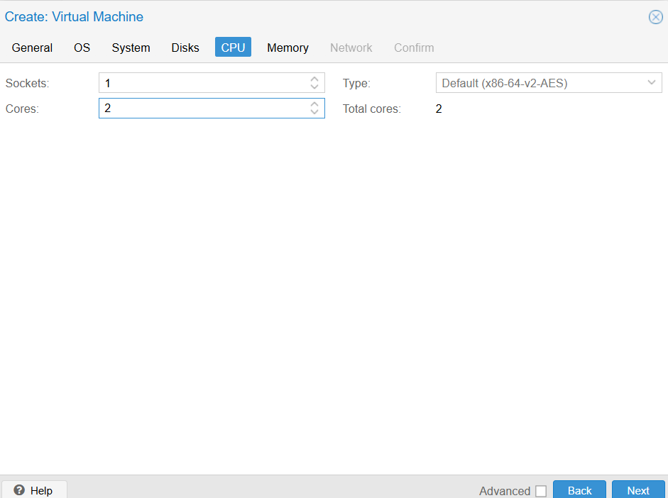
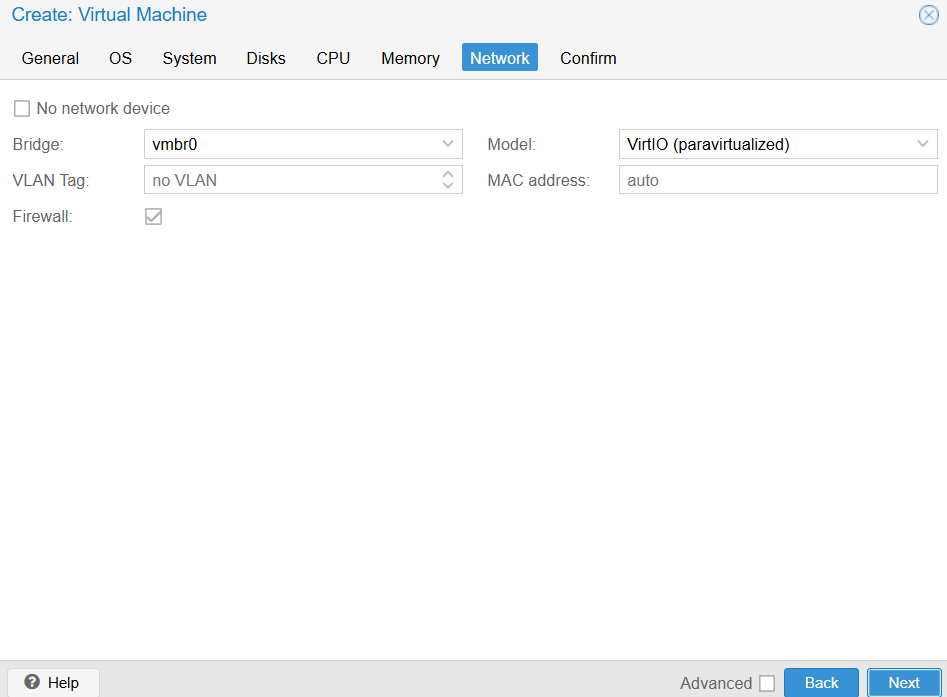
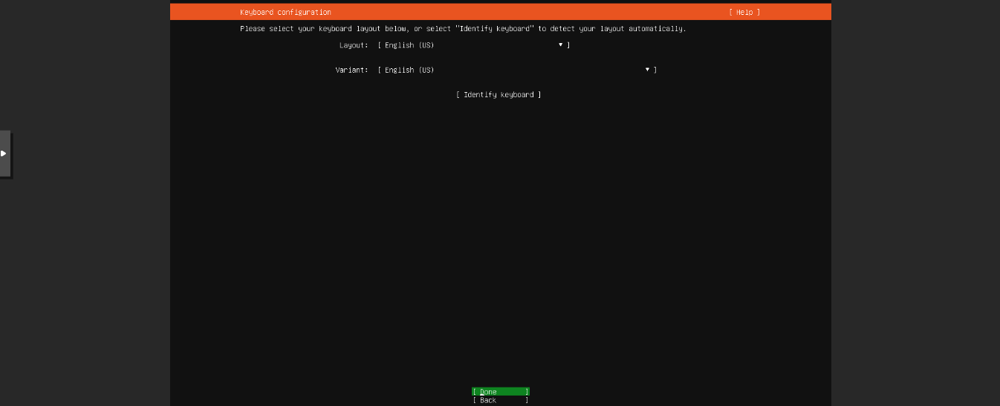
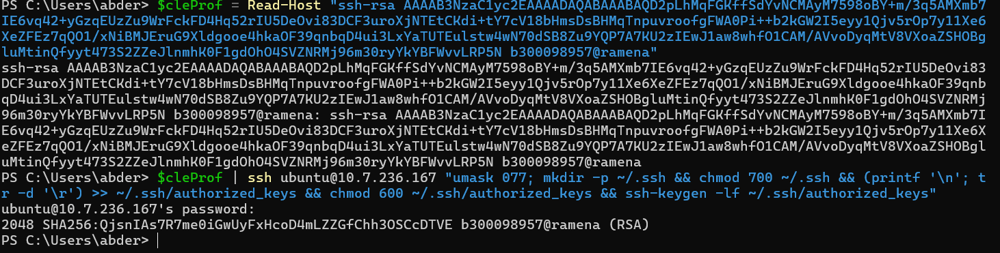

# Laboratoire 3 - Machines virtuelles

## Informations

- Matricule : 300151449
- Etudiant : Abderrahim
- Cours : INF1085

## Configuration Proxmox

| Parametre | Valeur |
|---|---|
| Serveur | server197 |
| IP Proxmox | 10.7.236.197 |
| VM ID | 103 |
| Nom | Abderrahim-Ubuntu |
| Systeme | Ubuntu Server 24.04.5 LTS |
| RAM | 4 Go |
| CPU | 2 coeurs |
| Disque | 20 Go |
| Bridge | vmbr0 |

## Configuration reseau

| Parametre | Valeur |
|---|---|
| Interface | ens18 |
| Adresse IP | 10.7.236.167/23 |
| Passerelle | 10.7.237.1 |
| DNS | 8.8.8.8 |
| DHCP | Desactive |

## Configuration SSH

- Service OpenSSH actif.
- Port 22 accessible.
- Utilisateur : ubuntu
- Cle publique RSA presente.
- Identifiant : b300098957@ramena
- Permissions .ssh : 700
- Permissions authorized_keys : 600

## Connexion SSH

```bash
ssh ubuntu@10.7.236.167
```

## Resultats des tests

| Test | Resultat |
|---|---|
| Installation Ubuntu | Reussie |
| Configuration IP statique | Reussie |
| SSH local | Reussi |
| Ping depuis Windows | 0 % de perte |
| Test du port 22 | True |
| SSH depuis Windows | Reussi |
| Acces du professeur | A confirmer |
| Internet et DNS | A confirmer |

## Conclusion

La machine virtuelle Ubuntu est operationnelle.
La connexion SSH depuis Windows a ete testee avec succes.
La validation par le professeur reste a confirmer.

## Captures d'ecran

### 01-proxmox-dashboard


### 02-vm-general



### 03-ubuntu-iso



### 04-vm-system


### 05-vm-disks



### 06-vm-cpu



### 07-vm-memory


### 08-vm-network



### 09-vm-confirm


### 10-vm-created


### 15-ubuntu-language



### 16-ubuntu-keyboard


### cnx.ssh




## Commandes de verification

### Configuration reseau Ubuntu

```bash
ip -4 addr show ens18
ip route
sudo netplan get
```

### Verification du service SSH

```bash
sudo systemctl status ssh
sudo sshd -t
```

### Verification de la cle publique

```bash
ls -la ~/.ssh
ssh-keygen -lf ~/.ssh/authorized_keys
```

### Test SSH local

```bash
ssh ubuntu@localhost
```

### Tests depuis Windows PowerShell

```powershell
ping 10.7.236.167
Test-NetConnection 10.7.236.167 -Port 22
ssh ubuntu@10.7.236.167
```

### Verification apres connexion SSH

```bash
whoami
hostname
uptime
ip -4 addr show ens18
```

