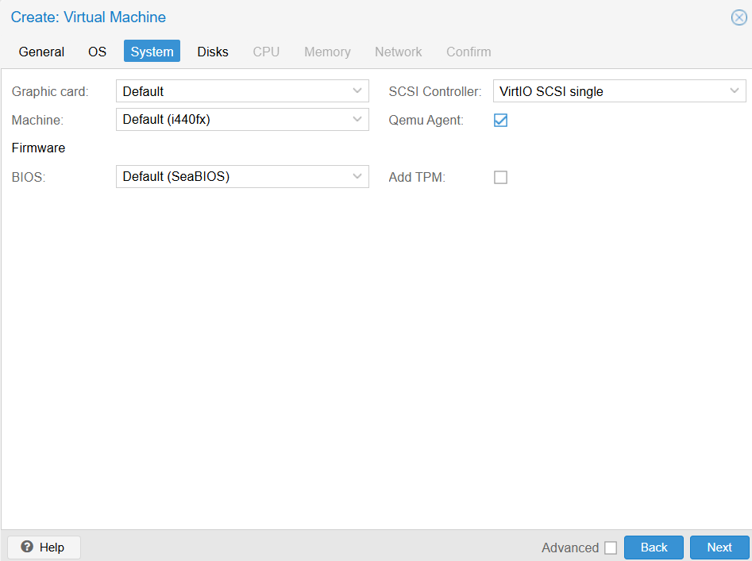
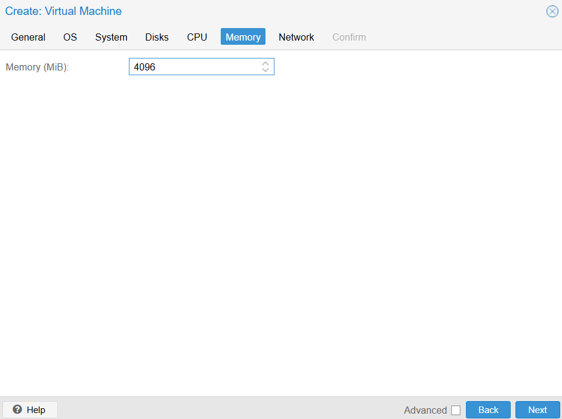
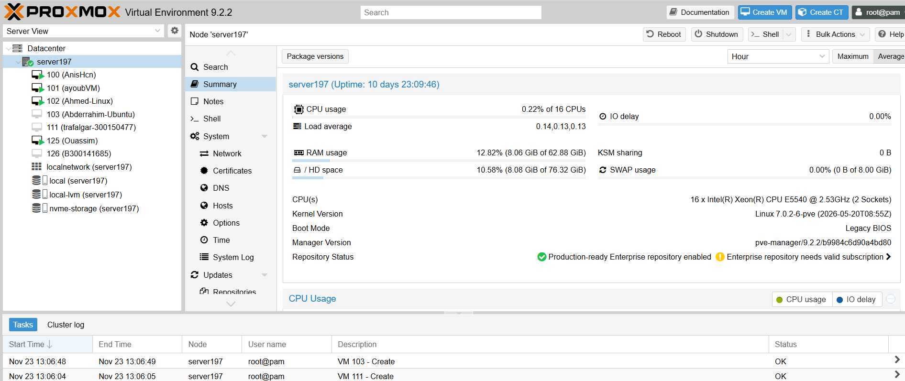

# 🖥️ Création d'une VM Ubuntu Server sur Proxmox VE

**Nom :** Abderrahim  
**Matricule :** 300151449  
**Cours :** INF1085  

---

## 🎯 Objectif

Créer et configurer une machine virtuelle Ubuntu Server 24.04.5 LTS sur Proxmox VE, configurer une adresse IP statique et permettre son administration à distance avec SSH.

---

## 🔐 Étape 1 — Connexion au serveur Proxmox

Connexion à l'interface Web du serveur Proxmox :

https://10.7.236.197:8006

- **Serveur :** server197
- **Adresse IP :** 10.7.236.197
- **Port :** 8006

La connexion à l'interface Proxmox a réussi.

---

## 🖥️ Étape 2 — Création de la machine virtuelle

Création de la machine virtuelle Abderrahim-Ubuntu sur le serveur server197.

- **VM ID :** 103
- **Nom :** Abderrahim-Ubuntu
- **Système :** Ubuntu Server 24.04.5 LTS

---

## 📀 Étape 3 — Installation du système d'exploitation

Installation d'Ubuntu Server 24.04.5 LTS à partir d'une image ISO.

Le système Ubuntu Server a été installé et démarré correctement.

---

## ⚙️ Étape 4 — Configuration du processeur

La machine virtuelle utilise deux cœurs de processeur virtuels.

- **CPU :** 2 cœurs

---

## 💾 Étape 5 — Configuration de la mémoire et du stockage

Les ressources suivantes ont été attribuées à la machine virtuelle :

- **RAM :** 4 Go
- **Disque virtuel :** 20 Go

---

## 🌐 Étape 6 — Configuration de la carte réseau

La carte réseau virtuelle utilise les paramètres suivants :

- **Modèle :** VirtIO
- **Bridge :** vmbr0
- **Interface Ubuntu :** ens18

---

## 👤 Étape 7 — Configuration du compte utilisateur

Un compte utilisateur a été créé pour administrer Ubuntu Server.

- **Utilisateur :** ubuntu
- **Nom de la machine :** ubuntu-bderrahim

Vérification :

```bash
whoami
hostname
```

---

## 🐧 Étape 8 — Démarrage d'Ubuntu Server

Après l'installation, la machine virtuelle démarre correctement.

La connexion avec l'utilisateur ubuntu fonctionne.

---

## 📡 Étape 9 — Vérification de l'interface réseau

La configuration réseau a été vérifiée avec les commandes :

```bash
ip a
ip -4 addr show ens18
ip route
```

L'interface réseau utilisée est ens18.

---

## 🌐 Étape 10 — Configuration de l'adresse IP statique

La machine virtuelle utilise une adresse IP statique afin de faciliter son administration à distance.

Configuration Netplan :

```yaml
network:
  version: 2
  ethernets:
    ens18:
      dhcp4: false
      addresses:
        - 10.7.236.167/23
      routes:
        - to: default
          via: 10.7.237.1
      nameservers:
        addresses:
          - 8.8.8.8
```

Vérification :

```bash
sudo netplan get
ip -4 addr show ens18
```

Adresse IP finale :

```text
10.7.236.167/23
```

---

## 🛣️ Étape 11 — Vérification de la table de routage

```bash
ip route
```

La passerelle configurée est :

```text
10.7.237.1
```

---

## 🔗 Étape 12 — Test de communication avec Proxmox

```bash
ping -c 4 10.7.236.197
```

Résultat observé : 0 % de perte de paquets.

La communication entre la machine virtuelle et le serveur Proxmox fonctionne.

---

## 🌍 Étape 13 — Vérification de la passerelle

```bash
ping -c 40 10.7.237.1
```

Résultat observé :

- 40 paquets transmis
- 15 paquets reçus
- 62,5 % de perte de paquets

La passerelle répond, mais la communication présente des pertes.

---

## ⚠️ Étape 14 — Test de la connexion Internet

```bash
ping -c 4 8.8.8.8
```

Le test de connectivité ICMP vers Internet n'a pas réussi.

Le DNS est configuré, mais son fonctionnement reste à confirmer.

Ce problème n'empêche pas la connexion SSH depuis le réseau local.

---

## 🔐 Étape 15 — Vérification du serveur OpenSSH

Le service SSH permet d'administrer la machine virtuelle à distance.

```bash
sudo systemctl status ssh
```

Résultat :

```text
Active: active (running)
```

Le service SSH est actif et accessible sur le port 22.

---

## ⚙️ Étape 16 — Vérification de la configuration SSH

```bash
sudo sshd -t
```

Aucune erreur de configuration n'a été affichée.

Le service SSH a également été redémarré pendant le diagnostic.

```bash
sudo systemctl restart ssh
```

---

## 🔑 Étape 17 — Configuration de la clé publique SSH

Une clé publique RSA est présente dans le fichier :

```text
~/.ssh/authorized_keys
```

Identifiant de la clé :

```text
b300098957@ramena
```

Vérification :

```bash
ls -la ~/.ssh
cat ~/.ssh/authorized_keys
```

La correspondance avec la clé officielle du professeur reste à confirmer.

---

## 🛡️ Étape 18 — Vérification des permissions SSH

Les permissions observées sont :

```text
drwx------  .ssh
-rw-------  authorized_keys
```

- Dossier .ssh : 700
- Fichier authorized_keys : 600

Ces permissions sont correctes pour l'authentification SSH par clé publique.

---

## 🧪 Étape 19 — Test SSH local

Une connexion SSH locale a été effectuée :

```bash
ssh ubuntu@localhost
```

Résultat : connexion réussie.

Ce test confirme le fonctionnement local du serveur SSH.

---

## ⚠️ Étape 20 — Difficultés rencontrées

Pendant le laboratoire, plusieurs problèmes ont été rencontrés :

- Difficultés de connexion à Proxmox.
- Utilisation d'adresses IP incorrectes pendant les premiers tests.
- Connexion SSH interrompue.
- Pertes de paquets vers la passerelle.

### 🔧 Solutions

- Vérification de l'adresse IP du serveur Proxmox.
- Vérification de l'adresse IP de la machine virtuelle.
- Vérification de la configuration Netplan.
- Vérification et redémarrage du service SSH.
- Tests de connectivité depuis Windows.

La connexion SSH depuis Windows a finalement réussi.

---

## 💻 Étape 21 — Vérification du réseau depuis Windows

Depuis Windows PowerShell :

```powershell
ping 10.7.236.167
```

Résultat :

```text
Paquets envoyés : 4
Paquets reçus : 4
Paquets perdus : 0
Perte : 0 %
```

La machine virtuelle est accessible depuis Windows.

---

## 🔌 Étape 22 — Vérification du port SSH

```powershell
Test-NetConnection 10.7.236.167 -Port 22
```

Résultat :

```text
TcpTestSucceeded : True
```

Le port 22 est accessible depuis mon ordinateur.

---

## 🚀 Étape 23 — Connexion SSH depuis Windows PowerShell

```powershell
ssh ubuntu@10.7.236.167
```

La connexion a été effectuée avec succès.

Le système affiche :

```text
Welcome to Ubuntu 24.04.5 LTS
```

Invite de commandes Ubuntu :

```text
ubuntu@ubuntu-bderrahim:~$
```

La machine virtuelle peut maintenant être administrée à distance depuis Windows.

---

## 📋 Étape 24 — Configuration finale

| Composant | Configuration |
|---|---|
| Matricule | 300151449 |
| Serveur Proxmox | server197 |
| IP Proxmox | 10.7.236.197 |
| VM ID | 103 |
| Nom de la VM | Abderrahim-Ubuntu |
| Système | Ubuntu Server 24.04.5 LTS |
| Utilisateur | ubuntu |
| CPU | 2 cœurs |
| RAM | 4 Go |
| Disque | 20 Go |
| Interface | ens18 |
| Carte réseau | VirtIO |
| Bridge | vmbr0 |
| Adresse IP | 10.7.236.167/23 |
| Masque | 255.255.254.0 |
| Passerelle | 10.7.237.1 |
| DNS | 8.8.8.8 |
| SSH | Actif, port 22 |

---

## 🔑 Étape 25 — Accès pour le professeur

Commande de connexion :

```bash
ssh ubuntu@10.7.236.167
```

Une clé publique RSA est présente dans authorized_keys.

La validation de la connexion par le professeur reste à confirmer.

---

## 📊 Résultats des vérifications

- [x] Création de la machine virtuelle
- [x] Installation Ubuntu Server
- [x] Configuration du réseau
- [x] Configuration IP statique
- [x] Service OpenSSH actif
- [x] Présence d'une clé publique SSH
- [x] Permissions SSH correctes
- [x] Connexion SSH locale
- [x] Ping depuis Windows
- [x] Port 22 accessible
- [x] Connexion SSH depuis Windows
- [ ] Validation SSH par le professeur
- [ ] Validation Internet et DNS

---

## ✅ Étape 26 — Conclusion

La machine virtuelle Ubuntu Server 24.04.5 LTS a été créée et configurée sur Proxmox.

Elle utilise une adresse IP statique 10.7.236.167/23.

Malgré les difficultés rencontrées pendant la configuration réseau, la connexion SSH depuis Windows PowerShell a été effectuée avec succès.

Ce laboratoire m'a permis de développer mes compétences en virtualisation, en administration Linux, en configuration réseau et en diagnostic des problèmes de connexion.

La validation de l'accès du professeur et de la connectivité Internet reste à confirmer.

---

## 📸 Captures d'écran du laboratoire

### 01-proxmox-dashboard


### 02-vm-general


### 03-ubuntu-iso


### 04-vm-system



### 05-vm-disks


### 06-vm-cpu


### 07-vm-memory



### 08-vm-network


### 09-vm-confirm


### 10-vm-created



### 15-ubuntu-language


### 16-ubuntu-keyboard


### cnx.ssh


