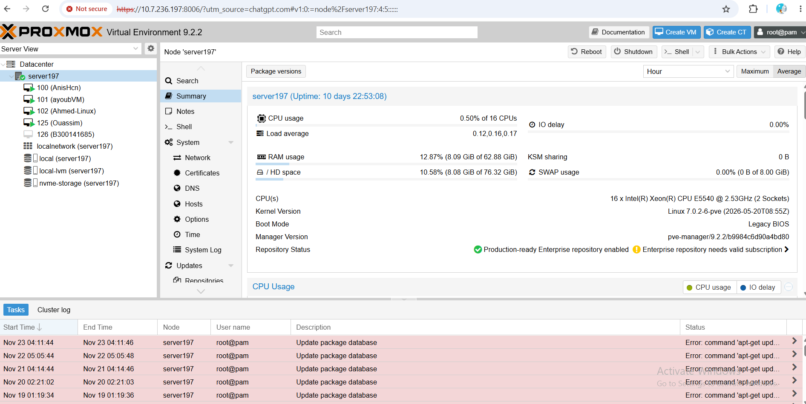
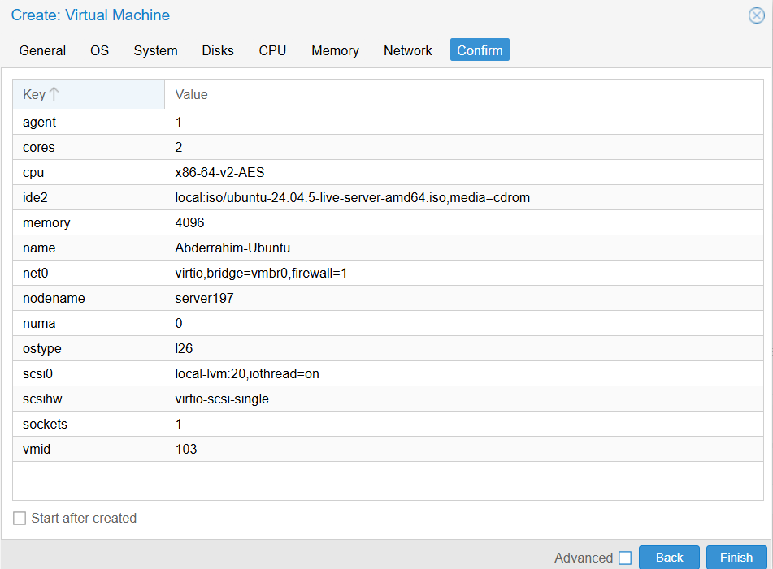
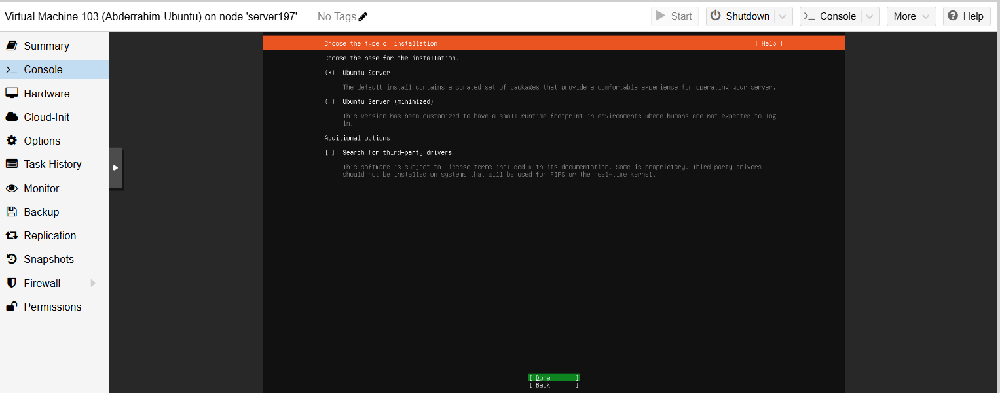

# 🖥️ Laboratoire 3 — Création d'une VM Ubuntu Server sur Proxmox VE

**Étudiant :** Abderrahim  
**Matricule :** 300151449  
**Cours :** INF1085

---

## 🎯 Objectif

Créer une machine virtuelle Ubuntu Server 24.04.5 LTS sur Proxmox, configurer une adresse IP statique et permettre son administration à distance avec SSH.

---

## 🌐 Étape 1 — Accès à Proxmox

Accès à l'interface de gestion du serveur `server197`, dont l'adresse IP est `10.7.236.197`.



---

## 🖥️ Étape 2 — Création de la machine virtuelle

- **Nom :** Abderrahim-Ubuntu
- **VM ID :** 103


---

## 📀 Étape 3 — Sélection de l'image ISO

Sélection d'Ubuntu Server 24.04.5 LTS comme système d'exploitation.


---

## ⚙️ Étape 4 — Configuration du système

Configuration des paramètres système de la machine virtuelle.


---

## 💾 Étape 5 — Configuration du disque

Attribution d'un espace disque de **20 Go**.


---

## 🔧 Étape 6 — Configuration du processeur

Attribution de **2 cœurs** à la machine virtuelle.


---

## 🧠 Étape 7 — Configuration de la mémoire

Attribution de **4 Go de RAM**.


---

## 🌐 Étape 8 — Configuration de la carte réseau

La machine virtuelle utilise le bridge `vmbr0`.


---

## 📋 Étape 9 — Confirmation des paramètres

Vérification de la configuration avant la création de la VM.



---

## 🟢 Étape 10 — Machine virtuelle créée

La VM **103 (Abderrahim-Ubuntu)** est créée sur le serveur Proxmox.


---

## 🐧 Étape 11 — Installation d'Ubuntu Server

### Sélection de la langue


### Configuration du clavier



L'installation d'Ubuntu Server est réussie. ✅

---

## 📡 Étape 12 — Configuration de l'adresse IP statique

| Paramètre | Valeur |
|---|---|
| Interface | `ens18` |
| Adresse IP | `10.7.236.167/23` |
| Passerelle | `10.7.237.1` |
| DNS | `8.8.8.8` |
| DHCP | Désactivé |

Commandes de vérification du réseau :

```bash
ip -4 addr show ens18
ip route
sudo netplan get
```

---

## 🔑 Étape 13 — Configuration de la clé SSH

Une clé publique RSA est présente dans `~/.ssh/authorized_keys`.

- **Utilisateur :** `ubuntu`
- **Identifiant de la clé :** `b300098957@ramena`
- **Permissions du dossier `.ssh` :** 700
- **Permissions du fichier `authorized_keys` :** 600

Vérification :

```bash
ls -la ~/.ssh
ssh-keygen -lf ~/.ssh/authorized_keys
```

---

## 🔐 Étape 14 — Vérification du service SSH

Le service OpenSSH est actif et le port 22 est accessible.

```bash
sudo systemctl status ssh
sudo sshd -t
```

Test de connexion locale :

```bash
ssh ubuntu@localhost
```

Le test SSH local est réussi. ✅

---

## 💻 Étape 15 — Tests depuis Windows PowerShell

Vérification de la connectivité et du port SSH :

```powershell
ping 10.7.236.167
Test-NetConnection 10.7.236.167 -Port 22
```

**Résultats :** 0 % de perte de paquets et test du port 22 positif.

Connexion à distance :

```powershell
ssh ubuntu@10.7.236.167
```


La connexion SSH depuis Windows est réussie. ✅

Commandes de vérification après connexion :

```bash
whoami
hostname
uptime
ip -4 addr show ens18
```

---

## 📋 Configuration finale

| Composant | Configuration |
|---|---|
| Serveur Proxmox | server197 |
| IP Proxmox | `10.7.236.197` |
| VM | Abderrahim-Ubuntu |
| VM ID | 103 |
| Système | Ubuntu Server 24.04.5 LTS |
| Utilisateur | `ubuntu` |
| Processeur | 2 cœurs |
| RAM | 4 Go |
| Disque | 20 Go |
| Bridge | `vmbr0` |
| Interface réseau | `ens18` |
| Adresse IP | `10.7.236.167/23` |
| Passerelle | `10.7.237.1` |
| DNS | `8.8.8.8` |
| DHCP | Désactivé |
| SSH | Actif — port 22 |

---

## 🧪 Résultats des tests

| Test | Résultat |
|---|---|
| Installation Ubuntu | ✅ Réussie |
| Adresse IP statique | ✅ Réussie |
| SSH local | ✅ Réussi |
| Ping depuis Windows | ✅ 0 % de perte |
| Test du port 22 | ✅ True |
| SSH depuis Windows | ✅ Réussi |
| Accès du professeur | ⏳ À confirmer |
| Internet et DNS | ⏳ À confirmer |

---

## ✅ Conclusion

La machine virtuelle Ubuntu Server 24.04.5 LTS est opérationnelle sur Proxmox. Elle dispose d'une adresse IP statique et d'un service SSH fonctionnel.

Les tests de connectivité depuis Windows et la connexion SSH ont réussi. L'accès du professeur ainsi que les tests Internet et DNS restent à confirmer.
