# 300151496

# Rapport — Installation Proxmox VE et création d'une VM Ubuntu Server

**Étudiant :** Anis Ouhocine (matricule 300151496)
**Date :** 12 octobre 2026
**Serveur :** 10.7.236.197 (serveur Proxmox dédié du groupe)
**VM créée :** 100 — `AnisHcn` (Ubuntu Server 24.04.5)  [10.7.236.168]


---

## 1. Objectif

Installer Proxmox VE sur le serveur du groupe, y créer une machine virtuelle Linux (Ubuntu Server 24.04) puis la configurer pour que le professeur puisse s'y connecter en SSH avec sa clé publique afin de corriger l'exercice.

**Contexte :** un premier travail avait été réalisé le 2 octobre 2026 sur l'ancien serveur partagé `server56` (VM 103). Chaque groupe disposant maintenant de son propre serveur dédié, ce rapport décrit la recréation complète de la VM sur le nouveau serveur du groupe (10.7.236.197).

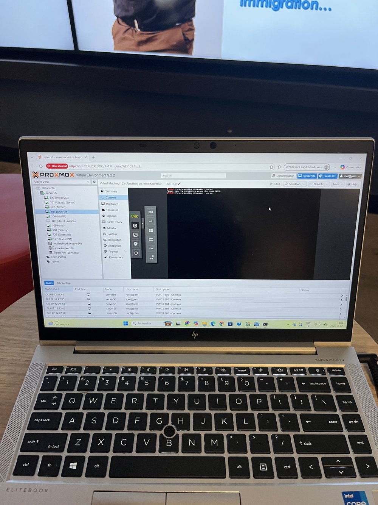

---

## 2. Installation de Proxmox VE

1. Création d'une clé USB bootable avec l'image ISO de Proxmox VE (outil Rufus).
2. Démarrage du serveur sur la clé USB via le menu de démarrage (touches **F8** puis **F11** selon le modèle du serveur).
3. Suivi de l'assistant d'installation Proxmox : choix du disque, pays/clavier, mot de passe administrateur, configuration réseau (adresse IP du serveur : `10.7.236.197`).
4. Redémarrage sur le disque dur, puis accès à l'interface web d'administration : `https://10.7.236.197:8006` (compte `root`).

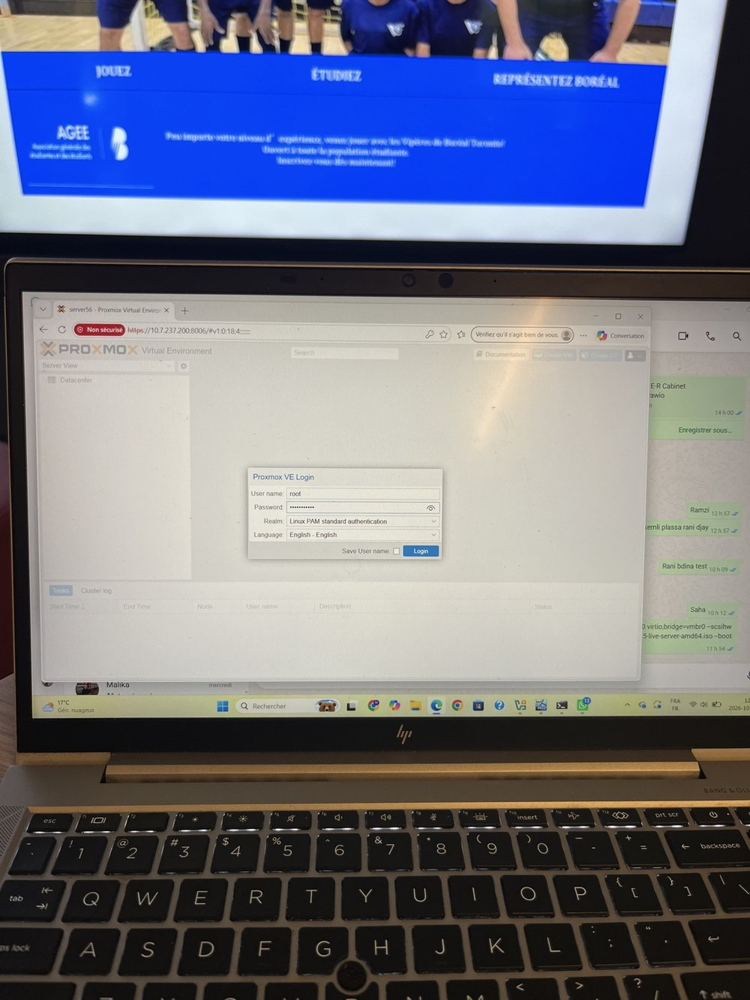

## 3. Accès distant au serveur

Le serveur n'est joignable que depuis le réseau du collège. En dehors du campus, on passe par le VPN du collège :

1. Ouvrir **FortiClient**, profil **« RAVPN »**, se connecter avec le compte du collège.
2. Vérifier le message **« RPV connecté »**.

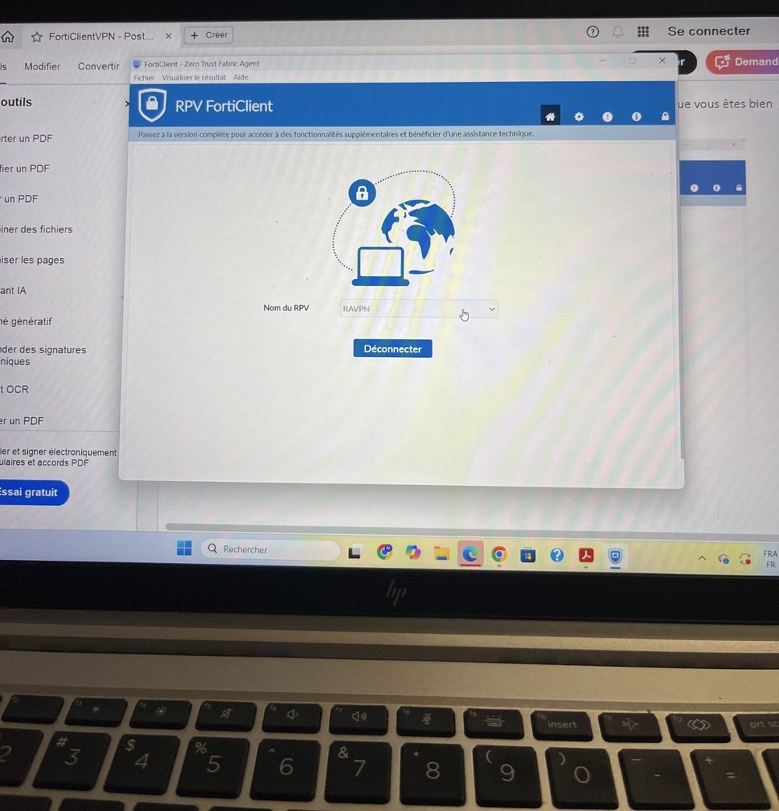

La procédure du collège indique de vérifier le message « RPV connecté » avec les détails de connexion (adresse IP, durée) :


3. Connexion SSH au serveur en administrateur :

```bash
ssh root@10.7.236.197
```

## 4. Préparation : image ISO Ubuntu

Vérification des ISO déjà présentes sur le serveur :

```bash
pvesm list local --content iso
```

→ Aucune ISO (installation fraîche). La commande `pvesm download` **n'existe pas** sur Proxmox (erreur `unknown command`) :

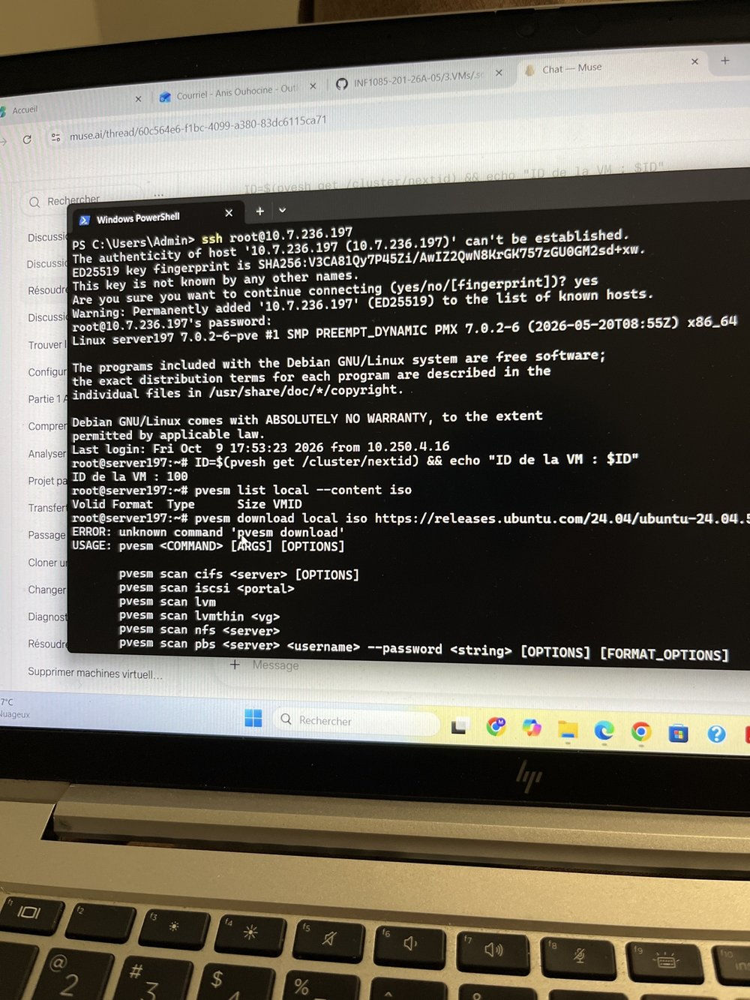

**Solution :** télécharger l'ISO directement avec `wget` dans le dossier des images :

```bash
wget -P /var/lib/vz/template/iso https://releases.ubuntu.com/24.04/ubuntu-24.04.5-live-server-amd64.iso
```

Vérification des stockages disponibles :

```bash
pvesm status
```

→ `local` et `local-lvm` actifs, avec suffisamment d'espace libre.

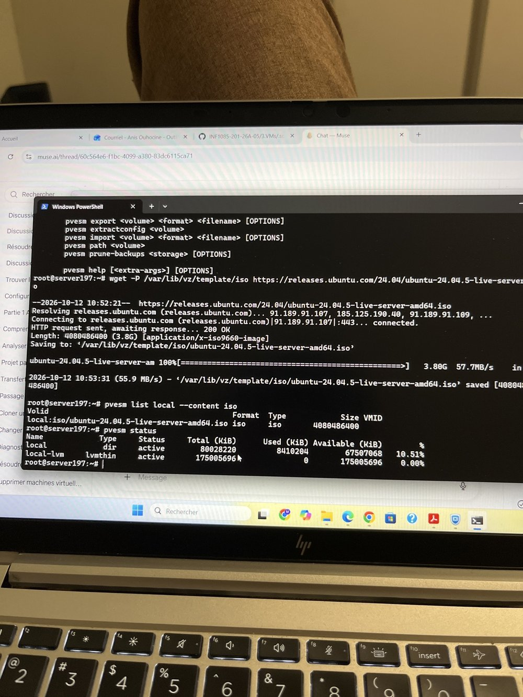

## 5. Création de la machine virtuelle

Prochain identifiant libre :

```bash
pvesh get /cluster/nextid
```

→ `100`. Création de la VM (2 Go de RAM, 2 processeurs, disque de 20 Go, réseau `vmbr0`, ISO Ubuntu branchée) :

```bash
qm create 100 --name ubuntu-linux --memory 2048 --cores 2 \
  --net0 virtio,bridge=vmbr0 --scsihw virtio-scsi-pci --scsi0 local-lvm:20 \
  --cdrom local:iso/ubuntu-24.04.5-live-server-amd64.iso \
  --boot order='ide2;scsi0' --ostype l26
```

Démarrage et renommage (possible même pendant que la VM tourne) :

```bash
qm start 100
qm set 100 --name AnisHcn
```

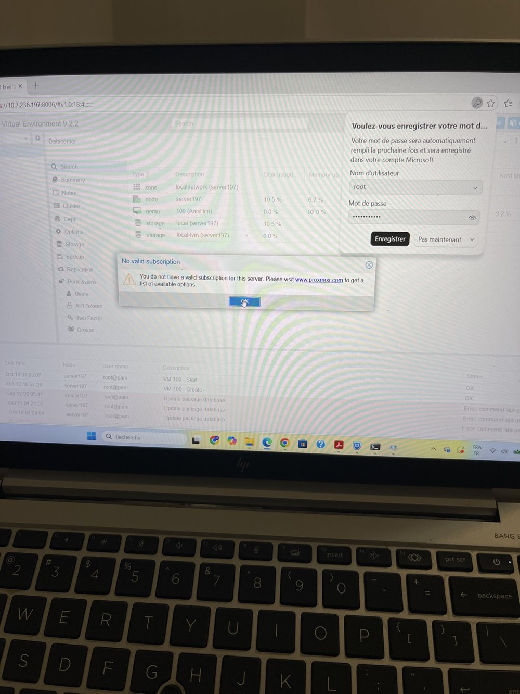

## 6. Installation d'Ubuntu Server 24.04

Via la **Console** de la VM dans l'interface web Proxmox, suivi de l'installeur Ubuntu :

1. Langue, disposition du clavier.
2. Configuration réseau (DHCP).
3. Miroir Ubuntu (miroir canadien validé par l'installeur).

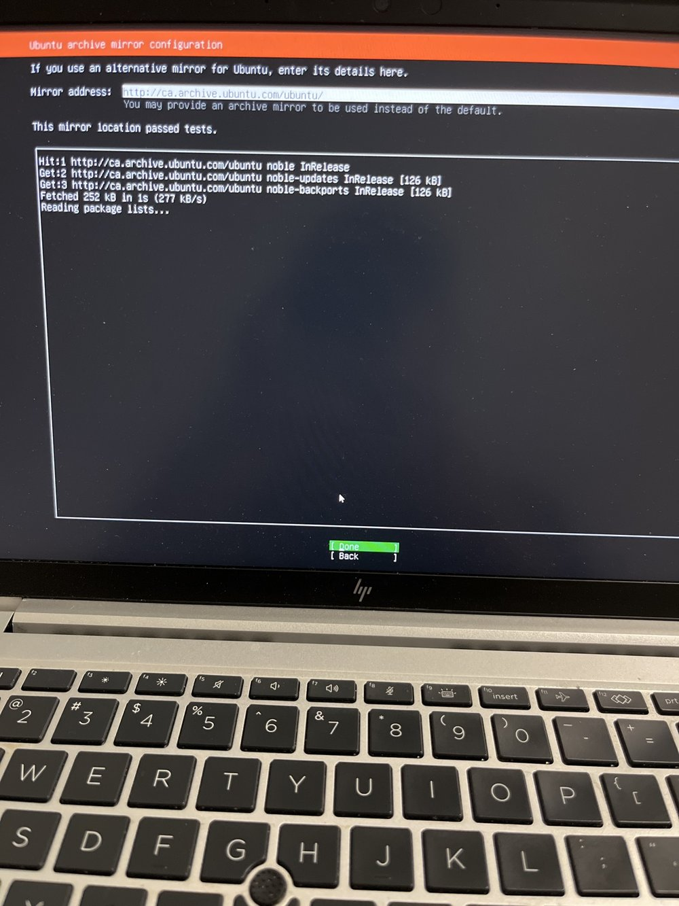

4. Partitionnement guidé (LVM : `/` de 10 Go, `/boot` séparé).

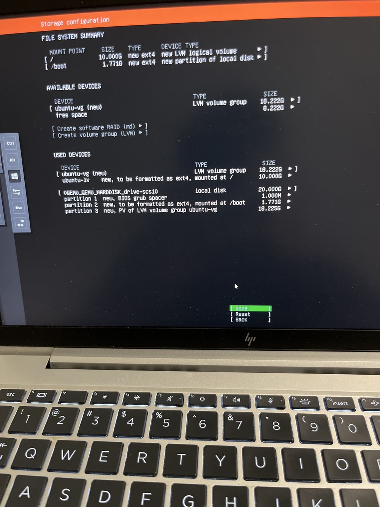

5. Création du profil : nom du serveur `ubuntulinux`, utilisateur `anishcn` (en minuscules : sous Linux, les noms d'utilisateur sont sensibles à la casse).
6. Installation du serveur OpenSSH.

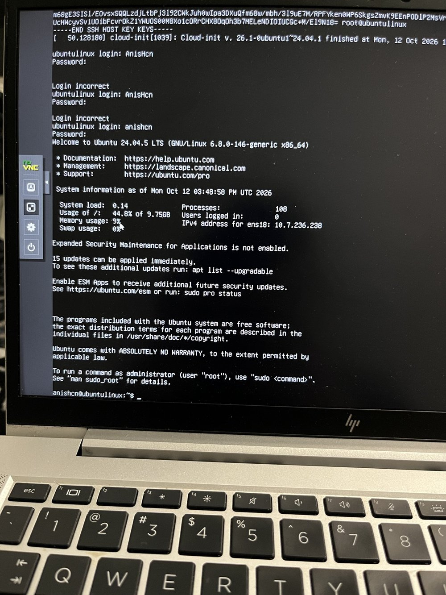

## 7. Détachement de l'ISO et premier démarrage

Avant le redémarrage final, détacher l'ISO et forcer le démarrage sur le disque :

```bash
qm set 100 --delete ide2 --boot order=scsi0
```

À la fin de l'installation, l'installeur demande de retirer le support d'installation avant de redémarrer :

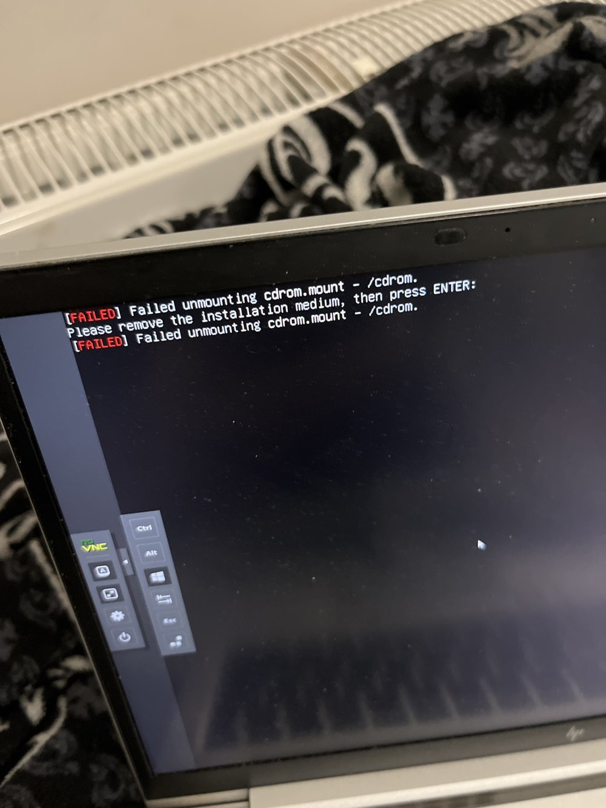

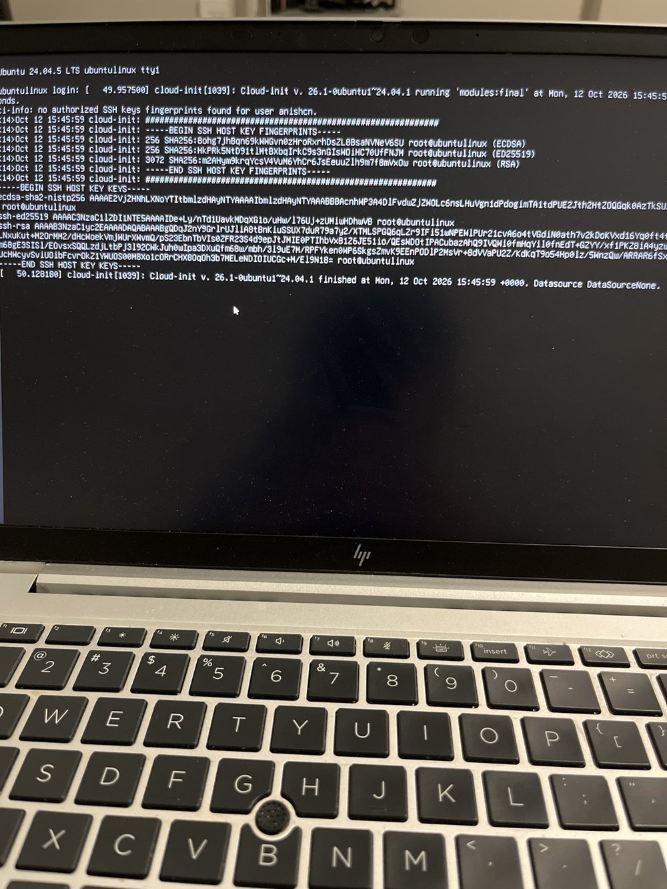

## 8. Problèmes rencontrés et solutions

| # | Problème | Cause | Solution |
|---|----------|-------|----------|
| 1 | `pvesm download` → `unknown command` | La sous-commande n'existe pas sur Proxmox | Télécharger l'ISO avec `wget -P /var/lib/vz/template/iso` |
| 2 | Après le redémarrage, la VM revient sur l'installeur au lieu d'Ubuntu installé | Le détachement de l'ISO a été fait après le début du redémarrage : la VM a redémarré sur l'ISO | Détacher l'ISO **avant** de valider le redémarrage |
| 3 | La VM reste bloquée sur le menu de l'ISO | Le processus QEMU ne répond plus (`qm reboot` / `qm reset` en timeout) | Tuer le processus bloqué puis redémarrer proprement : `kill -9 $(ps -ef | grep '\-id 100 ' | grep -v grep | awk '{print $2}'); sleep 2; qm start 100` |
| 4 | `systemctl restart ssh` → `Unit ssh.service not found` | Le serveur OpenSSH n'était pas installé dans la VM | `sudo apt update && sudo apt install -y openssh-server && sudo systemctl enable --now ssh` |
| 5 | `WARNING: REMOTE HOST IDENTIFICATION HAS CHANGED` en SSH | La clé d'hôte a changé après la (ré)installation du serveur SSH | `ssh-keygen -f '/root/.ssh/known_hosts' -R '10.7.236.238'` puis accepter la nouvelle clé |

Le redémarrage demandé à la VM restait sans effet (timeout), et la VM retombait sur l'écran de l'installeur :

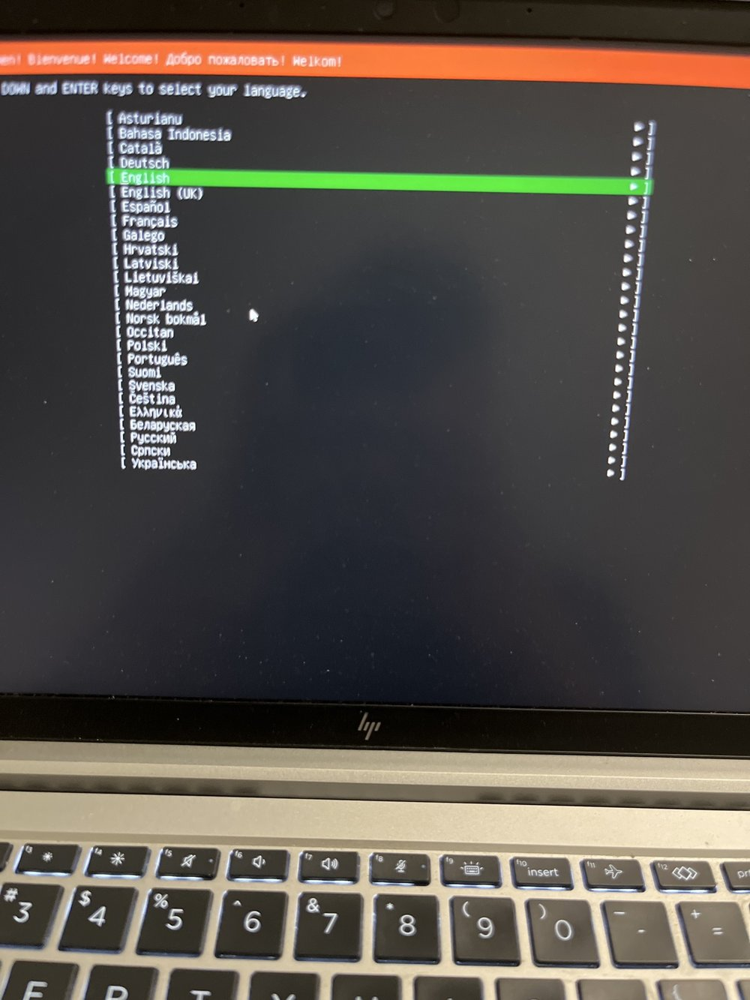

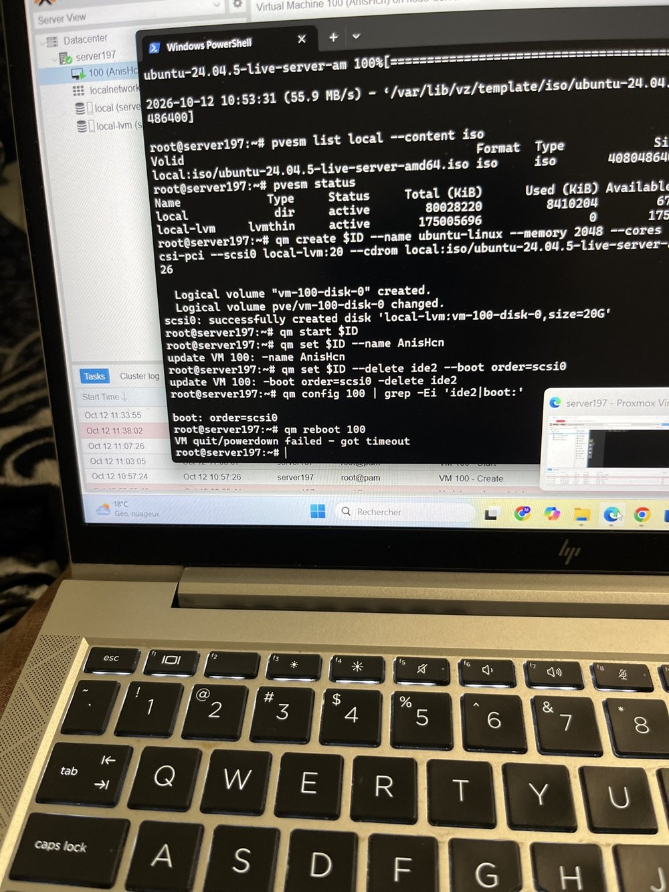

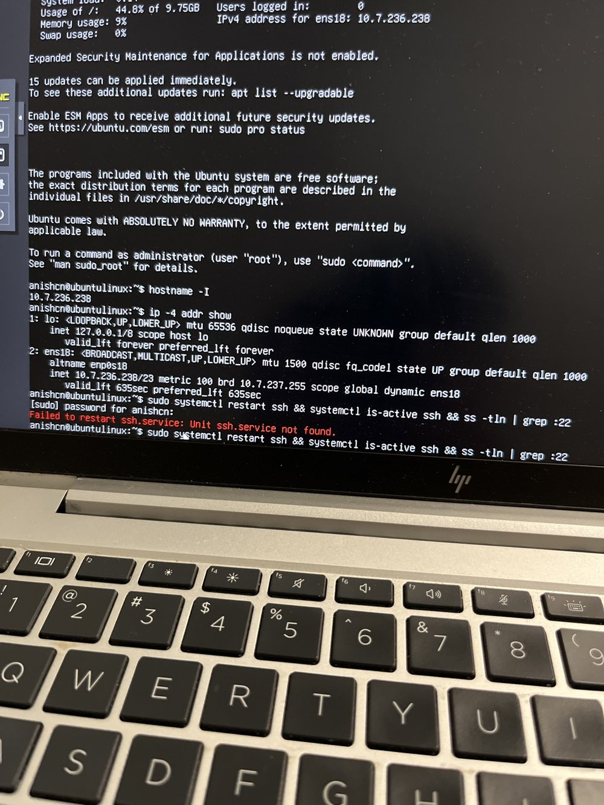

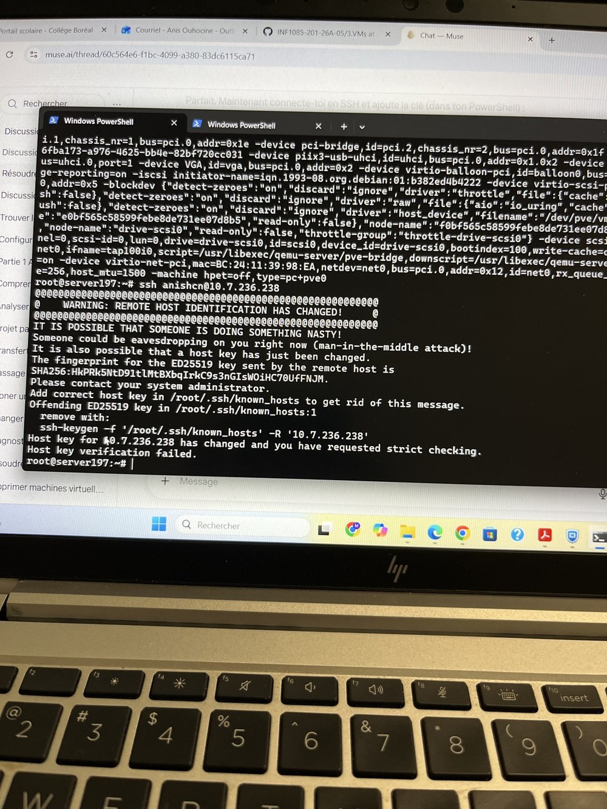

## 9. Clé SSH du professeur

Pour que le professeur puisse se connecter à la VM et corriger l'exercice, ajout de sa clé publique dans le fichier `authorized_keys` de l'utilisateur `anishcn` :

```bash
ssh anishcn@10.7.236.238
mkdir -p ~/.ssh && chmod 700 ~/.ssh
echo 'CLE_PUBLIQUE_DU_PROFESSEUR' >> ~/.ssh/authorized_keys && chmod 600 ~/.ssh/authorized_keys
```

Vérification que la clé est bien en place et valide :

```bash
ssh-keygen -l -f ~/.ssh/authorized_keys
```

→ Affiche l'empreinte de la clé du professeur : l'ajout est confirmé.

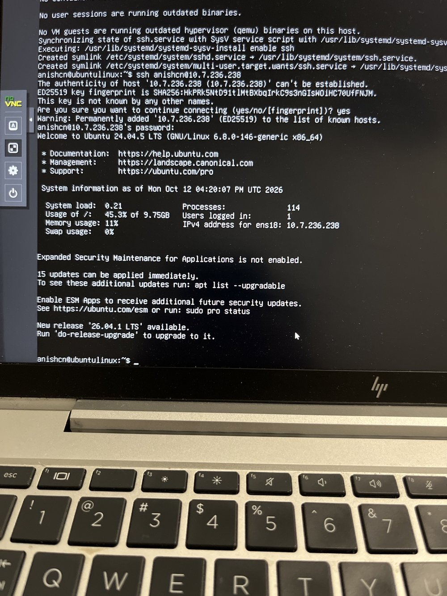

## 10. Conclusion

La VM **100 (`AnisHcn`)** est opérationnelle : Ubuntu Server 24.04.5 installé, démarrage sur disque, serveur SSH actif (adresse `10.7.236.238`, utilisateur `anishcn`) et clé publique du professeur installée pour la correction. Les difficultés rencontrées (téléchargement de l'ISO, redémarrage sur l'ISO, processus bloqué, serveur SSH manquant) ont toutes été résolues sans réinstallation.

## Annexe — Récapitulatif des commandes clés

```bash
# Connexion au serveur Proxmox
ssh root@10.7.236.197

# Téléchargement de l'ISO Ubuntu
wget -P /var/lib/vz/template/iso https://releases.ubuntu.com/24.04/ubuntu-24.04.5-live-server-amd64.iso

# Vérifications
pvesh get /cluster/nextid
pvesm list local --content iso
pvesm status

# Création et démarrage de la VM
qm create 100 --name ubuntu-linux --memory 2048 --cores 2 \
  --net0 virtio,bridge=vmbr0 --scsihw virtio-scsi-pci --scsi0 local-lvm:20 \
  --cdrom local:iso/ubuntu-24.04.5-live-server-amd64.iso \
  --boot order='ide2;scsi0' --ostype l26
qm start 100
qm set 100 --name AnisHcn

# Détachement de l'ISO après installation
qm set 100 --delete ide2 --boot order=scsi0

# En cas de VM bloquée
kill -9 $(ps -ef | grep '\-id 100 ' | grep -v grep | awk '{print $2}'); sleep 2; qm start 100

# Dans la VM : ajout de la clé du professeur
mkdir -p ~/.ssh && chmod 700 ~/.ssh
echo 'CLE_PUBLIQUE_DU_PROFESSEUR' >> ~/.ssh/authorized_keys && chmod 600 ~/.ssh/authorized_keys
ssh-keygen -l -f ~/.ssh/authorized_keys
```

# Dans la VM : installation du serveur SSH
sudo apt update && sudo apt install -y openssh-server && sudo systemctl enable --now ssh

# Dans le Shell de notre serveur :

pveum user add B300151496@pve

pveum passwd B300151496@pve

pveum user list 

<image src=images/image.png width=50% height=50% > </image>
