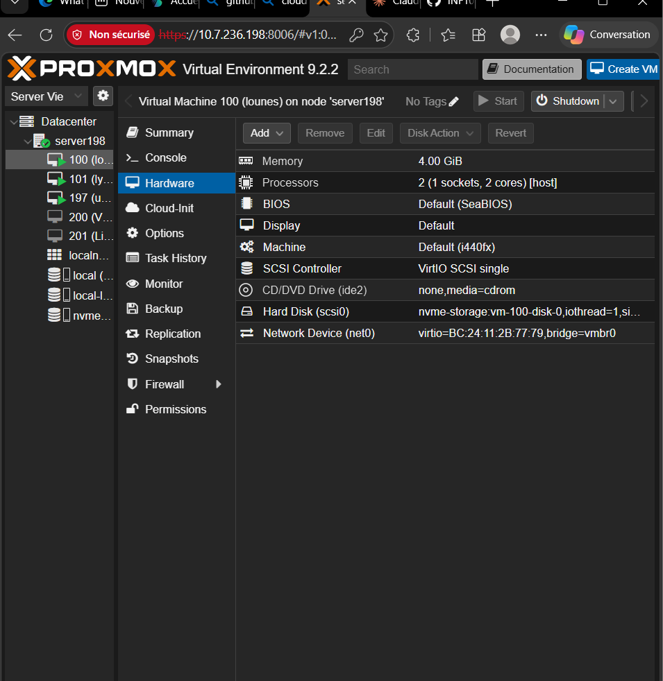
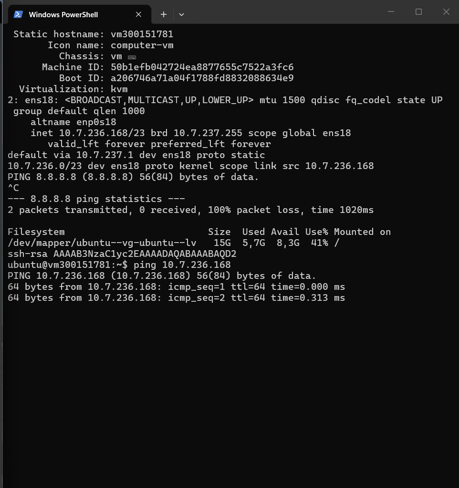
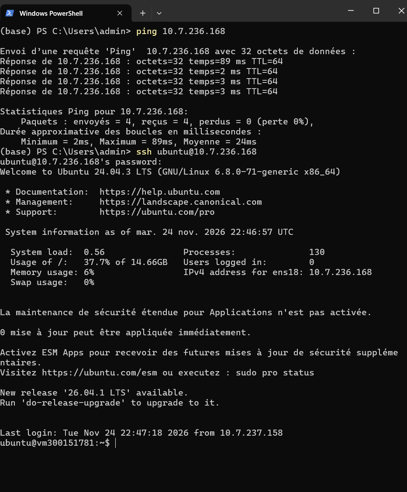
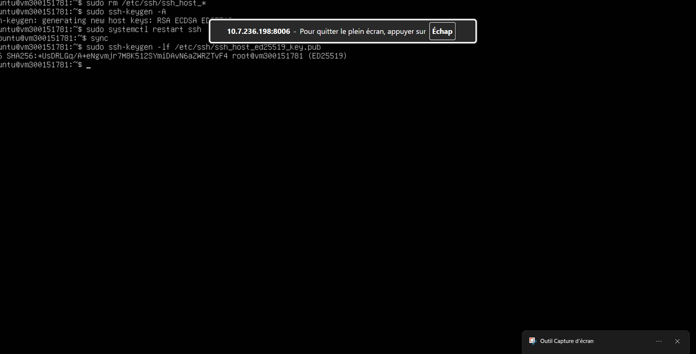

# 🏗️ 3.VMs — Ma machine virtuelle Ubuntu sur Proxmox

| 👤 Étudiant | 🆔 | 👥 Groupe | 🖥️ Serveur | 💻 VM |
|---|---|---|---|---|
| Lounes Allouti | 300151781 | 2️⃣ | server198 — `10.7.236.198` | VM 100 `lounes` — `10.7.236.168` |

## 🎯 Objectif

Créer ma propre machine virtuelle sur le serveur Proxmox du groupe 2, y installer **Ubuntu Server 24.04**,
lui donner une **adresse IP fixe** et pouvoir m'y connecter en **SSH** depuis mon poste.

---

## 🧱 Configuration de la VM

| Élément | Valeur |
|---|---|
| ID / Nom | `100` / `lounes` |
| Système | Ubuntu Server 24.04.3 LTS (noyau 6.8.0-71) |
| Mémoire | 4 Go |
| Processeur | 2 cœurs (type `host`) |
| Disque | 32 Go — `nvme-storage:vm-100-disk-0` (VirtIO SCSI, LVM) |
| Réseau | VirtIO — `bridge=vmbr0` — MAC `BC:24:11:2B:77:79` |
| Adresse IP | `10.7.236.168/23` (fixe) |
| Passerelle | `10.7.237.1` |
| DNS | `8.8.8.8`, `1.1.1.1` |
| Nom d'hôte | `vm300151781` |
| Utilisateur | `ubuntu` (+ clé SSH du prof) |



> ⚠️ **Pourquoi l'adresse 10.7.236.168 ?**
> L'adresse que le prof m'avait attribuée, `10.7.236.172`, était **déjà utilisée par une autre machine** du réseau.
> Ma VM entrait en **conflit d'adresse IP** : les connexions se coupaient et le réseau ne fonctionnait pas correctement.
> J'ai donc vérifié avec `ping` qu'une autre adresse était **libre**, puis j'ai choisi **`10.7.236.168`** pour ma VM.

---

## 🛠️ Étapes réalisées

### 1. Création de la VM (interface Proxmox)

- **Create VM** sur `server198`, ID `100`, nom `lounes`
- ISO : `local:iso/ubuntu-24.04.3-live-server-amd64.iso`
- Disque de 32 Go sur le stockage **`nvme-storage`**, 2 cœurs, 4 Go de RAM, carte réseau VirtIO sur `vmbr0`

### 2. Installation d'Ubuntu Server

| Écran | Choix |
|---|---|
| Clavier | English (US) |
| Réseau | Installation **hors ligne** (voir défi n°1) |
| Stockage | Disque entier + LVM (`/` 15 Go, `/boot` 2 Go) |
| Profil | `ubuntu` / serveur `vm300151781` |
| SSH | ✅ **Installer le serveur OpenSSH** |

Après l'installation : CD/DVD retiré (`Do not use any media`) et ordre de démarrage `scsi0` en premier.

### 3. Adresse IP fixe avec Netplan

Fichier `/etc/netplan/01-reseau.yaml` :

```yaml
network:
  version: 2
  ethernets:
    ens18:
      addresses: [10.7.236.168/23]
      routes:
        - to: default
          via: 10.7.237.1
      nameservers:
        addresses: [8.8.8.8, 1.1.1.1]
```

```bash
sudo chmod 600 /etc/netplan/01-reseau.yaml
sudo netplan apply
```

### 4. Clé SSH du prof

```bash
mkdir -p ~/.ssh && chmod 700 ~/.ssh
echo 'ssh-rsa AAAAB3...LRP5N b300098957@ramena' >> ~/.ssh/authorized_keys
chmod 600 ~/.ssh/authorized_keys
```

---

## ✅ Vérifications

```bash
hostnamectl          # Static hostname: vm300151781 — Virtualization: kvm
ip -4 a show ens18   # inet 10.7.236.168/23
ip route             # default via 10.7.237.1 dev ens18 proto static
df -h /              # 15G — 41 % utilisé
```



Connexion depuis mon poste Windows :

```powershell
ping 10.7.236.168          # 4 reçus, 0 % de perte
ssh ubuntu@10.7.236.168    # Welcome to Ubuntu 24.04.3 LTS
```



---

## 🧗 Défis rencontrés et solutions

| # | 🚧 Problème | 🔍 Cause | ✅ Solution |
|:-:|---|---|---|
| 1 | L'adresse IP donnée par le prof (`10.7.236.172`) était **déjà utilisée** | Une autre machine du réseau avait la même adresse : **conflit d'adresse IP** | Vérification avec `ping`, puis choix d'une adresse **libre** : `10.7.236.168` |
| 2 | L'installation échouait à l'étape **« installing kernel »** | Téléchargement impossible depuis le miroir Ubuntu | Réinstallation **hors ligne** : interface `ens18` désactivée, tout est pris sur l'ISO |
| 3 | Démarrage bloqué sur **« Wait for Network to be Configured »** | Aucune configuration réseau après l'installation hors ligne | Démarrage sur l'ISO → *Help → Enter shell* → montage du disque LVM et désactivation du service d'attente |
| 4 | Réseau à configurer sans accès SSH | Console Proxmox sans copier-coller | Fichier Netplan écrit depuis le shell de l'installateur |
| 5 | **Connexion SSH coupée** et empreinte qui change | Fichiers de clés SSH **vides** (0 octet) après des redémarrages forcés | Clés régénérées avec `ssh-keygen -A` + `sync` |

Commandes du défi n°3 (shell de l'installateur) :

```bash
vgchange -ay
mount /dev/ubuntu-vg/ubuntu-lv /mnt
ln -s /dev/null /mnt/etc/systemd/system/systemd-networkd-wait-online.service
```

Commandes du défi n°5 :

```bash
sudo rm /etc/ssh/ssh_host_*
sudo ssh-keygen -A
sudo systemctl restart ssh
sync
sudo ssh-keygen -lf /etc/ssh/ssh_host_ed25519_key.pub
```



> ℹ️ La VM communique sur le réseau du collège (ping et SSH depuis mon poste), mais l'accès **Internet** sortant
> (`ping 8.8.8.8`, `apt update`) est filtré depuis le réseau des VM : les mises à jour seront faites quand l'accès sera ouvert.

---

## 📚 Ce que j'ai appris

- Créer et configurer une VM dans **Proxmox VE** (disque, CPU, RAM, réseau, ordre de démarrage)
- Détecter un **conflit d'adresse IP** et choisir une adresse libre
- Installer **Ubuntu Server** et configurer une **IP fixe** avec **Netplan**
- Dépanner un système qui ne démarre pas grâce au **shell de l'installateur** et à **LVM**
- Diagnostiquer un problème **SSH** (empreintes, clés d'hôte, `known_hosts`)
- Toujours arrêter une VM proprement (**Shutdown**) plutôt qu'avec **Reset**

---

✍️ *Lounes Allouti — 300151781 — Collège Boréal — INF1085*
