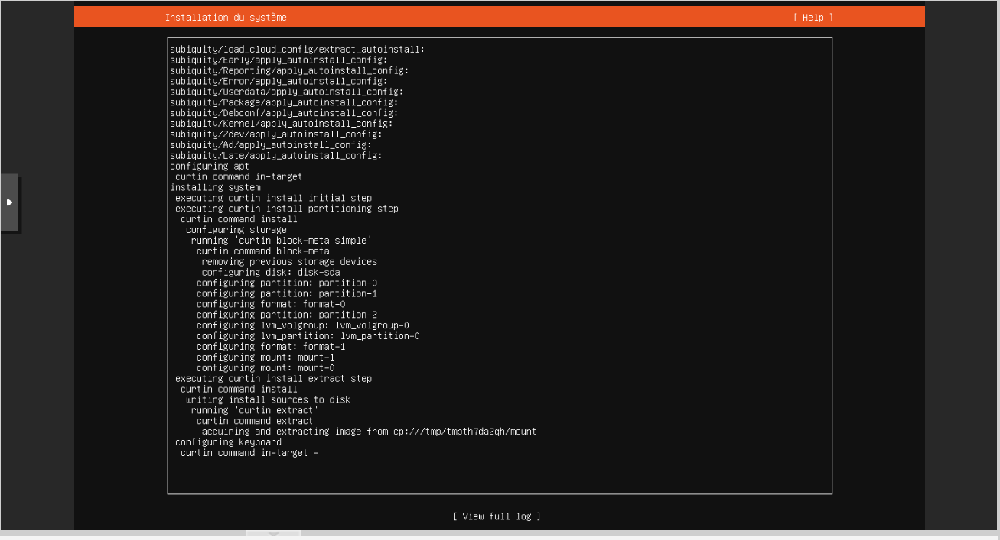
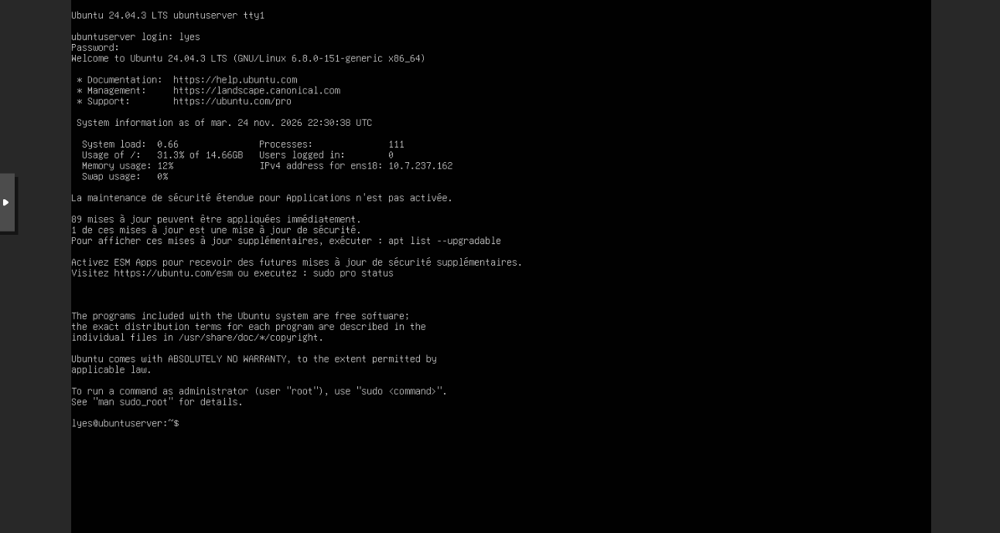

# Installation de la VM Ubuntu Server

Lyes Medjahed · 300153676 · Groupe 2

## Installation

J’ai installé Ubuntu Server 24.04.3 LTS. La première capture montre l’installation du système sur le disque.

## Première connexion

J’ai ouvert une session avec le compte `lyes` sur `ubuntuserver`. La console affiche l’adresse `10.7.237.162` pour l’interface `ens18`.

## Configuration demandée au laboratoire

| Paramètre | Valeur indiquée dans la fiche du groupe 2 |
| --- | --- |
| Hôte Proxmox | `10.7.236.198` |
| Adresse attribuée à ma VM | `10.7.236.174` |
| Compte pour la connexion SSH | `ubuntu` |

Il reste à vérifier sur Proxmox le numéro de cette VM et son rattachement à l’hôte du groupe. L’adresse affichée dans la console diffère de l’adresse attribuée. L’accès SSH à `ubuntu@10.7.236.174` avec la clé du professeur reste à confirmer.
