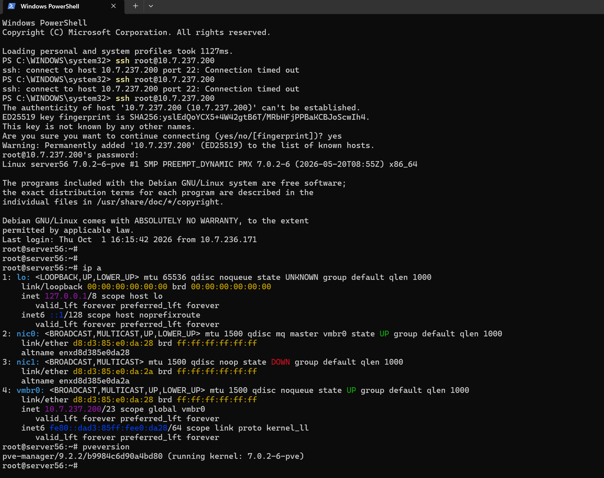
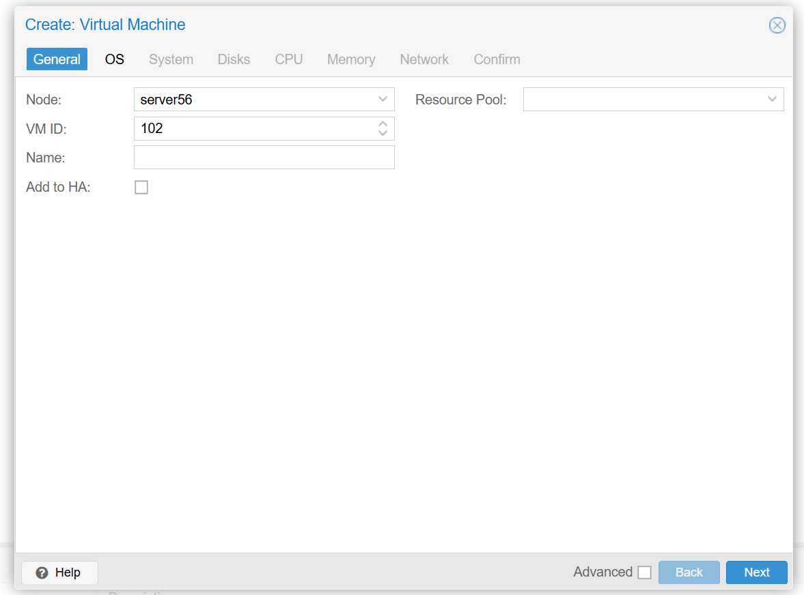
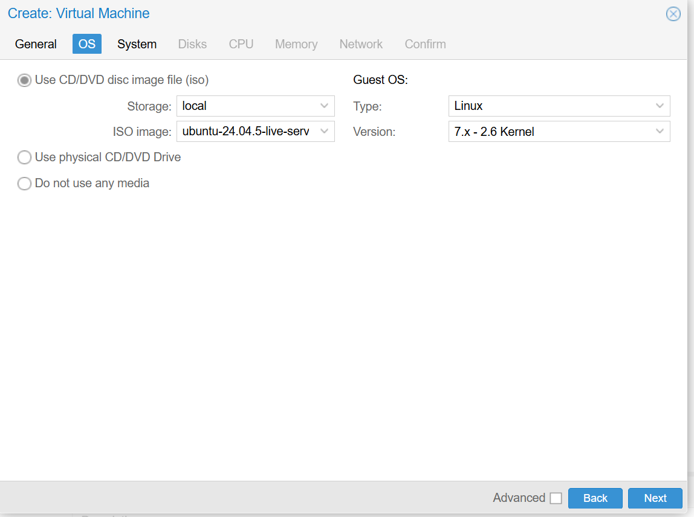
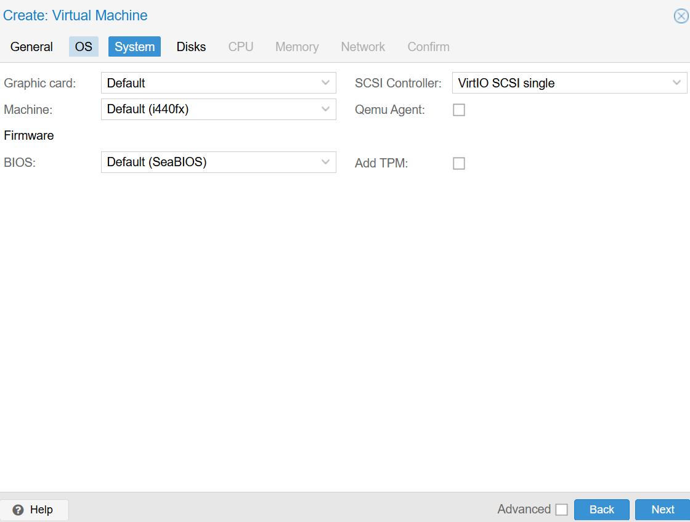

# Création d'une VM Ubuntu Server sur Proxmox VE

| Champ | Information |
| --- | --- |
| Étudiant | Karim Bamba |
| Matricule | 300153972 |
| Programme | Techniques des systèmes informatiques – Collège Boréal |
| Cours | INF1085 – Administration Linux |

---

## Objectif

Installer une machine virtuelle Ubuntu Server 24.04 LTS sur le serveur Proxmox VE de l'école, lui attribuer une adresse IP statique et l'administrer à distance par SSH avec une clé publique.

## Environnement

| Élément | Valeur |
| --- | --- |
| Hyperviseur | Proxmox VE 9.2.2 (noyau `7.0.2-6-pve`) |
| Nœud | `server56` (`10.7.237.200/23`) |
| Système invité | Ubuntu Server 24.04.5 LTS |
| Accès hors campus | VPN FortiClient |

---

## 1. Connexion au serveur Proxmox

Depuis PowerShell, connexion SSH au nœud, puis vérification de son adresse et de sa version :

```bash
ssh root@10.7.237.200
ip a
pveversion
```

Les deux premiers essais ont échoué avec `Connection timed out` (problème réseau : le PC n'était pas encore sur le bon réseau). Au troisième essai, SSH demande de confirmer l'empreinte ED25519 du serveur, puis la connexion réussit.

Résultats :

- `ip a` : le bridge `vmbr0` porte l'adresse `10.7.237.200/23`, et l'interface physique `nic0` est rattachée à `vmbr0`.
- `pveversion` : `pve-manager/9.2.2` avec le noyau `7.0.2-6-pve`.



L'interface Web est ensuite ouverte à l'adresse `https://10.7.237.200:8006`.

---

## 2. Téléversement de l'ISO Ubuntu

**Chemin :** `server56` → `local` → **ISO Images** → **Upload**

Le fichier `ubuntu-24.04.5-live-server-amd64.iso` est téléversé dans le stockage `local` pour pouvoir être monté dans la VM.

---

## 3. Création de la VM

Assistant **Create VM** :

**General** : nœud `server56`, VM ID proposé par Proxmox (premier numéro libre).



**OS** : ISO `ubuntu-24.04.5-live-server-amd64.iso` dans le stockage `local`, type **Linux**, version **7.x - 2.6 Kernel**.



**System** : paramètres par défaut, carte graphique *Default*, machine *i440fx*, BIOS *SeaBIOS*, contrôleur SCSI **VirtIO SCSI single**.



Récapitulatif des paramètres :

| Onglet | Paramètre | Valeur |
| --- | --- | --- |
| General | Nom / VM ID | **À COMPLÉTER** / **À COMPLÉTER** |
| OS | Image ISO | ubuntu-24.04.5-live-server-amd64.iso |
| System | Contrôleur SCSI / BIOS | VirtIO SCSI single / SeaBIOS |
| Disks | Taille | 32 GiB |
| CPU | Cœurs / Type | **À COMPLÉTER** / **À COMPLÉTER** |
| Memory | RAM | 4096 MiB |
| Network | Bridge / Modèle | `vmbr0` / VirtIO (paravirtualized) |

VirtIO est choisi parce que c'est un pilote paravirtualisé : il offre de meilleures performances qu'une carte émulée (ex. Intel E1000).

---

## 4. Installation d'Ubuntu Server

| Étape de l'installateur | Choix |
| --- | --- |
| Réseau | Interface `ens18` détectée (VirtIO), IP temporaire par DHCP |
| Miroir | `http://ca.archive.ubuntu.com/ubuntu/` (test réussi) |
| Stockage | Disque entier de 32 GiB avec LVM |
| Profil | Utilisateur **À COMPLÉTER**, hostname **À COMPLÉTER** |
| SSH | **Install OpenSSH server** coché |

À la fin de l'installation, l'ISO est retirée du lecteur CD/DVD virtuel (**Hardware** → **CD/DVD Drive** → *Do not use any media*) pour éviter que la VM redémarre sur l'installateur.

---

## 5. Premier démarrage et tests réseau

Connexion avec mon utilisateur dans la console Proxmox, puis :

```bash
ip a                 # vérifier l'IP de ens18
ping -c 4 8.8.8.8    # tester l'accès Internet
```

Résultat : 4 paquets reçus, 0 % de perte.

---

## 6. Configuration de la clé SSH

```bash
mkdir -p ~/.ssh
chmod 700 ~/.ssh
nano ~/.ssh/authorized_keys      # coller la clé publique
chmod 600 ~/.ssh/authorized_keys
ls -ld ~/.ssh && ls -l ~/.ssh/authorized_keys
```

Résultat attendu :

```
drwx------ ... .ssh
-rw------- ... authorized_keys
```

Ces permissions sont obligatoires : si le dossier ou le fichier est accessible par d'autres utilisateurs, OpenSSH refuse la clé.

Vérification du service :

```bash
sudo systemctl status ssh
```

Le service est `active (running)` et écoute sur le port 22.

---

## 7. Adresse IP statique avec Netplan

Fichier : `/etc/netplan/50-cloud-init.yaml`

```yaml
network:
  version: 2
  ethernets:
    ens18:
      dhcp4: false
      addresses:
        - <IP_STATIQUE>/23
      routes:
        - to: default
          via: <PASSERELLE>
      nameservers:
        addresses:
          - 8.8.8.8
```

Application et vérification :

```bash
sudo netplan try      # applique avec retour arrière automatique si erreur
sudo netplan apply
ip a
```

> Netplan utilise le YAML : l'indentation se fait **uniquement avec des espaces**. Une tabulation ou un décalage provoque une erreur de syntaxe.

---

## 8. Validation du réseau

```bash
ping -c 4 8.8.8.8      # passerelle + Internet
ping -c 4 google.com   # résolution DNS
```

Les deux tests réussissent avec 0 % de perte : la passerelle, l'accès Internet, le DNS et l'IP statique sont fonctionnels.

---

## 9. Connexion SSH depuis Windows

Depuis PowerShell :

```powershell
ssh <UTILISATEUR>@<IP_STATIQUE>
```

La connexion réussit : la VM est administrable à distance.

---

## Configuration finale

| Composant | Valeur |
| --- | --- |
| Nœud Proxmox | `server56` (`10.7.237.200`) – Proxmox VE 9.2.2 |
| VM | **À COMPLÉTER** (ID **À COMPLÉTER**) |
| OS | Ubuntu Server 24.04.5 LTS |
| Ressources | 4 Go RAM, 32 GiB disque (LVM) |
| Réseau | `ens18`, VirtIO, bridge `vmbr0` |
| Adresse IP | **À COMPLÉTER**/23 |
| Passerelle / DNS | **À COMPLÉTER** / 8.8.8.8 |
| SSH | Actif, port 22, authentification par clé |

## 10. Conclusion

La VM Ubuntu Server est installée sur Proxmox, configurée avec une adresse IP statique et accessible par SSH depuis Windows.

Les difficultés rencontrées (connexion SSH qui expire, type de CPU incompatible, syntaxe YAML) m'ont permis de comprendre plusieurs points pratiques : il faut être sur le bon réseau pour joindre le serveur, les ressources d'un serveur partagé (VM ID, IP) doivent être uniques, le CPU virtuel doit correspondre aux capacités du matériel réel, et la configuration Netplan doit être validée avant d'être appliquée.
