 # 300155927
 
# Installation d'Ubuntu Server 24.04 LTS — Compte-rendu

Documentation de l'installation d'Ubuntu Server sur une machine virtuelle hébergée sur le nœud **server56** (Proxmox VE).

## Configuration retenue

| Paramètre | Valeur |
|---|---|
| Nœud Proxmox | `server56` |
| Nom du serveur | `ubuntu` |
| Nom d'utilisateur | `garvey200` |
| Version | Ubuntu **24.04.5 LTS** (noyau 6.8.0-146-generic, x86_64) |
| Type d'installation | Ubuntu Server (installation complète, pas minimisée) |
| Interface réseau | `ens18` (Virtio, MAC `bc:24:11:f4:5c:7b`) |
| Adresse IPv4 finale | `10.7.237.140` (DHCPv4, /23) |
| Proxy | Aucun |
| Miroir d'archives | `http://ca.archive.ubuntu.com/ubuntu/` (version *noble*) |
| Disque | 32 Go (`QEMU_QEMU_HARDDISK_drive-scsi0`) |
| Partitionnement | LVM : `/` 14,996 Go (ext4), `/boot` 2,000 Go (ext4) |
| Ubuntu Pro | Ignoré (peut être activé plus tard avec `pro attach`) |
| Snaps | Aucun sélectionné |

## Étapes de l'installation

### 1. Type d'installation
Choix de **Ubuntu Server** (installation complète avec l'ensemble de paquets recommandé).

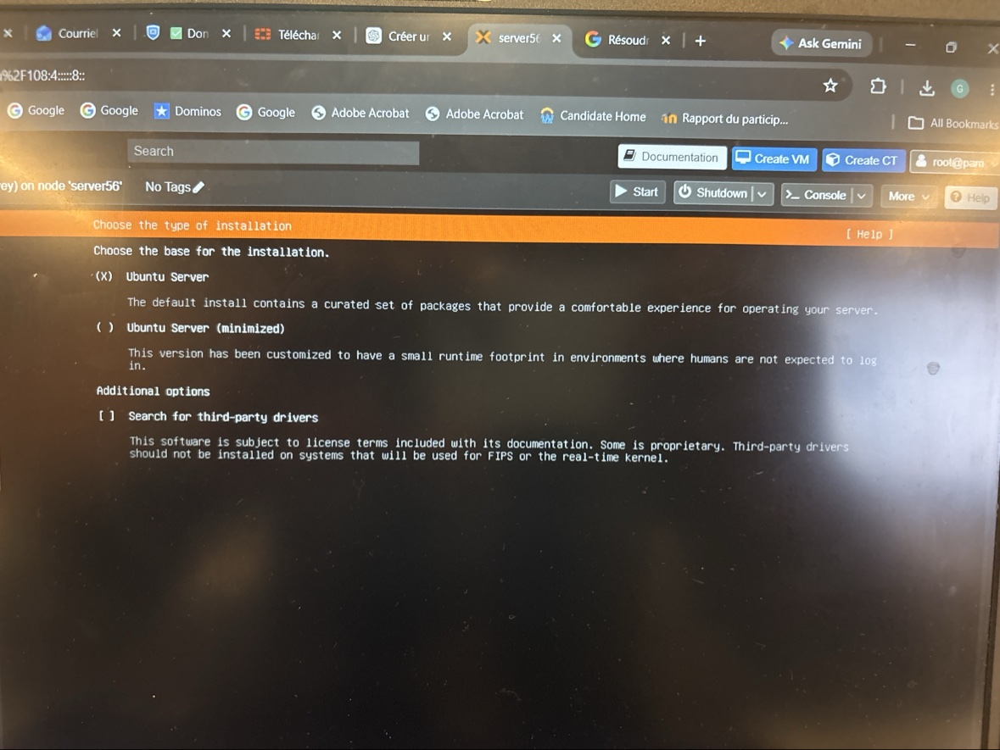

### 2. Configuration réseau
L'interface `ens18` est configurée en DHCPv4 (`10.7.237.138/23` pendant l'installation).

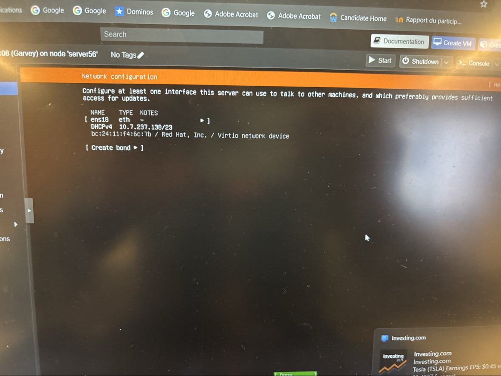

### 3. Configuration du proxy
Aucun proxy nécessaire : le champ est laissé vide.

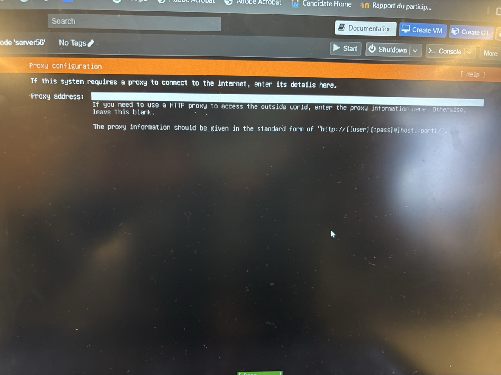

### 4. Miroir d'archives Ubuntu
Miroir canadien `http://ca.archive.ubuntu.com/ubuntu/` — le test du miroir est réussi (`noble`, `noble-updates`, `noble-backports`).

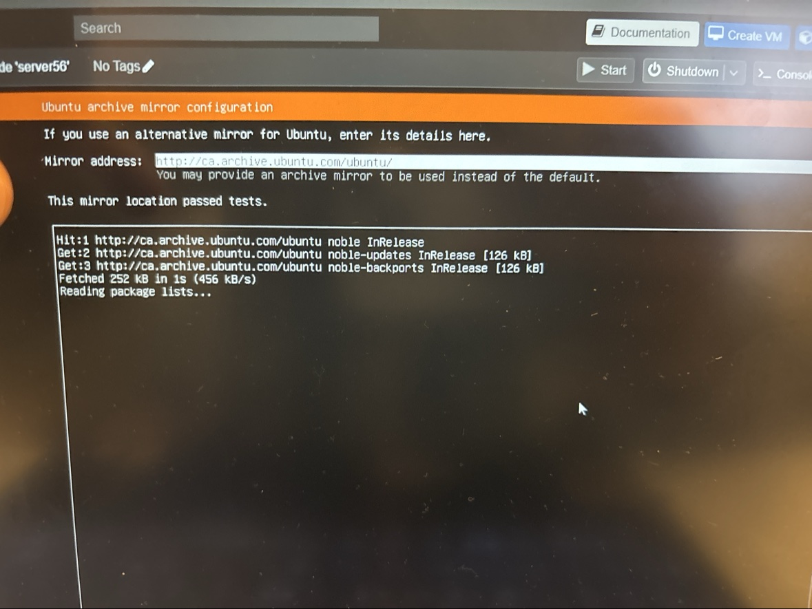

### 5. Stockage guidé
Utilisation du disque entier de 32 Go, configuré comme **groupe LVM** (sans chiffrement LUKS).

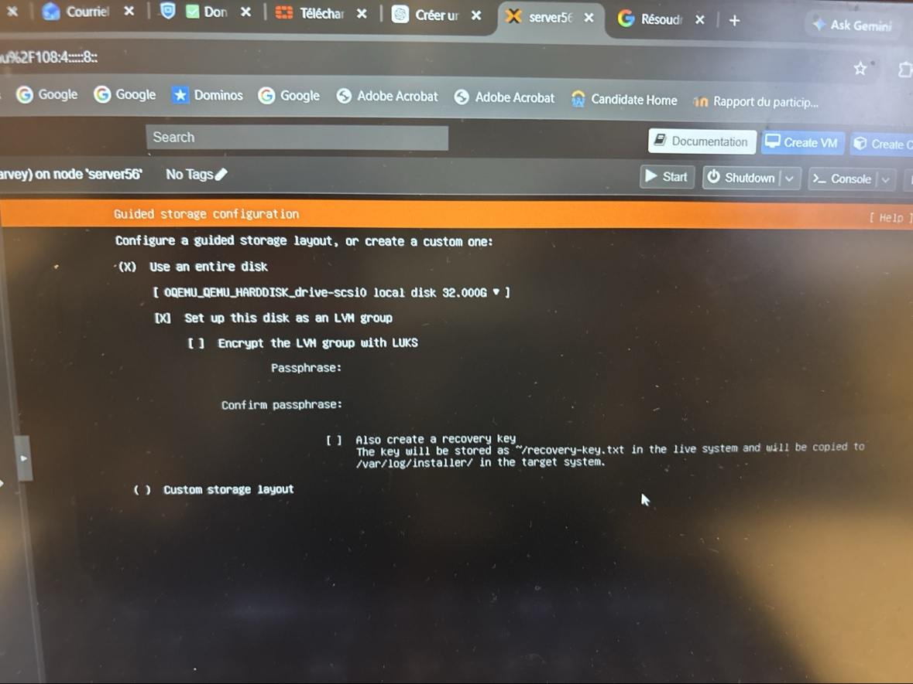

### 6. Résumé du système de fichiers
- `/` : 14,996 Go, ext4, volume logique LVM (`ubuntu-vg`)
- `/boot` : 2,000 Go, ext4, partition du disque local

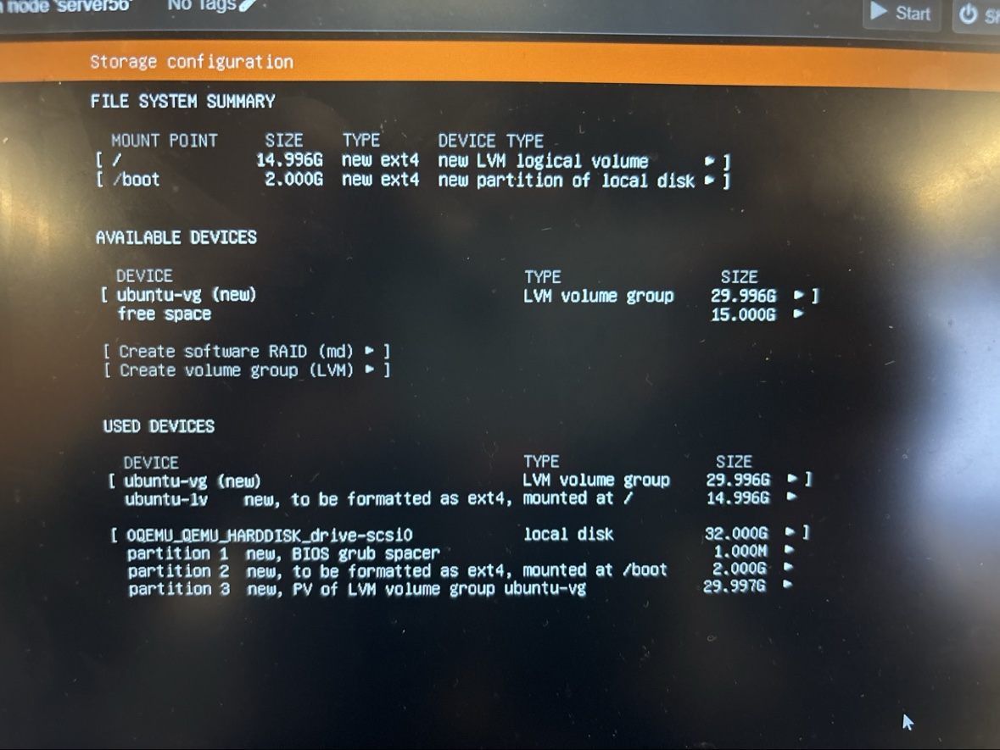

### 7. Configuration du profil
- Nom : Garvey
- Nom du serveur : `ubuntu`
- Nom d'utilisateur : `garvey200`
- Mot de passe défini (masqué sur la capture)

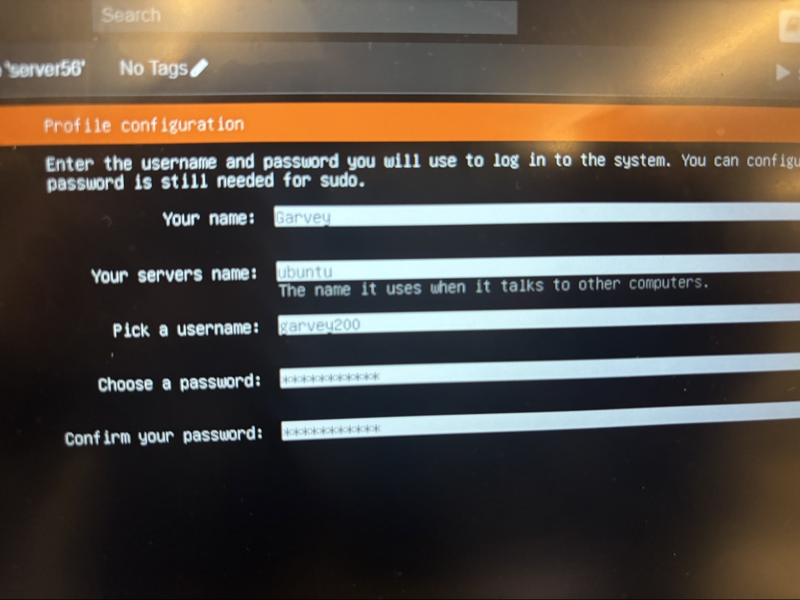

### 8. Ubuntu Pro
Option **« Skip for now »** : Ubuntu Pro n'est pas activé pendant l'installation.

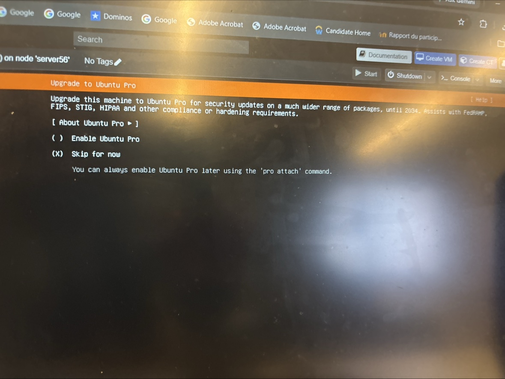

### 9. Snaps serveur
Aucun snap sélectionné.

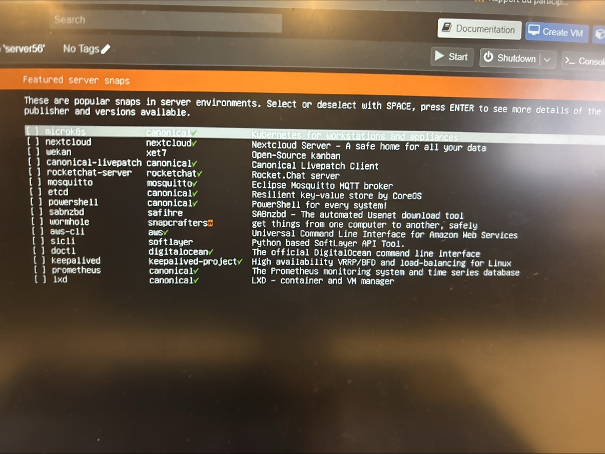

### 10. Installation du système
Le programme d'installation (Subiquity/Curtin) configure le stockage, APT et installe le système.

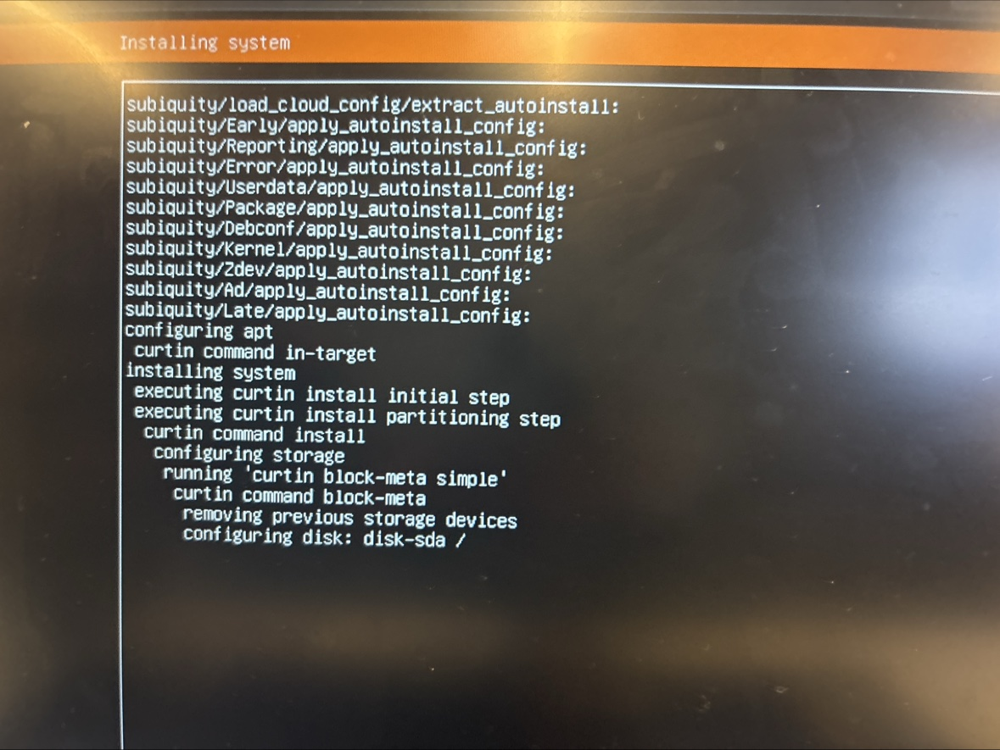

### 11. Connexion réussie
Premier démarrage : connexion avec `garvey200`. Le système affiche Ubuntu **24.04.5 LTS**, adresse IPv4 `10.7.237.140`, charge système 0.69, 13 % de mémoire utilisée.

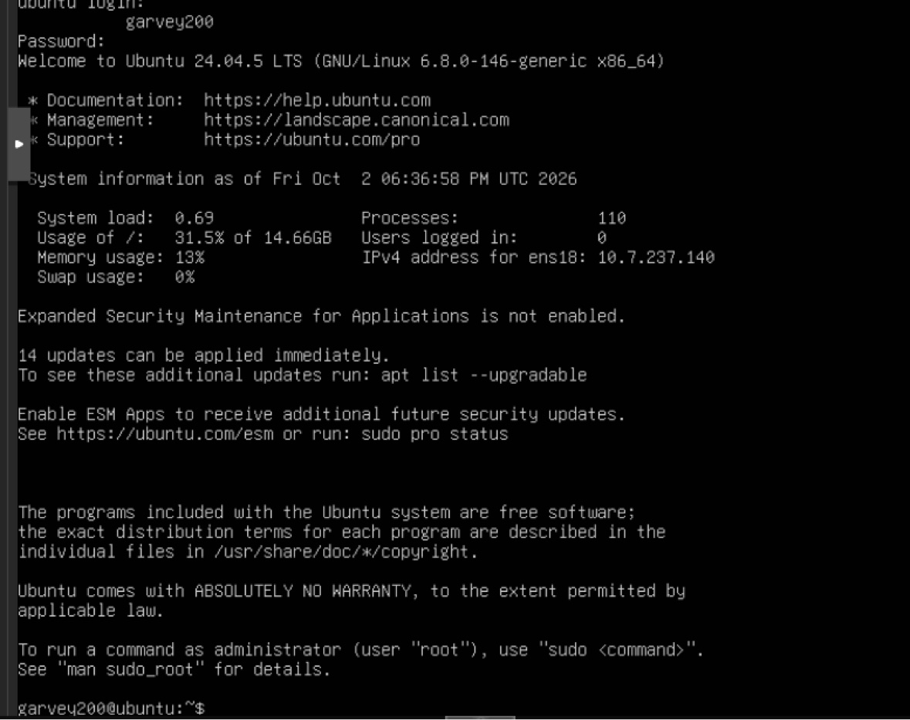

## Vérifications post-installation

```bash
# Vérifier la version
lsb_release -a

# Vérifier l'adresse IP
ip addr show ens18

# Vérifier l'espace disque
df -h

# Voir les mises à jour disponibles
apt list --upgradable
```

## ⚠️ Pour que les images s'affichent sur GitHub

Le fichier `README.md` doit être à la **racine du dépôt** et le dossier `images/` (avec les 11 fichiers `.jpg`) doit être téléversé **au même niveau**, avec exactement les mêmes noms (minuscules, sans espaces). Si seules les légendes s'affichent sans les images, c'est que le dossier `images/` n'a pas été poussé sur GitHub.
