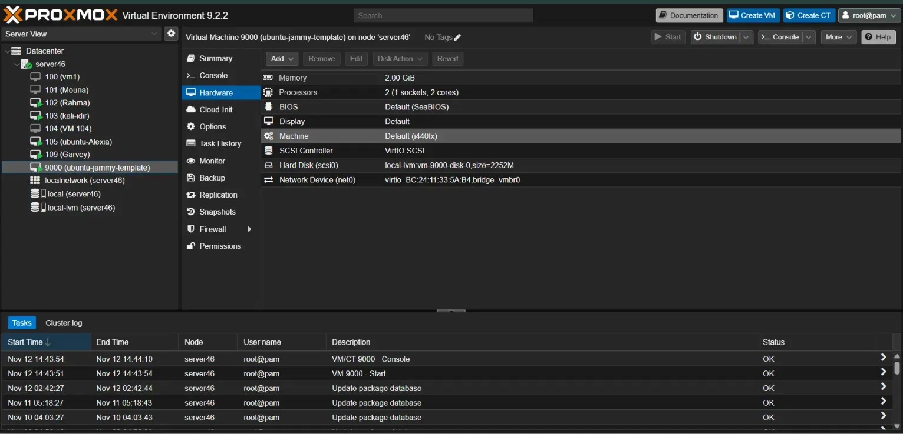
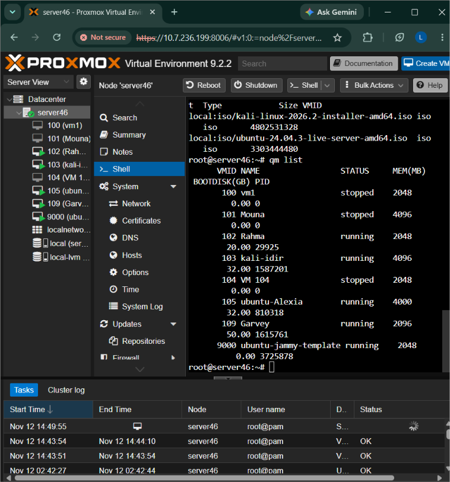
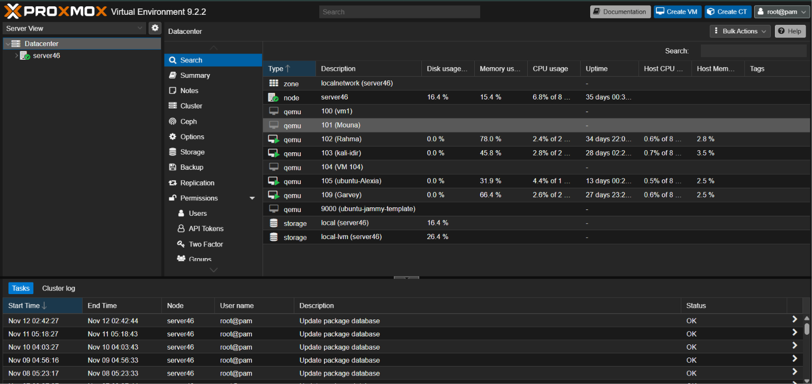
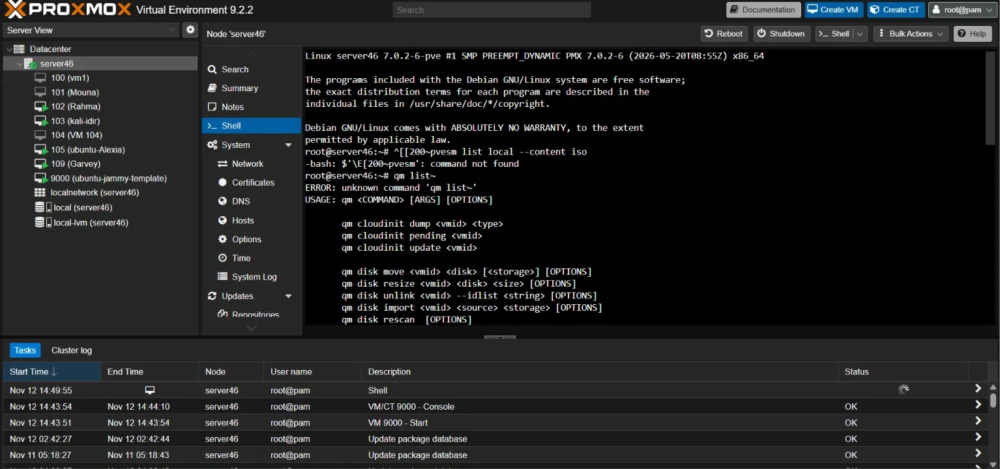
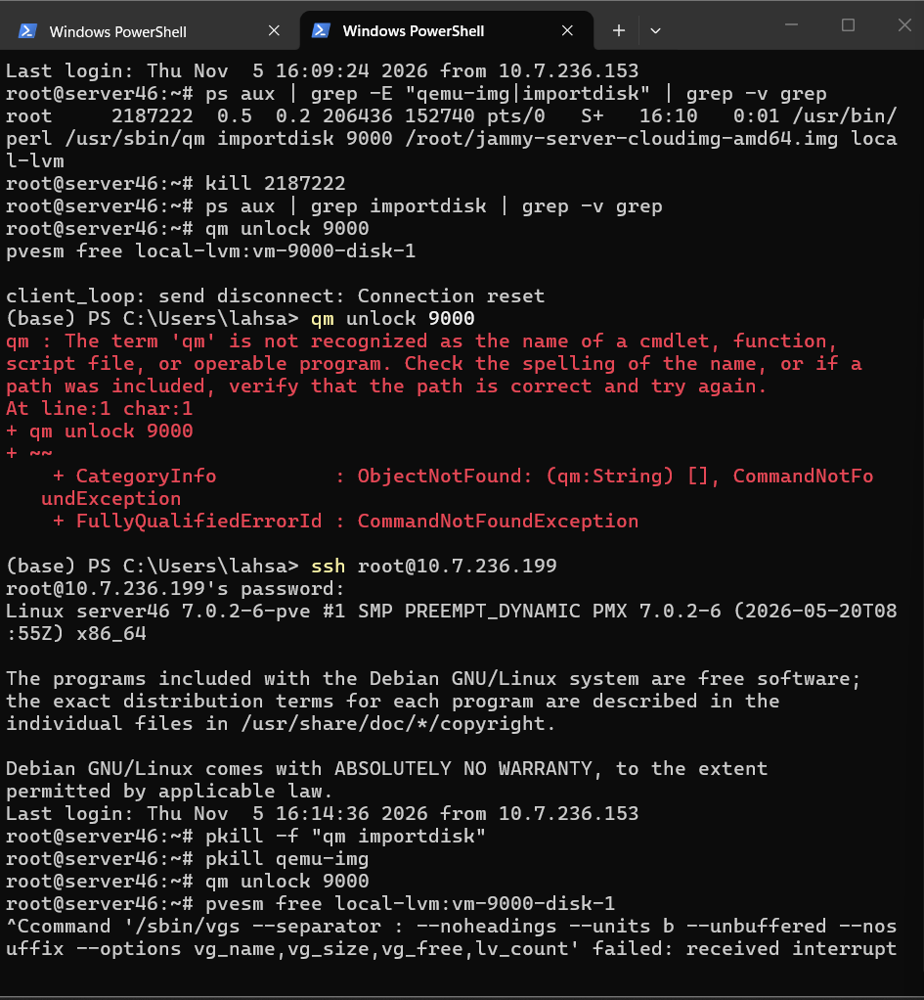

# Création d'une VM sur Proxmox : walid (300156615)

**Cours :** INF1085, Administration Linux
**Serveur :** server46 (10.7.236.199), Proxmox VE 9.2.2
**VM visée :** 184, nommée walid

## 1. Accès au serveur

Le serveur Proxmox n'est pas joignable depuis le Wi-Fi général du collège. Avec l'adresse 10.7.140.81, le ping vers la passerelle (10.7.237.1) et vers le serveur (10.7.236.199) expirait, et `Test-NetConnection` sur le port 22 répondait `TcpTestSucceeded : False`.

Après m'être connecté au Wi-Fi du laboratoire, mon PC a reçu l'adresse 10.7.236.153 (passerelle 10.7.237.1). Le test du port 22 est passé à `True` et SSH a fonctionné.

| Situation | Adresse du PC | Accès au serveur |
|---|---|---|
| Wi-Fi général | 10.7.140.81 | Non (délai dépassé) |
| Wi-Fi du laboratoire | 10.7.236.153 | Oui |

J'ai aussi créé une paire de clés SSH (`ssh-keygen -t ed25519`) pour l'accès aux VM.

## 2. Inventaire du serveur

J'ai utilisé le terminal intégré de l'interface web (`https://10.7.236.199:8006`, domaine Linux PAM) pour inspecter le serveur.

- `qm list` : le serveur héberge déjà des VM d'autres étudiants (identifiants 100 à 109). L'identifiant 184 est libre.
- `pvesm status` : deux stockages, `local` (répertoire) et `local-lvm` (LVM-thin).
- `pvesm list local --content iso` : deux ISO disponibles, Kali Linux 2026.2 et Ubuntu Server 24.04.3.

## 3. Première tentative : template cloud-init (VM 9000)

J'ai d'abord suivi la méthode du cours : télécharger l'image cloud Ubuntu 22.04 (694 Mo, téléchargée en 18 secondes) puis créer un template, la VM 9000 (`ubuntu-jammy-template`).

| Élément | Valeur |
|---|---|
| Mémoire | 2 Gio |
| Processeurs | 2 (1 socket, 2 cœurs) |
| BIOS / machine | SeaBIOS / i440fx |
| Contrôleur SCSI | VirtIO SCSI |
| Disque (scsi0) | local-lvm:vm-9000-disk-0, 2252 Mo |
| Réseau (net0) | VirtIO, bridge vmbr0 |

## 4. Problèmes rencontrés et solutions

| # | Problème | Cause | Solution |
|---|---|---|---|
| 1 | `ssh` et `ping` vers le serveur expiraient | PC sur le Wi-Fi général (10.7.140.x), un autre réseau que les serveurs (10.7.236.0/23) | Connexion au Wi-Fi du laboratoire, puis `Test-NetConnection 10.7.236.199 -Port 22` pour vérifier |
| 2 | Mot de passe root refusé deux fois | Mot de passe mal saisi | Retapé avec soin, connexion réussie à la troisième tentative |
| 3 | La commande `qm` n'est pas reconnue | Elle existe seulement sur le serveur. Ma connexion SSH s'était coupée (`Connection reset`) et j'étais revenu sur mon PC | Reconnexion avec `ssh root@10.7.236.199`, puis commande sur le serveur |
| 4 | Le terminal s'est figé pendant l'import du disque | Plusieurs commandes collées pendant que `qm importdisk` travaillait | Fermeture du terminal, reconnexion, puis vérification avec `qm list` et `qm config 9000` |
| 5 | La VM 9000 existait sans disque attaché ni lecteur cloud-init | Les commandes suivant l'import n'avaient pas été exécutées | Attachement du disque existant (`vm-9000-disk-0`) avec `qm set` |
| 6 | Un deuxième `qm importdisk` est resté bloqué (processus en veille) | Import lancé alors que le disque existait déjà | Arrêt avec `kill` et `pkill`, puis `qm unlock 9000` |
| 7 | `pvesm free` est resté figé | Il attendait un verrou LVM (commande `vgs` en attente) | Ctrl+C, je n'ai pas insisté car ce disque en trop n'était pas nécessaire |
| 8 | Les commandes collées dans le terminal web étaient refusées (`^[[200~` au début, `~` à la fin) | Mode de collage du terminal du navigateur (bracketed paste) | `bind 'set enable-bracketed-paste off'` |

**Ce que j'ai fait pour éviter d'autres problèmes :**
- Utiliser `qm list` avant de créer une VM, pour ne pas prendre l'identifiant d'un autre étudiant ni toucher à leurs VM.
- Laisser les commandes longues finir avant d'en taper d'autres.
- Choisir une méthode plus simple (VM créée à partir de l'ISO Ubuntu déjà présente sur le serveur) quand le template est devenu trop long à réparer.

## 5. Création de la VM 184 (walid)

**Configuration prévue :**

| Élément | Valeur |
|---|---|
| Identifiant / nom | 184 / walid |
| Processeur | 1 cœur, type kvm64 |
| Mémoire | 2048 Mo |
| Disque | 20 Go sur local-lvm |
| ISO | ubuntu-24.04.3-live-server-amd64.iso |
| Réseau | VirtIO, bridge vmbr0 |
| Démarrage | CD-ROM puis disque |

Commande : `qm create 184 --name walid --memory 2048 --cores 1 --cpu kvm64 --ostype l26 --scsihw virtio-scsi-pci --scsi0 local-lvm:20 --ide2 local:iso/ubuntu-24.04.3-live-server-amd64.iso,media=cdrom --net0 virtio,bridge=vmbr0 --boot 'order=ide2;scsi0'`

À compléter : résultat de `qm config 184`, installation d'Ubuntu Server, adresse IP et connexion SSH.

## Conclusion

J'ai appris à joindre un serveur Proxmox depuis le bon réseau, à inspecter ses VM, ses stockages et ses ISO, et à diagnostiquer des blocages (collage dans le terminal, import de disque figé, verrou LVM). La méthode par template cloud-init m'a pris beaucoup de temps à cause des blocages, donc je suis passé à une création à partir d'une ISO.

À compléter : résultat final de la VM 184 et ce que j'ai retenu.