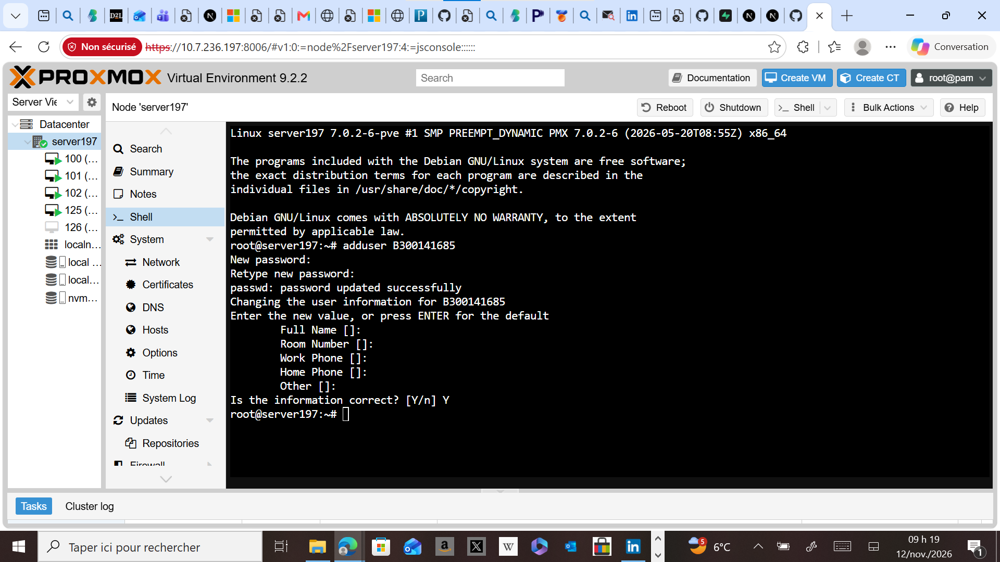
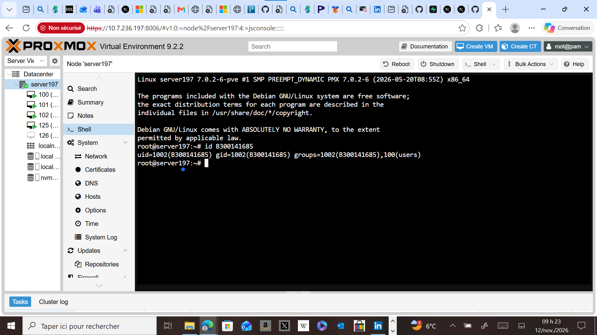
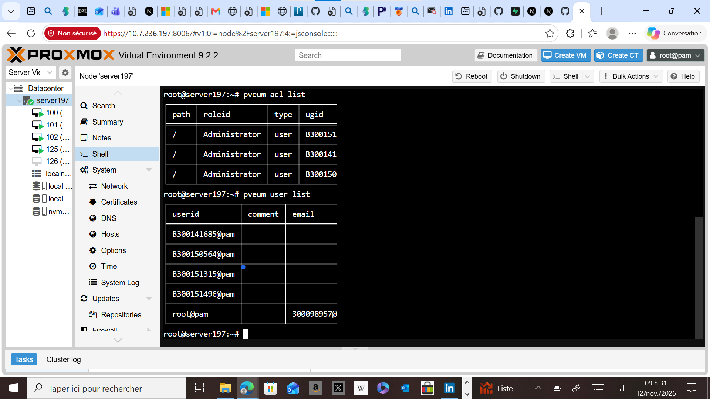
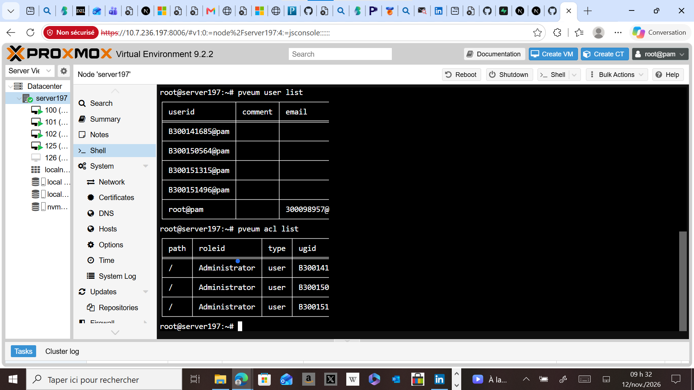
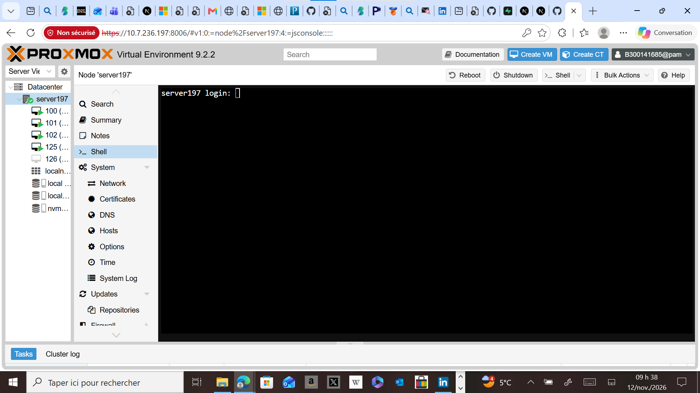

# 🔐 Labo 4 : Comptes administrateurs Proxmox

### Création d'un compte administrateur individuel (bonnes pratiques)

| | |
|---|---|
| 👤 **Étudiant** | SOULEYMANE BARRY |
| 🆔 **Numéro** | 300141685 |
| 👨‍🏫 **Professeur** | Brice Robert |
| 📚 **Cours** | INF1085 - Collège Boréal |
| 🖥️ **Serveur** | server197 (10.7.236.197) |
| 🗓️ **Date** | 12 novembre 2026 |

---

## 🎯 Objectif

Sécuriser l'accès à Proxmox VE en utilisant un compte administrateur individuel (`B300141685@pam`) plutôt que le compte partagé `root@pam`, afin que chaque action soit traçable.

## 📋 Étapes réalisées

### 1️⃣ Création de l'utilisateur Linux
Commande : `adduser B300141685`

Création du compte Linux avec son mot de passe.

### 2️⃣ Vérification de l'utilisateur
Commande : `id B300141685`

L'utilisateur existe (`uid=1002`) et appartient au groupe `users`.

### 3️⃣ Ajout de l'utilisateur à Proxmox
Commandes : `pveum user add B300141685@pam` puis `pveum user list`

`B300141685@pam` apparaît dans la liste des utilisateurs Proxmox.

### 4️⃣ Attribution des droits administrateur
Commandes : `pveum aclmod / -user B300141685@pam -role Administrator` puis `pveum acl list`

Le rôle `Administrator` est attribué sur `/`.

### 5️⃣ Connexion à l'interface web
Connexion à `https://10.7.236.197:8006` avec `B300141685@pam` (realm Linux PAM).

---

## ✅ Résultat

| Vérification | Statut |
|---|---|
| Utilisateur Linux créé | ✅ |
| Utilisateur ajouté à Proxmox | ✅ |
| Droits Administrator attribués | ✅ |
| Connexion web avec compte individuel | ✅ |

## 🧠 Conclusion

Chaque administrateur possède désormais son propre compte. Les actions sont traçables et le compte `root@pam` peut être réservé aux urgences (dépannage, réinitialisation de mots de passe, récupération du système).
