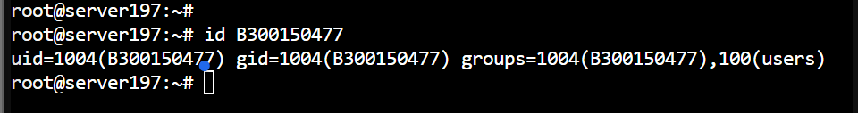
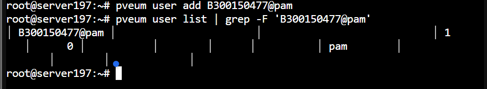
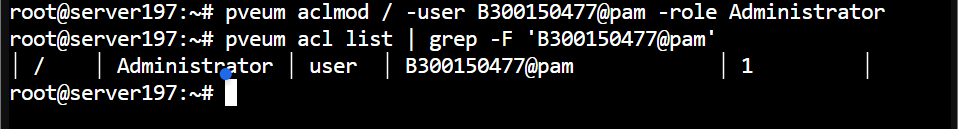
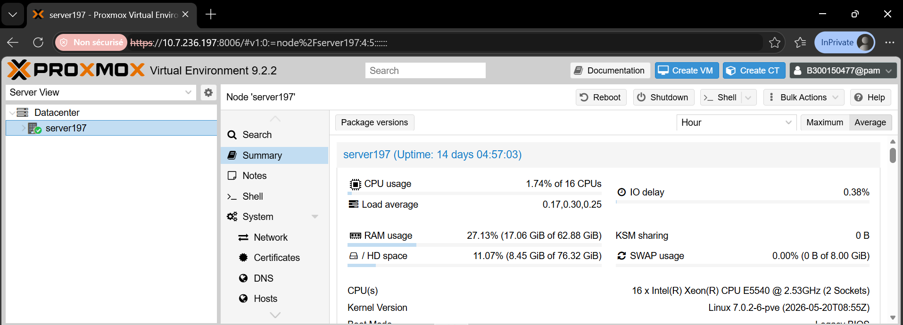
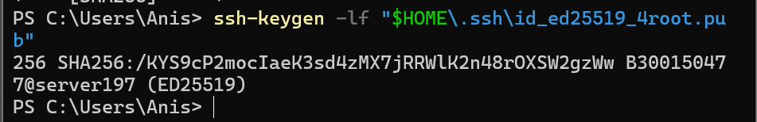
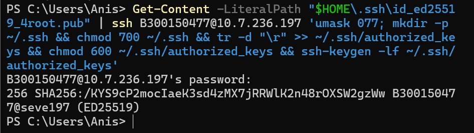
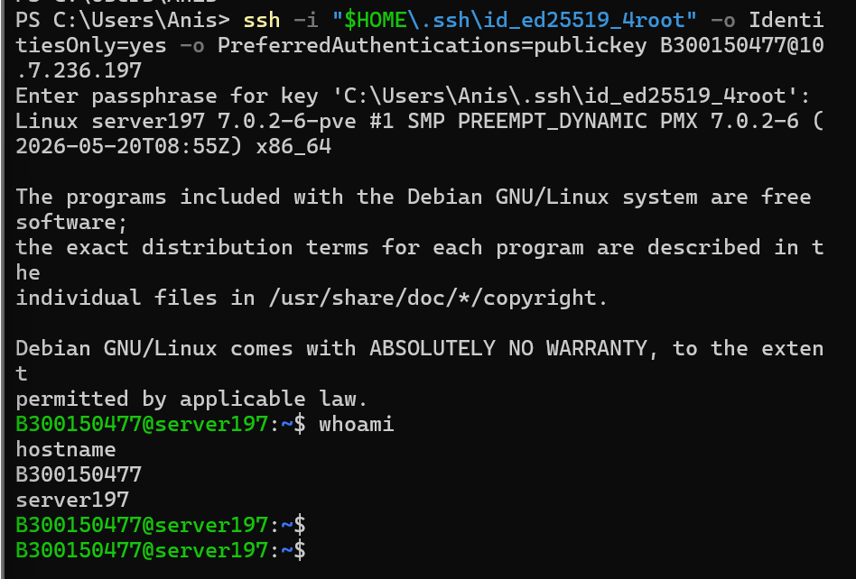

# Administration de Proxmox VE avec un compte individuel

**Anis Benabbas · 300150477 · Groupe 1**  
INF1085 — Administration Linux · Collège Boréal

J’ai configuré un compte personnel sur le nœud Proxmox `server197`, vérifié ses permissions et testé l’accès SSH depuis Windows avec une clé ED25519.

| Élément | Configuration |
| --- | --- |
| Nœud Proxmox | `server197` · `10.7.236.197` |
| Compte Linux | `B300150477` · UID `1004` |
| Compte Proxmox | `B300150477@pam` |
| Rôle Proxmox | `Administrator` sur le chemin `/` |
| Clé SSH personnelle | ED25519 · `id_ed25519_4root` |

## 1. Créer le compte Linux et l’ajouter à Proxmox

Dans le Shell de `server197`, j’ai créé le compte Linux `B300150477`. La commande `id` a confirmé sa création et affiché l’UID `1004`. J’ai ensuite enregistré ce compte dans le domaine `pam` de Proxmox, qui utilise les comptes Linux de l’hôte.

| Vérification du compte Linux | Vérification du compte Proxmox |
| --- | --- |
|  |  |

## 2. Vérifier le rôle et la connexion Web

J’ai suivi la consigne du laboratoire en attribuant le rôle `Administrator` au chemin `/`. J’ai vérifié l’attribution dans la liste des permissions, puis ouvert une session Web avec `B300150477@pam` pour vérifier l’accès au résumé du nœud.

| Attribution du rôle | Session Web avec le compte personnel |
| --- | --- |
|  |  |

## 3. Installer et vérifier la clé publique SSH

Depuis PowerShell, j’ai généré une paire de clés ED25519 dédiée au laboratoire. J’ai ajouté uniquement la clé publique au fichier `~/.ssh/authorized_keys` de mon compte sur `server197`. La clé privée est conservée sur mon PC. J’ai appliqué les permissions `700` au dossier `~/.ssh` et `600` au fichier `authorized_keys`.

La commande `ssh-keygen -lf` a affiché la même empreinte SHA256 sur mon PC et sur le serveur.

| Empreinte de la clé publique sur Windows | Empreinte de la clé installée sur server197 |
| --- | --- |
|  |  |

## 4. Tester la connexion SSH par clé

J’ai lancé cette commande depuis PowerShell pour limiter le test à l’authentification par clé publique.

```powershell
ssh -i "$HOME\.ssh\id_ed25519_4root" -o IdentitiesOnly=yes -o PreferredAuthentications=publickey B300150477@10.7.236.197
```

Dans la session SSH, `whoami` a renvoyé `B300150477` et `hostname` a renvoyé `server197`.


