# 🔐 Comptes administrateurs Proxmox – Bonnes pratiques

**Nom :** Ouassim Ahmed Benamira  
**Matricule :** 300150564  
**Cours :** INF1085 – Administration Linux  

---

## 🎯 Objectif

L'objectif de ce laboratoire est de sécuriser l'accès à **Proxmox VE** en utilisant un compte administrateur individuel au lieu d'utiliser uniquement le compte `root@pam`.

Le compte utilisé pour ce laboratoire est :

```text
B300150564
```

Le serveur Proxmox utilisé est :

```text
server197
Adresse IP : 10.7.236.197
```

---

## 👤 Étape 1 – Création de l'utilisateur Linux

Après une connexion au serveur Proxmox avec le compte `root`, j'ai créé mon compte Boreal avec la commande :

```bash
adduser B300150564
```

Un mot de passe a ensuite été configuré pour le nouvel utilisateur.

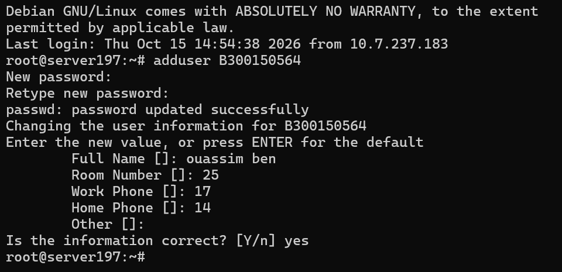

---

## 🔎 Étape 2 – Vérification de l'utilisateur

Pour vérifier que le compte Linux a bien été créé, j'ai utilisé :

```bash
id B300150564
```

Cette commande affiche l'UID, le GID et les groupes associés au compte.

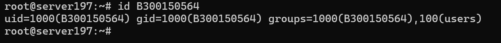

---

## 🖥️ Étape 3 – Ajout de l'utilisateur dans Proxmox

Le compte Linux a ensuite été ajouté aux utilisateurs Proxmox avec le domaine d'authentification `pam`.

Commande utilisée :

```bash
pveum user add B300150564@pam
```

Pour vérifier les utilisateurs Proxmox :

```bash
pveum user list
```

Le compte suivant apparaît maintenant dans la liste :

```text
B300150564@pam
```

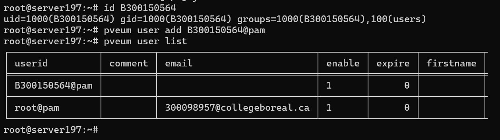

---

## 🔑 Étape 4 – Attribution du rôle Administrator

Pour donner les droits administrateur à mon compte, j'ai utilisé :

```bash
pveum aclmod / -user B300150564@pam -role Administrator
```

J'ai ensuite vérifié les permissions avec :

```bash
pveum acl list
```

Le compte `B300150564@pam` possède maintenant le rôle :

```text
Administrator
```

sur le chemin :

```text
/
```

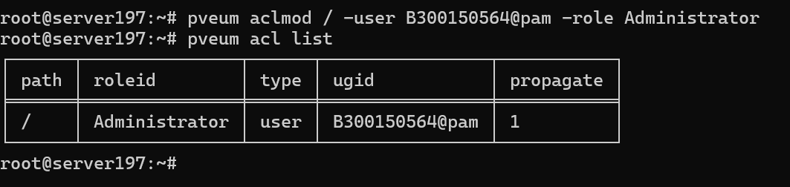

---

## 🌐 Étape 5 – Accès à l'interface Web Proxmox

L'interface Web du serveur Proxmox est accessible à l'adresse :

```text
https://10.7.236.197:8006
```

Le serveur utilisé pour ce laboratoire est :

```text
server197
```

Le compte Proxmox personnel utilise le domaine d'authentification :

```text
B300150564@pam
```

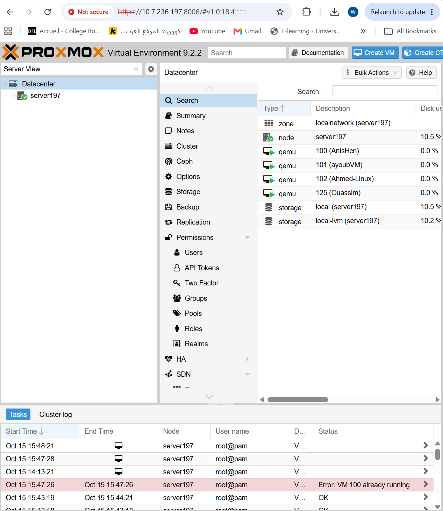

---

## 💻 Étape 6 – Connexion SSH avec le compte personnel

Depuis **Windows PowerShell**, j'ai testé la connexion SSH avec mon nouveau compte.

Commande utilisée :

```powershell
ssh B300150564@10.7.236.197
```

Après avoir entré le mot de passe du compte, la connexion au serveur fonctionne correctement.

Pour vérifier l'utilisateur connecté :

```bash
whoami
```

Résultat :

```text
B300150564
```

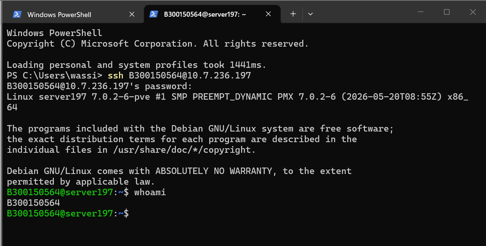

---

## 🔐 Étape 7 – Configuration de la clé SSH

Une paire de clés SSH existait déjà sur mon ordinateur.

J'ai donc utilisé la clé publique :

```text
ma_cle.pub
```

Depuis PowerShell, la clé publique a été ajoutée au fichier `authorized_keys` du compte `B300150564`.

Commande utilisée :

```powershell
Get-Content $HOME\.ssh\ma_cle.pub | ssh B300150564@10.7.236.197 "mkdir -p ~/.ssh; chmod 700 ~/.ssh; cat >> ~/.ssh/authorized_keys; chmod 600 ~/.ssh/authorized_keys"
```

Cette commande :

- crée le dossier `.ssh` si nécessaire ;
- configure les permissions `700` sur `.ssh` ;
- ajoute la clé publique dans `authorized_keys` ;
- configure les permissions `600` sur `authorized_keys`.

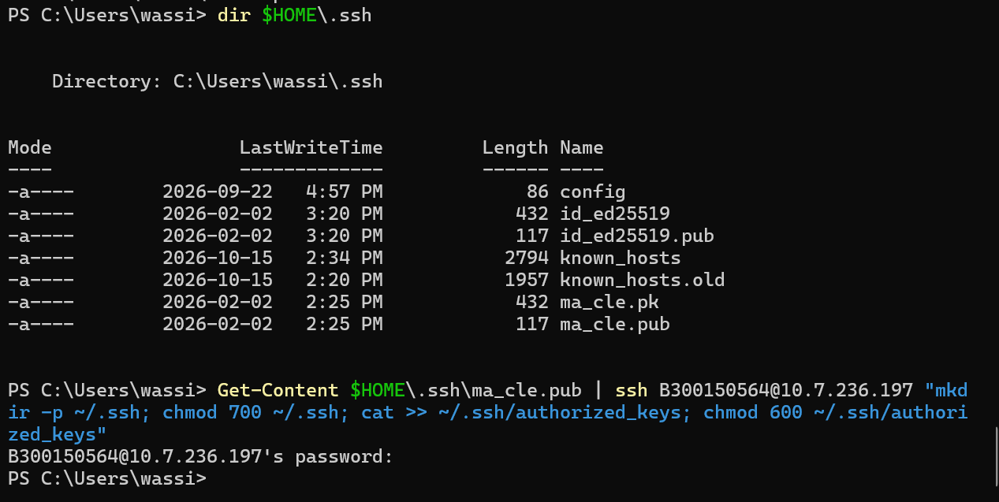

---

## 🔓 Étape 8 – Connexion SSH avec la clé

Après l'installation de la clé publique, j'ai testé la connexion avec ma clé privée depuis PowerShell.

Commande utilisée :

```powershell
ssh -i $HOME\.ssh\ma_cle.pk B300150564@10.7.236.197
```

La connexion au serveur a été effectuée directement avec la clé SSH.

Le mot de passe du compte Linux n'a pas été demandé.

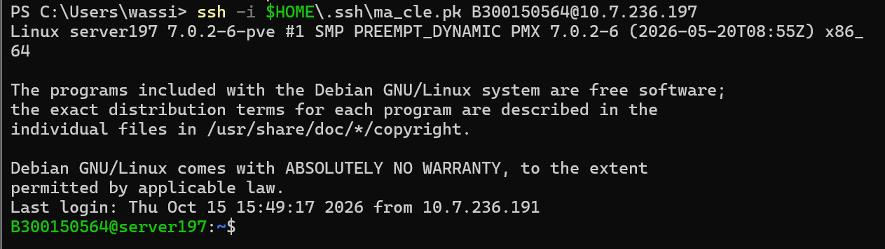

---

## ✅ Étape 9 – Vérification de l'utilisateur connecté

Après la connexion SSH avec la clé, j'ai effectué une dernière vérification avec :

```bash
whoami
```

et :

```bash
id
```

Le résultat confirme que la session utilise bien le compte :

```text
B300150564
```

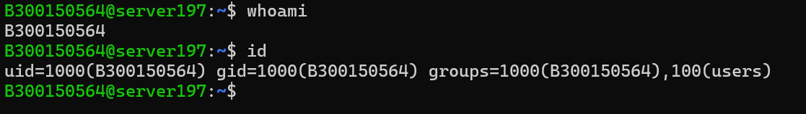

---

## 🧪 Étape 10 – Vérification des rôles Proxmox

Pour afficher les rôles disponibles dans Proxmox, j'ai utilisé :

```bash
pveum role list
```

La liste contient plusieurs rôles Proxmox, dont :

```text
Administrator
```

Cela confirme que le rôle attribué à mon compte est bien disponible sur le serveur.

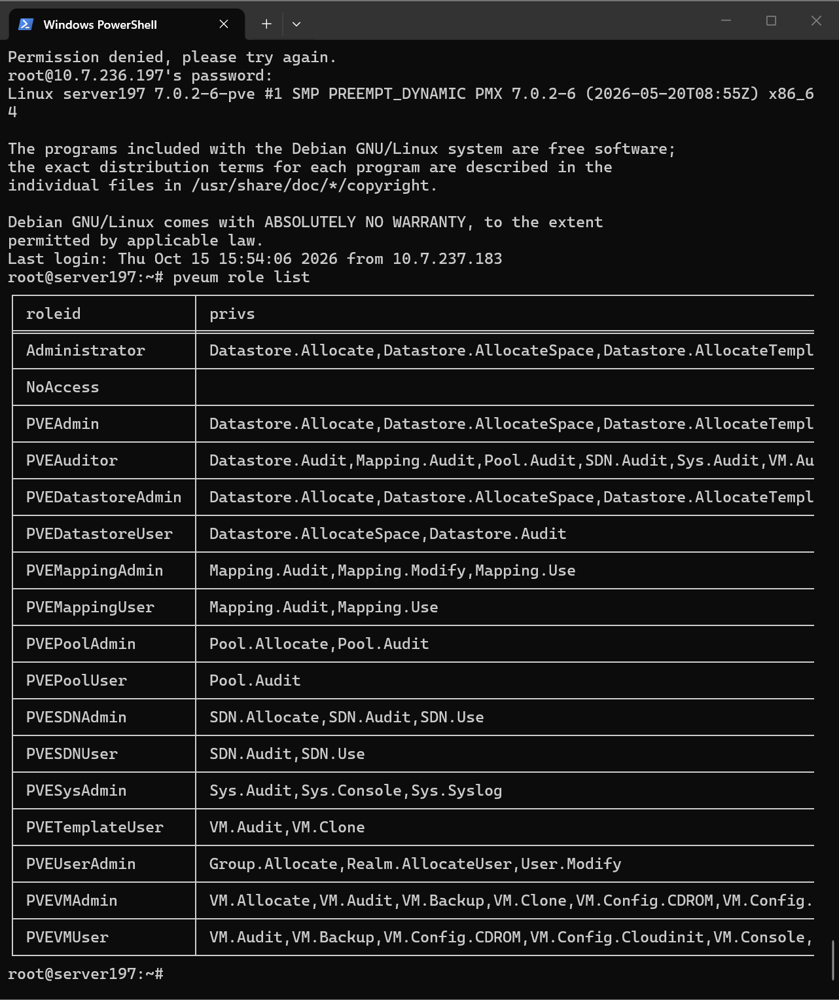

---

## 🔑 Étape 11 – Vérification finale des permissions

Pour terminer, j'ai vérifié les ACL Proxmox avec :

```bash
pveum acl list
```

Le résultat affiche :

```text
path       : /
roleid     : Administrator
type       : user
ugid       : B300150564@pam
propagate  : 1
```

Cela confirme que le compte `B300150564@pam` possède le rôle `Administrator` sur le serveur Proxmox.

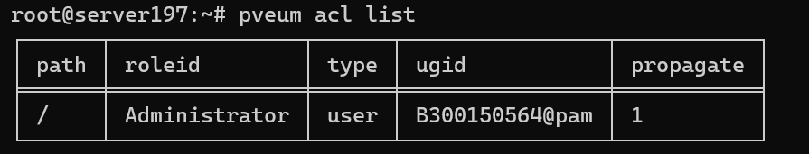

---

## 📋 Configuration finale

| Élément | Configuration |
|---|---|
| **Serveur** | `server197` |
| **Adresse IP** | `10.7.236.197` |
| **Compte Linux** | `B300150564` |
| **Compte Proxmox** | `B300150564@pam` |
| **Rôle** | `Administrator` |
| **Chemin ACL** | `/` |
| **SSH** | Fonctionnel |
| **Authentification SSH par clé** | Fonctionnelle |
| **Clé publique utilisée** | `ma_cle.pub` |

---

## 🛡️ Bonnes pratiques

L'utilisation d'un compte administrateur individuel permet de mieux identifier les actions effectuées par chaque administrateur.

Il est préférable d'éviter de partager le compte :

```text
root@pam
```

Chaque administrateur doit utiliser son propre compte.

L'utilisation d'une clé SSH améliore également la sécurité de l'accès distant au serveur.

Le compte `root@pam` doit principalement être conservé pour :

- le dépannage ;
- la réinitialisation de mots de passe ;
- la maintenance d'urgence ;
- la récupération du système.

---

## 🎓 Résultat obtenu

À la fin de ce laboratoire :

- ✅ Mon compte Linux `B300150564` a été créé.
- ✅ Le compte `B300150564@pam` a été ajouté à Proxmox.
- ✅ Le rôle `Administrator` a été attribué au compte.
- ✅ Les permissions ont été vérifiées avec les ACL Proxmox.
- ✅ La connexion SSH avec mon compte personnel fonctionne.
- ✅ Une clé publique SSH a été configurée.
- ✅ La connexion SSH avec la clé fonctionne.
- ✅ Le compte `root` peut être réservé aux opérations d'urgence.

---

## ✅ Conclusion

Ce laboratoire m'a permis de créer et configurer mon propre compte administrateur sur **Proxmox VE**.

Le compte `B300150564@pam` possède maintenant le rôle `Administrator`. J'ai également configuré l'accès SSH avec une clé publique et vérifié que la connexion fonctionne correctement.

Cette configuration est plus sécuritaire que l'utilisation permanente d'un compte `root` partagé et permet une meilleure traçabilité des actions effectuées sur le serveur.