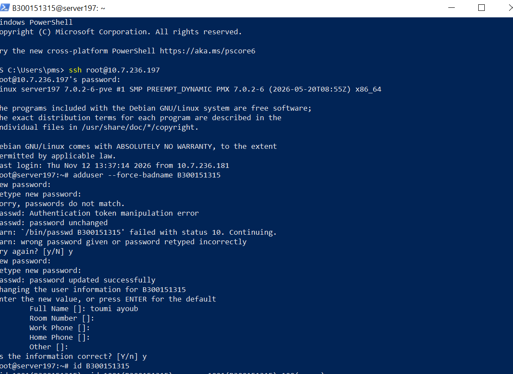
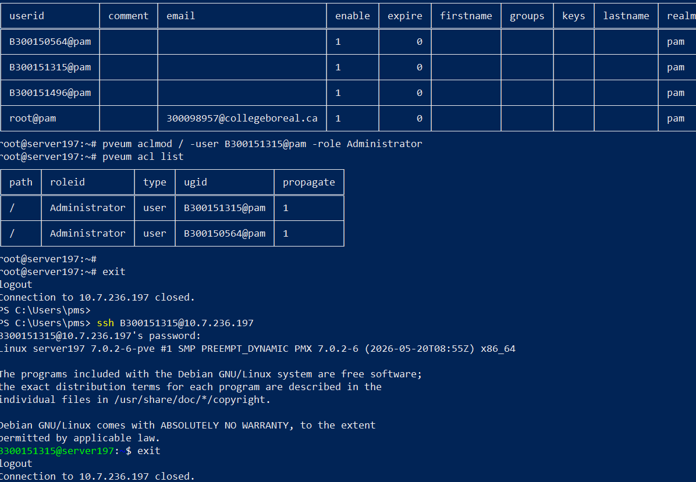
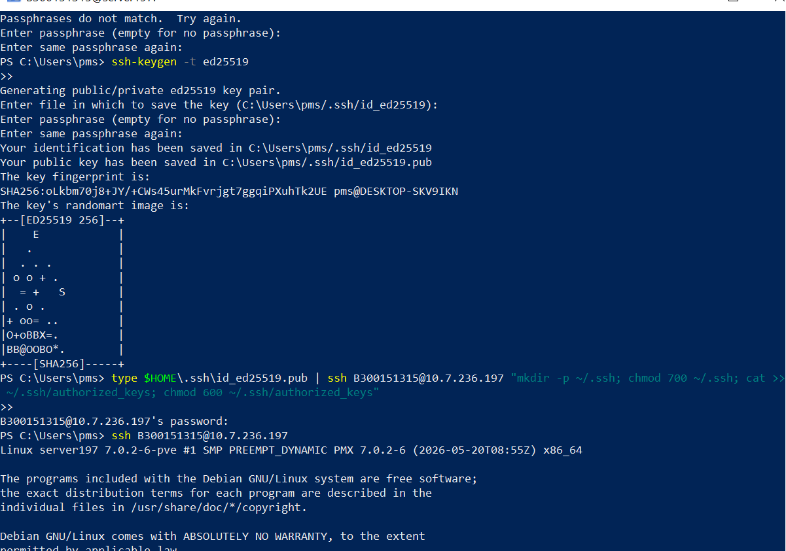
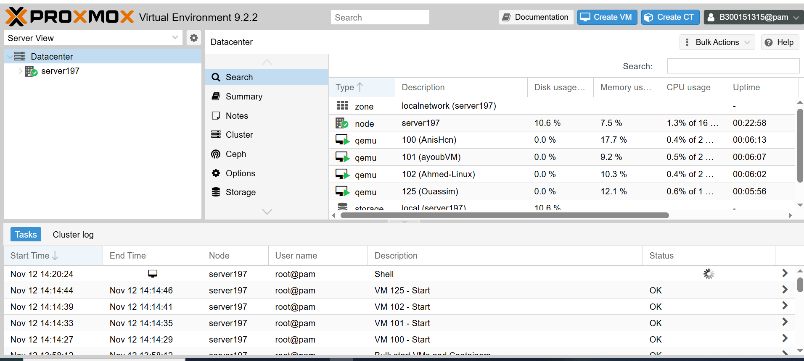

# 300151315 - Compte administrateur Proxmox

Laboratoire réalisé par **Toumi Ayoub** sur le serveur Proxmox du groupe 1 (`server197`, `10.7.236.197`).

## Objectif
Ne plus utiliser le compte partagé `root@pam`, mais un compte administrateur personnel `B300151315@pam`, avec une connexion SSH par clé.

## 1. Créer l'utilisateur Linux
Connexion en `root` (une dernière fois), puis création de l'utilisateur :

```
ssh root@10.7.236.197
adduser --force-badname B300151315
id B300151315
```
`--force-badname` est nécessaire car Debian refuse par défaut les noms d'utilisateur avec une majuscule (`B`).



## 2. Ajouter l'utilisateur à Proxmox et donner les droits administrateur
```
pveum user add B300151315@pam
pveum user list
pveum aclmod / -user B300151315@pam -role Administrator
pveum acl list
```

Puis test de la connexion SSH avec mon compte (mot de passe) :
```
ssh B300151315@10.7.236.197
```



## 3. Connexion SSH avec une clé
Création d'une paire de clés `ed25519` sur mon PC, puis copie de la clé publique sur le serveur. Sous Windows, `ssh-copy-id` n'existe pas, donc la clé est envoyée avec `type` :

```
ssh-keygen -t ed25519
type $HOME\.ssh\id_ed25519.pub | ssh B300151315@10.7.236.197 "mkdir -p ~/.ssh; chmod 700 ~/.ssh; cat >> ~/.ssh/authorized_keys; chmod 600 ~/.ssh/authorized_keys"
ssh B300151315@10.7.236.197
```

✅ La dernière connexion se fait sans mot de passe.



## 4. Connexion à l'interface Web
`https://10.7.236.197:8006` avec l'utilisateur `B300151315`, realm **Linux PAM**. En haut à droite : `B300151315@pam`.



## Résultat

| Vérification | Résultat |
|---|---|
| Utilisateur Linux `B300151315` | ✅ |
| Utilisateur Proxmox `B300151315@pam` | ✅ |
| Rôle `Administrator` sur `/` | ✅ |
| SSH avec mot de passe | ✅ |
| SSH avec clé (sans mot de passe) | ✅ |
| Connexion Web avec mon compte | ✅ |

Le compte `root@pam` reste réservé au dépannage et aux urgences.

## Problèmes rencontrés et solutions

| Problème | Solution |
|---|---|
| `adduser` refuse un nom avec une majuscule | Option `--force-badname` |
| `Passwords do not match` pendant `adduser` | Répondre `y` à « Try again? » et retaper le mot de passe |
| `ssh-copy-id` n'existe pas sous Windows | Envoi de la clé avec `type ... \| ssh ... "cat >> ~/.ssh/authorized_keys"` |
| `Passphrases do not match` pendant `ssh-keygen` | Relancer la commande et appuyer seulement sur Entrée (pas de phrase secrète) |
