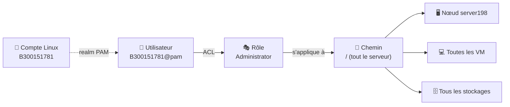
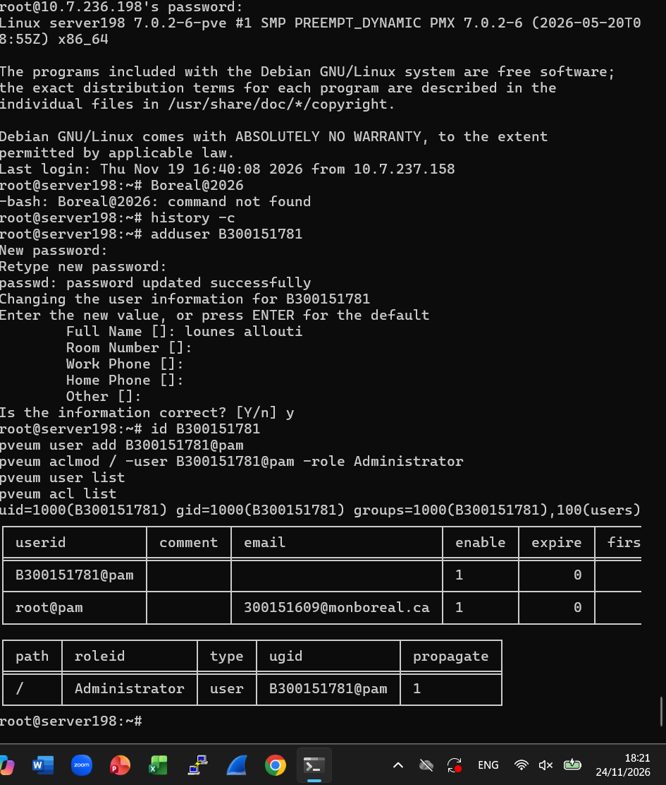
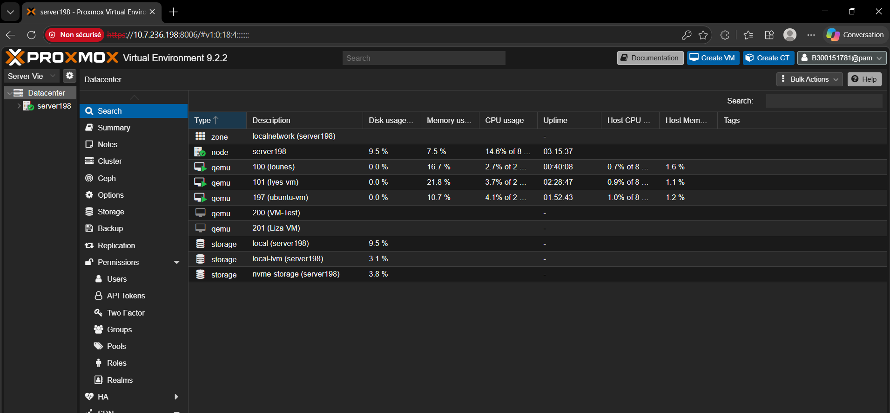
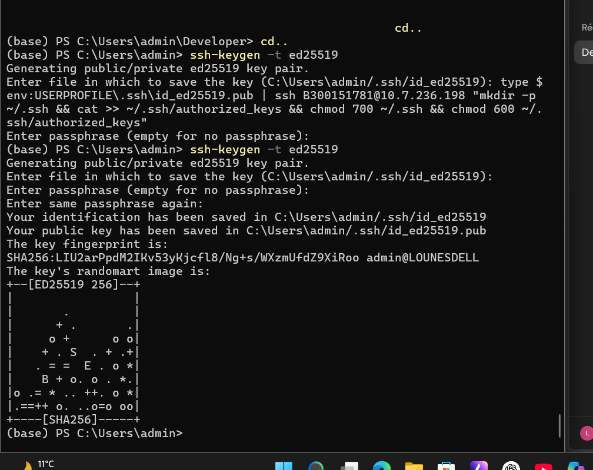
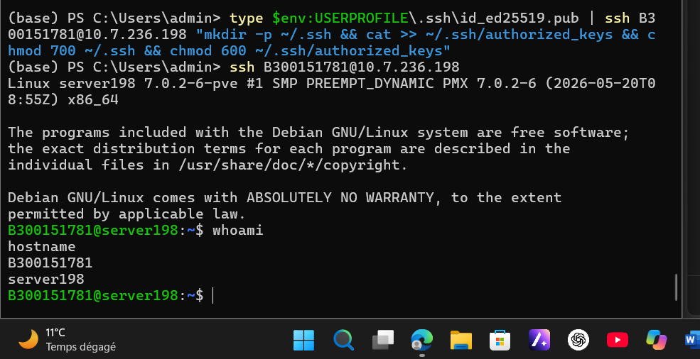
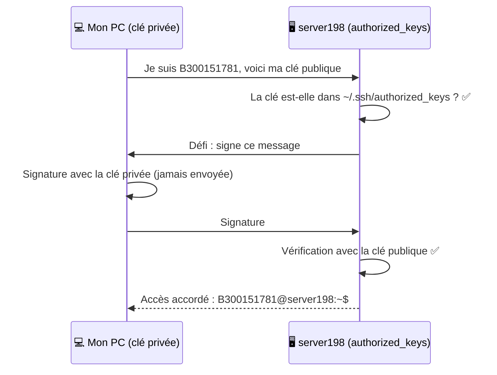

<div align="center">

# 🔐 4.Root — Comptes administrateurs Proxmox

### *Un compte par administrateur, une clé par machine, et `root` réservé aux urgences*


| 👤 Étudiant | 🆔 | 👥 Groupe | 🖥️ Serveur | 🔑 Compte créé |
|:-:|:-:|:-:|:-:|:-:|
| **Lounes Allouti** | 300151781 | 2️⃣ | server198 — `10.7.236.198` | **`B300151781@pam`** |

</div>

---

## 📑 Sommaire

| | | |
|---|---|---|
| [🎯 Objectif](#-objectif) | [🧭 Le modèle de droits](#-le-modèle-de-droits-proxmox) | [🛠️ Réalisation](#️-réalisation-pas-à-pas) |
| [🔐 Clé SSH](#-5-connexion-ssh-par-clé) | [📖 Les commandes expliquées](#-les-commandes-expliquées) | [🧗 Défis](#-défis-rencontrés) |

---

## 🎯 Objectif

Sécuriser l'accès au serveur Proxmox en remplaçant le compte partagé **`root@pam`**
par un **compte administrateur personnel**, avec une **connexion SSH par clé publique**.

| ❌ Mauvaise pratique | ✅ Bonne pratique (réalisée) |
|---|---|
| Tout le monde se connecte en `root@pam` | Chaque administrateur a **son** compte : `B300151781@pam` |
| Un mot de passe root partagé entre tous | Mot de passe **personnel** + **clé SSH** |
| Impossible de savoir qui a fait quoi | Chaque action est **traçable** dans les journaux |
| Révoquer un accès = changer le mot de passe de tous | Révoquer un accès = **désactiver un seul compte** |

---

## 🧭 Le modèle de droits Proxmox

Proxmox donne les droits avec des **ACL** : *qui* (utilisateur) reçoit *quel rôle* (ensemble de privilèges) sur *quel chemin* (ressource).



> 🔎 **PAM** (*Pluggable Authentication Modules*) : Proxmox vérifie le mot de passe auprès des comptes **Linux** du serveur.
> C'est pour ça qu'il faut d'abord créer l'utilisateur Linux (`adduser`), puis le déclarer dans Proxmox (`pveum user add`).

---

## 🛠️ Réalisation pas à pas

### 👤 1. Créer l'utilisateur Linux

Connexion au serveur en `root` (une dernière fois 😉) :

```bash
ssh root@10.7.236.198
adduser B300151781
id B300151781
```

```text
uid=1000(B300151781) gid=1000(B300151781) groups=1000(B300151781),100(users)
```

### 🖥️ 2. Déclarer l'utilisateur dans Proxmox

```bash
pveum user add B300151781@pam
pveum user list
```

### 🔑 3. Lui donner le rôle Administrator

```bash
pveum aclmod / -user B300151781@pam -role Administrator
pveum acl list
```

| path | roleid | type | ugid | propagate |
|:-:|:-:|:-:|:-:|:-:|
| `/` | **Administrator** | user | `B300151781@pam` | 1 |

> `propagate = 1` : le rôle s'applique à `/` **et à tout ce qui est en dessous** (nœud, VM, stockages).



### 🌐 4. Se connecter à l'interface Web avec son compte

| Champ | Valeur |
|---|---|
| Adresse | `https://10.7.236.198:8006` |
| User name | `B300151781` |
| Realm | **Linux PAM standard authentication** |



✅ En haut à droite : **`B300151781@pam`**. Le compte voit tout le serveur grâce au rôle **Administrator** sur `/`.

### 🔐 5. Connexion SSH par clé

**Générer une paire de clés** sur mon poste Windows :

```powershell
ssh-keygen -t ed25519
```



**Déposer la clé publique** sur le serveur. Windows n'a pas `ssh-copy-id`, donc on envoie la clé par un tube (`|`) :

```powershell
type $env:USERPROFILE\.ssh\id_ed25519.pub | ssh B300151781@10.7.236.198 "mkdir -p ~/.ssh && cat >> ~/.ssh/authorized_keys && chmod 700 ~/.ssh && chmod 600 ~/.ssh/authorized_keys"
```

**Tester** :

```powershell
ssh B300151781@10.7.236.198
whoami      # B300151781
hostname    # server198
```



✅ **Aucun mot de passe demandé** : le serveur reconnaît ma clé `ed25519`.

#### 🔄 Comment fonctionne la connexion par clé ?



> 🔒 La **clé privée** (`id_ed25519`) ne quitte **jamais** mon PC. Seule la **clé publique** (`id_ed25519.pub`) est copiée sur le serveur.

---

## 🔒 Mot de passe ou clé SSH ?

| | 🔑 Mot de passe | 🗝️ Clé SSH ed25519 |
|---|:-:|:-:|
| Résiste aux attaques par force brute | ⚠️ | ✅ |
| Peut être volé par hameçonnage | ⚠️ | ✅ non |
| Circule sur le réseau | chiffré, mais oui | ❌ jamais |
| Connexion rapide, sans saisie | ❌ | ✅ |
| Recommandé pour un administrateur | ⚠️ | ✅ |

---

## 📖 Les commandes expliquées

| Commande | Rôle |
|---|---|
| `adduser B300151781` | Crée le compte Linux, son dossier `/home/B300151781` et son mot de passe |
| `id B300151781` | Affiche l'identifiant (uid) et les groupes du compte |
| `pveum user add B300151781@pam` | Déclare le compte dans Proxmox, dans le realm **PAM** |
| `pveum aclmod / -user … -role Administrator` | Donne le rôle **Administrator** sur `/` |
| `pveum user list` / `pveum acl list` | Vérifie les comptes et les permissions |
| `ssh-keygen -t ed25519` | Crée une paire de clés (privée + publique) |
| `type … \| ssh … "cat >> ~/.ssh/authorized_keys"` | Ajoute la clé publique sur le serveur |
| `chmod 700 ~/.ssh` / `chmod 600 authorized_keys` | Droits stricts, exigés par SSH pour accepter la clé |

---

## 🧗 Défis rencontrés

| # | 🚧 Problème | ✅ Solution |
|:-:|---|---|
| 1 | `ssh-copy-id` n'existe pas sous Windows | Envoi de la clé publique par un tube : `type … \| ssh … "cat >> ~/.ssh/authorized_keys"` |
| 2 | Commande collée pendant que `ssh-keygen` demandait le nom du fichier | `Ctrl + C`, puis relance en validant chaque question par **Entrée** |
| 3 | Un mot de passe tapé à l'invite a été pris pour une commande | Ne jamais taper un mot de passe à l'invite ; sur le serveur, `history -c` efface l'historique |
| 4 | Déconnexion de `root@pam` difficile à trouver dans l'interface | Connexion dans une **fenêtre InPrivate** (`Ctrl + Maj + N`) |

---

## 🚨 Le compte root

`root@pam` est **conservé**, mais uniquement pour :

| | Usage réservé |
|:-:|---|
| 🔧 | Dépannage |
| 🔄 | Réinitialisation de mots de passe |
| 🛠️ | Maintenance d'urgence |
| 🚑 | Récupération du système |

---

## ✅ Bilan

| Bonne pratique | Statut |
|---|:-:|
| Un compte par administrateur | ✅ |
| Droits gérés avec les ACL Proxmox | ✅ |
| Connexion Web avec un compte personnel | ✅ |
| Connexion SSH par clé publique, sans mot de passe | ✅ |
| Compte `root` réservé aux urgences | ✅ |

## 📚 Glossaire

| Terme | Définition |
|---|---|
| **PAM** | Système d'authentification de Linux, utilisé par Proxmox pour vérifier les mots de passe |
| **Realm** | « Domaine » d'authentification dans Proxmox (`pam`, `pve`, LDAP…) |
| **ACL** | Liste de contrôle d'accès : qui a quel rôle sur quelle ressource |
| **Rôle** | Ensemble de privilèges (ex. `Administrator`, `PVEVMUser`) |
| **ed25519** | Algorithme de clé SSH moderne, court et très sûr |
| **authorized_keys** | Fichier du serveur listant les clés publiques autorisées à se connecter |

---

<div align="center">

✍️ **Lounes Allouti** — 300151781 — Collège Boréal — INF1085

*Un compte par personne, une clé par machine, et root seulement en cas d'urgence* 🔐

</div>
