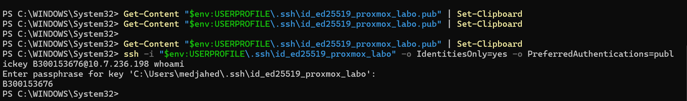

# Compte personnel sur Proxmox

Lyes Medjahed · 300153676 · Groupe 2

Sur le serveur Proxmox `server198` (`10.7.236.198`), j’ai vérifié mon compte et ses droits.

| Commande | Résultat |
| --- | --- |
| `id B300153676` | Le compte Linux existe. Son UID et son GID sont 1001. |
| `pveum user list` | Mon compte Proxmox est enregistré sous `B300153676@pam`. |
| `pveum acl list` | Mon compte a le rôle `Administrator` sur `/`, avec propagation. |

## Connexion SSH par clé

Depuis PowerShell, je me suis connecté au serveur avec ma clé SSH. La commande distante `whoami` a affiché `B300153676`.

