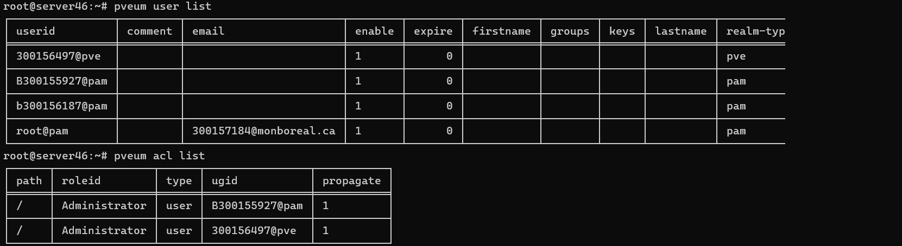
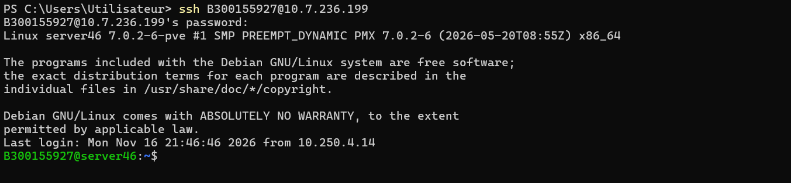

# 300155927

# 🖥️ Proxmox VE — Utilisateurs et accès — server46 🔐

Documentation de la gestion des utilisateurs et des droits sur le nœud Proxmox **server46**, et de la connexion SSH avec son propre compte.

## 🛠️ Environnement

| Élément | Détail |
|---|---|
| Nœud Proxmox | `server46` (`10.7.236.199`) |
| Version | Proxmox VE 7.0.2-6 (Linux server46, Debian) |
| Compte utilisé | `B300155927@pam` |
| Connexion | SSH depuis PowerShell sur Windows |

## 📋 Étapes

### 1️⃣ 👥 Lister les utilisateurs — `pveum user list`

Connecté en `root` sur le nœud, la commande `pveum user list` affiche tous les comptes Proxmox :

| Utilisateur | Activé | Expiration | Type |
|---|---|---|---|
| `300156497@pve` | 1 (oui) | 0 (jamais) | pve |
| `B300155927@pam` | 1 (oui) | 0 (jamais) | pam |
| `b300156187@pam` | 1 (oui) | 0 (jamais) | pam |
| `root@pam` | 1 (oui) | 0 (jamais) | pam |

- **enable = 1** : le compte est activé ;
- **expire = 0** : le compte n'expire jamais ;
- **pve** : un compte créé dans Proxmox lui-même ;
- **pam** : un compte Linux du nœud (le nom d'utilisateur du système).



### 2️⃣ 🔑 Voir les droits — `pveum acl list`

La commande `pveum acl list` affiche qui a quels droits :

| Chemin | Rôle | Type | Compte | Propagé |
|---|---|---|---|---|
| `/` | Administrator | user | `B300155927@pam` | 1 |
| `/` | Administrator | user | `300156497@pve` | 1 |

- **path `/`** : les droits s'appliquent à tout le serveur ;
- **rôle Administrator** : tous les droits (créer des VM, les démarrer, les arrêter, changer les réglages) ;
- **propagate = 1** : les droits s'appliquent aussi à tout ce qui est en dessous (les VM, le stockage, le réseau).


### 3️⃣ 💻 Se connecter en SSH avec son compte

Depuis PowerShell sur Windows, on se connecte au nœud avec son propre compte (pas `root`) :

```powershell
ssh B300155927@10.7.236.199
```

Après le mot de passe, le serveur affiche son message de bienvenue : **Linux server46 7.0.2-6-pve**, puis l'invite de commande `B300155927@server46:~$`. La connexion a réussi avec le compte `B300155927`, qui a les droits Administrator vus à l'étape 2.



## 💻 Commandes utilisées

```bash
pveum user list   # lister les utilisateurs Proxmox
pveum acl list    # lister les droits (qui peut faire quoi)
```

```powershell
ssh B300155927@10.7.236.199   # se connecter au nœud avec son compte
```
