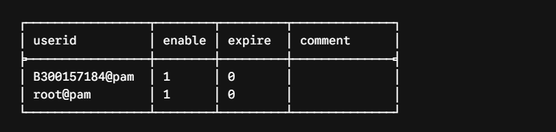
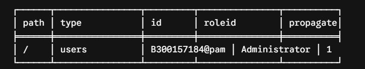

# 🔐 Comptes administrateurs Proxmox : bonnes pratiques

| Champ | Valeur |
|-------|--------|
| Étudiant | 300157184 (anta) |
| Groupe | 4 — Participation #3 |
| Compte Proxmox | `B300157184@pam` |
| Serveur Proxmox | `10.7.237.200` (server56) |
| Poste client | `anta@10.7.236.187` |

## 🎯 Objectif

Sécuriser l'accès à Proxmox VE avec un compte administrateur individuel au lieu du compte partagé `root@pam`, pour que chaque action soit traçable.

---

## 1. 👤 Créer l'utilisateur et l'ajouter à Proxmox

```bash
adduser B300157184
pveum user add B300157184@pam
pveum user list
```

Le compte `B300157184@pam` est créé et actif (`enable = 1`), à côté de `root@pam`.


## 2. 🔑 Donner le rôle Administrator

```bash
pveum acl modify / --users B300157184@pam --roles Administrator
pveum acl list
```

L'utilisateur a le rôle `Administrator` sur la racine `/`, avec propagation (`propagate = 1`) à tout le Datacenter.



## 3. 💻 Connexion SSH avec mon compte

Depuis mon poste `anta@10.7.236.187` :

```bash
ssh B300157184@10.7.237.200
```

Je suis connecté au serveur `server56` avec mon propre compte, pas avec root.


---

## ✅ Résultat

| Méthode | Recommandation |
|---------|:--------------:|
| Utiliser seulement `root@pam` | ❌ |
| Un compte par administrateur | ✅ |
| SSH avec mot de passe | ⚠️ |
| SSH avec clé publique | ✅ |
| Partager le compte root | ❌ |
| Utiliser les ACL Proxmox | ✅ |

- ✅ J'ai mon propre compte `B300157184@pam`
- ✅ Il a le rôle Administrator via les ACL Proxmox
- ✅ Je me connecte en SSH avec mon compte, mes actions sont traçables
- ✅ `root@pam` est réservé au dépannage et aux urgences
