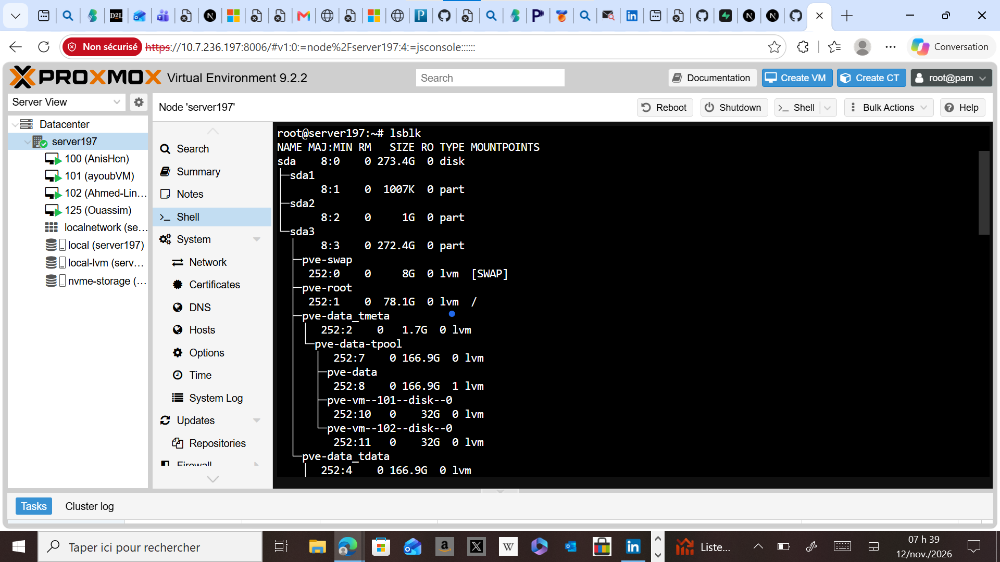
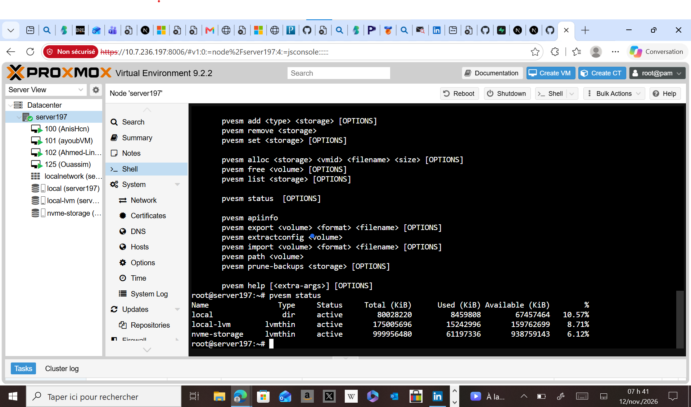
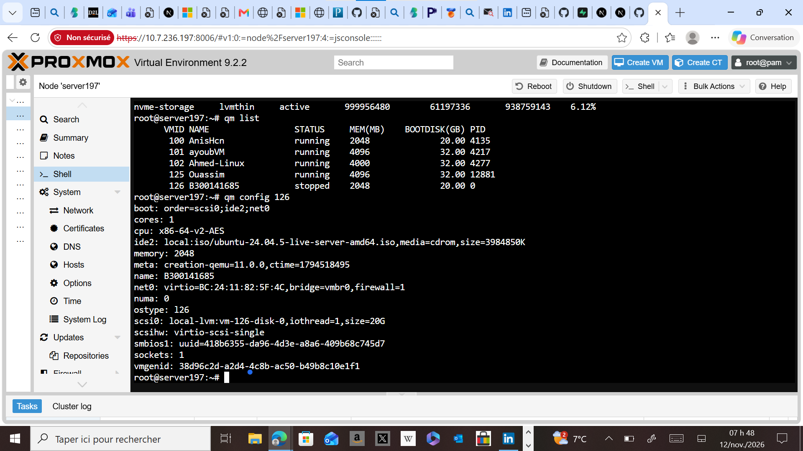
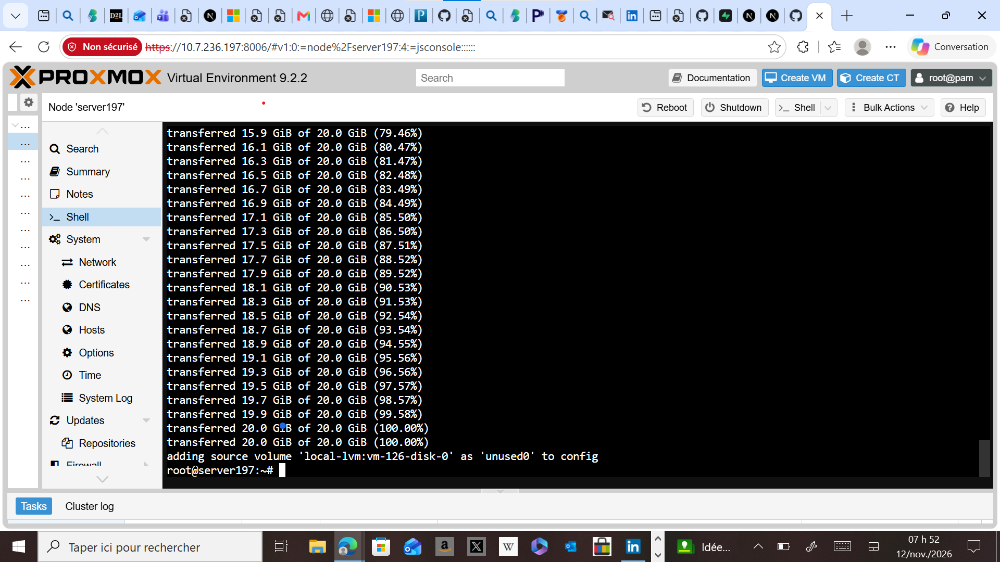
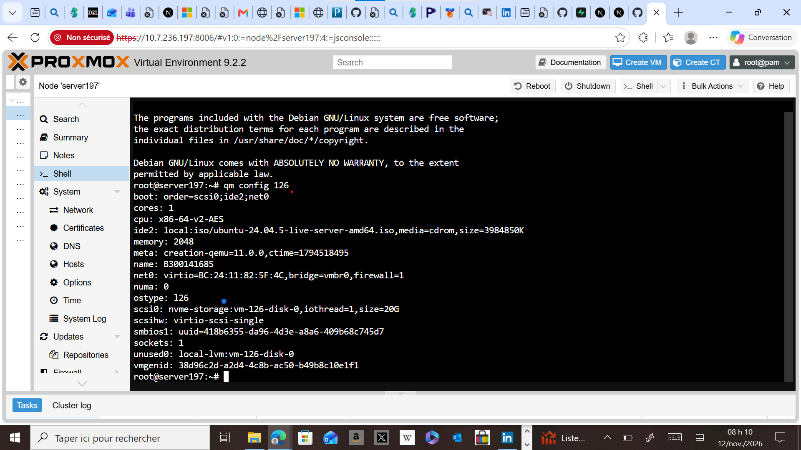
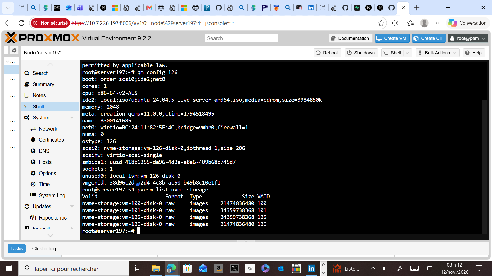

<div align="center">

# 💾 Labo 5 : Stockage sous Linux et Proxmox VE

### Déplacement d'une machine virtuelle vers un stockage NVMe (LVM-Thin)

| | |
|---|---|
| 👤 **Étudiant** | SOULEYMANE BARRY |
| 🆔 **Numéro** | 300141685 |
| 👨‍🏫 **Professeur** | Brice Robert |
| 📚 **Cours** | INF1085 - Collège Boréal |
| 🖥️ **Serveur** | server197 (10.7.236.197) |
| 🗓️ **Date** | 12 novembre 2026 |

</div>

---

## 🎯 Objectif

Déplacer le disque d'une machine virtuelle de `local-lvm` (disque SAS/SATA) vers `nvme-storage` (SSD NVMe) afin d'améliorer les performances, et documenter chaque étape avec des captures d'écran.

## 🧱 Architecture

```text
Disque NVMe (nvme0n1, 953.9G)
        │
        ▼
 Partition (nvme0n1p1)
        │
        ▼
 PV ──► VG (nvme-vg) ──► Thin Pool (data)
        │
        ▼
 Stockage Proxmox : nvme-storage
        │
        ▼
 Disque de ma VM 126 (B300141685)
```

## 🛠️ Environnement

| Élément | Valeur |
|---|---|
| Hyperviseur | Proxmox VE 9.2.2 |
| Stockage source | `local-lvm` (LVM-Thin sur disque SAS 273.4G) |
| Stockage cible | `nvme-storage` (LVM-Thin sur NVMe 953.9G) |
| VM | ID `126`, nom `B300141685`, 1 cœur, 2048 Mo RAM, disque 20G |

---

## 📋 Étapes réalisées

### 1️⃣ Identification des disques
Commande : `lsblk`

Le disque NVMe `nvme0n1` (953.9G) est déjà partitionné et configuré en LVM-Thin (`nvme--vg-data`).



### 2️⃣ Vérification des stockages Proxmox
Commande : `pvesm status`

Trois stockages sont actifs : `local` (répertoire), `local-lvm` (LVM-Thin) et `nvme-storage` (LVM-Thin sur NVMe).



### 3️⃣ Configuration de la VM avant le déplacement
Commande : `qm config 126`

Le disque de la VM est sur `local-lvm` : `scsi0: local-lvm:vm-126-disk-0,size=20G`.



### 4️⃣ Déplacement du disque vers le NVMe
Commande : `qm move_disk 126 scsi0 nvme-storage`

Le disque de 20 GiB est copié à 100 %. Proxmox conserve l'ancien volume en `unused0` par sécurité.



### 5️⃣ Configuration de la VM après le déplacement
Commande : `qm config 126`

Le disque est maintenant sur le NVMe : `scsi0: nvme-storage:vm-126-disk-0,size=20G`.



### 6️⃣ Vérification sur le stockage NVMe
Commande : `pvesm list nvme-storage`

Le volume `vm-126-disk-0` apparaît dans `nvme-storage`, à côté des disques des VM 100, 101 et 125.



---

## ✅ Résultat

| Vérification | Statut |
|---|---|
| Disques identifiés dans Linux | ✅ |
| Stockage `nvme-storage` actif | ✅ |
| VM 126 créée sur `local-lvm` | ✅ |
| Disque déplacé vers `nvme-storage` | ✅ |
| Configuration mise à jour | ✅ |
| Stockage NVMe utilisé par la VM | ✅ |

## 🧪 Questions de réflexion

**1. Quelle est la différence entre un HDD, un SSD SATA et un NVMe ?**
Le HDD est un disque mécanique : grande capacité, faible coût, mais lent. Le SSD SATA n'a pas de pièces mécaniques et est plus rapide. Le NVMe utilise le bus PCI Express et est le plus rapide.

**2. Quel est le rôle d'une partition ?**
Elle divise un disque en zones pour organiser l'espace de stockage.

**3. À quoi sert un système de fichiers ?**
Il organise et gère la façon dont les données sont écrites et retrouvées sur le disque (ext4, xfs, ntfs, fat32).

**4. Que signifient PV, VG et LV ?**
PV = Physical Volume (disque ou partition), VG = Volume Group (regroupe des PV), LV = Logical Volume (volume utilisable).

**5. Pourquoi Proxmox utilise-t-il souvent LVM-Thin ?**
Le thin provisioning alloue l'espace seulement quand il est utilisé, ce qui économise de la place et permet les instantanés.

**6. Quelle commande affiche les stockages configurés dans Proxmox ?**
`pvesm status`

**7. Quel est l'avantage d'un NVMe pour les VM ?**
Il offre un débit et des temps d'accès bien meilleurs, donc des VM plus rapides.

---

## 🧠 Conclusion

Ce laboratoire m'a permis de comprendre la chaîne du stockage sous Linux (disque, partition, LVM) et son utilisation dans Proxmox VE. J'ai déplacé avec succès le disque de ma VM vers un stockage NVMe LVM-Thin, ce qui améliore ses performances.

<div align="center">

*Réalisé par Souleymane Barry - 300141685*

</div>
