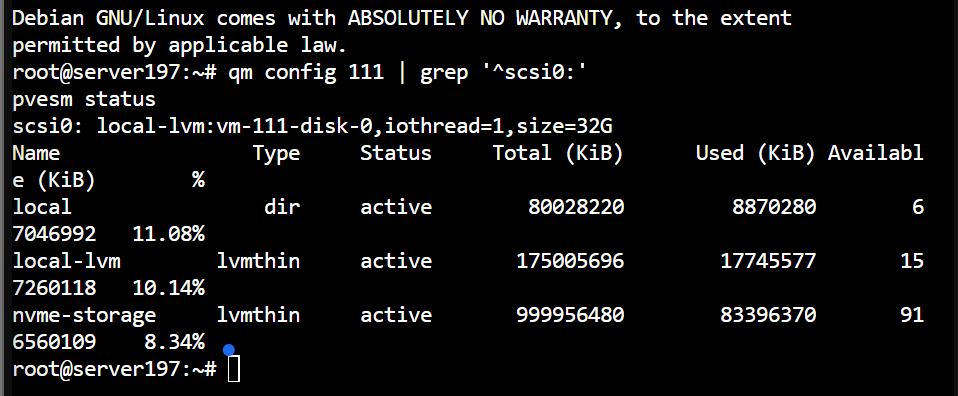
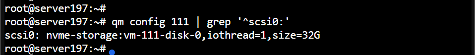
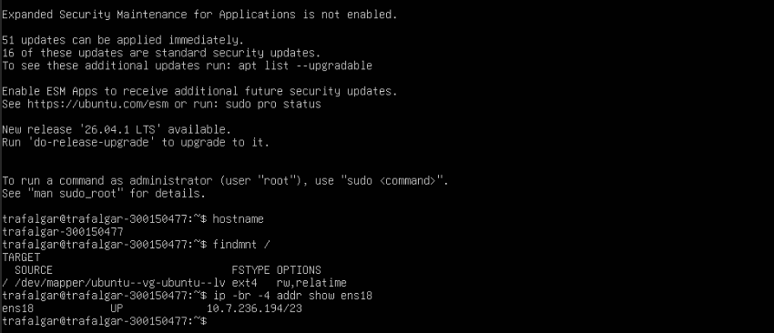

# Migration du disque de la VM 111 vers un SSD NVMe

**Anis Benabbas · 300150477 · Groupe 1**  
INF1085 — Administration Linux · Collège Boréal

J’ai déplacé le disque système de ma VM Ubuntu de `local-lvm` vers `nvme-storage` sur le nœud `server197`. Après le redémarrage, j’ai confirmé que le système de fichiers racine était monté et que l’interface réseau utilisait toujours l’adresse prévue.

| Paramètre | Avant | Après |
| --- | --- | --- |
| Disque système | `scsi0` · 32 Gio | `scsi0` · 32 Gio |
| Volume Proxmox | `local-lvm:vm-111-disk-0` | `nvme-storage:vm-111-disk-0` |

## 1. Vérifier la source et la destination

Dans le Shell de `server197`, j’ai vérifié l’emplacement du disque et la disponibilité du stockage de destination. `pvesm status` affichait `nvme-storage` comme **actif**, de type **LVM-Thin**, avec environ **874 Gio libres**.

```bash
qm config 111 | grep '^scsi0:'
pvesm status
```



## 2. Déplacer le disque système

J’ai déplacé `scsi0` vers `nvme-storage` avec l’option `--delete 0` pour conserver le volume source comme disque inutilisé après la migration. La vérification a confirmé que le disque actif de la VM se trouve sur le NVMe.

```bash
qm move_disk 111 scsi0 nvme-storage --delete 0
qm config 111 | grep '^scsi0:'
```



## 3. Vérifier Ubuntu après le redémarrage

Depuis la console Proxmox de la VM 111, j’ai vérifié le nom d’hôte, le montage de la racine et l’adresse IPv4.

| Commande | Résultat observé |
| --- | --- |
| `hostname` | `trafalgar-300150477` |
| `findmnt /` | `/dev/mapper/ubuntu--vg-ubuntu--lv` monté en `ext4`, en lecture-écriture |
| `ip -br -4 addr show ens18` | `ens18` active, avec `10.7.236.194/23` |



## Questions de réflexion

1. **HDD, SSD SATA et SSD NVMe.** Un HDD utilise des plateaux mécaniques. Un SSD SATA utilise de la mémoire flash et l’interface SATA. Un SSD NVMe utilise de la mémoire flash et le protocole NVMe sur PCIe, ce qui permet généralement un débit supérieur et une latence plus faible.
2. **Partition.** Elle délimite une zone d’un disque afin de l’utiliser, par exemple, pour un système de fichiers ou comme support pour LVM.
3. **Système de fichiers.** Il organise les fichiers et les dossiers et gère leur emplacement, leurs métadonnées et leurs permissions.
4. **PV, VG et LV.** Le *Physical Volume* est un disque ou une partition initialisée pour LVM. Le *Volume Group* réunit un ou plusieurs PV. Le *Logical Volume* est un volume créé à partir de l’espace du VG.
5. **LVM-Thin.** Le stockage alloue des blocs physiques au fur et à mesure des écritures des VM. On peut ainsi présenter à une VM un disque virtuel dont la capacité maximale dépasse l’espace qu’elle utilise au départ. Il faut surveiller l’espace réellement disponible dans le pool.
6. **Afficher les stockages Proxmox.** La commande `pvesm status` affiche les stockages configurés, leur type, leur état et leur capacité.
7. **Avantage du NVMe pour les VM.** Sa faible latence et sa capacité à traiter des requêtes en parallèle peuvent accélérer les accès disque, surtout quand plusieurs VM utilisent le même stockage.
