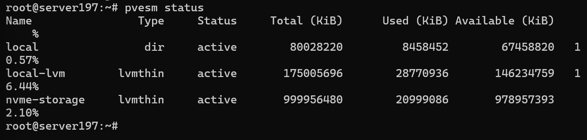
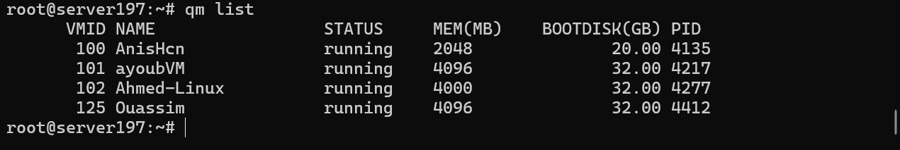
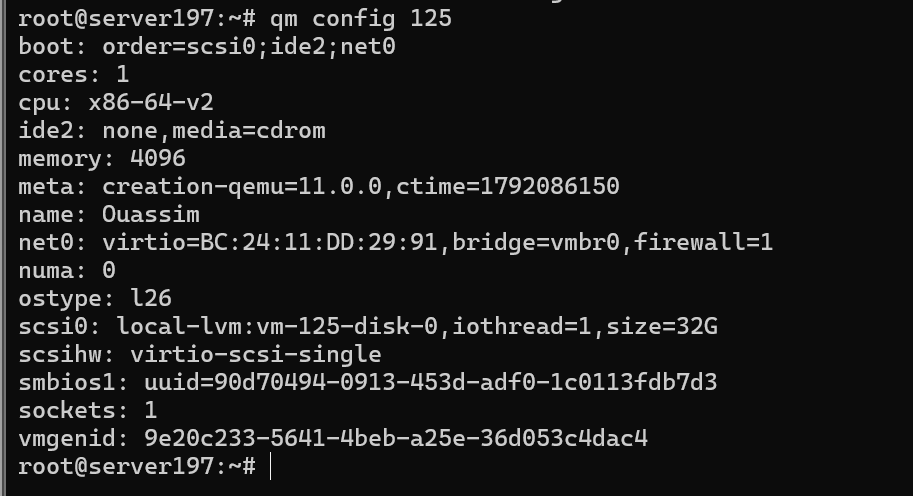
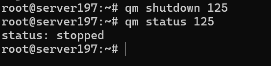
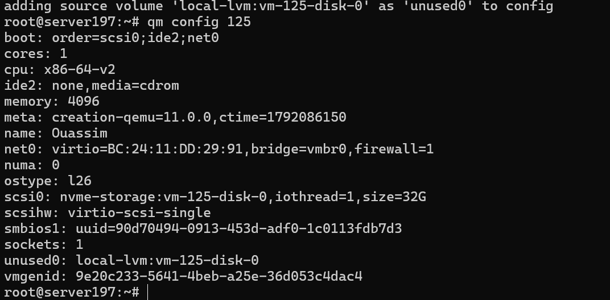
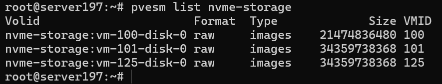
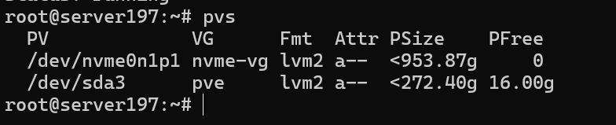
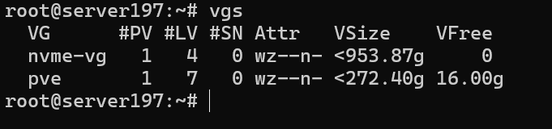
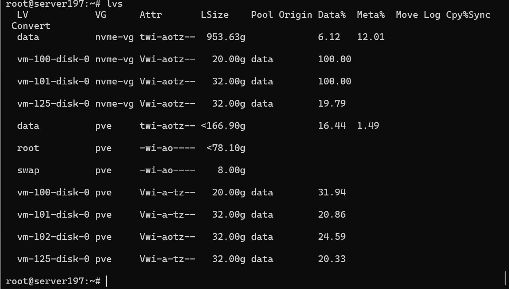
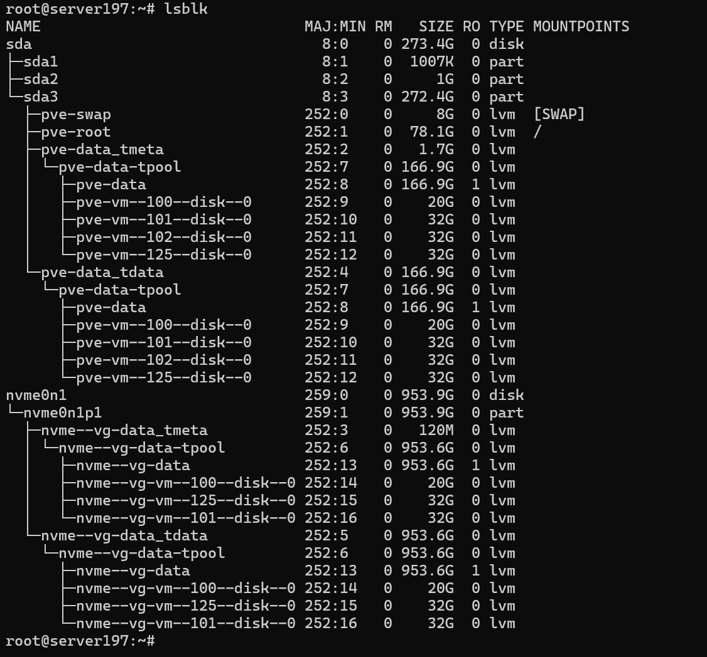

# 5.Storage - Stockage Proxmox

**Nom :** Ouassim Ahmed Benamira  
**Matricule :** 300150564  
**Cours :** INF1085 - Administration Linux  

---

## 🎯 Objectif

L'objectif de ce laboratoire est de comprendre le fonctionnement du stockage sous Linux et Proxmox VE.

Dans la partie pratique, j'ai vérifié le stockage NVMe disponible sur le serveur Proxmox, puis j'ai déplacé le disque de ma machine virtuelle du stockage `local-lvm` vers `nvme-storage`.

---

## 🖥️ Environnement

- **Serveur Proxmox :** `server197`
- **Adresse IP :** `10.7.236.197`
- **Machine virtuelle :** `125 - Ouassim`
- **Disque de la VM :** `32 GB`
- **Stockage initial :** `local-lvm`
- **Nouveau stockage :** `nvme-storage`
- **NVMe :** environ `953.9 GB`

---

## 💽 Vérification du stockage Proxmox

J'ai commencé par vérifier les stockages disponibles avec :

```bash
pvesm status
```

Le résultat montre trois stockages actifs :

- `local`
- `local-lvm`
- `nvme-storage`

Le stockage `nvme-storage` est de type **LVM-Thin** et utilise le disque NVMe.



---

## 🔍 Identification de la machine virtuelle

J'ai affiché les machines virtuelles du serveur avec :

```bash
qm list
```

Ma machine virtuelle est :

```text
VMID : 125
Nom  : Ouassim
RAM  : 4096 MB
Disque : 32 GB
```



---

## 📦 Vérification du disque avant la migration

Avant de déplacer le disque, j'ai vérifié la configuration de la VM :

```bash
qm config 125
```

Le disque `scsi0` était stocké sur :

```text
local-lvm:vm-125-disk-0
```

Cela confirme que la VM utilisait encore le stockage local LVM.



---

## ⏹️ Arrêt de la VM

Avant la migration, j'ai arrêté la VM avec :

```bash
qm shutdown 125
```

Puis j'ai vérifié son état :

```bash
qm status 125
```

Résultat :

```text
status: stopped
```



---

## 🚀 Migration vers le stockage NVMe

Le disque de la VM a ensuite été déplacé de `local-lvm` vers `nvme-storage` avec :

```bash
qm move_disk 125 scsi0 nvme-storage
```

Après la copie, j'ai vérifié de nouveau la configuration :

```bash
qm config 125
```

Le disque principal est maintenant :

```text
scsi0: nvme-storage:vm-125-disk-0
```

La migration vers le stockage NVMe a donc réussi.



---

## 📋 Vérification dans nvme-storage

Pour confirmer la présence du disque sur le nouveau stockage :

```bash
pvesm list nvme-storage
```

Le résultat contient :

```text
nvme-storage:vm-125-disk-0
```

Le disque de ma VM est donc bien présent dans `nvme-storage`.



---

## 🧱 Vérification LVM

### Physical Volume

La commande :

```bash
pvs
```

montre que `/dev/nvme0n1p1` appartient au Volume Group `nvme-vg`.



### Volume Group

J'ai vérifié les Volume Groups avec :

```bash
vgs
```

Le groupe `nvme-vg` possède environ `953.87 GB`.



### Logical Volumes et Thin Pool

La commande :

```bash
lvs
```

permet de voir le Thin Pool `data` ainsi que les disques des machines virtuelles stockés sur `nvme-vg`.

Le disque `vm-125-disk-0` apparaît bien dans ce stockage.



---

## 🔎 Vérification finale des disques

Pour terminer, j'ai utilisé :

```bash
lsblk
```

Le serveur possède :

- `sda` : disque principal d'environ `273.4 GB`
- `nvme0n1` : SSD NVMe d'environ `953.9 GB`
- `nvme0n1p1` : partition utilisée par `nvme-vg`

La VM 125 apparaît maintenant dans la structure LVM du NVMe.



---

## 🧪 Questions de réflexion

### 1. Quelle est la différence entre un HDD, un SSD SATA et un NVMe ?

Un HDD utilise des disques mécaniques et est généralement plus lent. Un SSD SATA utilise de la mémoire flash et offre de meilleures performances. Un SSD NVMe utilise PCI Express et offre des vitesses beaucoup plus élevées.

### 2. Quel est le rôle d'une partition ?

Une partition permet de diviser et d'organiser l'espace disponible sur un disque physique.

### 3. À quoi sert un système de fichiers ?

Un système de fichiers permet d'organiser et de stocker les fichiers et les répertoires sur un support de stockage.

### 4. Que signifient PV, VG et LV ?

- **PV :** Physical Volume
- **VG :** Volume Group
- **LV :** Logical Volume

Ces éléments sont utilisés par LVM pour organiser et gérer le stockage.

### 5. Pourquoi Proxmox utilise-t-il souvent LVM-Thin ?

LVM-Thin permet d'allouer l'espace de stockage aux machines virtuelles de manière flexible et efficace sans réserver immédiatement tout l'espace disponible.

### 6. Quelle commande permet d'afficher les stockages configurés dans Proxmox ?

```bash
pvesm status
```

### 7. Quel est l'avantage d'utiliser un NVMe pour les machines virtuelles ?

Le NVMe offre des vitesses de lecture et d'écriture élevées et une faible latence. Cela peut améliorer les performances des machines virtuelles.

---

## 🧠 Résumé de la migration

Avant :

```text
local-lvm
   │
   └── VM 125 - Ouassim
```

Après :

```text
nvme-storage
   │
   └── VM 125 - Ouassim
```

Le stockage NVMe et son environnement LVM-Thin étaient déjà configurés sur le serveur. J'ai vérifié leur configuration avec `pvesm status`, `pvs`, `vgs`, `lvs` et `lsblk` avant de valider l'utilisation du stockage par ma VM.

---

## ✅ Résultat obtenu

- ✅ Stockages Proxmox identifiés
- ✅ Disque NVMe identifié
- ✅ PV et VG vérifiés
- ✅ LVM-Thin vérifié
- ✅ VM 125 identifiée
- ✅ Stockage initial vérifié
- ✅ VM arrêtée avant la migration
- ✅ Disque déplacé vers `nvme-storage`
- ✅ Nouvelle configuration vérifiée
- ✅ Disque présent dans `nvme-storage`
- ✅ VM redémarrée et opérationnelle

---

## Conclusion

Ce laboratoire m'a permis de mieux comprendre l'organisation du stockage sous Linux et Proxmox, notamment les concepts de PV, VG, LV et LVM-Thin.

J'ai également déplacé le disque de ma machine virtuelle du stockage `local-lvm` vers le stockage NVMe `nvme-storage`. Après la migration, j'ai vérifié que le disque était correctement présent sur le nouveau stockage et que la machine virtuelle fonctionnait toujours.