# 300151315 - Stockage Linux et Proxmox VE

Laboratoire réalisé par **Toumi Ayoub**.

| Élément | Valeur |
|---|---|
| Serveur | `server197` (`10.7.236.197`), groupe 1, Proxmox VE 9.2.2 |
| Ma VM | `101` (`ayoubVM`), Ubuntu Server 24.04 |
| Disque NVMe | `/dev/nvme0n1` (≈ 954 Go) |

## 🤝 Travail de groupe
Le serveur est partagé par le groupe. Quand je suis arrivé, le NVMe était déjà préparé par un collègue : partition `nvme0n1p1`, volume group `nvme-vg`, thin pool `data` et stockage Proxmox `nvme-storage`.

Je n'ai donc **pas** relancé `fdisk`, `pvcreate`, `vgcreate`, `lvcreate` ni `pvesm add` : recréer la table GPT aurait effacé le disque et les VM des autres étudiants. J'ai vérifié la configuration, puis déplacé le disque de **ma** VM vers le NVMe.

## 1. Vérifier le stockage existant
```
ssh root@10.7.236.197
```

### Les disques : `lsblk`
`sda` (273,4 Go) contient Proxmox (VG `pve` : `root`, `swap` et le thin pool `data` = `local-lvm`). `nvme0n1` (953,9 Go) a une partition `nvme0n1p1` avec le VG `nvme-vg`. Le disque de ma VM (`pve-vm--101--disk--0`) est encore sur `sda`.

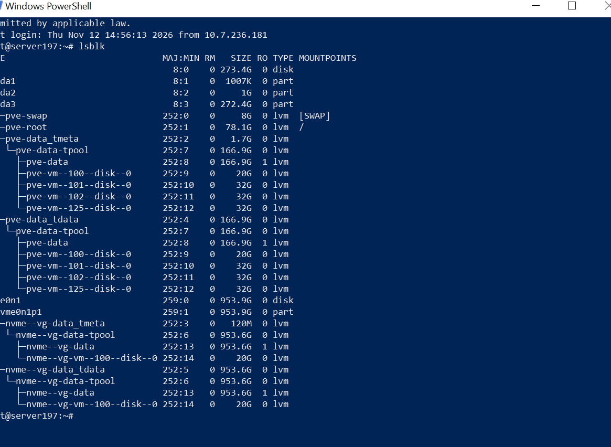

### Physical Volumes : `pvs`
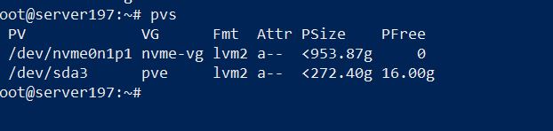

### Volume Groups : `vgs`
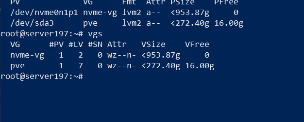

### Logical Volumes : `lvs`
Le thin pool `data` de `nvme-vg` fait 953,63 Go. Le disque de la VM 100 d'un collègue y est déjà.

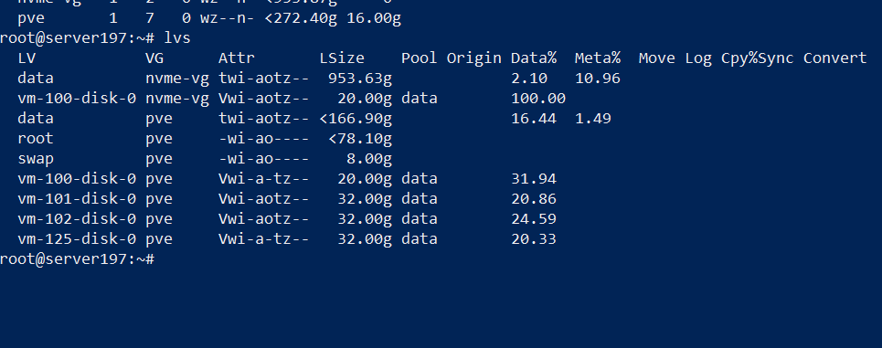

### Stockages Proxmox : `pvesm status`
`nvme-storage` (type `lvmthin`) est actif, à côté de `local` et `local-lvm`.

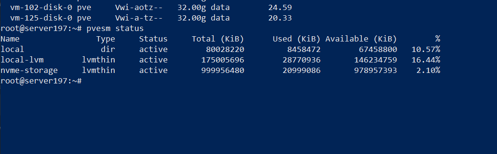

## 2. Vérifier ma VM avant le déplacement
```
qm list
qm config 101
```

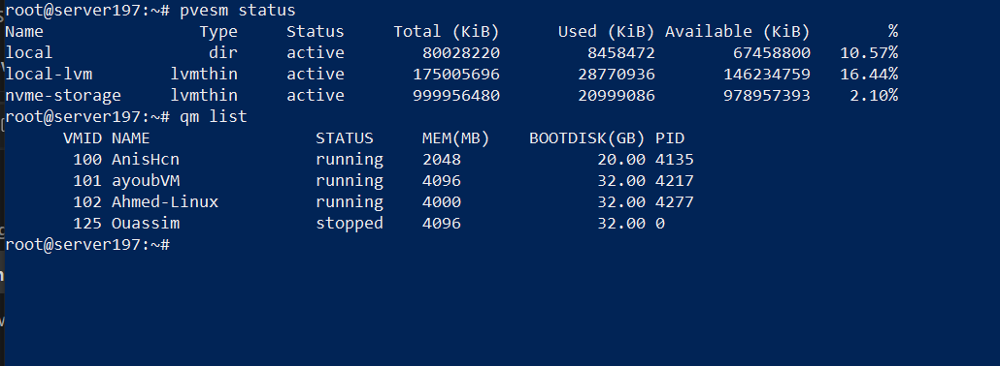

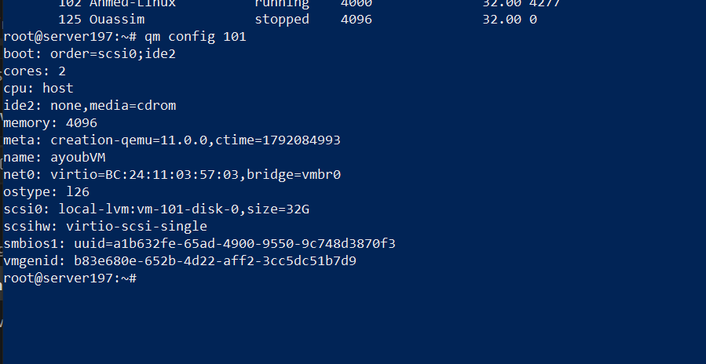

Avant : `scsi0: local-lvm:vm-101-disk-0,size=32G`

## 3. Déplacer le disque vers le NVMe
```
qm move_disk 101 scsi0 nvme-storage
```

La copie se fait pendant que la VM tourne (32 Go en 1 min 43 s). L'ancien disque n'est pas effacé : Proxmox le garde comme `unused0`.

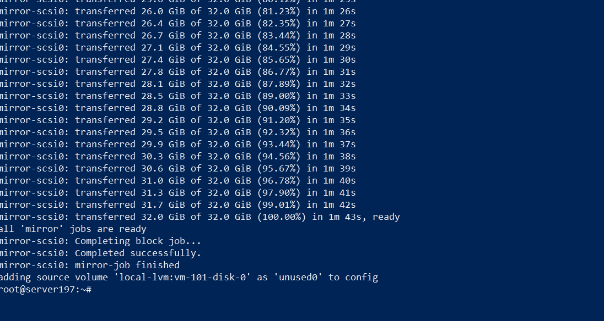

## 4. Vérifier le résultat
```
qm config 101
pvesm list nvme-storage
```

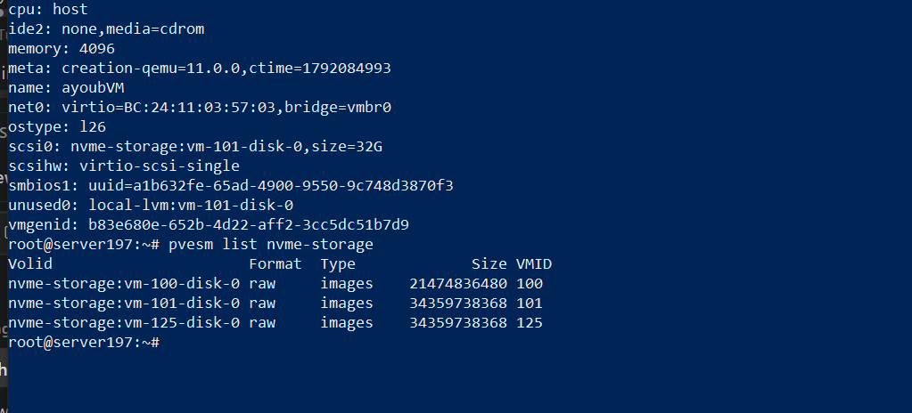

Après :
- `scsi0: nvme-storage:vm-101-disk-0,size=32G`
- `unused0: local-lvm:vm-101-disk-0` (l'ancienne copie, gardée par sécurité)
- `nvme-storage:vm-101-disk-0` apparaît dans `pvesm list nvme-storage`

Remarque : je n'ai pas utilisé `wipefs -a` sur le NVMe. Cette commande sert à nettoyer un disque **avant** de le partitionner ; ici le NVMe était déjà en service (VM 100 et 125 dessus), elle aurait tout effacé.

## 🧠 Résumé

```text
Avant                         Après
local-lvm                     nvme-storage
   └── VM 101 (ayoubVM)          └── VM 101 (ayoubVM)
```

## 🧪 Questions de réflexion

**1. Différence entre un HDD, un SSD SATA et un NVMe ?**
Le HDD utilise des plateaux qui tournent : grande capacité, peu cher, mais lent. Le SSD SATA n'a pas de pièces mécaniques, il est beaucoup plus rapide, mais limité par l'interface SATA (≈ 550 Mo/s). Le NVMe est aussi un SSD, mais il est branché sur le PCI Express : il est plusieurs fois plus rapide (plusieurs Go/s) avec une latence très faible.

**2. Rôle d'une partition ?**
Elle découpe un disque en zones séparées, pour organiser l'espace (système, données, LVM...) et isoler les usages.

**3. À quoi sert un système de fichiers ?**
Il organise les données sur la partition en fichiers et dossiers (noms, tailles, droits, emplacement des blocs). Exemples : `ext4`, `xfs`, `ntfs`, `fat32`.

**4. Que signifient PV, VG et LV ?**
- **PV** (Physical Volume) : un disque ou une partition donné à LVM.
- **VG** (Volume Group) : un groupe qui réunit un ou plusieurs PV.
- **LV** (Logical Volume) : un volume découpé dans le VG, utilisé comme un disque.

**5. Pourquoi Proxmox utilise souvent LVM-Thin ?**
Avec le thin provisioning, l'espace n'est consommé que quand la VM écrit vraiment des données. On peut créer des disques de VM plus grands que l'espace réellement utilisé, et faire des snapshots rapides.

**6. Quelle commande affiche les stockages configurés dans Proxmox ?**
`pvesm status`

**7. Avantage d'un NVMe pour les machines virtuelles ?**
Les VM font beaucoup de petites lectures et écritures en même temps. Le NVMe a une latence très faible et beaucoup d'IOPS, donc les VM démarrent et répondent plus vite, même quand plusieurs tournent sur le même serveur.

## ✅ Résultat
- ✅ Disques et stockages identifiés (`lsblk`, `pvs`, `vgs`, `lvs`, `pvesm status`)
- ✅ VM 101 identifiée
- ✅ Disque déplacé de `local-lvm` vers `nvme-storage`
- ✅ Configuration mise à jour (`qm config 101`)
- ✅ VM opérationnelle sur le stockage NVMe

## 5. Supprimer l'ancien disque
Avant : la ligne **Unused Disk 0** (`local-lvm:vm-101-disk-0`) dans *Hardware*.

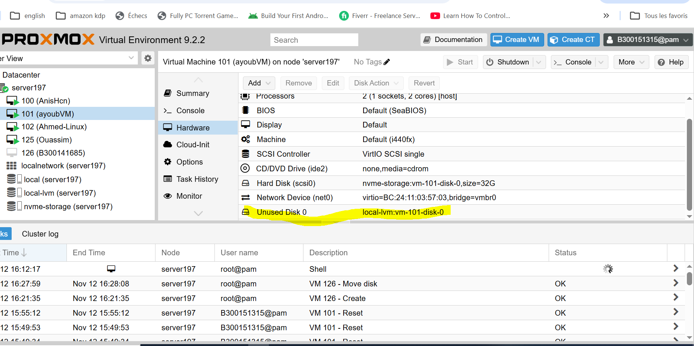

Une fois la VM vérifiée sur le NVMe (connexion SSH, disque étendu), j'ai supprimé l'ancienne copie restée sur `local-lvm` :

```
qm disk unlink 101 --idlist unused0 --force
qm config 101            # plus de ligne unused0
pvesm list local-lvm     # vm-101-disk-0 n'apparaît plus
```

Résultat : `Logical volume "vm-101-disk-0" successfully removed.` La VM 101 n'utilise plus que `nvme-storage`.

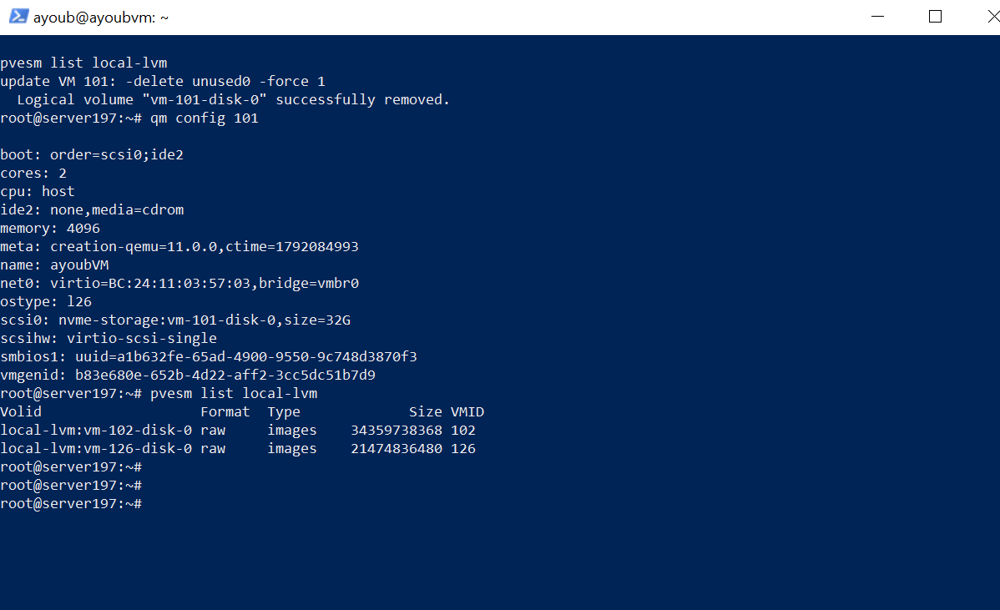

Après : dans *Hardware*, il ne reste que **Hard Disk (scsi0)** sur `nvme-storage`.

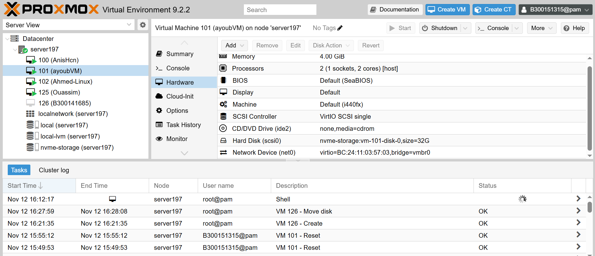
