# 5.Storage — Gestion du stockage Proxmox

**Matricule :** 300151449  
**Serveur :** server197  
**Date :** 26 novembre 2026

## Objectif

Identifier et vérifier le stockage existant, les volumes LVM et le disque de ma machine virtuelle, sans modifier les disques du serveur utilisé par le groupe.

## 1. Identification des disques

```bash
hostname
lsblk
```

Le serveur server197 possède un disque sda de 273,4 GiB et un NVMe de 953,9 GiB.

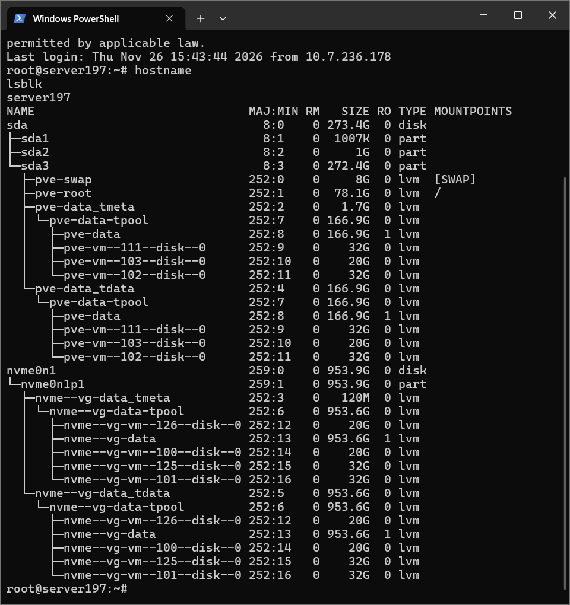

## 2. Partitions

```bash
fdisk -l /dev/nvme0n1
```

Le disque PC811 SK hynix 1024GB utilise GPT et contient la partition nvme0n1p1.

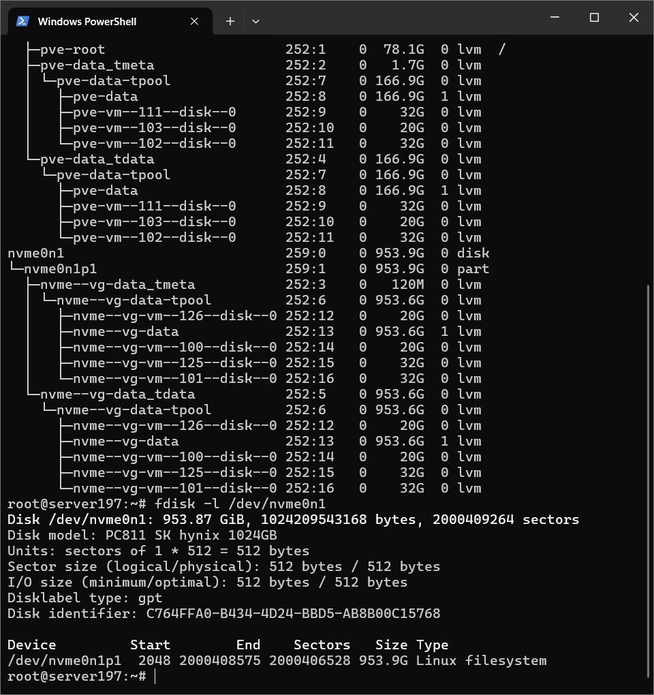

## 3. Volume physique (PV)

```bash
pvs
pvdisplay /dev/nvme0n1p1
```

Le PV appartient à nvme-vg, avec 953,87 GiB environ et aucun extent libre.

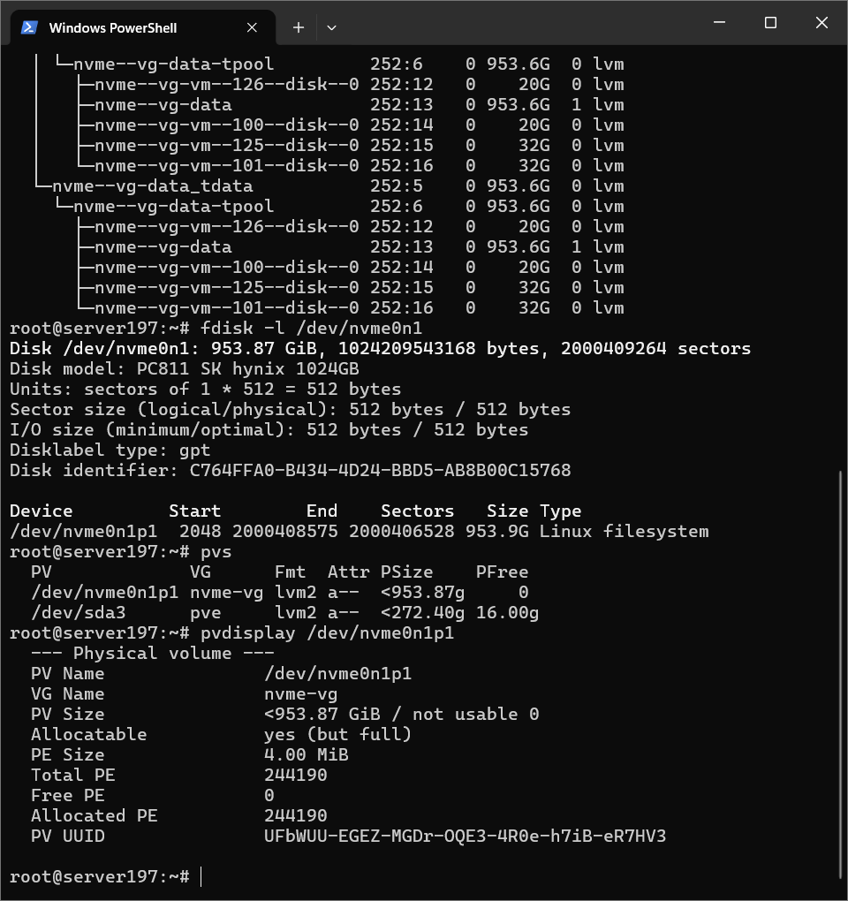

## 4. Groupe de volumes (VG)

```bash
vgs
vgdisplay nvme-vg
```

Le VG contient un PV et cinq LV ; aucun espace non alloué dans le VG.

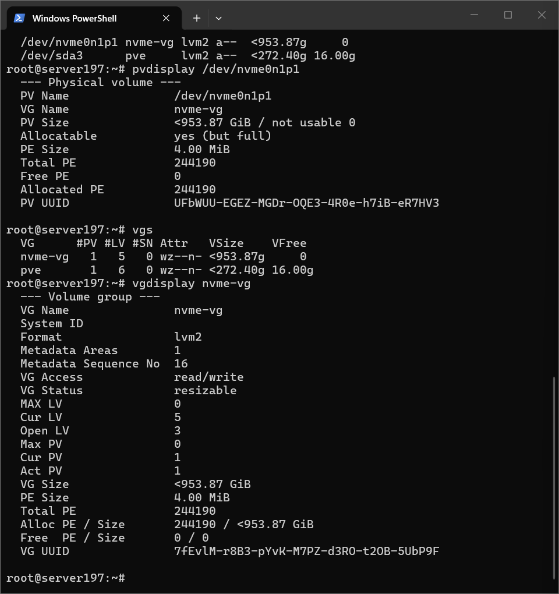

## 5. Volumes logiques et LVM-Thin

```bash
lvs
lvdisplay nvme-vg/data
```

Le pool data dispose de 953,63 GiB ; données utilisées : 6,24 %, métadonnées : 12,07 %.

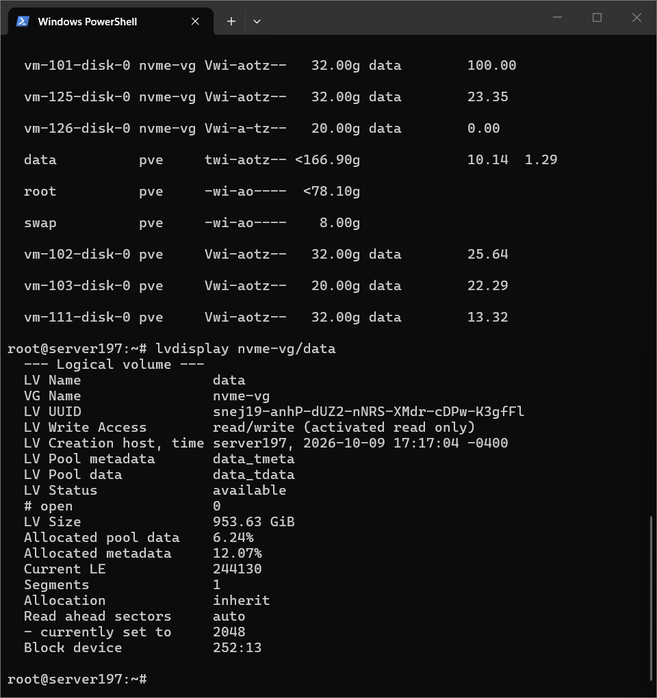

## 6. Configuration Proxmox

```bash
pvesm status
cat /etc/pve/storage.cfg
```

Les stockages local, local-lvm et nvme-storage sont actifs. Le dernier utilise nvme-vg/data et accepte images et rootdir.

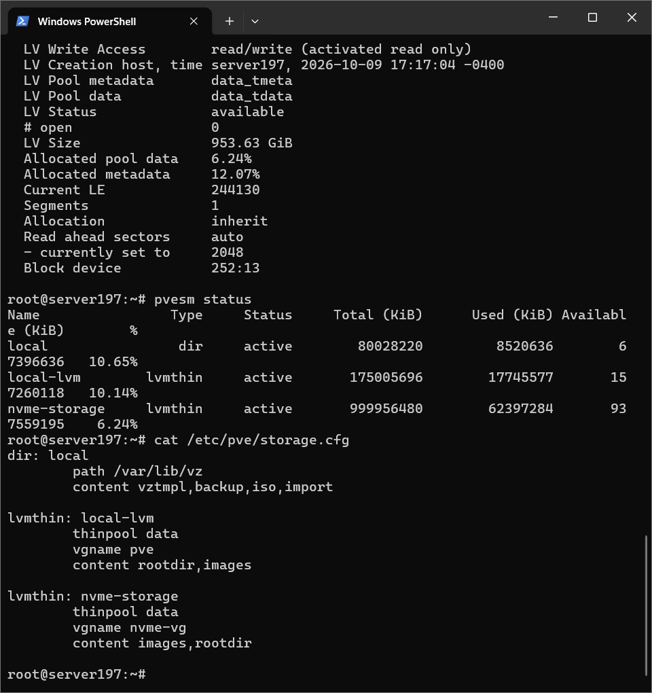

## 7. Interface Web

Le nœud server197 affiche les trois stockages.

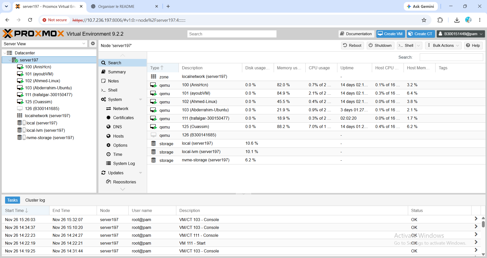

## 8. Datacenter – chargement

Le tableau est initialement vide avant actualisation.

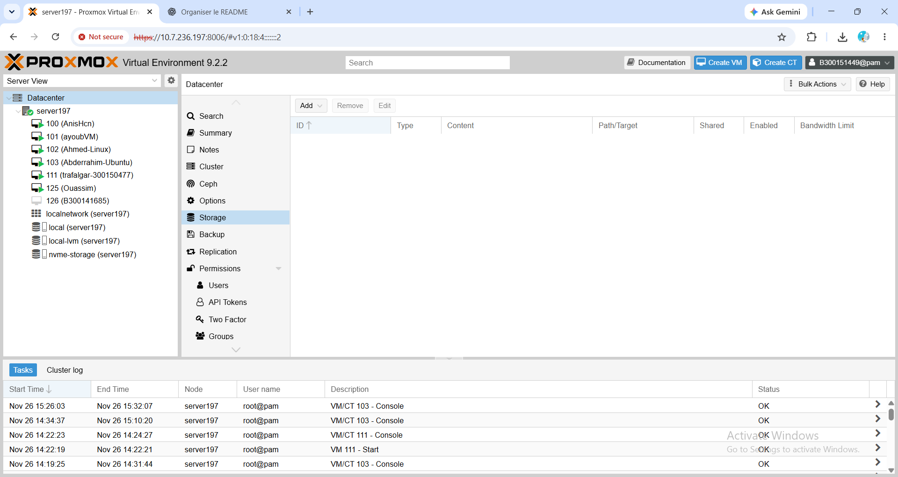

## 9. Datacenter – Storage

Les trois stockages sont activés et non partagés au sens de Proxmox.

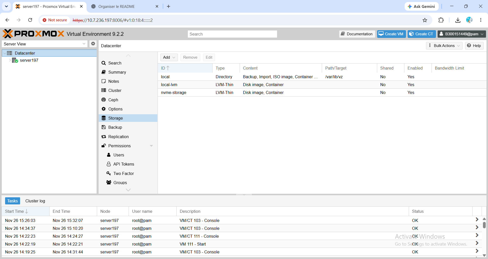

## 10. Capacité NVMe

Summary confirme 63,89 GB utilisés sur 1,02 TB (6,24 %).

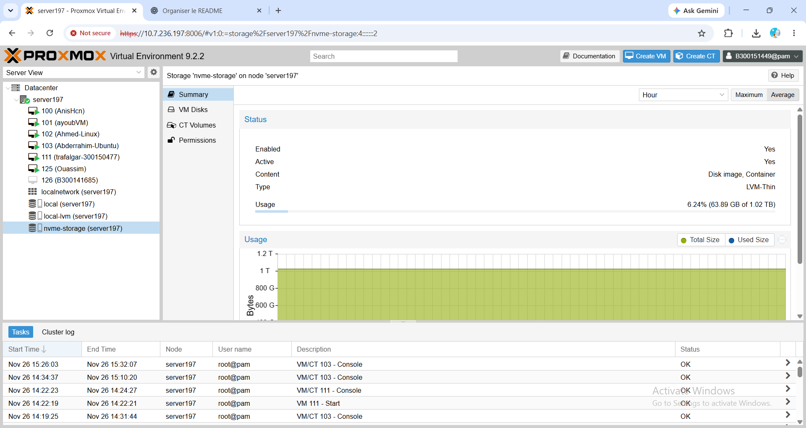

## 11. Disques virtuels

Quatre disques raw (VM 100, 101, 125, 126), pour 104 GiB provisionnés.

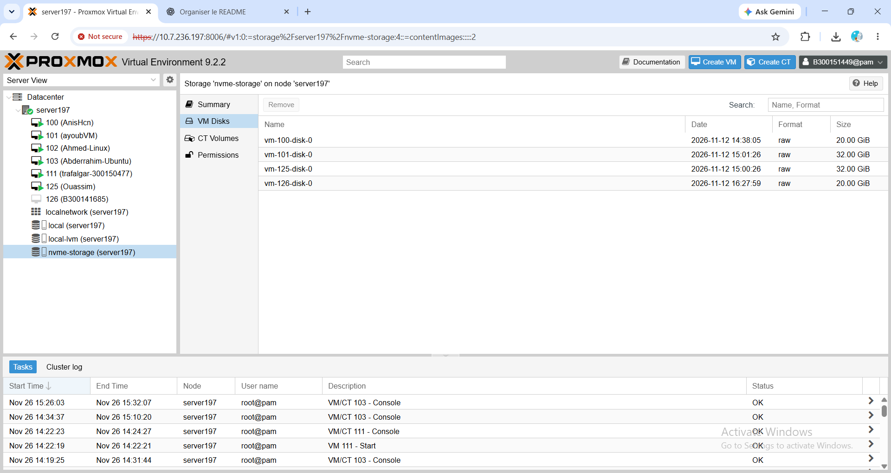

## 12. Configuration de ma VM

La VM 103 possède 4 GiB de RAM, deux cœurs et un disque scsi0 de 20 GiB sur local-lvm.

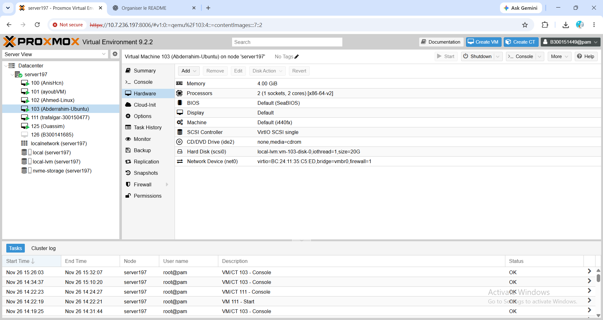

## 13. Vérification finale SSH

```bash
qm config 103
pvesm list local-lvm --vmid 103
```

Le disque local-lvm:vm-103-disk-0 est au format raw et mesure 20 GiB.

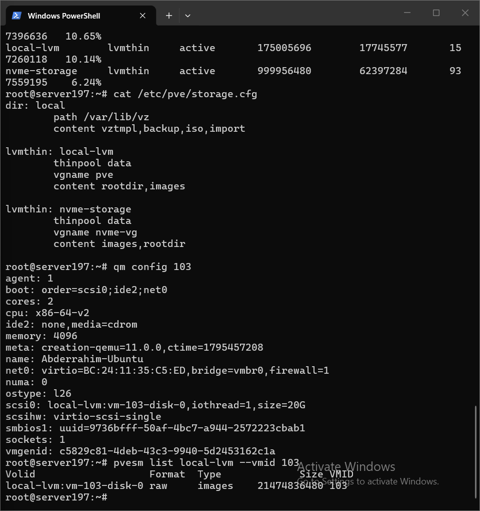

## Conclusion

Le stockage NVMe existant est actif et fonctionnel. Ma VM 103 reste sur local-lvm. Les opérations effectuées sont des vérifications ; aucun partitionnement, formatage ou déplacement de disque n’a été réalisé.
