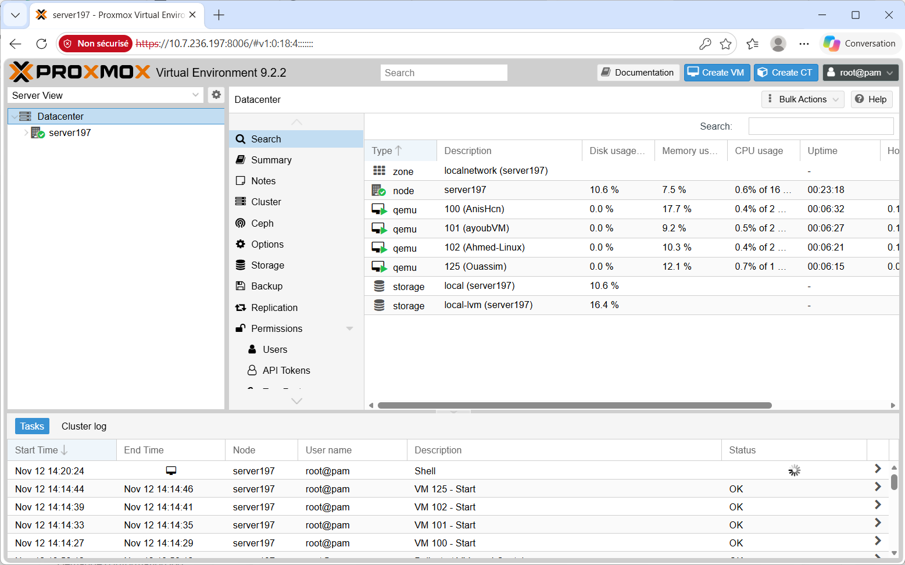
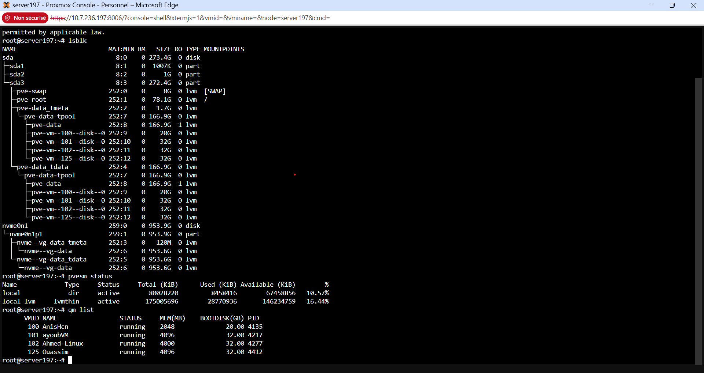
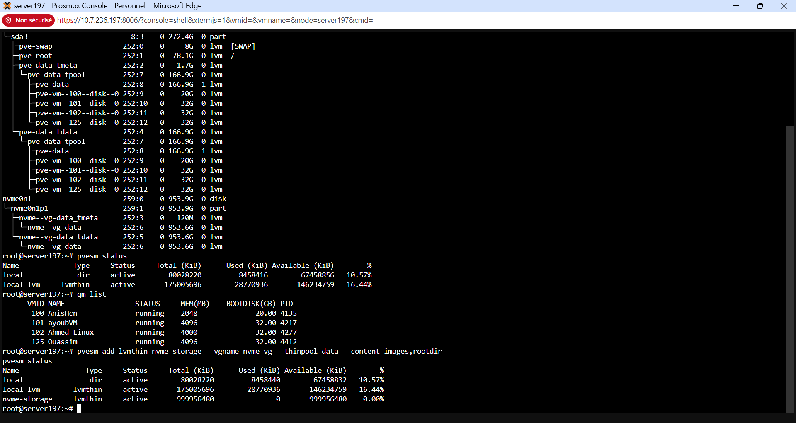
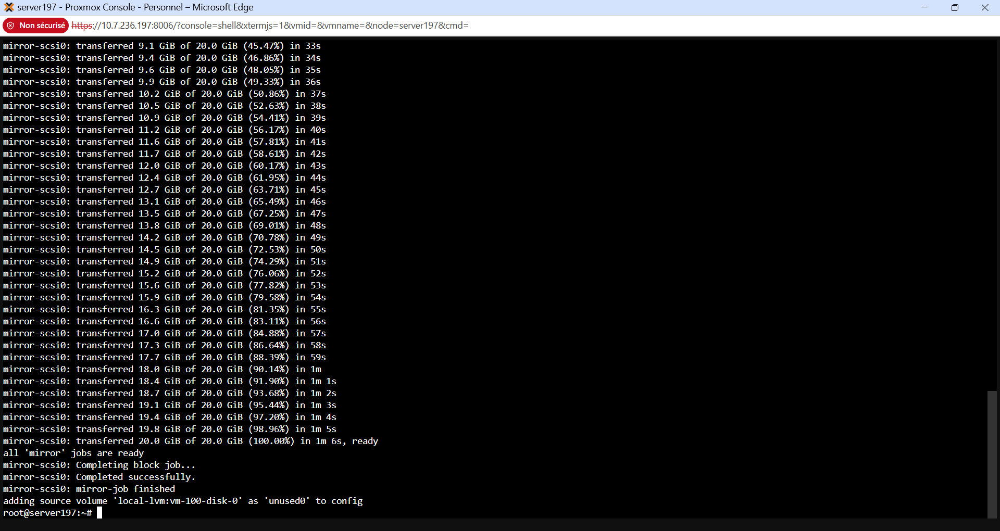
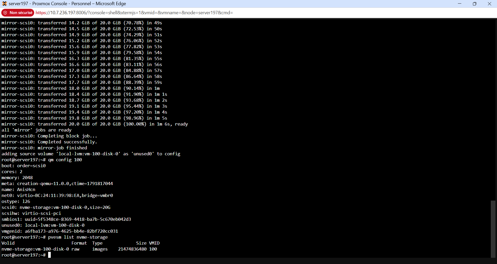
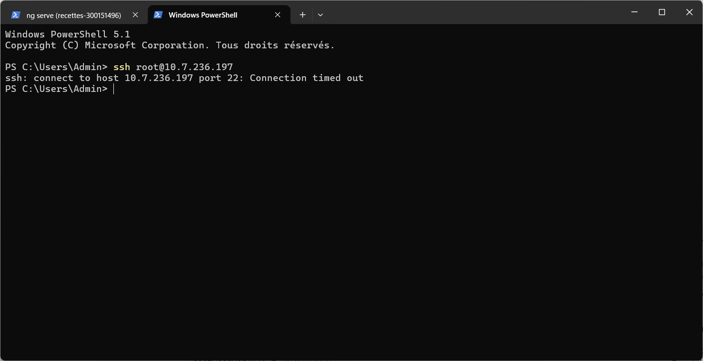
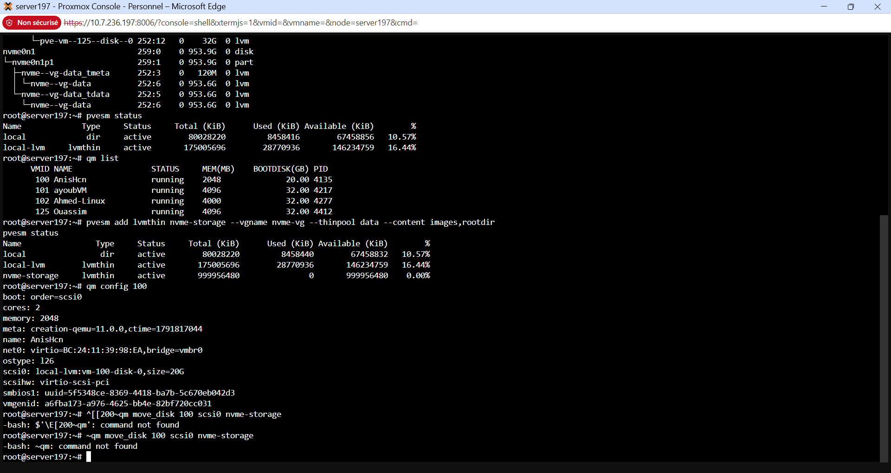

# Labo 5.Storage — Stockage NVMe et LVM-Thin sous Proxmox VE

## Déplacer le disque d'une machine virtuelle vers le stockage NVMe

**Étudiant :** Anis Ouhocine (matricule 300151496)
**Date :** 12 novembre 2026
**Serveur :** 10.7.236.197 (nœud `server197`, Proxmox VE 9.2.2)
**VM déplacée :** 100 — `AnisHcn` (Ubuntu Server 24.04.5)

---

## 1. Objectif

À la fin de cette leçon, je dois être capable de :

- Comprendre les différents types de stockage.
- Identifier les disques présents dans un système Linux.
- Comprendre les concepts de partition, système de fichiers et LVM.
- Comprendre les stockages utilisés par Proxmox VE.
- Ajouter un disque NVMe comme stockage pour les machines virtuelles.
- Déplacer le disque d'une machine virtuelle vers le stockage NVMe.

Le travail s'est fait en deux temps, comme l'a expliqué le professeur : une partie en **groupe** (préparer le disque NVMe : partition, PV, VG et Thin Pool), puis une partie **individuelle** (ajouter le stockage à Proxmox et déplacer le disque de ma propre VM).

---

## 2. Pourquoi le stockage est-il important ?

Le stockage permet de conserver de façon permanente :

- Le système d'exploitation
- Les données
- Les machines virtuelles
- Les sauvegardes
- Les images ISO

Sans stockage :

```
Pas de système
Pas de fichiers
Pas de machines virtuelles
```

---

## 3. Architecture générale

```
Disque physique
      │
      ▼
 Partition
      │
      ▼
 Système de fichiers
      │
      ▼
 Données
```

Sous Proxmox :

```
Disque
   │
   ▼
LVM / ZFS
   │
   ▼
Stockage Proxmox
   │
   ▼
Disques des VM
```

---

## 4. Types de stockage

### Disque dur (HDD)

Exemples : SAS, SATA.

Caractéristiques :

- Grande capacité
- Faible coût
- Plus lent

### SSD SATA

Exemple : Samsung 870 EVO.

Caractéristiques :

- Plus rapide qu'un HDD
- Pas de pièces mécaniques

### SSD NVMe

Exemples : SK hynix PC811, Samsung 980 Pro, WD SN850X.

Caractéristiques :

- Très rapide
- Utilise PCI Express
- Idéal pour les VM Proxmox

| Type | Vitesse | Pièces mécaniques | Usage typique |
| --- | --- | --- | --- |
| HDD (SAS/SATA) | Lente | Oui | Grande capacité, faible coût |
| SSD SATA | Rapide | Non | Usage général |
| SSD NVMe (PCIe) | Très rapide | Non | Disques des VM Proxmox |

---

## 5. Voir les disques

Afficher les périphériques de stockage :

```
lsblk
```

Informations détaillées (disques, partitions, tailles) :

```
fdisk -l
```

### Résultat sur notre serveur



Le serveur `server197` (Proxmox VE 9.2.2) héberge 4 VM en cours d'exécution : 100 (AnisHcn), 101 (ayoubVM), 102 (Ahmed-Linux) et 125 (Ouassim). Les stockages visibles sont `local` et `local-lvm`.

```
lsblk
```

Résultat :

```
sda                          8:0    0  273.4G  0 disk
├─sda1                       8:1    0   1007K  0 part
├─sda2                       8:2    0      1G  0 part
└─sda3                       8:3    0  272.4G  0 part
  ├─pve-swap               252:0    0      8G  0 lvm  [SWAP]
  ├─pve-root               252:1    0   78.1G  0 lvm  /
  ├─pve-data_tmeta         252:2    0    1.7G  0 lvm
  │ └─pve-data-tpool       252:7    0  166.9G  0 lvm
  │   ├─pve-data           252:8    0  166.9G  1 lvm
  │   ├─pve-vm--100--disk--0 252:9  0     20G  0 lvm
  │   ├─pve-vm--101--disk--0 252:10 0     32G  0 lvm
  │   ├─pve-vm--102--disk--0 252:11 0     32G  0 lvm
  │   └─pve-vm--125--disk--0 252:12 0     32G  0 lvm
  └─pve-data-tdata         252:4    0  166.9G  0 lvm
    └─pve-data-tpool       252:7    0  166.9G  0 lvm
nvme0n1                    259:0    0  953.9G  0 disk
└─nvme0n1p1                259:1    0  953.9G  0 part
  ├─nvme--vg-data_tmeta    252:3    0    120M  0 lvm
  │ └─nvme--vg-data        252:6    0  953.6G  0 lvm
  └─nvme--vg-data_tdata    252:5    0  953.6G  0 lvm
    └─nvme--vg-data        252:6    0  953.6G  0 lvm
```

Ce que je retiens :

- **sda (273,4 Go)** : le disque système. Il contient le système Proxmox (`pve-root`, 78,1 Go), le swap (8 Go) et le Thin Pool `pve-data` (166,9 Go) qui héberge les disques des VM — dont celui de ma VM 100 (20 Go).
- **nvme0n1 (953,9 Go)** : le disque NVMe. Il contient déjà une partition `nvme0n1p1` (953,9 Go) avec le Volume Group `nvme-vg` et le Thin Pool `data` (953,6 Go).



Les VM présentes sur le serveur :

```
qm list
```

```
VMID  NAME         STATUS   MEM(MB)  BOOTDISK(GB)  PID
 100  AnisHcn      running    2048       20.00     4135
 101  ayoubVM      running    4096       32.00     4217
 102  Ahmed-Linux  running    4000       32.00     4277
 125  Ouassim      running    4096       32.00     4412
```

Ma VM est la **100 (AnisHcn)** — la leçon donne l'exemple avec la VM 101, mais moi je déplace le disque de ma propre VM, la 100.

---

## 6. Les partitions

Un disque peut être divisé en plusieurs partitions. Une partition permet d'organiser l'espace disque.

Exemple :

```
nvme0n1
├── nvme0n1p1
└── nvme0n1p2
```

### Créer la partition (procédure de la leçon)

Ouvrir le disque avec :

```
fdisk /dev/nvme0n1
```

Créer une table GPT — dans `fdisk` :

```
g
```

Résultat :

```
Created a new GPT disklabel
```

Créer la partition — entrer :

```
n
```

Puis accepter les valeurs par défaut :

```
Partition number: Enter
First sector:     Enter
Last sector:      Enter
```

Sauvegarder — entrer :

```
w
```

Résultat :

```
The partition table has been altered.
Syncing disks.
```

Vérifier la partition :

```
lsblk
```

Résultat attendu :

```
nvme0n1
└── nvme0n1p1 953.9G
```

> **Remarque importante (travail de groupe) :** quand je suis arrivé sur le serveur, cette étape était déjà faite : `nvme0n1p1` (953,9 Go) existait déjà, comme le montre le `lsblk` ci-dessus. Je n'ai donc **pas** relancé `fdisk` — recréer une table GPT aurait effacé la partition et tout ce qu'elle contient.

---

## 7. Les systèmes de fichiers

Un système de fichiers organise les données sur une partition.

Exemples :

```
ext4
xfs
ntfs
fat32
```

Identifier un système de fichiers :

```
blkid
```

Exemple :

```
TYPE="ext4"
```

---

## 8. Introduction à LVM

LVM signifie **Logical Volume Manager**. Il permet de gérer dynamiquement l'espace disque.

Architecture :

```
PV
 │
 ▼
VG
 │
 ▼
LV
```

### Physical Volume (PV)

Le PV représente un disque ou une partition.

Exemple : `/dev/nvme0n1p1`

Création :

```
pvcreate /dev/nvme0n1p1
```

Vérification :

```
pvs
```

### Volume Group (VG)

Le VG regroupe un ou plusieurs PV.

Exemple : `nvme-vg`

Création :

```
vgcreate nvme-vg /dev/nvme0n1p1
```

Vérification :

```
vgs
```

### Logical Volume (LV)

Le LV est un volume logique utilisé comme espace de stockage.

Exemple : `data`

Création :

```
lvcreate -L 100G -n data nvme-vg
```

Vérification :

```
lvs
```

> **Remarque (travail de groupe) :** comme pour la partition, le PV (`/dev/nvme0n1p1`), le VG (`nvme-vg`) et le Thin Pool (`data`, 953,6 Go) existaient déjà sur le serveur. Je les ai vérifiés avec `lsblk` au lieu de les recréer.

---

## 9. Thin Provisioning

Proxmox utilise souvent **LVM-Thin**.

Architecture :

```
NVMe
 │
 ▼
PV
 │
 ▼
VG
 │
 ▼
Thin Pool
 │
 ▼
VM
```

Création d'un Thin Pool :

```
lvcreate -l 100%FREE -T nvme-vg/data
```

Avec le Thin Provisioning, l'espace disque n'est réservé que quand la VM écrit vraiment des données. On peut donc donner à une VM un disque de 20 Go sans bloquer 20 Go tout de suite : le Thin Pool ne consomme que l'espace réellement utilisé. C'est pour ça que Proxmox l'utilise pour les disques des VM (`local-lvm` et `nvme-storage` sont tous les deux des LVM-Thin).

---

## 10. Les stockages Proxmox : pvesm (Storage Manager)

Afficher les stockages :

```
pvesm status
```

Exemple de la leçon :

```
local
local-lvm
nvme-storage
```

### local

```
Type : Directory
```

Contient :

- ISO
- Sauvegardes
- Templates

### local-lvm

```
Type : LVM-Thin
```

Contient :

- Disques des VM
- Conteneurs LXC

### nvme-storage

```
Type : LVM-Thin
```

Créé sur un SSD NVMe.

---

## 11. Ajouter le NVMe à Proxmox

C'est la première étape que j'ai faite moi-même. La commande déclare à Proxmox le Thin Pool déjà existant (`nvme-vg` / `data`) comme un stockage utilisable :

```
pvesm add lvmthin nvme-storage --vgname nvme-vg --thinpool data --content images,rootdir
```

Puis la vérification :

```
pvesm status
```

Résultat :

```
Name          Type     Status   Total (KiB)  Used (KiB)  Available (KiB)     %
local         dir      active    80028220     8458440       67458832      10.57%
local-lvm     lvmthin  active   175005696    28770936      146234759      16.44%
nvme-storage  lvmthin  active   999956480          0      999956480       0.00%
```



Le stockage **nvme-storage** apparaît : type `lvmthin`, statut `active`, total 999 956 480 KiB (environ 953,6 Go), 0 utilisé (0,00 %) — il est vide et prêt à recevoir des disques de VM.

---

## 12. Déplacer la machine virtuelle vers le stockage NVMe

Objectif : déplacer le disque de ma VM vers `nvme-storage` afin d'améliorer les performances.

### Vérifier le disque actuel

```
qm config 100
```

Résultat (avant le déplacement) :

```
boot: order=scsi0
cores: 2
memory: 2048
meta: creation-qemu=11.0.0,ctime=1791817044
name: AnisHcn
net0: virtio=BC:24:11:39:98:EA,bridge=vmbr0
ostype: l26
scsi0: local-lvm:vm-100-disk-0,size=20G
scsihw: virtio-scsi-pci
smbios1: uuid=5f5348ce-8369-4418-ba7b-5c670eb042d3
vmgenid: a6fba173-a976-4625-bb4e-82bf720cc031
```

Le disque de ma VM est bien `scsi0`, sur `local-lvm`, taille 20 Go.

### Déplacer le disque

```
qm move_disk 100 scsi0 nvme-storage
```

Attendre la fin de la copie. La copie s'est faite VM en marche (déplacement en direct) :

```
mirror-scsi0: transferred 20.0 GiB of 20.0 GiB (100.00%) in 1m 6s, ready
all 'mirror' jobs are ready
mirror-scsi0: Completing block job...
mirror-scsi0: Completed successfully.
mirror-scsi0: mirror-job finished
adding source volume 'local-lvm:vm-100-disk-0' as 'unused0' to config
```



Les 20 Go ont été copiés en **1 minute 6 secondes**. L'ancien disque (`local-lvm:vm-100-disk-0`) n'a pas été supprimé : Proxmox l'a gardé dans la configuration comme `unused0`.

### Vérifier le résultat

```
qm config 100
```

Résultat (après le déplacement) :

```
scsi0: nvme-storage:vm-100-disk-0,size=20G
...
unused0: local-lvm:vm-100-disk-0
```

La ligne `scsi0` pointe maintenant vers `nvme-storage` au lieu de `local-lvm`.

Vérifier le stockage NVMe :

```
pvesm list nvme-storage
```

Résultat :

```
Volid                       Format  Type    Size        VMID
nvme-storage:vm-100-disk-0  raw     images  21474836480 100
```



Le disque `vm-100-disk-0` (20 Go = 21 474 836 480 octets) apparaît bien dans `nvme-storage`, rattaché à la VM 100.

### Résumé

Avant :

```
local-lvm
   │
   └── VM 100
```

Après :

```
nvme-storage
   │
   └── VM 100
```

---

## 13. Problèmes rencontrés et solutions

| # | Problème | Cause | Solution |
| --- | --- | --- | --- |
| 1 | `ssh root@10.7.236.197` → `Connection timed out` | Le port SSH (22) ne répond pas depuis mon portable, même à l'école : le réseau Wi-Fi ne laisse pas passer le SSH vers le serveur | Passer par le navigateur : interface web Proxmox `https://10.7.236.197:8006`, puis le Shell du nœud `server197` (utilisateur `root@pam`) |
| 2 | `qm move_disk` collé → `command not found` (`^[[200~qm` puis `~qm`) | Le collage dans le Shell du navigateur a ajouté des caractères parasites devant la commande | Taper la commande à la main au clavier, sans la coller |
| 3 | Le NVMe semblait « à préparer » (fdisk, PV, VG) alors qu'il était déjà prêt | La préparation avait déjà été faite en groupe avant mon arrivée | Vérifier d'abord avec `lsblk` : `nvme0n1p1`, le VG `nvme-vg` et le Thin Pool `data` existaient déjà — ne surtout pas relancer `fdisk`, qui aurait tout effacé |





---

## 14. Questions de réflexion

### 1. Quelle est la différence entre un HDD, un SSD SATA et un NVMe ?

- **HDD** : disque mécanique (plateaux qui tournent), grande capacité, faible coût, mais le plus lent. Exemples : SAS, SATA.
- **SSD SATA** : mémoire flash, pas de pièces mécaniques, plus rapide qu'un HDD. Exemple : Samsung 870 EVO.
- **NVMe** : mémoire flash aussi, mais branchée en PCI Express au lieu du SATA : c'est le plus rapide des trois, avec une latence très faible. Exemples : SK hynix PC811, Samsung 980 Pro, WD SN850X. C'est le meilleur choix pour les disques des VM Proxmox.

### 2. Quel est le rôle d'une partition ?

Une partition divise un disque physique en plusieurs parties pour organiser l'espace. Par exemple, `nvme0n1` (953,9 Go) est divisé avec une partition `nvme0n1p1` qui prend tout le disque. Chaque partition peut ensuite recevoir son propre usage (système, données, LVM).

### 3. À quoi sert un système de fichiers ?

Un système de fichiers organise les données sur une partition : il décide comment les fichiers sont rangés, nommés et retrouvés (ext4, xfs, ntfs, fat32). Sans système de fichiers, une partition est juste un espace vide qu'on ne peut pas utiliser pour stocker des fichiers. On identifie le système de fichiers d'une partition avec `blkid` (exemple : `TYPE="ext4"`).

### 4. Que signifient les acronymes PV, VG et LV ?

- **PV (Physical Volume)** : un disque ou une partition physique préparée pour LVM. Exemple : `/dev/nvme0n1p1` (commande : `pvcreate`, vérification : `pvs`).
- **VG (Volume Group)** : un groupe qui regroupe un ou plusieurs PV en un seul réservoir d'espace. Exemple : `nvme-vg` (commande : `vgcreate`, vérification : `vgs`).
- **LV (Logical Volume)** : un volume logique découpé dans le VG, utilisé comme espace de stockage. Exemple : `data` (commande : `lvcreate`, vérification : `lvs`).

### 5. Pourquoi Proxmox utilise-t-il souvent LVM-Thin ?

Avec LVM-Thin (Thin Provisioning), l'espace disque n'est réservé que quand la VM écrit vraiment des données. Une VM avec un disque de 20 Go ne bloque pas 20 Go tout de suite : le Thin Pool ne consomme que l'espace réellement utilisé. Ça permet de gérer l'espace dynamiquement et d'héberger plus de VM sur le même disque. C'est pour ça que `local-lvm` et `nvme-storage` sont des LVM-Thin.

### 6. Quelle commande permet d'afficher les stockages configurés dans Proxmox ?

```
pvesm status
```

Elle affiche tous les stockages (`local`, `local-lvm`, `nvme-storage`) avec leur type, leur statut, leur taille totale, l'espace utilisé et l'espace disponible.

### 7. Quel est l'avantage d'utiliser un NVMe pour les machines virtuelles ?

Le NVMe est beaucoup plus rapide qu'un HDD ou un SSD SATA (PCI Express, latence faible, débits élevés). Les VM démarrent plus vite, le système et les applications répondent plus vite, et les copies de disques (comme le déplacement de 20 Go en 1 minute 6 secondes) prennent moins de temps.

---

## 15. Résultat attendu

À la fin du laboratoire, je suis capable de :

- ✅ Identifier les disques présents dans Linux (`lsblk` : `sda` 273,4 Go et `nvme0n1` 953,9 Go)
- ✅ Comprendre l'organisation du stockage (disque → partition → LVM → stockage Proxmox → disque de VM)
- ✅ Créer un PV, un VG et un LV (préparés en groupe : PV `/dev/nvme0n1p1`, VG `nvme-vg`, Thin Pool `data` — vérifiés avec `lsblk`)
- ✅ Comprendre le fonctionnement de LVM-Thin (allocation à la demande)
- ✅ Ajouter un disque NVMe à Proxmox (`pvesm add lvmthin nvme-storage`, vérifié : actif, 953,6 Go)
- ✅ Vérifier les stockages avec `pvesm status`
- ✅ VM identifiée (100 AnisHcn)
- ✅ Disque déplacé vers `nvme-storage` (`qm move_disk 100 scsi0 nvme-storage`, 20 Go en 1 min 6 s)
- ✅ Configuration mise à jour (`scsi0: nvme-storage:vm-100-disk-0,size=20G`)
- ✅ VM opérationnelle (en marche pendant et après le déplacement)
- ✅ Stockage NVMe utilisé (`pvesm list nvme-storage` : disque présent, VMID 100)

---

## Annexe — Récapitulatif des commandes clés

```
# Afficher les disques
lsblk

# Afficher les stockages Proxmox
pvesm status

# Afficher les VM
qm list

# Ajouter le stockage NVMe à Proxmox
pvesm add lvmthin nvme-storage --vgname nvme-vg --thinpool data --content images,rootdir

# Vérifier le disque actuel de la VM
qm config 100

# Déplacer le disque vers nvme-storage
qm move_disk 100 scsi0 nvme-storage

# Vérifier le résultat
qm config 100
pvesm list nvme-storage
```

### Procédure complète de préparation du NVMe (leçon — déjà faite en groupe sur ce serveur)

```
# Créer la table GPT et la partition (fdisk : g, n, w)
fdisk /dev/nvme0n1

# Créer le PV, le VG et le Thin Pool
pvcreate /dev/nvme0n1p1
vgcreate nvme-vg /dev/nvme0n1p1
lvcreate -l 100%FREE -T nvme-vg/data

# Vérifications LVM
pvs
vgs
lvs
```
