<div align="center">


# :floppy_disk: Stockage NVMe sous Proxmox VE

### Ajouter un SSD NVMe en **LVM-Thin** et y déplacer une machine virtuelle


**Lounes Allouti** · :id: 300151781 · :octocat: [@lounesallouti](https://github.com/lounesallouti)
<br>
INF1085 — Labo 5 : Storage · Groupe 2 · Collège Boréal

[Résultat](#white_check_mark-résultat) ·
[Architecture](#building_construction-architecture) ·
[Préparation du NVMe](#a-préparer-le-disque-nvme) ·
[Déplacement de la VM](#b-déplacer-la-vm-133-vers-le-nvme) ·
[Questions](#thinking-questions-de-réflexion)

</div>

---

## :zap: En bref

<table>
  <tr>
    <td align="center" width="25%"><h3>954 Go</h3>stockage NVMe ajouté<br><sub><code>nvme-storage</code></sub></td>
    <td align="center" width="25%"><h3>32 Go</h3>disque de VM déplacé<br><sub>VM 133 allumée</sub></td>
    <td align="center" width="25%"><h3>1 min 30 s</h3>durée du déplacement<br><sub>copie à chaud</sub></td>
    <td align="center" width="25%"><h3>0</h3>interruption<br><sub>la VM n'a pas été arrêtée</sub></td>
  </tr>
</table>

> [!NOTE]
> Le serveur `server198` est **partagé par les 3 membres du groupe 2**. J'ai préparé le disque NVMe
> pour tout le groupe (partie :a:), puis chacun a déplacé **sa propre VM** (partie :b:).

---

## :world_map: Le parcours en un coup d'œil

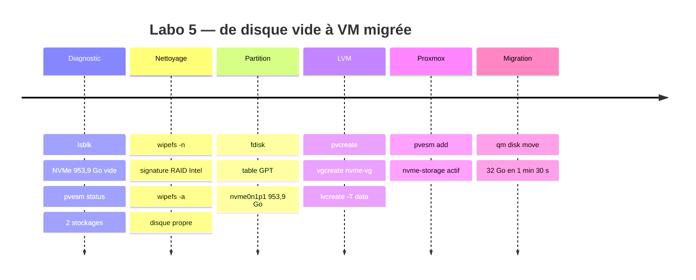

---

## :white_check_mark: Résultat

| | Avant | Après |
|---|---|---|
| **Stockages Proxmox** | `local`, `local-lvm` | `local`, `local-lvm`, **`nvme-storage`** |
| **Disque NVMe** `nvme0n1` | 953,9 Go, non utilisé | Partition `nvme0n1p1` → PV → VG `nvme-vg` → Thin Pool `data` |
| **Disque de la VM 133** | `local-lvm:vm-133-disk-0` (SAS) | **`nvme-storage:vm-133-disk-0`** (NVMe) |
| **Occupation `local-lvm`** | 5,97 % | 3,73 % |
| **Occupation `nvme-storage`** | — | 3,36 % |

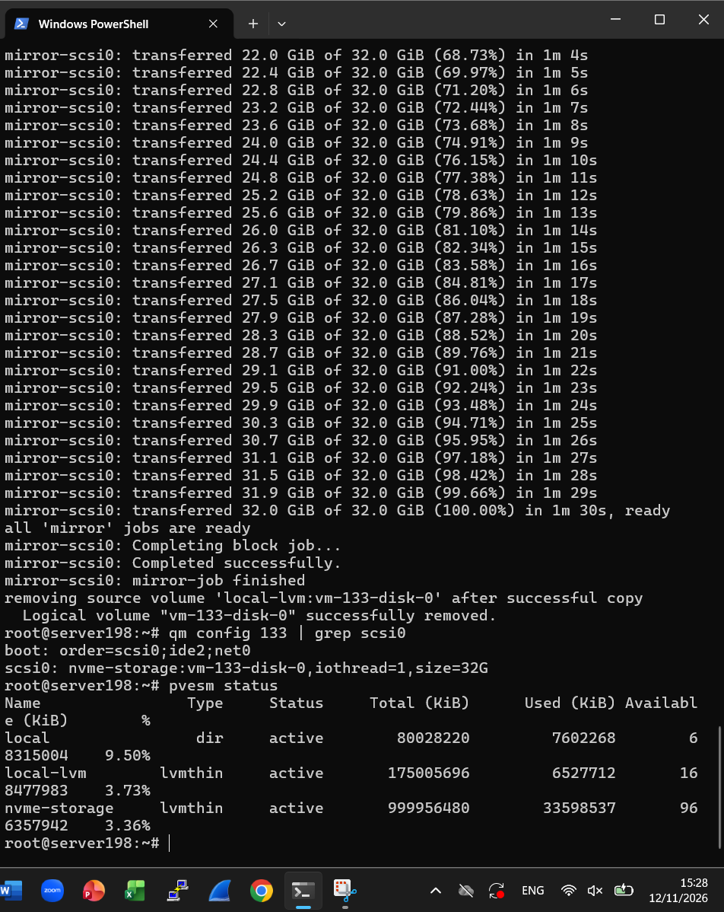

### Répartition de l'espace

<table>
  <tr>
    <td width="50%">

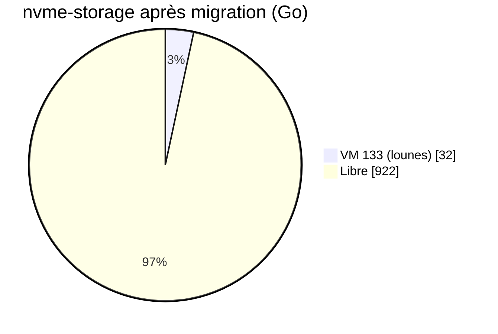

</td>
    <td width="50%">

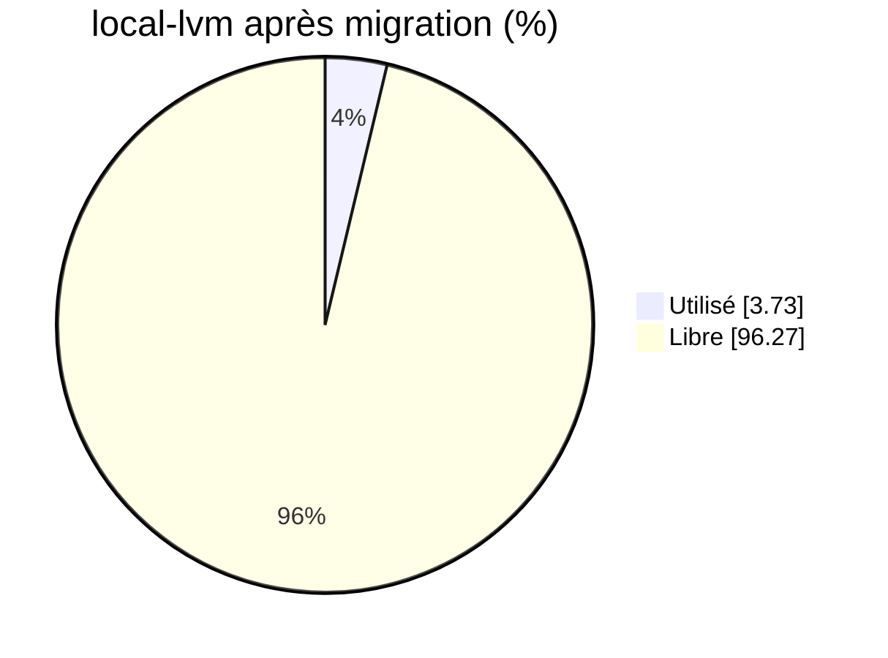

</td>
  </tr>
</table>

---

## :building_construction: Architecture

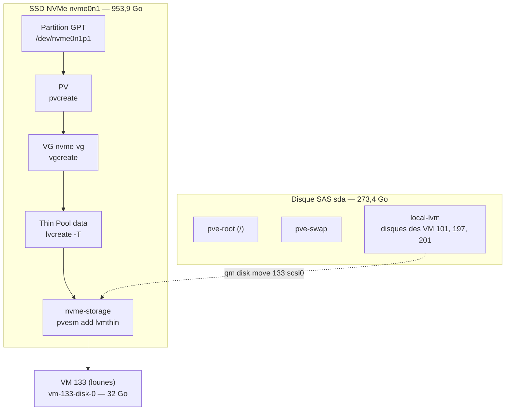

### Les couches de stockage

| Couche | Rôle | Commande | Résultat |
|---|---|---|---|
| **Disque** | Support physique | `lsblk` | `nvme0n1` — 953,9 Go |
| **Partition** | Découpe le disque | `fdisk` | `nvme0n1p1` — 953,9 Go, GPT |
| **PV** — Physical Volume | Prépare la partition pour LVM | `pvcreate` | `/dev/nvme0n1p1` |
| **VG** — Volume Group | Regroupe un ou plusieurs PV | `vgcreate` | `nvme-vg` — 953,87 Go |
| **Thin Pool** | Espace alloué à la demande | `lvcreate -T` | `data` — 953,63 Go |
| **Stockage Proxmox** | Rend l'espace utilisable par les VM | `pvesm add` | `nvme-storage` |

---

## :a: Préparer le disque NVMe

### 1. État initial

```bash
lsblk
pvesm status
```

Le disque `nvme0n1` (953,9 Go) n'a **aucune partition**, et Proxmox ne connaît que `local` et `local-lvm`.

<table>
  <tr>
    <td align="center">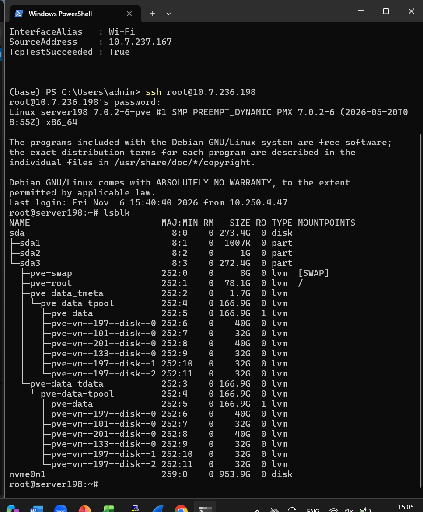</td>
    <td align="center">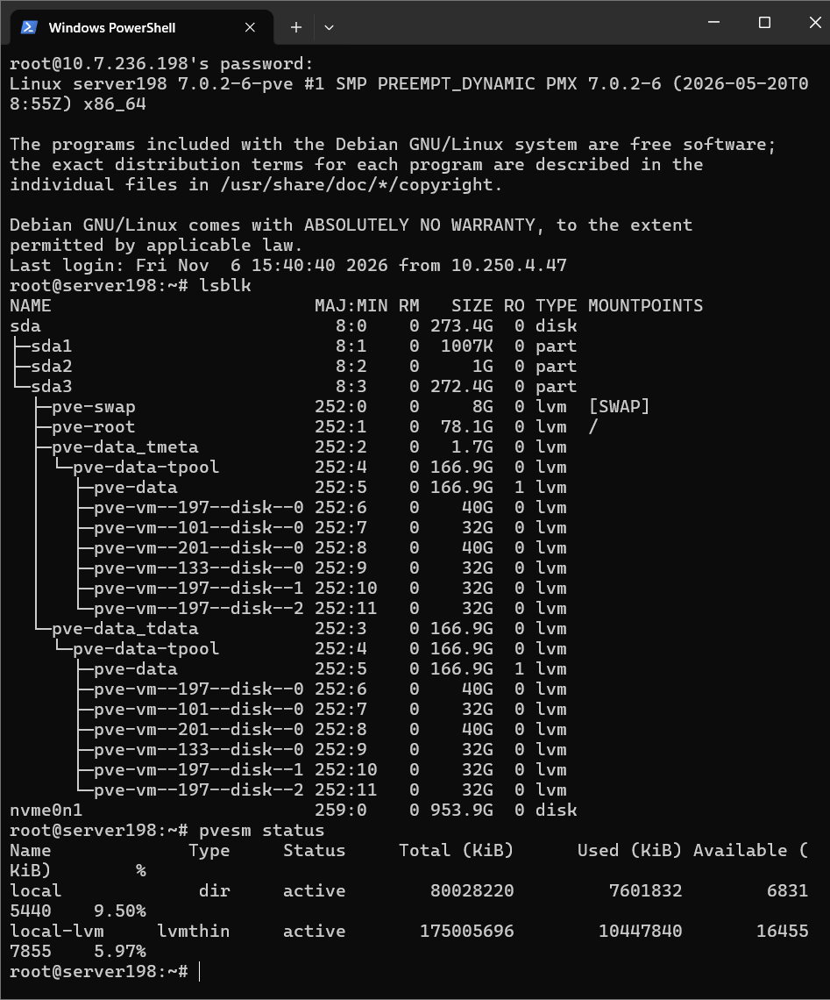</td>
  </tr>
  <tr>
    <td align="center"><sub><code>lsblk</code> : NVMe vide</sub></td>
    <td align="center"><sub><code>pvesm status</code> : 2 stockages</sub></td>
  </tr>
</table>

### 2. Nettoyer les anciennes signatures

```bash
wipefs -n /dev/nvme0n1      # afficher les signatures (sans rien effacer)
cat /proc/mdstat            # vérifier qu'aucun RAID n'est actif
wipefs -a /dev/nvme0n1      # effacer les signatures
```

> [!WARNING]
> Le NVMe portait encore une signature **`isw_raid_member`** (RAID Intel d'une autre machine) et un
> **`PMBR`**. Ces restes peuvent bloquer `pvcreate` : il faut les effacer avant de partitionner.
> `cat /proc/mdstat` (`unused devices: <none>`) confirme qu'aucun RAID n'utilise le disque.

<table>
  <tr>
    <td align="center">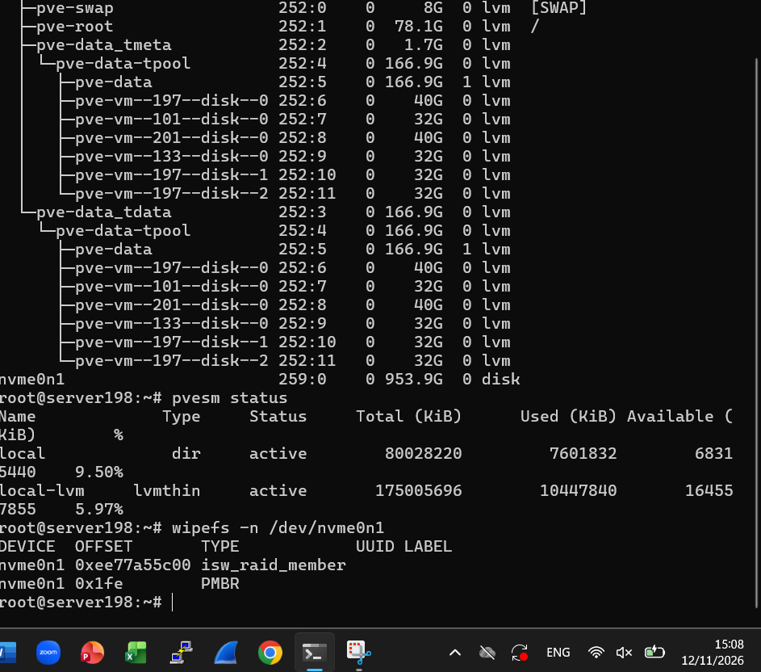</td>
    <td align="center">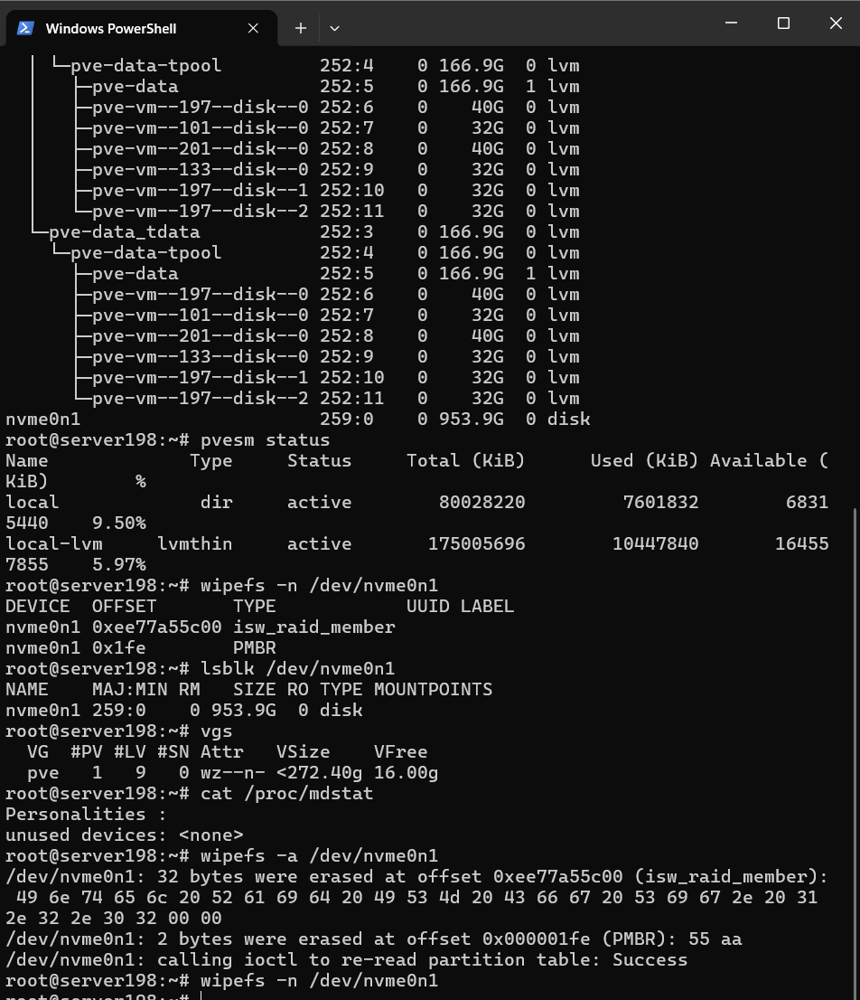</td>
  </tr>
  <tr>
    <td align="center"><sub>Signatures <code>isw_raid_member</code> et <code>PMBR</code></sub></td>
    <td align="center"><sub>Signatures effacées</sub></td>
  </tr>
</table>

### 3. Créer la partition GPT

```text
fdisk /dev/nvme0n1
  g        -> Created a new GPT disklabel
  n        -> nouvelle partition
  Entrée   -> numéro 1
  Entrée   -> premier secteur 2048
  Entrée   -> dernier secteur (tout le disque)
  w        -> The partition table has been altered.
```

Résultat : `Created a new partition 1 of type 'Linux filesystem' and of size 953.9 GiB.`

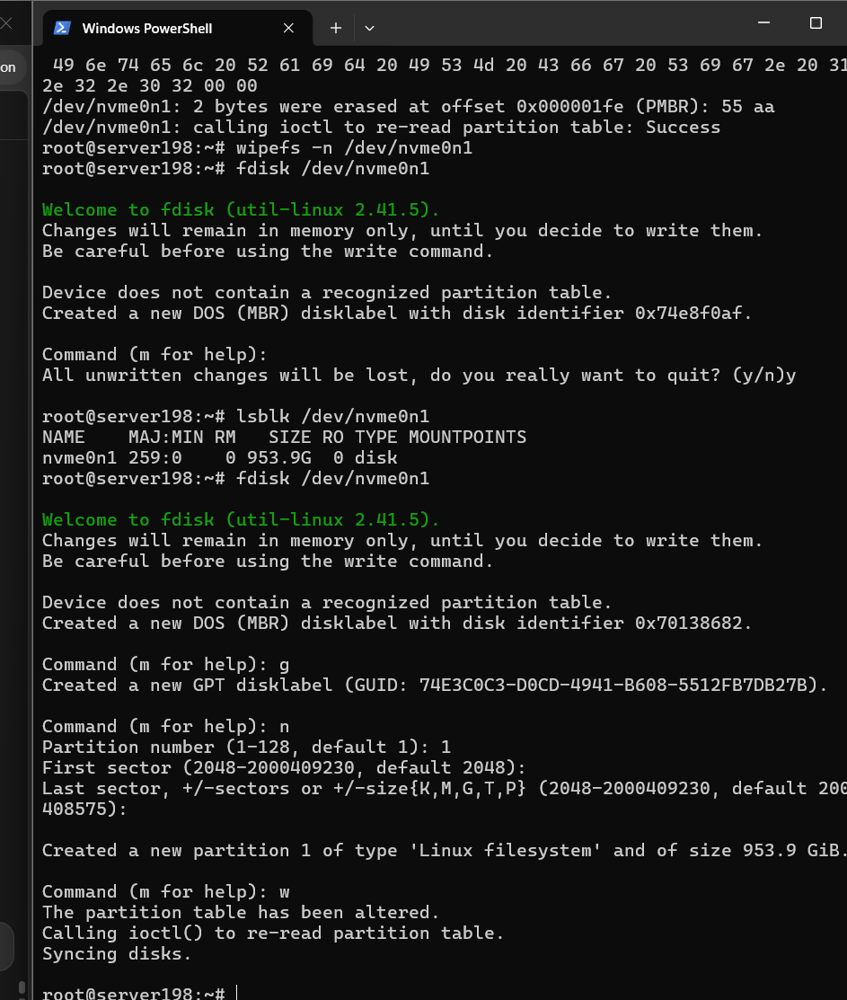

### 4. Créer le PV et le VG

```bash
pvcreate /dev/nvme0n1p1
vgcreate nvme-vg /dev/nvme0n1p1
```

```text
Physical volume "/dev/nvme0n1p1" successfully created.
Volume group "nvme-vg" successfully created
```

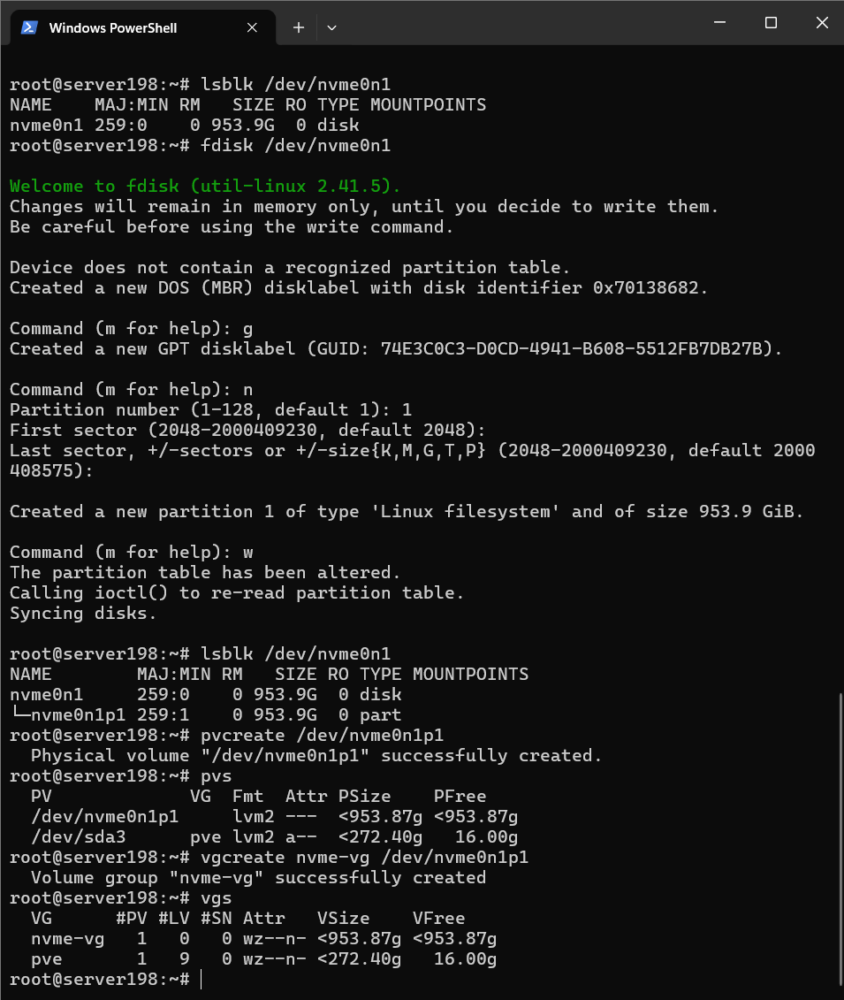

### 5. Créer le Thin Pool et l'ajouter à Proxmox

```bash
lvcreate -l 100%FREE -T nvme-vg/data
pvesm add lvmthin nvme-storage --vgname nvme-vg --thinpool data --content images,rootdir
pvesm status
```

```text
data  nvme-vg  twi-a-tz--  953.63g
nvme-storage  lvmthin  active  999956480  0  999956480  0.00%
```

> [!TIP]
> Les deux `WARNING` de `lvcreate` (taille des blocs de 512 Kio, remise à zéro) sont des **conseils
> de performance**, pas des erreurs. Le `t` de `twi-a-tz--` confirme que `data` est un **thin pool**.

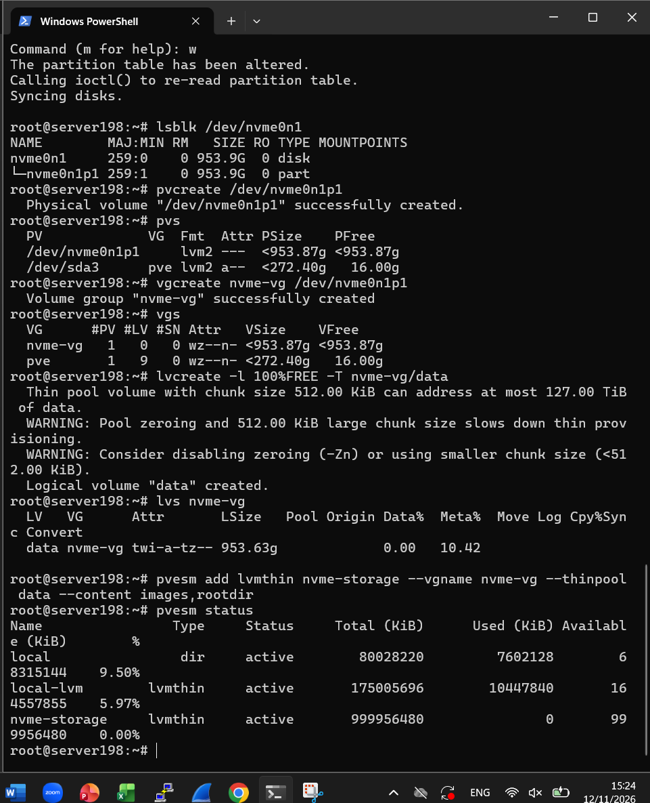

---

## :b: Déplacer la VM 133 vers le NVMe

### 1. Identifier le disque de la VM

```bash
qm config 133 | grep -E "^(scsi|virtio|sata|ide)[0-9]"
```

```text
ide2: local:iso/ubuntu-24.04.3-live-server-amd64.iso,media=cdrom
scsi0: local-lvm:vm-133-disk-0,iothread=1,size=32G
```

Le disque système est **`scsi0`**, sur `local-lvm` (disque SAS).

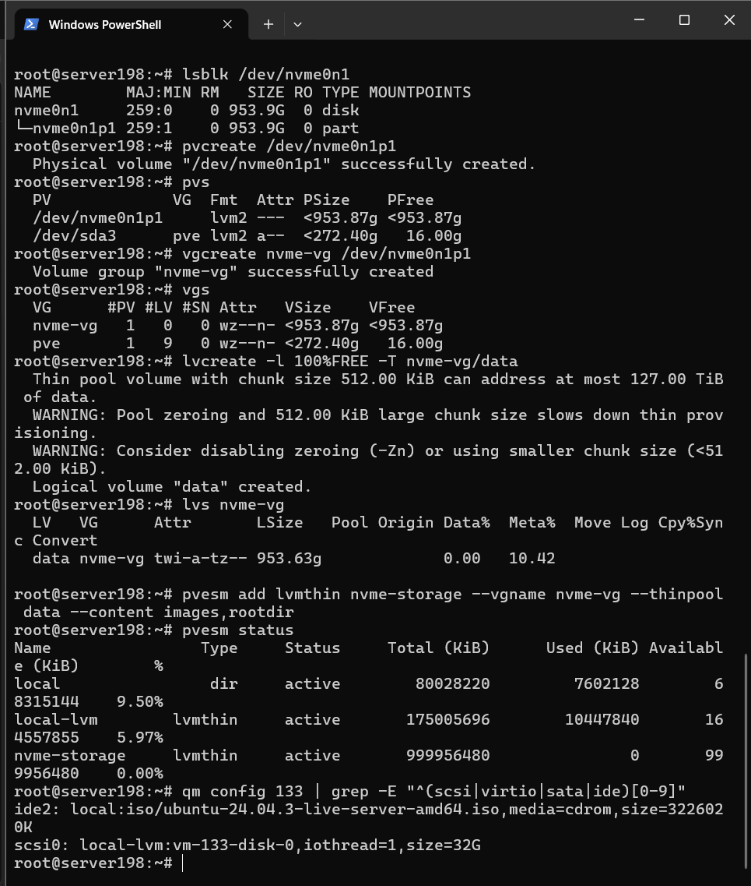

### 2. Déplacer le disque à chaud

```bash
qm disk move 133 scsi0 nvme-storage --delete 1
```

| Option | Rôle |
|---|---|
| `133` | Numéro de la VM |
| `scsi0` | Disque à déplacer |
| `nvme-storage` | Stockage de destination |
| `--delete 1` | Supprime l'ancien disque après une copie réussie |

```text
mirror-scsi0: transferred 32.0 GiB of 32.0 GiB (100.00%) in 1m 30s, ready
mirror-scsi0: Completed successfully.
removing source volume 'local-lvm:vm-133-disk-0' after successful copy
  Logical volume "vm-133-disk-0" successfully removed.
```

> [!NOTE]
> Proxmox utilise un **miroir de bloc** (`mirror-scsi0`) : il copie le disque pendant que la VM
> tourne, puis bascule sur la nouvelle copie. La VM **n'a jamais été arrêtée**.

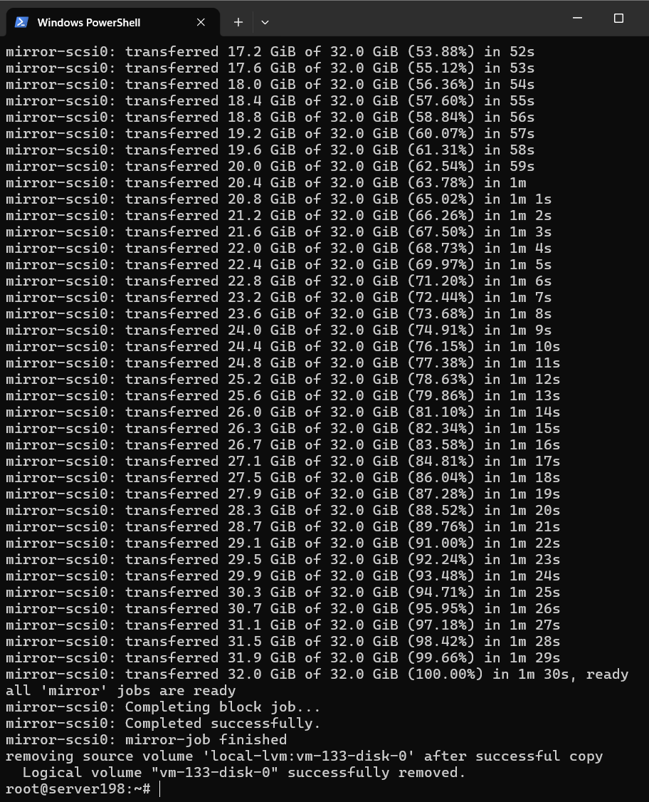

### 3. Vérifier

```bash
qm config 133 | grep scsi0
pvesm status
```

```text
scsi0: nvme-storage:vm-133-disk-0,iothread=1,size=32G
local-lvm      lvmthin  active  ...  3.73%
nvme-storage   lvmthin  active  ...  3.36%
```

Le disque est bien sur **`nvme-storage`**, et environ 32 Go sont passés de `local-lvm` au NVMe.

---

## :wrench: Problèmes rencontrés et solutions

| Problème | Cause | Solution |
|---|---|---|
| Signature `isw_raid_member` sur le NVMe | Le disque venait d'un RAID Intel | Vérification avec `cat /proc/mdstat`, puis `wipefs -a` |
| Sortie de `fdisk` sans enregistrer | Touche de sortie pressée avant `w` | Relance de `fdisk` en tapant une commande à la fois |
| Risque de conflit dans le groupe | Serveur et NVMe partagés par 3 étudiants | Une seule personne prépare le NVMe ; chacun déplace **sa** VM |

> [!CAUTION]
> `wipefs -a` et `fdisk` **effacent le disque**. Sur un serveur partagé, il faut toujours vérifier avec
> `lsblk`, `vgs` et `pvesm status` que personne d'autre n'utilise le disque avant de le modifier.

---

## :keyboard: Aide-mémoire

| Objectif | Commande |
|---|---|
| Lister les disques | `lsblk` |
| Voir les signatures d'un disque | `wipefs -n /dev/nvme0n1` |
| Effacer les signatures | `wipefs -a /dev/nvme0n1` |
| Partitionner | `fdisk /dev/nvme0n1` (`g`, `n`, `w`) |
| Créer un PV | `pvcreate /dev/nvme0n1p1` |
| Créer un VG | `vgcreate nvme-vg /dev/nvme0n1p1` |
| Créer un thin pool | `lvcreate -l 100%FREE -T nvme-vg/data` |
| Ajouter le stockage à Proxmox | `pvesm add lvmthin nvme-storage --vgname nvme-vg --thinpool data --content images,rootdir` |
| Déplacer le disque d'une VM | `qm disk move <vmid> <disque> nvme-storage --delete 1` |
| Vérifier | `pvs` · `vgs` · `lvs` · `pvesm status` · `qm config <vmid>` |

---

## :shield: Check-list de sécurité sur un serveur partagé

- [x] Vérifier que le disque cible est **vide** (`lsblk`, `wipefs -n`)
- [x] Vérifier qu'aucun **RAID** ni **VG** ne l'utilise (`cat /proc/mdstat`, `vgs`)
- [x] Prévenir le groupe : **une seule personne** prépare le NVMe
- [x] Ne modifier **que sa propre VM** (`qm config <vmid>` avant toute action)
- [x] Garder `--delete 1` seulement quand la copie est **terminée avec succès**

---

## :thinking: Questions de réflexion

<details open>
<summary><b>1. Quelle est la différence entre un HDD, un SSD SATA et un NVMe ?</b></summary>

| | HDD | SSD SATA | SSD NVMe |
|---|---|---|---|
| **Technologie** | Plateaux magnétiques et tête de lecture | Mémoire flash | Mémoire flash |
| **Interface** | SATA / SAS | SATA (≈ 600 Mo/s max) | **PCI Express** (plusieurs Go/s) |
| **Pièces mobiles** | Oui | Non | Non |
| **Prix au Go** | Le plus bas | Moyen | Le plus élevé |
| **Usage** | Archives, gros volumes | Usage général | **VM, bases de données** |

</details>

<details>
<summary><b>2. Quel est le rôle d'une partition ?</b></summary>

Une partition **découpe un disque en zones indépendantes**, chacune pouvant recevoir son propre système
de fichiers ou devenir un PV LVM. La table de partitions (GPT ici) décrit où commence et finit chaque zone.

</details>

<details>
<summary><b>3. À quoi sert un système de fichiers ?</b></summary>

Il **organise les données** sur une partition en fichiers et en dossiers, avec leurs noms, tailles et
permissions (exemples : `ext4`, `xfs`, `ntfs`). Sans lui, la partition n'est qu'une suite de blocs bruts.

</details>

<details>
<summary><b>4. Que signifient PV, VG et LV ?</b></summary>

- **PV** — *Physical Volume* : un disque ou une partition préparé pour LVM (`/dev/nvme0n1p1`).
- **VG** — *Volume Group* : un réservoir qui regroupe un ou plusieurs PV (`nvme-vg`).
- **LV** — *Logical Volume* : un volume découpé dans le VG, utilisé comme un disque (`data`, `vm-133-disk-0`).

</details>

<details>
<summary><b>5. Pourquoi Proxmox utilise-t-il souvent LVM-Thin ?</b></summary>

Avec le **thin provisioning**, l'espace n'est réservé **qu'au moment où il est écrit**. Une VM de 32 Go
qui n'utilise que 5 Go n'occupe que 5 Go. On peut donc créer plus de disques virtuels que l'espace
physique ne le permettrait, et LVM-Thin permet aussi les **snapshots** rapides.

</details>

<details>
<summary><b>6. Quelle commande affiche les stockages configurés dans Proxmox ?</b></summary>

```bash
pvesm status
```

</details>

<details>
<summary><b>7. Quel est l'avantage d'un NVMe pour les machines virtuelles ?</b></summary>

Le NVMe passe par **PCI Express** : il offre des débits et des temps d'accès bien meilleurs qu'un disque
SAS, surtout pour les **accès aléatoires** de plusieurs VM en même temps. Les VM démarrent plus vite et
répondent mieux. Ici, 32 Go ont été copiés en **1 min 30 s**.

</details>

---

## :bulb: Ce que j'ai appris

- [x] Identifier les disques d'un serveur Linux avec `lsblk` et `wipefs`
- [x] Créer une table **GPT** et une partition avec `fdisk`
- [x] Construire une pile **LVM** : PV → VG → Thin Pool
- [x] Ajouter un stockage à Proxmox avec `pvesm add`
- [x] Déplacer le disque d'une VM **sans l'arrêter** avec `qm disk move`
- [x] Travailler prudemment sur un **serveur partagé** : vérifier avant d'effacer

---

## :books: Références

- [Proxmox VE — Storage](https://pve.proxmox.com/wiki/Storage)
- [Proxmox VE — LVM Thin](https://pve.proxmox.com/wiki/Storage:_LVM_Thin)
- [Proxmox VE — `pvesm`](https://pve.proxmox.com/pve-docs/pvesm.1.html)
- [Proxmox VE — `qm`](https://pve.proxmox.com/pve-docs/qm.1.html)

<div align="center">

<sub>Réalisé par <b>Lounes Allouti</b> · INF1085 · Groupe 2 · Collège Boréal · 2026</sub>


</div>
