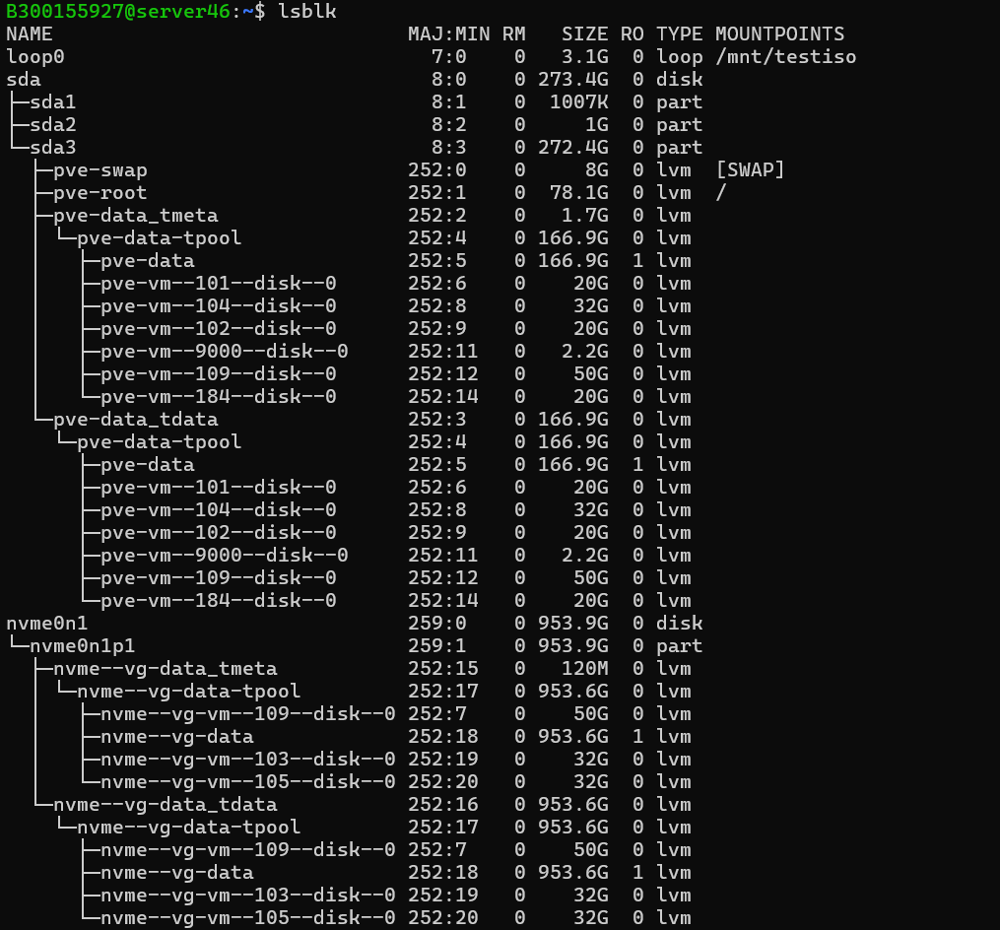
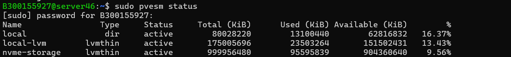
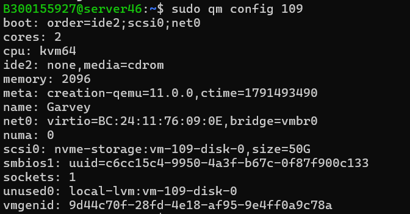

# 300155927

# 💾 Proxmox VE — Stockage et disques — server46

Documentation des disques et du stockage du nœud Proxmox **server46**, et de la configuration actuelle de la VM 109 « Garvey ».

## 🛠️ Environnement

| Élément | Détail |
|---|---|
| Nœud Proxmox | `server46` (`10.7.236.199`) |
| Disque système | `sda` — 273,4 Go |
| Disque NVMe | `nvme0n1` — 953,9 Go |
| VM | `109` / `Garvey` |

## 📋 Étapes

### 1️⃣ 💽 Voir les disques — `lsblk`

La commande `lsblk` affiche l'arborescence des disques du nœud :

**Le disque `sda` (273,4 Go)** — le disque système de Proxmox :
- `sda1` (1007 K), `sda2` (1 Go), `sda3` (272,4 Go) ;
- `pve-swap` (8 Go) : la mémoire d'échange `[SWAP]` ;
- `pve-root` (78,1 Go) : le système, monté sur `/` ;
- `pve-data` (166,9 Go) : le stockage fin (*thin pool* LVM) avec les disques des VM : `vm-101` (20 Go), `vm-102` (20 Go), `vm-104` (32 Go), `vm-9000` (2,2 Go), `vm-109` (50 Go, ancien disque) et `vm-184` (20 Go).

**Le disque `nvme0n1` (953,9 Go)** — le disque NVMe :
- `nvme-vg-data` (953,6 Go) : le stockage fin (*thin pool* LVM) avec les disques `vm-109` (50 Go, disque actuel), `vm-103` (32 Go) et `vm-105` (32 Go).

**`loop0` (3,1 Go)** : une image ISO montée sur `/mnt/testiso`.



### 2️⃣ 🗄️ Voir les stockages — `sudo pvesm status`

La commande `pvesm status` affiche les stockages Proxmox et leur espace :

| Stockage | Type | État | Total | Utilisé | Libre | % |
|---|---|---|---|---|---|---|
| `local` | dir | active | 76,3 Gio | 12,5 Gio | 59,9 Gio | 16,37 % |
| `local-lvm` | lvmthin | active | 166,9 Gio | 22,4 Gio | 144,5 Gio | 13,43 % |
| `nvme-storage` | lvmthin | active | 953,6 Gio | 91,2 Gio | 862,5 Gio | 9,56 % |

- **`local`** : un dossier classique (pour les ISO, les sauvegardes, les modèles) ;
- **`local-lvm`** : le stockage fin LVM sur le disque `sda` ;
- **`nvme-storage`** : le stockage fin LVM sur le disque NVMe, le plus grand (953,6 Gio) et le moins rempli (9,56 %).



### 3️⃣ 🖥️ Configuration actuelle de la VM 109 — `sudo qm config 109`

La commande `qm config 109` affiche la configuration de la VM « Garvey » :

| Paramètre | Valeur |
|---|---|
| Nom | `Garvey` |
| Mémoire | 2096 Mo |
| CPU | 2 cœurs (1 socket), type `kvm64` |
| Disque | `scsi0: nvme-storage:vm-109-disk-0`, 50 Go |
| Réseau | `net0: virtio=BC:24:11:76:09:0E`, bridge `vmbr0` |
| CD-ROM | `ide2: none,media=cdrom` (éjecté) |
| Ordre de démarrage | `ide2;scsi0;net0` |
| Ancien disque | `unused0: local-lvm:vm-109-disk-0` (non utilisé) |

Le disque de la VM est maintenant sur **`nvme-storage`** : l'ancien disque sur `local-lvm` est devenu `unused0`, c'est-à-dire qu'il n'est plus branché à la VM.



## 💻 Commandes utilisées

```bash
lsblk                # afficher l'arborescence des disques
sudo pvesm status    # afficher les stockages et leur espace libre
sudo qm config 109   # afficher la configuration de la VM 109
```
